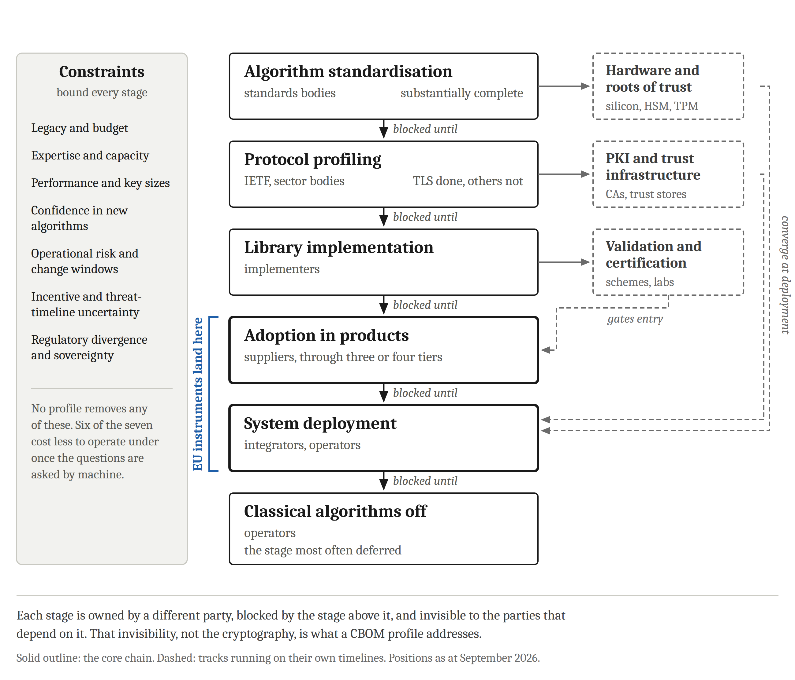
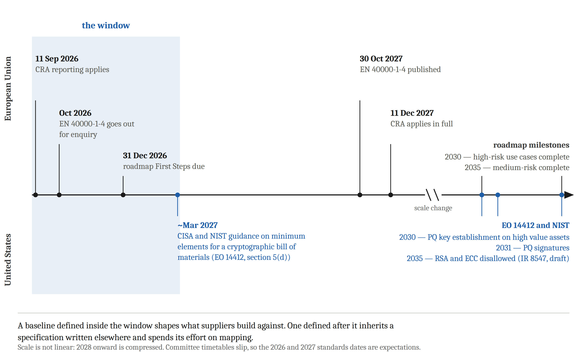
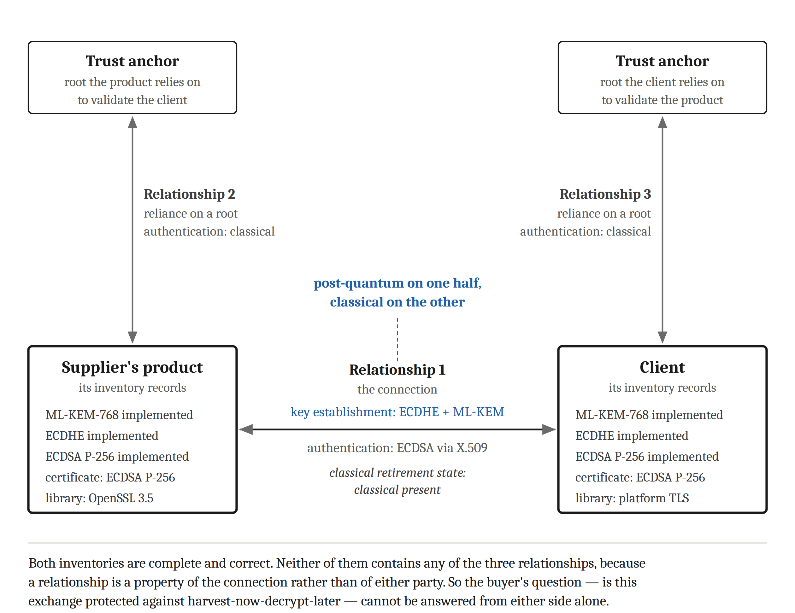
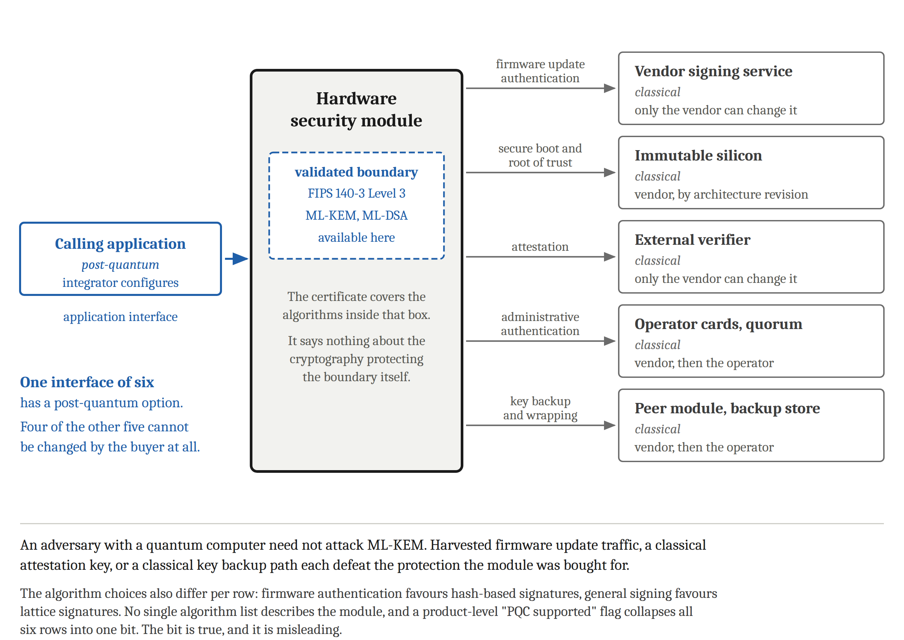
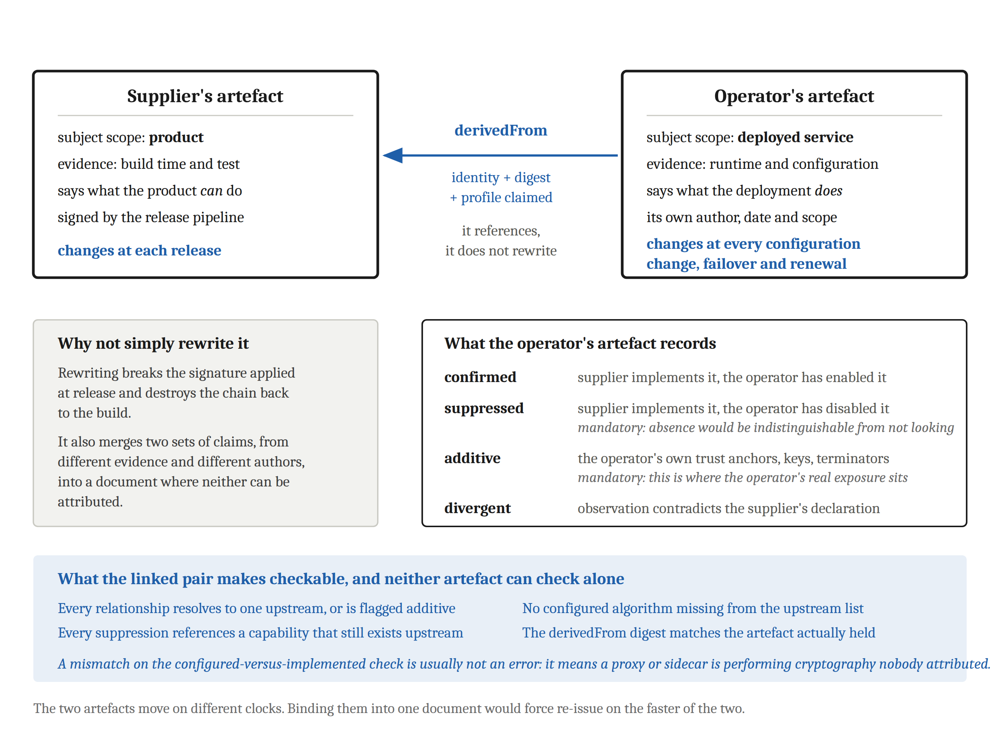
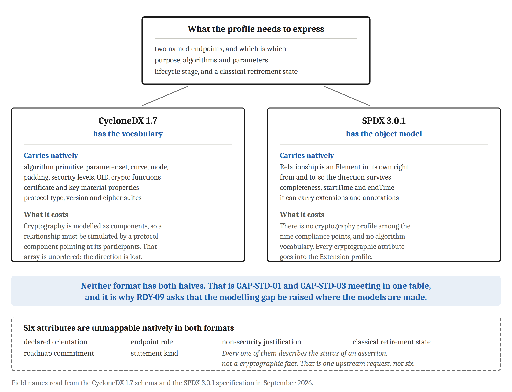

# Cryptographic Transparency in the Supply Chain

**A CBOM profile approach to post-quantum migration readiness**

| | |
|---|---|
| **Version** | Working draft — not agreed text |
| **Date** | September 2026 |
| **Audience** | European Commission and Member State policy stakeholders |
| **Prepared by** | PKI Consortium CBOM Profiles Working Group _(confirm attribution and any co-signatories before submission)_ |
| **Status of facts** | Instrument status, specification versions and protocol positions are stated as at September 2026 and are dated in the text where they move |

---

<!-- TOC -->

## Contents

- [1  Executive summary](#1-executive-summary)
- [2  Cryptographic opacity across the supply chain](#2-cryptographic-opacity-across-the-supply-chain)
  - [2.1  Exposure is set by parties the buyer cannot see](#21-exposure-is-set-by-parties-the-buyer-cannot-see)
  - [2.2  The question that cannot be asked](#22-the-question-that-cannot-be-asked)
  - [2.3  The cryptography that matters is between the parties](#23-the-cryptography-that-matters-is-between-the-parties)
  - [2.4  Why transparency is the precondition](#24-why-transparency-is-the-precondition)
- [3  What PQC migration actually involves](#3-what-pqc-migration-actually-involves)
  - [3.1  The shape of the problem](#31-the-shape-of-the-problem)
  - [3.2  The core chain](#32-the-core-chain)
  - [3.3  The parallel tracks](#33-the-parallel-tracks)
  - [3.4  The cross-cutting constraints](#34-the-cross-cutting-constraints)
  - [3.5  Why the structure matters for this report](#35-why-the-structure-matters-for-this-report)
  - [3.6  Migration is not a single event](#36-migration-is-not-a-single-event)
  - [Resolved drafting questions](#resolved-drafting-questions)
- [4  What a CBOM profile is](#4-what-a-cbom-profile-is)
  - [4.1  From inventory to profile](#41-from-inventory-to-profile)
  - [4.2  Four properties that matter for policy](#42-four-properties-that-matter-for-policy)
  - [4.3  Two declarations that come before the attributes](#43-two-declarations-that-come-before-the-attributes)
  - [4.4  Format-independence](#44-format-independence)
  - [4.5  What a profile is not](#45-what-a-profile-is-not)
- [5  Policy anchoring](#5-policy-anchoring)
  - [5.1  The instruments](#51-the-instruments)
  - [5.2  Three qualifications](#52-three-qualifications)
  - [5.3  The gap](#53-the-gap)
  - [5.4  A precedent already exists](#54-a-precedent-already-exists)
  - [5.5  The space is being occupied, and there is a date](#55-the-space-is-being-occupied-and-there-is-a-date)
- [6  Lessons from SBOM adoption](#6-lessons-from-sbom-adoption)
  - [6.1  What the evidence shows](#61-what-the-evidence-shows)
  - [6.2  What this predicts for CBOM](#62-what-this-predicts-for-cbom)
  - [6.3  What worked, and transfers](#63-what-worked-and-transfers)
  - [6.4  The transferable conclusion](#64-the-transferable-conclusion)
- [7  Why the supply chain is not ready](#7-why-the-supply-chain-is-not-ready)
  - [7.1  Standards gaps](#71-standards-gaps)
  - [7.2  Discovery and tooling](#72-discovery-and-tooling)
  - [7.3  Commercial and contractual](#73-commercial-and-contractual)
  - [7.4  Organisational capability](#74-organisational-capability)
  - [7.5  Product lifecycle](#75-product-lifecycle)
  - [7.6  Policy asymmetry](#76-policy-asymmetry)
  - [7.7  What readiness would look like](#77-what-readiness-would-look-like)
  - [7.8  Readiness by migration layer](#78-readiness-by-migration-layer)
- [8  What a CBOM profile fixes — and what it does not](#8-what-a-cbom-profile-fixes-and-what-it-does-not)
  - [8.1  The mechanism: standardisation enables automation](#81-the-mechanism-standardisation-enables-automation)
  - [8.2  Gap by gap](#82-gap-by-gap)
  - [8.3  Compounding effects](#83-compounding-effects)
  - [8.4  Preconditions](#84-preconditions)
  - [8.5  Making completion reportable](#85-making-completion-reportable)
  - [8.6  What a profile does not touch](#86-what-a-profile-does-not-touch)
  - [8.7  Is a cryptographic inventory a map for an attacker?](#87-is-a-cryptographic-inventory-a-map-for-an-attacker)
  - [8.8  Proportionality, and what this costs a supplier](#88-proportionality-and-what-this-costs-a-supplier)
- [9  The methodology applied](#9-the-methodology-applied)
  - [9.1  Purpose of the profile](#91-purpose-of-the-profile)
  - [9.2  What the profile says](#92-what-the-profile-says)
  - [9.3  How it is carried and checked](#93-how-it-is-carried-and-checked)
  - [9.4  Policy fit](#94-policy-fit)
  - [9.5  What the application returned to the methodology](#95-what-the-application-returned-to-the-methodology)
- [10  Worked example: a supply-chain PQC migration profile](#10-worked-example-a-supply-chain-pqc-migration-profile)
  - [10.1  The decision the profile serves](#101-the-decision-the-profile-serves)
  - [10.2  Profile identity](#102-profile-identity)
  - [10.3  The unit of description](#103-the-unit-of-description)
  - [10.4  Attributes](#104-attributes)
  - [10.5  Worked relationships](#105-worked-relationships)
  - [10.6  A conformance check](#106-a-conformance-check)
  - [10.7  The derived artefact: after the operator installs it](#107-the-derived-artefact-after-the-operator-installs-it)
  - [10.8  What the artefact does not contain](#108-what-the-artefact-does-not-contain)
  - [10.9  How a procurement profile would compose](#109-how-a-procurement-profile-would-compose)
- [11  How the EU could use CBOM profiles](#11-how-the-eu-could-use-cbom-profiles)
  - [11.1  A reference EU baseline profile](#111-a-reference-eu-baseline-profile)
  - [11.2  CRA technical documentation](#112-cra-technical-documentation)
  - [11.3  NIS2 supervision](#113-nis2-supervision)
  - [11.4  Public procurement](#114-public-procurement)
  - [11.5  PQC roadmap progress reporting](#115-pqc-roadmap-progress-reporting)
  - [11.6  Sector profiles composing on the baseline](#116-sector-profiles-composing-on-the-baseline)
  - [11.7  Custodianship](#117-custodianship)
  - [11.8  Phasing against the chain](#118-phasing-against-the-chain)
- [12  Recommendations](#12-recommendations)
  - [12.1  The recommendations](#121-the-recommendations)
  - [12.2  The one gap that must be escalated, not solved](#122-the-one-gap-that-must-be-escalated-not-solved)
  - [12.3  Sequencing](#123-sequencing)
  - [12.4  What this report does not recommend](#124-what-this-report-does-not-recommend)
  - [12.5  Closing](#125-closing)
- [Annex A  Profile definition table](#annex-a-profile-definition-table)
  - [A.1  Artefact level](#a1-artefact-level)
  - [A.2  Endpoint level](#a2-endpoint-level)
  - [A.3  Relationship level](#a3-relationship-level)
  - [A.3b  Obligation by subject scope](#a3b-obligation-by-subject-scope)
  - [A.4  Conformance rules](#a4-conformance-rules)
- [Annex B  Format mapping](#annex-b-format-mapping)
  - [B.1  The constructs each format offers](#b1-the-constructs-each-format-offers)
  - [B.2  Artefact level](#b2-artefact-level)
  - [B.3  Endpoint level](#b3-endpoint-level)
  - [B.4  Relationship level](#b4-relationship-level)
  - [B.5  What the mapping establishes](#b5-what-the-mapping-establishes)
  - [B.6  What a conforming producer does in the meantime](#b6-what-a-conforming-producer-does-in-the-meantime)
- [Annex C  Glossary](#annex-c-glossary)
  - [Core terms](#core-terms)
  - [Adjacent artefacts](#adjacent-artefacts)
  - [Cryptography and migration](#cryptography-and-migration)
  - [Report constructs](#report-constructs)
  - [A note on German usage](#a-note-on-german-usage)
- [Annex D  References](#annex-d-references)
  - [D.1  European instruments and guidance](#d1-european-instruments-and-guidance)
  - [D.2  National guidance](#d2-national-guidance)
  - [D.3  Standards and specifications](#d3-standards-and-specifications)
  - [D.4  Methodology](#d4-methodology)
  - [D.4b  United States](#d4b-united-states)
  - [D.4c  Tooling](#d4c-tooling)
  - [D.5  Sector work](#d5-sector-work)
  - [D.6  Supporting research](#d6-supporting-research)
  - [Citation convention](#citation-convention)

<!-- /TOC -->

---

## How to read this report

Three conventions run through the report.

**Obligation language.** MUST, SHOULD and MAY are used in the sense of BCP 14, capitalised, and only
where an obligation is meant.

**Two numbering schemes, deliberately unrelated.** Divisions of this report are cited as "chapter n"
and "§n.n". The thirteen aspects of the CBOM profile methodology are cited as "aspect 3.n". A
reference to aspect 3.4 is not a reference to §3.4 of this report.

**Four families of item identifier.** The report tracks its own findings with tags, so that a claim
made in one chapter can be answered in another and nothing is lost between them:

| Tag | What it identifies | Defined in |
|---|---|---|
| `LYR-C-*`, `LYR-T-*`, `LYR-X-*` | Migration layers: the core chain of dependent stages, the parallel tracks converging at deployment, and the cross-cutting constraints | Chapter 3 |
| `LSN-*` | Lessons observed in software bill of materials adoption | Chapter 6 |
| `GAP-*` | Readiness gaps, tagged with the layer where each one bites | Chapter 7 |
| `RDY-*` | Readiness criteria, each answered by one recommendation | §7.7 and chapter 12 |

Annex C is a glossary. Annex A is the worked profile in the form a producer would use, and Annex B
binds it to the two serialisation formats in use.

---

## Editorial conventions

> **Internal. Removed by the publication build.**

- **Format-independence.** The methodology is defined independently of CycloneDX or SPDX
  throughout. Format-specific detail belongs in Annex B, not in the body.
- **Precedent.** Cite the **PKIC CBOM Profiles Working Group charter** as the motivating
  precedent for the profile-first, format-independent method. Do not cite the PQC Maturity
  Model — it is a separate effort.
- **Obligation language.** BCP 14 keywords, capitalised, only where an obligation is meant.
- **Length.** Body targets 40 pages as a guide. Chapters 6 and 7 cap at six pages each; chapters
  3 and 8 are uncapped (DR-05 as amended, DR-10). Detail that does not fit goes to the register or
  an annex.
- **Decisions.** Recorded in `decisions.md` as `DR-nn`. Cite the record rather than restating
  the rationale.
- **Numbering.** Report divisions are cited as "chapter n" / "§n.n". PKIC methodology
  aspects are cited as "aspect 3.n". The two numbering schemes are unrelated.
- **Item IDs.** `LYR-*`, `LSN-*`, `GAP-*` and `RDY-*` are defined once in `register.md`. Chapters
  reference them; they do not redefine them.
- **Verification markers.** `> **Verify:**` flags a claim to be checked against current
  releases or instrument text. None should survive to v1.0.
- **Publication.** `bash publish.sh` emits the submittable copy. It strips this section, owner and
  status lines, page caps, drafting notes, resolved-questions sections, verification markers and
  internal `DR-`, `VL` and `P-` citations, and regenerates the table of contents. Edit the working
  draft, never the publication output.

---

# 1  Executive summary

**Owner:** _tbd_ · **Status:** first draft — prose, not agreed text

European policy already expects organisations to hold a cryptographic inventory. The coordinated
post-quantum roadmap goes further and names the artefact. It recommends "using a standardised format
for a cryptographic inventory, like CBOM (Cryptographic Bill of Materials, an extension of the SBOM
standard)". That recommendation sits in the roadmap's First Steps, which Member States are to have
implemented by 31 December 2026, along with cryptographic asset management, dependency mapping and
initial national transition roadmaps.

That milestone is months away, and no instrument states **which attributes, at what obligation
level, for which decision**. Without that, a supplier cannot know what a conforming answer looks
like, and each supervisory authority will reasonably arrive at its own. Divergence is the default
outcome rather than a risk. The inventories built against the First Steps will not be comparable with
each other, and that follows from a specification gap rather than from anyone's failure.

This report proposes filling that space with **CBOM profiles**: defined attribute sets, with
obligation levels, each serving a named decision. It uses a supply-chain post-quantum migration
profile as the worked example, and it is addressed to the Commission because the space is at
Union level and the alternative is being filled nationally already.

Migration is a coordination problem rather than an engineering one. It runs as a chain of dependent
stages: algorithm standardisation, then protocol profiling, then library implementation, then
adoption in products, then deployment, and finally switching the classical algorithms off. Three
tracks run alongside the chain and converge on it, covering public key infrastructure, hardware and
certification. Constraints of legacy, budget, expertise and performance bound all of it. Every stage
is owned by a different party, blocked by the stage below it, and invisible to the parties that
depend on it. That invisibility is what a profile addresses.

The comparable experiment has already been run, in this jurisdiction, under a comparable instrument.
ENISA measured software bill of materials adoption ahead of the Cyber Resilience Act. Regulation
drove investment decisively. Generation is largely solved. Consumption is not: four in five
organisations rarely or never receive an artefact from their suppliers, two thirds report a gap
between producing artefacts and using them, and ENISA concludes that they serve compliance rather
than security. An artefact produced under an obligation and then not read is the default outcome,
not the failure case. Any cryptographic transparency measure that does not design against that will
reproduce it, and faster, because cryptographic attributes are harder to normalise than component
names and reading them takes scarcer expertise.

What a profile does is make the same question reach every supplier in the same terms. Because the
question and the answer are both machine-readable, asking, checking and monitoring become machine
operations rather than expert ones. That is what eases the expertise shortage running through every
stage of the chain, and it is what cryptographic agility comes down to in practice.

A profile does not verify that a declaration is true. It does not create visibility that does not
exist, shrink a signature, resolve doubt about a new algorithm, or shorten a capital cycle. Chapter 8
accounts for all twenty-five identified gaps on both sides of that line.

There are nine recommendations. Each answers a readiness criterion stated at §7.7, and none requires
new legislation. Chapter 12 gives each one an addressee, a precondition and an indicative date.

1. **Establish a reference EU baseline CBOM profile**, named, versioned and publicly available, with
   four profile families above it grouped by the decision each serves: procurement, vulnerability
   response, migration, and compliance. Build procurement first, as a pathfinder.
2. **Define it independently of serialisation format**, and map it to both formats in use, so the
   Union need not pick a winner between formats moving at different speeds.
3. **Support normalised vocabularies** covering the algorithms actually deployed in Europe,
   including the sector and national primitives that current registries omit.
4. **Require declared and observed state to be distinguishable** in any artefact used as regulatory
   evidence, so the limits of an inventory are visible rather than assumed.
5. **Fund consumer-side validation tooling as part of the deliverable**, not as something the market
   supplies once demand exists. The evidence is that it does not.
6. **Publish model procurement clauses** citing a named profile at a stated version. This is the
   fastest lever available and needs no instrument at all.
7. **Require forward-looking commitments to be expressed comparably**, and kept separate from
   current-state inventory.
8. **Identify a custodian**, with a change process and a versioning policy. This report sets out the
   options and does not choose between them; the choice is the Commission's.
9. **Raise the absence of a standard means of expressing cryptography applied between two parties**
   where the models are made. That gap is the one this report cannot solve and does not claim to.

Four of the nine can be acted on immediately: 2, 8, 9, and settling the shared vocabulary that 1
depends on.

**A note on precedent and on pace.** The mechanism is not novel in Europe: Germany's BSI already
defines required SBOM content and binds it to a format through a published taxonomy. Nor will the
space stay empty. A United States executive order signed in June 2026 directs CISA and NIST to
publish minimum elements for a cryptographic bill of materials by around March 2027. If no European
baseline exists by then, the reference specification will be somebody else's, and the European
exercise becomes reconciliation rather than definition. And two
cautions bear on timing. Protocol profiling has landed for TLS and is still in motion for other
families. Certification throughput is structurally limited. An obligation that outruns the stages
it depends on produces declarations and queues rather than migration. Neither point is an argument
for delay. Both are arguments for sequencing.

**Finally, the durable case is not post-quantum.** Algorithms standardised today will be
deprecated; parameters will change; hybrid modes will be retired. The chain will be walked
again. The question is whether Europe emerges from this transition able to do the next one. That
takes three things: knowing what cryptography is in use, being able to check a proposed change
against policy, and confirming the change took effect. Repeatedly, and at scale. The post-quantum
transition is the occasion for building that capability, not the reason for it.

---

# 2  Cryptographic opacity across the supply chain

**Owner:** _tbd_ · **Status:** first draft — prose, not agreed text

A European operator of critical infrastructure, asked today which of its systems are protected
against an adversary recording traffic now to decrypt later, cannot answer. The question is not hard
and the operator is not negligent. The answer is distributed across suppliers it has never
contracted with, in a form nobody has agreed how to write down.

That is the subject of this report. It is stated here before any bill-of-materials vocabulary
appears, because the vocabulary is the proposed remedy and the problem is prior to it.

## 2.1  Exposure is set by parties the buyer cannot see

Harvest-now-decrypt-later gives ordinary supply-chain opacity a deadline. Traffic captured today
under classical cryptography is decryptable whenever a sufficiently capable quantum computer
arrives; the value of the protection therefore depends on how long the data stays sensitive, not
on when the machine appears. Anything with a long confidentiality life has already incurred the
exposure: health records, legal and financial archives, state communications, industrial designs.

What determines that exposure is not the operator's own cryptography. It is the weakest link in
a chain the operator can see perhaps one tier into. The buyer contracts with a primary supplier;
the cryptography is frequently in a library or hardware module two or three tiers further down,
integrated by parties whose names never appear in the contract. And once a product is deployed,
its cryptographic posture is fixed for a service life measured in years and, for
hardware-anchored elements, in decades.

## 2.2  The question that cannot be asked

Suppose the operator asks. Today the same enquiry, sent to five suppliers, returns five
incommensurable answers: a spreadsheet, a security questionnaire response, a PDF datasheet, a
statement that the matter is confidential, and silence.

None is unreasonable in isolation. There is no agreed form for the question, so each supplier
answers the question they understood; there is no agreed vocabulary, so the same algorithm
appears under three names; there is no agreed scope, so one supplier answers for the product and
another for the library inside it; and there is no obligation, so a supplier for whom the honest
answer is unflattering may reasonably decline.

The operator's cost is not that any single answer is wrong. It is that the answers cannot be
compared, aggregated or checked, so collecting them produces no position on which anyone can act.
Multiply that by a supplier base in the hundreds and the exercise stops being worth running. This is
why, in the adjacent domain of software transparency, most organisations that receive such artefacts
do not use them (§6.1).

## 2.3  The cryptography that matters is between the parties

A more fundamental difficulty sits underneath the practical ones, and it recurs throughout this
report.

Cryptographic inventories describe what a component *has*: the algorithms it implements, the
libraries it links, the certificates it holds. But cryptography secures a *connection*, and a
connection has two ends. Whether traffic between two components is protected against a future
quantum adversary depends on what both ends support, what was negotiated between them, and what
configuration was in force at the time. None of those is a property of either component alone.

This report calls that locus a **cryptographic relationship**, and the participants in it
**endpoints**. The terms are used consistently from here on, and Figure 2 in §10.5 draws a worked
case. A relationship is not a
cryptographic asset: it is where cryptography is applied, between parties, and it appears in
neither party's inventory.

The consequence for supply chain is direct. Even if every supplier produced a perfect inventory
of its own component, the buyer would still not know whether the connections between those
components were secure. And the ordinary state of the internet in 2026 illustrates the problem
rather than the exception. A connection may carry post-quantum key establishment while its
certificate authentication stays classical (§7.1). One relationship, two different answers, and
neither of them recorded in either endpoint.

Section 7.1 records this as the structural gap in current standards; §12.1 recommends it be
raised where the models are made. It is named here because everything that follows depends on
the distinction.

## 2.4  Why transparency is the precondition

Nothing above is an argument for a particular artefact, format, or instrument. It is an argument
that the migration described in the next chapter cannot be planned, sequenced, or evidenced
while the information required to do so is unaskable.

Migration planning needs to know which systems are exposed and in what order to address them.
Procurement needs to avoid acquiring, today, the constraint that blocks the migration in 2030.
Supervision needs to distinguish progress from assertion. Each of those is a different question,
and each is unanswerable for the same reason.

---

# 3  What PQC migration actually involves

**Owner:** _tbd_ · **Status:** first draft — prose, not agreed text · **Register: `LYR-*`**

> **Drafting note.** This chapter carries the report's central structural claim: migration is a
> chain of dependent stages, each owned by a different party, and no party can see the progress
> of the parties it depends on. Chapters 7, 8 and 11 all consume it. The page cap has been lifted
> (DR-10) — this chapter carries the structural argument the rest of the report consumes.

Post-quantum migration is routinely described as replacing one set of algorithms with another.
That description is accurate and almost entirely unhelpful, because it locates the work in a
single place. In practice the work is distributed across at least a dozen organisations that
have no contractual relationship with one another, and it proceeds in a fixed order that no
individual participant controls.

This chapter sets out that order. It distinguishes a **core chain**, in which each stage is
blocked until the stage before it completes; two **parallel tracks** that run on their own
timelines and converge at deployment; and **cross-cutting constraints** that bound what is
achievable at every stage. The purpose is not to be exhaustive about the engineering. It is to
establish, before any bill-of-materials vocabulary appears, that the binding difficulty is
coordination between parties rather than cryptography.

## 3.1  The shape of the problem

**Figure 1.** The migration chain, its parallel tracks, and the constraints that bound both. The
table below carries the same structure with the identifiers used throughout this report.

| Track | ID | Stage | Owned by | Blocked until |
|---|---|---|---|---|
| Core chain | LYR-C-01 | Algorithm standardisation | standards bodies | — |
| | LYR-C-02 | Protocol profiling | IETF, sector bodies | LYR-C-01 |
| | LYR-C-03 | Library implementation | implementers | LYR-C-02 |
| | LYR-C-04 | Adoption in products and components | suppliers | LYR-C-03 |
| | LYR-C-05 | System deployment, preserving availability and interoperability | integrators, operators | LYR-C-04 |
| | LYR-C-06 | Decommissioning classical algorithms and retiring hybrids | operators | LYR-C-05 |
| Parallel | LYR-T-01 | PKI and trust infrastructure | CAs, trust store operators, relying parties | LYR-C-02 |
| | LYR-T-02 | Hardware and roots of trust | silicon and module vendors | LYR-C-01 |
| | LYR-T-03 | Validation and certification | schemes, labs, sponsors | LYR-C-03 |
| Constraint | LYR-X-01 | Legacy estate within budget and lifecycle limits | operators | — |
| | LYR-X-02 | Expertise and capacity | all parties | — |
| | LYR-X-03 | Performance and resource cost | all parties | — |
| | LYR-X-04 | Confidence in the new algorithms | all parties | — |
| | LYR-X-05 | Operational risk and change tolerance | operators | — |
| | LYR-X-06 | Incentive and threat-timeline uncertainty | all parties | — |
| | LYR-X-07 | Regulatory divergence and sovereignty | suppliers, operators | — |

The tracks are not a second-order detail. A product can hold a validated PQC library, speak a
profiled PQC protocol, and still be unable to establish a single post-quantum session because
no certificate authority will issue it a suitable certificate, or because the root of trust in
the device it must authenticate to is fixed in silicon. Treating PKI and hardware as stages
inside the chain rather than as tracks converging on it produces a diagram that is tidy and
wrong.

## 3.2  The core chain

### LYR-C-01  Algorithm standardisation

The most visible stage and the only one that is substantially complete. Standardisation
establishes the primitives, their parameter sets, and the security levels they claim. It does
not say how they are used.

This stage is where public attention has concentrated, which has had an unhelpful side effect:
its completion is widely read as migration being underway, when it is the precondition for
work that has barely started at the stages below.

### LYR-C-02  Protocol profiling

Primitives are not deployed; protocols are. Between a standardised algorithm and a working
connection sits the question of how the algorithm is carried: negotiation, identifiers, message
sizes, fallback behaviour, and whether classical and post-quantum algorithms are combined and how. This is decided in the IETF for general-purpose protocols and in sector
bodies for sector-specific ones, and it is decided protocol by protocol.

Two features of this stage matter for the rest of the report. It is **plural**: there is no
single completion date, because TLS, IPsec, code signing, secure messaging, and each sector
protocol proceed independently. And it is **the last stage at which design choices are cheap**. A
decision taken here propagates into every library, product and deployment above.

The per-protocol position makes the plurality concrete. The report shows it at this granularity
rather than asserting it. The position below is as at September 2026.

| Protocol family | Position | Status |
|---|---|---|
| IPsec / IKEv2 | Post-quantum key exchange integrated | Finalised RFCs |
| TLS 1.3 — hybrid key agreement | RFC 9954, July 2026 | Published |
| TLS 1.3 — hybrid groups (ECDHE-MLKEM) | RFC 10024, August 2026 | Published, Standards Track |
| TLS 1.3 — ML-KEM-only key agreement | `draft-ietf-tls-mlkem` | RFC Editor queue |
| TLS 1.3 — ML-DSA authentication | `draft-ietf-tls-mldsa` | RFC Editor queue |
| X.509 and CMS | Post-quantum signature and KEM uses | Parts published |
| JOSE and COSE | Post-quantum algorithm bindings | Active drafts |

Two things follow from that table, and they pull in opposite directions.

The first is the plurality point. One protocol family being finished says nothing about the next.
TLS is substantially done. JOSE, COSE and the sector protocols are not. A policy instrument that
treats "the protocols are ready" as a single fact will be wrong about most of the estate.

The second is about pace. The TLS rows moved fast. In the second quarter of 2026 hybrid key
agreement was approved and awaiting publication. By September 2026 two documents were published
and two more were in the RFC Editor queue. A working draft of this report written six months
earlier described a different world.

That is an argument about what to record, not an argument for waiting. A product cannot usefully
declare that it is "post-quantum capable" against a target moving at this rate. It can declare
which specification, at which revision, it implements. That is attribute R9 in the worked example
(§10.4, Annex A), and the pace of this stage is the reason R9 exists.

### LYR-C-03  Library implementation

Implementations of the profiled protocols, in the libraries that products actually consume.
Correctness is necessary but not sufficient: implementations must also be maintained,
packaged, and made available on the platforms and language runtimes suppliers use, including
the constrained and embedded environments common in critical infrastructure.

Availability at this stage is uneven in a way that is easy to miss from the outside. A library may support an algorithm in its development branch, or in its stable release, or in the
version that a supplier's platform actually ships. Those are three different things.

### LYR-C-04  Adoption in products and components

The stage at which the supply chain becomes the constraint. A supplier must take an available
library, integrate it, expose the necessary configuration, test interoperability, and ship it.
Then their customer must do the same, and so on up the chain, frequently through three or four
tiers, each blocked by the tier below.

This is also the first stage at which the visibility problem becomes acute. A buyer can
observe that a product has shipped; they cannot observe whether the cryptography inside it is
post-quantum capable, at which version, on which interfaces, and under which configurations.
Nor can they observe where their supplier sits in their own dependency chain. Almost every
commercial gap in chapter 7 lands here.

### LYR-C-05  System deployment, preserving availability

Deployment into running systems that cannot stop. This stage introduces requirements the
stages below do not have: staged rollout with rollback, interoperability across mixed-version
estates during the transition, and negotiation behaviour that degrades safely when the two
endpoints of a connection are at different points in their own migrations.

Two problems that are specific to this stage:

- **The cryptography that matters sits between components.** A connection is established
  between two parties, and neither party's inventory describes it. What each supplier can tell
  you is what their component supports; whether the connection is post-quantum depends on both
  ends and the configuration in force. This is the structural gap introduced in §2.3 and
  recorded as GAP-STD-03.
- **Capability is not configuration.** A deployed system may be entirely PQC-capable and
  running classical cryptography, and may revert across a configuration change or a failover.

### LYR-C-06  Decommissioning classical algorithms

Migration is not complete when post-quantum cryptography is switched on. It is complete when
classical algorithms are switched off, hybrid modes are retired, and the fallback paths that
made the transition survivable are removed. Until then an attacker is in the same position as before, whether by forcing a downgrade or simply
by capturing traffic on a connection that has quietly reverted.

Naming this as a stage is deliberate. Without it, every party in the chain can declare success
at the midpoint, and the harvest-now-decrypt-later exposure that motivated the work persists
behind a completed migration programme. Backward-compatibility obligations make this the stage
most likely to be indefinitely deferred (GAP-LIFE-03).

## 3.3  The parallel tracks

### LYR-T-01  PKI and trust infrastructure

Authentication depends on certificates, and certificates depend on issuance, chains, trust
stores, and roots. A post-quantum handshake requires a certificate the relying party will
accept, issued under a chain it trusts, from a root already distributed to it. Root
distribution and rollover run on multi-year cycles that are not synchronised with any product
release schedule, and the constraints propagate: certificate sizes, chain construction,
issuance policy, and revocation all interact with the protocol choices made at LYR-C-02.

The current position illustrates the point better than any argument could. Hybrid post-quantum key
agreement is widely deployed in browsers and servers. No post-quantum root has entered the major
trust stores, and the CA/Browser Forum has no merged requirement permitting ML-DSA in publicly
trusted certificates. The result is a **split state inside a single connection**: the session key is
post-quantum, and the certificate that authenticated it is not.

Where post-quantum authentication is arriving first is instructive. It is arriving in private
infrastructure, not public. Browser support for ML-DSA trust anchors is shipping for private PKI in
TLS 1.3, and at least one major vendor is piloting ML-DSA certificates deliberately outside the
public web, with an open question about whether such certificates should appear in certificate
transparency logs at all.

That is not an accident of sequencing. Private PKI is where one party controls both ends of the
relationship and can change them together. Public PKI is where it does not, and where every root
programme, every certificate authority and every relying party has to move in some order. The
migration arrives first exactly where the coordination problem is absent, which is the report's
thesis restated as an observation about the market.

The asymmetry demonstrates two claims this report makes elsewhere. "PQC enabled" is not one state. A
single cryptographic relationship can be post-quantum on key establishment and classical on
authentication, which is why the migration profile carries a retirement state per relationship
(DR-09). And the asymmetry sits on the connection rather than in either endpoint's inventory, which
is the structural gap of §2.3.

Size drives the timeline, and two schedules are moving in opposite directions at once.

Replacing the authentication data in a typical handshake with post-quantum signatures takes it from
roughly 1.2 kB to roughly 14.7 kB. At the same time, maximum certificate validity is being cut in
stages: 200 days from March 2026, 100 days from March 2027, and 47 days from March 2029. So each
certificate carries an order of magnitude more authentication data, and each must be issued roughly
eight times as often. LYR-T-01 and LYR-X-03 bind together here exactly as the structure predicts, and
the binding tightens on a published timetable rather than at an uncertain future date. And because roots commonly carry 20–30 year validity, roots issued today on classical
algorithms will sit in trust stores well into the post-quantum era: a parallel track bounded by
LYR-X-01.

For a policy audience this track deserves explicit treatment, because it is infrastructure in the
ordinary sense: shared, slow to change, and belonging to no single market participant.

### LYR-T-02  Hardware and roots of trust

Silicon, secure elements, hardware security modules, trusted platform modules and smartcards.
Three properties distinguish this track: lead times measured in years rather than releases;
migration by replacement rather than update; and, in many cases, a root of trust that is fixed
at manufacture and cannot be changed at all.

The figures bear this out. HSMs in financial, certificate authority and government use run on ten-
to twenty-year replacement cycles. TPMs are typically soldered in and cannot be replaced
independently of the board. An organisation that deployed a classical-only module recently chooses
between a firmware upgrade where one exists, a disruptive hardware replacement, or deferred
protection.

The certification track interacts with this one. Capability shipping in a product is not the same
as adoptability in a regulated sector. Two modules have now completed FIPS 140-3 Level 3
validations that cover post-quantum algorithms inside the validated boundary: one in July 2026 and
one in August 2026. Most mainstream commercial platforms remain in the validation queue, with
post-quantum algorithms certified at the algorithm level but not yet inside a validated module
boundary.

#### The module's own cryptography is a separate question

This point deserves its own treatment, because it is widely misread and because it is the clearest
hardware demonstration of the report's structural claim.

A validated module that offers post-quantum algorithms is not a post-quantum module. The
validation covers the algorithms the module makes available. It says nothing about the
cryptography that protects the module itself.

A hardware security module depends on cryptography in several places that no application ever
calls:

- **Firmware authentication.** The module verifies a vendor signature before accepting a firmware
  update. If that signature is classical, the update path is classical.
- **Secure boot and the root of trust.** The chain that establishes that the module is running
  authentic code.
- **Administrative authentication.** Operator cards, quorum schemes and remote management
  channels.
- **Key backup, wrapping and cloning.** The cryptography that protects keys leaving the module for
  backup, or moving between modules in a cluster.
- **Attestation.** The evidence the module gives a verifier about its own state.
- **The secure channel to the host.** The session between the module and the calling platform.

The industry distinction is between **external** and **internal** post-quantum support. External
support means post-quantum algorithms exposed through the module's interface, usually delivered by
a firmware update. Internal support means the module's own architecture has been migrated: roots of
trust, boot, internal key wrapping and component communications. Almost every vendor now offers the
first. Very few have redesigned for the second. Of the two recently validated modules, one is
designed with hybrid roots of trust and post-quantum secured boot; the other delivers algorithm
support by firmware.

The consequence is not subtle. An adversary with a quantum computer does not have to attack the
post-quantum algorithms a module offers. It can attack the classical cryptography that protects the
module instead. Harvested firmware update traffic, a classical attestation key, or a classical key
backup path each defeat the protection the module was bought for.

The algorithm choices also differ by interface. Firmware authentication favours hash-based
signatures, because their security rests on different assumptions and their long-lived verification
keys must outlast the device. General application signing favours lattice signatures, for size and
speed. A single algorithm list cannot describe a module even in principle.

This is why a product-level readiness flag fails here. "PQC supported" on a module collapses six
interfaces into one bit. The bit is true, and it is misleading in the way that matters. The worked
example addresses this directly: §10.5 WR4 describes a module interface by interface, and Annex A
requires it. The obligation is cheap for the vendor, who is the only party who knows, and for the
buyer it is the difference between a claim and a plan.

Splitting hardware out of LYR-C-04 rather than treating it as a kind of product is what makes
the interaction with LYR-X-01 visible. Where cryptography is hardware-anchored, migration is a
capital refresh, and the decision that determined it was taken at procurement, years before
anyone was asked about post-quantum readiness.

### LYR-T-03  Validation and certification

The EU Common Criteria scheme (EUCC), Common Criteria evaluation more broadly, FIPS and CMVP
validation, and national schemes. In regulated sectors an unvalidated implementation is not
adoptable regardless of its correctness. This track therefore functions as a gate between LYR-C-03
and LYR-C-04 for a substantial share of the market.

It is also a queue with finite capacity, and the evidence is that this is structural rather than a
passing backlog.

On the European side, EUCC issued 29 certificates in its first operational year, with 28 accredited
conformity assessment bodies across the Union. Europe accounts for more than 60% of the roughly 350
Common Criteria certificates issued globally each year, so this is not a small scheme; it is the
scale at which certification operates. The Commission has set an aspiration for sufficient notified
bodies to be operational by December 2026, which is policy intent rather than delivery, and roughly
two thirds of Member States do not yet have the national accreditation infrastructure in place.
Module availability also diverges by Member State, so capacity is uneven as well as limited.

On the US side, FIPS 140-3 validation has been running twelve to eighteen months from submission to
active certificate, with the average lengthening rather than shortening.

Both numbers say the same thing. This track is a rate limiter that is independent of technical
readiness. Any policy instrument that accelerates demand at LYR-C-04 without regard to capacity here
produces a backlog rather than a migration.

The framework is also itself in motion. The proposed revision of the Cybersecurity Act, published
in January 2026, restructures the certification framework and makes ENISA the formal scheme manager
with dedicated governance. That proposal is relevant twice over: it changes the track described here,
and it bears on the custodianship question at §11.7.

> **Verify (pass 5):** LYR-T-02's module figures and the internal/external distinction are sourced
> to vendor validation records and industry analysis, and should be checked against the CMVP
> validated-modules list before publication. LYR-T-03's EUCC figures should be checked against
> ENISA's own published certificate list.

## 3.4  The cross-cutting constraints

Seven constraints bound what is achievable at every stage above. They are not a list of
excuses: each one determines the pace at which a stage can actually move, and instruments that
assume migration is primarily a technical decision will misjudge that pace. Register §D.3 records
the admission test used, and the candidates that failed it.

### LYR-X-01  Legacy within budget and lifecycle limits

Presenting legacy management as a final step would imply it is dealt with last. The opposite is
true: it bounds every stage above, and the decisions that created it were taken at procurement,
sometimes a decade earlier. Long service lives, capital depreciation cycles, end-of-support
products that will never receive an update, and equipment that cannot be taken out of service
all constrain the pace at which LYR-C-05 and LYR-C-06 can proceed.

The budget point is not incidental. Migration competes for capital with every other programme, and as LYR-X-06 sets out, the case for it
is made against a threat with no fixed date.

### LYR-X-02  Expertise and capacity

The binding constraint at more stages than any other, and the one most often mistaken for a
technical problem. The people who can profile an algorithm into a protocol, review an
implementation for side channels, and write a defensible cryptographic requirement into a
tender are substantially the same small population.

It manifests differently at each stage. At LYR-C-02, working group participation bounds how
many protocol families can be profiled in parallel. At LYR-C-03, the scarce capability is
*review* rather than authorship: implementations that look correct are not hard to produce,
while constant-time, side-channel-resistant, correctly parameterised implementations reviewed
by someone competent to judge them are. At LYR-C-04, a buyer who cannot specify the requirement
cannot evaluate the answer, so capacity gates the demand signal itself. On the tracks, it is
issuance policy design and evaluation lab throughput.

One consequence is that concentration is a capacity phenomenon: where few implementations are
trusted, everyone queues behind the same ones, and a defect or delay propagates market-wide.

One illustration is unusually clean. A cryptography workstream inside one of the two major bill of
materials standards reported in 2026 that the work it could not progress was not difficult. It
lacked a single contributor with the knowledge and the time to do it (VL §2). Standards capacity is
measured in people, not in intent.

This report treats capacity as one constraint with different effects at each stage. A fuller
treatment of the labour market for cryptographers is out of scope.

### LYR-X-03  Performance and resource cost

Post-quantum key and signature sizes are materially larger than their classical equivalents,
and this propagates. It shapes protocol design at LYR-C-02, implementation choices at LYR-C-03,
and imposes hard limits at LYR-C-05 on constrained devices, high-volume interfaces, and links
where message size interacts with fragmentation or latency budgets. Some deployments cannot
absorb the overhead at any level of funding, which distinguishes this constraint from LYR-X-01.

### LYR-X-04  Confidence in the new algorithms

Hybrid modes exist because confidence in the new algorithms, while high, is not the confidence
that comes from decades of concentrated cryptanalysis. That uncertainty slows commitment
independently at three stages: what to profile at LYR-C-02, what to ship at LYR-C-04, and, most
consequentially, whether to retire the classical half at LYR-C-06. It is the main reason LYR-C-06
slips. It also resolves with time rather than with money or policy.

### LYR-X-05  Operational risk and change tolerance

Distinct from budget. Critical infrastructure operates with rare change windows, mandatory
availability targets, and a low appetite for experimentation at the handshake layer. A change that is affordable and technically ready may still wait for a window. And a failed
cryptographic change fails closed: the connection does not degrade, it stops. This bounds LYR-C-05
and LYR-C-06 regardless of funding or expertise.

### LYR-X-06  Incentive and threat-timeline uncertainty

There is no fixed date. Migration therefore competes for capital and attention against
programmes that have deadlines, and it does so with a benefit that is contingent, deferred, and
invisible if the work succeeds. This explains hesitancy at LYR-C-04 and delay at LYR-C-05 and LYR-C-06 better than any technical gap
does. It is also the constraint that regulation exists to address, which makes it the most
policy-relevant item in this section.

### LYR-X-07  Regulatory divergence and sovereignty

National parameter preferences, sovereign certification requirements, and export control regimes
mean a supplier may face several incompatible answers to the same question. Divergence
multiplies the cost of every other constraint: capacity is spent several times over, and
performance and certification budgets are duplicated per jurisdiction. It binds at LYR-C-02,
LYR-C-04, and on both the PKI and certification tracks.

For this report's audience the point is direct: divergence is not only a constraint the
Commission observes, it is one the Commission is positioned to reduce.

## 3.5  Why the structure matters for this report

Four consequences follow, and the rest of the report depends on each of them.

Readiness is not uniform. Saying that the supply chain is unready is not useful; the question is
where. Chapter 7 tags every gap against the stage or track at which it bites, and the distribution
turns out to be markedly uneven. That cross-tabulation (§7.8) tells a policy audience more than a
flat list of shortcomings.

Waiting is rational. Most EU instruments address LYR-C-04 and above. Below them, LYR-C-02 is settled
for TLS and still in motion for other families, and LYR-T-03 has finite throughput. A supplier that
commits early to a configuration may have to withdraw it. This is not only about unfinished work.
The TLS family moved through four documents in one quarter (§3.2), so a supplier who committed to a
specific configuration in early 2026 has already had to revise it. Movement costs a supplier as much
as delay does. This explains supplier hesitancy without ascribing bad faith to it, and it sets up
the phasing argument in §11.8.

The constraints are what a profile is measured against. A profile does not shrink a signature,
resolve cryptanalytic doubt, create a change window or lengthen a capital cycle. What it does is
make the questions machine-askable and machine-checkable, which lowers the cost of operating under
several of these constraints without removing any of them. Chapter 8 sets out that mechanism (§8.1)
and scores each constraint against it (§8.4), including the one it does nothing for.

Progress is invisible across the boundaries. Each party depends on stages it does not own and cannot
observe. No mechanism exists by which a buyer learns where their supplier's suppliers are, and no
common form exists in which a supplier could tell them even if willing. That absence is what a CBOM
profile addresses, and it is the transition into chapter 4.

## 3.6  Migration is not a single event

Parameter sets will change. Hybrid modes will be retired. Algorithms standardised today will be
deprecated in time. The chain above will be walked again.

There is a sharper version of this point, and it distinguishes cryptography from software.
Cryptographic posture decays **without anything changing in the estate**: an intermediate
authority is revoked, a certificate expires, a key outlives its cryptoperiod, or a national
authority deprecates an algorithm. A software vulnerability requires a code change to come into
existence. A cryptographic one can arrive by announcement. An organisation can therefore be compliant on Monday and not on Tuesday, having deployed nothing.
That is an argument for continuous inventory rather than periodic audit, and for building durable
capability rather than running a one-off programme with an end date. The capability is an inventory
that stays current, the agility to change what it records, and a repeatable way to ask the supply
chain a question.

---

## Resolved drafting questions

1. **Data-at-rest re-encryption** — sub-stage of LYR-C-05, not a separate stage (DR-07). Give it
   a paragraph within C-05: backups, archives and stored keys are central to
   harvest-now-decrypt-later, and re-encryption is bounded by LYR-X-05 as much as by budget.
2. **Interoperability testing** — remains within LYR-C-05 (DR-07), despite its plug-test
   resemblance to LYR-T-03.
3. **Depth per stage** — cap lifted (DR-10). LYR-C-04 and LYR-C-05 still take the larger share.
4. **Maturity claims** — the register's `Position today` column needs an owner or is deleted
   before v1.0 (DR-07). It does not ship empty.

*Register: `../register.md` §D. Layer tags on gaps are maintained there.*

---

# 4  What a CBOM profile is

**Owner:** _tbd_ · **Status:** first draft — prose, not agreed text · **Target: under 3pp**

Enough to follow chapters 6 to 12 without reading a specification. If this chapter grows beyond
three pages, the report has become one.

## 4.1  From inventory to profile

A **cryptographic bill of materials** is a structured, machine-readable inventory of the
cryptography associated with a product or system: the algorithms and parameters in use, the
protocols composing them, the keys and certificates supporting them, the libraries or hardware
implementing them, and the configurations determining how each is actually used. It is modelled
on the software bill of materials, deliberately, so that cryptographic information travels the
supply-chain channels and tooling that already exist for software rather than requiring parallel
ones.

An inventory alone does not settle what a given exchange should contain. Reporting every
cryptographic call in a large product can produce thousands of entries and bury the handful that
bear on any particular decision, while omitting the one attribute that decision actually needs.

A **profile** resolves that. It is a defined subset of attributes, each with an obligation level,
serving a named decision. It is stated precisely enough that two parties can produce and check
conforming artefacts without further negotiation.

## 4.2  Four properties that matter for policy

**It serves a decision, not an obligation.** A profile begins by naming the question it answers.
This is the discipline that separates an artefact somebody uses from an artefact somebody files
(§6.1).

**It is machine-readable, and therefore automatable.** The profile is a specification a machine
can enforce, not a document a person must interpret. Generation in a build pipeline, validation at a deployment gate, comparison between releases,
re-checking one artefact against another jurisdiction's profile: all of these are machine
operations. This is the property that does the work in chapter 8. It is also what cryptographic
agility amounts to, which is knowing what you have, checking a change against policy, and
confirming it took effect.

**It runs in both directions.** A profile is a production recipe, telling a supplier how to generate
a conforming artefact. It is also a conformance checklist, telling a consumer how to verify one they
receive. Both matter. The first is what suppliers do and the second is what procurement and
supervision do. A specification written only for producers is how the consumption gap opens.

**One artefact can satisfy several profiles.** A single CBOM may conform to a procurement
profile, a migration profile and a regulatory-reporting profile at once, each consumer reading
the subset its profile defines. This is the direct answer to duplicated supplier effort across
jurisdictions and use cases, and it turns divergence from a duplication problem into a mapping
problem.

## 4.3  Two declarations that come before the attributes

A profile is underspecified without two statements about itself, and both matter to a consumer
trying to judge what they are reading.

A related distinction runs underneath both, and it is why `lifecycleStage` exists. A built artefact states a **capability ceiling**, which is what the software can do. The deployment
states a **configured floor**, which is what it is permitted to do here. A strong implementation can
be made weak by a permissive configuration, and neither can be derived from the other.

**Orientation.** A profile declares itself `inventory` (present state), `migration` (adds
forward-looking capability, dependency and roadmap facts), or `both`. Orientation *classifies*
a profile; it does not reinterpret anything. An attribute shared with another profile keeps its
meaning, and forward-looking facts are carried under distinct attribute names rather than by
reading an existing present-state field differently. Without that rule, a consumer aggregating
artefacts from many suppliers cannot tell deployed reality from vendor intent, because the two
arrive in the same field.

One consequence follows early. Because scope determines what can be asserted, a profile's
obligations differ by scope instead of requiring a separate profile for each kind of subject. A supplier's product artefact and an operator's deployed-service artefact conform to
the same profile, with different mandatory sets (§10.7.1).

**Subject scope.** A profile declares what kind of thing it describes: a component, a product, a
deployed service, or a bounded estate. This is not labelling. It determines what evidence the
producer can have and what they have authority to disclose. A vendor asserting a product CBOM
speaks from build-time evidence about something it controls entirely; an operator asserting a
deployed-service CBOM speaks from runtime evidence about a boundary containing components it
did not build and may not be free to describe. Two CBOMs that appear to disagree may not be in conflict at all. One describes what a product can
do, the other what a deployment does.

## 4.4  Format-independence

A profile defines *what* must be captured. It does not define *how* the result is serialised.
The same content is then mapped onto the formats in use, currently CycloneDX and SPDX, which sit at
markedly different stages of cryptographic maturity (§7.1).

For a technical audience this is good practice. For a policy audience it is more than that: it
means content can be specified without selecting a format winner, and without the specification
becoming obsolete when the formats move. Where a format cannot carry an attribute, the gap is
documented and raised with the specification body rather than silently dropped.

## 4.5  What a profile is not

It is not a format, a competing standard, or a tool. It is not an attestation: a conforming
artefact is internally consistent and checkable against policy, but nothing in it verifies that
the supplier's declarations are true.

**Nor is it a statement of exploitability.** A CBOM records that an algorithm is present. It does not
say whether that algorithm is reachable, negotiable, or actually relied on in a given deployment,
which is usually what a defender or a supervisor is asking. That
judgement belongs in a separate assertion artefact referencing the CBOM, with its own author,
date and scope, in the way exploitability statements sit alongside software inventories rather
than inside them (DR-11, §9.3). The distinction matters because inventory alone generates
volume rather than action, which is exactly how the software case failed (LSN-10). And it is not a substitute for the instruments that create an obligation to produce one. Chapter 8 is
explicit about the difference between what a specification can do and what requires a market or a
regulator.

---

# 5  Policy anchoring

**Owner:** _tbd_ · **Status:** first draft — prose, not agreed text

This report describes a gap inside existing European policy, not a case for new policy. The
instruments below already establish that cryptographic inventory is expected. What none of them
establishes is what such an inventory must contain.

## 5.1  The instruments

| Instrument | Relevance to cryptographic inventory | Names CBOM? |
|---|---|---|
| Cyber Resilience Act (2024/2847) | Binding. SBOM-based supply-chain transparency for products with digital elements; general expectation of appropriate cryptographic protection | No |
| NIS2 Directive, implementing regulation (EU) 2024/2690, and ENISA technical implementation guidance | Binding directive. The implementing regulation's Annex covers cryptography at point 9; the guidance is read here as recommending that organisations inventory cryptographic assets, which Annex D flags for a primary check | No |
| Commission Recommendation (EU) 2024/1101 | Recommendation. Establishes the coordinated PQC transition and the workstream that produced the roadmap | No |
| NIS Cooperation Group coordinated PQC roadmap (June 2025) | Recommendation with strong political backing. Three milestones. By 31 Dec 2026: implement the First Steps, including cryptographic asset management, dependency mapping and quantum risk analysis, plus initial national transition roadmaps and pilots for high and medium risk use cases. By 31 Dec 2030: complete the transition for high-risk use cases and adopt cryptographic agility. By 31 Dec 2035: complete it for medium-risk use cases, and low-risk where feasible | **Yes — by name, §6.2** |
| COM(2026) 13 — proposed NIS2 amendment (20 January 2026) | Proposal, still in the ordinary legislative procedure as at September 2026. Would require Member States to adopt PQC transition policies aligned to the roadmap milestones, with 2030 and 2035 dates in the directive's own text | No, but names PQC |
| BSI TR-03183 (national) | Non-binding national guideline, now in four parts. Part 2 specifies SBOM format and content; Part 1 expresses risk-based controls in a machine-readable form. No part covers cryptography | Part 2 is SBOM |

> **Verify (pass 5):** article references against the source texts; the adoption status of
> COM(2026) 13, which was still in procedure in September 2026; whether the NIS CG technical
> recommendations have been published; and whether any harmonised standard under M/606 has been
> cited in the Official Journal. Two specific checks matter more than the rest. First, quote the
> roadmap's reference to a cryptography bill of materials verbatim in a footnote — §5.2, §5.3 and
> §11.1 all rest on it, and secondary summaries of the roadmap do not mention it. Second, confirm
> whether the 2035 date is in the roadmap itself or is drawn from NIST IR 8547 and the COM(2026) 13
> proposal.

## 5.2  Three qualifications

**The roadmap does name CBOM.** An earlier draft of this report recorded the reference as indirect.
It is not. Section 6.2 of the roadmap, under First Steps, states that "using a standardised format
for a cryptographic inventory, like CBOM (Cryptographic Bill of Materials, an extension of the SBOM
standard), is recommended" (VL C-01). Two things about that sentence matter. It names the artefact,
which narrows this report's argument and improves it (§5.3). And it recommends a format without
specifying its content, which is the gap this report addresses.

**BSI disclaims its own standing.** TR-03183 is explicit that it is not binding, cannot confer a
presumption of conformity, and is expected to be replaced by harmonised European standards once
those exist (VL §3c). It is a national interim rather than a parallel regime. It is also the most
useful precedent in this table, for the reason §5.4 gives.

**A proposal is not law.** COM(2026) 13, published on 20 January 2026, would make post-quantum
transition planning a named component of national cybersecurity strategy rather than something
reached by interpretation. If adopted it materially strengthens the supervisory route in §11.3. It
had not been agreed as at September 2026: feedback closed in April, the Council discussed the package
in June without a binding decision, and the file remains in the ordinary legislative procedure. Its
status must be re-checked before publication.

## 5.3  The gap

Cryptographic inventory is a recurring expectation across these instruments. In one case a
format family is named. In none is it specified **which attributes, at what obligation level,
for which decision**.

That distinction is the whole of the space this report addresses. "Maintain a cryptographic inventory in a standardised format" leaves a supplier unable to know what
a conforming answer looks like. It also leaves each supervisory authority to determine that
independently, which is why divergence between Member States is the default outcome rather than a
risk (GAP-POL-02).

To be precise about what is not being claimed: the instruments are not deficient for failing to
specify attribute sets. That is not what directives and recommendations do. The observation is that
the specification layer beneath them is empty, and something has to occupy it before the expectations
above can be met consistently.

## 5.4  A precedent already exists

The mechanism this report proposes is not novel in Europe. BSI TR-03183-2 defines required SBOM
content, names the accepted format versions, and binds its additional fields to a format through a
published property taxonomy (VL §3c). Part 1 of the same guideline goes further in a direction that
matters here: it expresses its risk-based controls in a machine-readable form rather than as prose, so
a control can be checked rather than only read.

That is a European technical authority doing profile-shaped work today, for software. What this
report proposes is the same mechanism applied to cryptography, at Union rather than national
level. The precedent matters for two reasons: it demonstrates the approach is workable rather
than theoretical, and it suggests that without a Union-level answer, national answers will arrive anyway. That is the
divergence problem beginning rather than a hypothetical.

## 5.5  The space is being occupied, and there is a date

The divergence argument above is usually made in the abstract. It no longer has to be.

**Figure 3.** The dates that bound the recommendations in chapter 12. The scale is not linear, and
the 2026 and 2027 standards dates are committee expectations rather than commitments.

On 22 June 2026 the United States issued Executive Order 14412, *Securing the Nation Against
Advanced Cryptographic Attacks*. Four of its provisions bear on this report:

- Section 5(d) requires that, within 270 days, "the Secretary of Homeland Security, through the
  Director of CISA, and in coordination with the Director of NIST, shall release public guidance
  describing the agencies' considered view as to the minimum elements for a cryptographic bill of
  materials". That falls in about March 2027. The stated purpose is to enable automated assessment of
  cryptographic assets in hardware and software.
- Agencies must review the cryptographic inventories of high value assets and high impact systems
  within 90 days, and produce migration plans.
- Post-quantum key establishment is required on those systems by the end of 2030, and post-quantum
  digital signatures by the end of 2031.
- The Federal Acquisition Regulatory Council is directed to propose rules requiring covered
  contractors to comply with the relevant NIST standards by the end of 2030.

Three observations follow, and they are the reason this section exists.

First, the mechanism is converging, which supports this report's case. The stated purpose of the US
minimum elements is automated assessment. That is the same two-step mechanism set out at §8.1:
standardise what is asked, then automate asking and checking. Two jurisdictions arriving
independently at the same mechanism corroborates the argument rather than competing with it.

Second, the form is the one chapter 6 warns against. A minimum-elements floor is set to what every
producer can supply, not to what any consumer's decision requires. That is how software bills of
materials came to be produced and not read (LSN-02, §6.1). The objection is not that a floor is
wrong. It is that a floor without a named decision behind it produces artefacts nobody uses. A
European contribution shaped around decisions would complement a US floor, and would be more useful
than a second floor.

Third, and most practically, the timing. Europe's own first roadmap milestone falls at the end of
2026. The US minimum elements are due around March 2027. The Cyber Resilience Act applies in full in
December 2027. A European baseline defined inside that window shapes what suppliers build. One
defined after it inherits a specification made elsewhere and spends its effort on mapping. The
difference is a matter of months, and it is why §12.3 puts three recommendations in the "now"
bucket.

---

# 6  Lessons from SBOM adoption

**Owner:** _tbd_ · **Status:** first draft — prose, not agreed text · **Cap: 6pp (DR-05)**
**Register: `LSN-*`**

This chapter is not background. It is the evidence base for the claim that the difficulties ahead
are predictable. The experiment has already been run, in this jurisdiction, under a comparable
instrument, and the Commission's own agency measured the result.

ENISA surveyed software bill of materials adoption at the end of 2025 and published the analysis in
June 2026. Read those findings as a forecast of CBOM adoption rather than as a report on a
neighbouring topic.

The survey's basis belongs here, because a chapter of this report rests on it. There were 334
respondents. Around two thirds were established in the EU. More than eight in ten said they were
directly affected by the Cyber Resilience Act. Participation was voluntary, so the sample is
self-selected and leans toward organisations already engaged with the subject.

That affects the magnitudes rather than the direction, and it happens to cut the right way. A
self-selected sample of engaged organisations reporting that consumption has not happened is stronger
evidence than the same finding drawn from everyone.

## 6.1  What the evidence shows

Regulation moved adoption and nothing else did (LSN-P-04). The survey is unambiguous that the Cyber
Resilience Act is the accelerator. Forty-three per cent of organisations reported that it
significantly accelerated their investment in tooling and automation, and a further twenty-nine per
cent reported moderate influence. A decade of voluntary advocacy had produced slower progress than
one regulation. This finding underwrites chapter 11. The question is not whether an instrument is
needed, but which one.

Generation is close to solved. Consumption is not (LSN-01, LSN-07). Most organisations now produce
these artefacts, often automatically, per release, inside the build pipeline.

Receiving them is another matter. Two per cent of organisations always receive one from their
suppliers. Thirty-nine per cent receive one rarely and another thirty-nine per cent never receive one
at all. Four in five organisations operating under a regulation that requires software transparency
are not getting the artefact.

Using them is worse still. Forty-four per cent report a moderate gap between generating artefacts and
using them, and twenty-three per cent report a significant gap. Seven per cent report no gap.

That last figure is the one to hold on to. After a decade of advocacy and a regulation, fewer than
one organisation in fourteen has closed the loop between producing an inventory and acting on it.

ENISA's own summary is that SBOMs are "not actively used to their full extent for security
but instead mainly for compliance purposes".

That sentence is the most important line in this report's evidence base. An artefact produced to
satisfy an obligation, and then not read, is the default outcome rather than the failure case. Any
CBOM instrument that does not design against it will reproduce it.

Maturity is thin (LSN-01). Seventy-eight per cent have begun. Nine per cent report a mature and
highly automated implementation. Twenty-five per cent report broad adoption across their products,
and forty-four per cent are still in pilots or limited deployment. The distance between having
started and being able to act is the problem this chapter is about.

Expertise binds adoption (LSN-07, and LYR-X-02). Two measurements exist. They measure different
things, so both are given here.

In the ENISA survey, twenty-eight per cent cite a lack of internal skills or dedicated staff as a
barrier. Twenty-nine per cent report moderate difficulty with it and twenty-eight per cent
considerable difficulty. That is a survey of organisations largely already adopting, asked what
makes adoption hard.

Separate academic research into business stakeholder groups asked a different question: why
organisations that have not adopted have not done so. There, lack of knowledge or expertise is the
leading reason, cited by around seven in ten (Annex D.6).

The two are consistent. Among organisations already committed, skills are one constraint among
several. Among those not committed, skills are the reason they are not. For a policy instrument the
second population is the relevant one, because it is the population an obligation would newly bring
in. This is the same constraint chapter 3 identifies running through the migration chain, measured
independently in the adjacent domain.

Format fragmentation persists even under a regulation that names formats (LSN-05). Forty-four per
cent of organisations use CycloneDX and twenty-nine per cent use SPDX. Seventeen per cent use a
proprietary format and eleven per cent use a non-standard one. More than a quarter sit outside both
named formats, despite the CRA guidance ecosystem and BSI TR-03183 naming them.

Two conclusions follow. Naming a format narrows the format question without settling it. And neither
named format has a majority, which is the empirical case for defining content independently of
serialisation rather than picking a winner (§4.4, RDY-02).

Completeness is not achievable by effort alone (LSN-03). Even organisations with mature development
practice produce incomplete artefacts, because the upstream open-source projects they depend on do
not produce artefacts for their own software. The incompleteness is inherited rather than chosen. And
an incomplete inventory can mislead as effectively as no inventory at all.

## 6.2  What this predicts for CBOM

Each finding maps to a design consequence. The register carries the full set (`LSN-01`…`LSN-10`);
these are the ones that change how a profile is specified.

| Observed | Consequence for a CBOM profile |
|---|---|
| Artefacts produced for compliance, not read (LSN-01) | Define profiles by the **decision** they serve, not by the obligation that prompts them (aspect 3.1) |
| Consumption lags production badly (LSN-07) | Consumer-side validation is a first-class deliverable, not a downstream concern (aspect 3.5) |
| Expertise is the top barrier | The profile must reduce the expertise needed to *ask*, not only to answer (§8.1) |
| Incompleteness inherited from upstream (LSN-03) | Scope and completeness statements, so an incomplete artefact is visibly incomplete (aspect 3.1) |
| Minimum-element floors too low to act on (LSN-02) | Obligation levels set per use case, against a decision (aspect 3.4) |
| Identity unresolvable across tools (LSN-04) | Normalised vocabularies and stable identifiers (aspect 3.7) |
| Format fragmentation persists (LSN-05) | Content defined once, independently of serialisation, then mapped (aspect 3.6) |
| Build-time snapshot drifts from deployment (LSN-06) | `lifecycleStage` — intended / implemented / configured / observed (aspect 3.3) |
| Disclosure resistance (LSN-08) | Bounded disclosure as an explicit purpose of obligation levels (aspect 3.4) |
| No agreed exchange channel (LSN-09) | Delivery, governance and versioning specified (aspect 3.11) |
| Output unusable without VEX (LSN-10) | Layering onto SBOM, HBOM and adjacent artefacts (aspect 3.8) |

## 6.3  What worked, and transfers

Three assets carry over, and they are why the CBOM case is credible rather than merely plausible.

Generation in the build pipeline (LSN-P-01). The survey shows per-release generation substantially
automated. Cryptographic inventory can ride the same pipeline at low marginal cost, and the
organisational argument for doing so has already been won.

Shared identity conventions (LSN-P-02). Package identifiers, and the practice of pinning versions,
are directly reusable for library-level cryptographic provenance.

An existing tooling ecosystem (LSN-P-03). CBOM inherits generators, parsers, storage and pipeline
integration rather than rebuilding them. This is the concrete reason for aligning CBOM with the
software bill of materials model instead of establishing a parallel one.

And a fourth that matters more than the other three: regulation works (LSN-P-04), as above.

## 6.4  The transferable conclusion

The difficulties were problems of specification and incentive far more than technical ones. Nobody
failed to produce artefacts. They produced artefacts that were incomplete, inconsistently identified,
formatted several ways and, decisively, not consumed. Nothing specified what a consumer should
expect, or gave them the means to check it.

A CBOM effort that repeats the specification error will fail the same way, and faster, for two
reasons.

Cryptographic attributes are harder to normalise than component names. A library version is a
string. An algorithm in use is a function of implementation, configuration, and the party at the
other end of the connection.

And the consumption gap will be wider, because reading a cryptographic inventory takes expertise
that is scarcer than the expertise to read a dependency list.

That is the case for defining the profile before mandating the artefact. It is also the case for
treating consumer tooling as part of the deliverable rather than as something the market will supply
once demand exists. The SBOM evidence is that it does not.

This is not a hypothetical warning. The minimum-elements approach is about to be applied to
cryptography: a US executive order directs CISA and NIST to publish minimum elements for a
cryptographic bill of materials by around March 2027 (§5.5). The lesson in this chapter is that a
floor set to what every producer can supply is not the same as a specification built around what a
consumer has to decide. The first produces artefacts. The second produces artefacts that get
read.

---

*Register: `../register.md` §A. Add or reword lessons there, not here.*

---

# 7  Why the supply chain is not ready

**Owner:** _tbd_ · **Status:** first draft — prose, not agreed text · **Cap: 6pp (DR-05)**
**Register: `GAP-*`, `RDY-*`**

> **Sourcing convention.** Sixteen of the twenty-five gaps below carry a source; nine are
> working group observation, and are written as such. Where this chapter says *we observe*, no
> public study was located and the claim rests on practitioner experience. That distinction is
> maintained deliberately: a report that presents observation as finding invites the reader to
> discount both.

The instruments in chapter 5 assume a supply chain that can answer a cryptographic question. It
cannot. This chapter sets out why, organised by the kind of obstacle rather than by who is at fault.

Most of what follows is nobody's failure. It is the ordinary condition of a market midway through a
transition whose lower layers only recently settled.

## 7.1  Standards gaps

**Format asymmetry, not absence** (GAP-STD-01). Both major BOM formats are moving, at markedly
different stages.

One carries a cryptographic object model ratified as an international standard, with published
algorithm-family and elliptic-curve lists. The other is building its cryptographic vocabulary now:
as at mid-2026 it had six algorithm classes defined, inclusion and removal criteria agreed,
parameter representation in progress, and post-quantum status being added as an orthogonal
property. The second is maturing rather than absent, and it is roughly two years behind the first.

Neither has a majority of the market. Forty-four per cent of organisations use one and twenty-nine
per cent the other (§6.1).

The consequence for policy is not that cryptographic inventory is unexpressible. It is that content
specified in one format is not reliably recoverable from the other. Any instrument naming a single
format picks a winner in a market where neither has won. Any instrument naming both must say what it
expects of each. Defining content independently of serialisation avoids both problems, which is why
RDY-02 is framed the way it is.

**Registry coverage** (GAP-STD-02). Algorithm registries are recent, and we observe that
sector-specific primitives are unevenly represented: air-interface algorithms, national schemes,
mission-critical voice. A profile author who meets an absent algorithm has no normalised term to
reference.

**No expression for cryptographic relationships** (GAP-STD-03). The structural gap, and the one
that matters most for supply chain. Current models describe cryptographic assets as things a
component *has*. The cryptography that determines security in a multi-party chain is applied
*between* components, and belongs to neither inventory. Section 2.3 introduces the terms;
§7.8 records that this gap bites at deployment while originating in protocol profiling; §12.1
escalates it, because no profile resolves it.

The current state of the public web is the cleanest available illustration. A connection may
carry post-quantum key establishment and classical certificate authentication simultaneously
(VL §3b). Neither endpoint's inventory records that combination, because the combination is a
property of the connection.

Roadmap commitments have no agreed representation (GAP-STD-04). Forward-looking supplier statements
therefore arrive as prose, and prose cannot be compared between suppliers or tracked across
releases.

**No conformance path** (GAP-STD-05), in two distinct senses. There is no CBOM conformance suite or reference implementation, which is working group observation.
And the validation machinery that does exist is capacity-constrained: certification has been running twelve to eighteen
months from submission to certificate, described as structural rather than a passing backlog,
with the average lengthening (VL §2). An instrument that increases demand here without regard
to throughput produces a queue, not a migration.

**Fragmented PKI inventory models** (GAP-STD-06) and **protocol profiling uneven by family**
(GAP-STD-07). On the latter, the position is uneven rather than uniformly immature. IPsec
integration is mature with finalised RFCs. TLS hybrid key agreement is published as RFC 9954 and
the hybrid groups as RFC 10024. ML-KEM-only key agreement and ML-DSA authentication for TLS are in
the RFC Editor queue. Parts of X.509 and CMS are published. JOSE and COSE are at active draft.
The full table is at §3.2.

Two consequences for policy. One family finishing says nothing about the next, so an instrument
cannot treat protocol readiness as a single fact. And the families that have finished did so
quickly, which means a supplier declaration naming a specification revision stays useful while a
declaration saying "post-quantum capable" does not.

## 7.2  Discovery and tooling

A built artefact states a capability ceiling. The running configuration states the floor, and the
floor is where security actually sits.

Scanners address the ceiling. They find what code contains rather than what a system does
(GAP-TOOL-01). A library present in a binary may be unused. An algorithm compiled in may be disabled
by configuration. A configuration in force may revert on failover. We observe that the gap between
compiled capability and effective runtime posture is the most common source of inventory error.

Firmware, hardware modules, trusted execution environments and sealed appliances resist
source-level analysis entirely (GAP-TOOL-02). The position is worse than opacity alone suggests.
Post-quantum support in embedded roots of trust depends on manufacturers shipping updated firmware,
which is outside the operator's control.

Opacity also means the operator has to take a vendor summary at face value, and vendor summaries
are made at the wrong granularity. A module has several cryptographic interfaces and they migrate
separately (§3.3, LYR-T-02). A single claim about the product cannot be true of all of them. The
operator cannot verify this by inspection, which is precisely why the obligation to enumerate falls
on the producer.

Consequently most cryptographic inventories are **declarations rather than measurements**
(GAP-TOOL-03). That fact should be visible in the artefact rather than assumed away.

The false-positive problem (GAP-TOOL-04) has a specific and fixable cause. Tools treat an algorithm
identifier as a universal risk indicator. A scanner encountering MD5 or SHA-1 raises a
high-severity finding regardless of what the algorithm is doing. But cryptographic weakness is a property of the **role**, not the primitive. MD5 used for
a digital signature is broken, because an adversary can construct collisions and forge an
identity. The same MD5 used to generate an HTTP ETag or index a hash table is harmless: a collision
costs a cache miss, and there is no adversary in the model at all.

An inventory that records the algorithm but not its role cannot separate a genuine exposure from a
benign legacy use. The consumer receives volume rather than signal. This is the cryptographic form of
the problem VEX was created to solve in software (LSN-10). Section 8.2 records what a profile can do
about it.

## 7.3  Commercial and contractual

No standard procurement language exists for requiring cryptographic transparency at a defined content
and version (GAP-COM-01). No instrument surveyed in chapter 5 creates an obligation to supply one
(GAP-COM-02). Suppliers who disclose do so voluntarily, which selects for the suppliers with least to
disclose.

Disclosure resistance is real and partly legitimate (GAP-COM-03). Open-ended cryptographic detail
exposes implementation choices that have competitive value, and the software transparency era produced
the same objection in the same form (LSN-08). We observe that visibility in practice stops at the first tier (GAP-COM-04). Flow-down obligations to
sub-suppliers are rare and rarely enforced, so a buyer's view ends precisely where the cryptographic
dependency usually begins.

One category no instrument reaches at all. Products already deployed and out of support will never
receive a bill of materials of any kind (GAP-COM-05). Whatever is agreed applies prospectively.

## 7.4  Organisational capability

Cryptography sits outside most configuration and asset-management functions, and few organisations
have anyone accountable for cryptographic inventory as such (GAP-ORG-01 and GAP-ORG-02, both working
group observation). The data required sits with engineering and procurement. The expertise to
interpret it sits in security (GAP-ORG-03). This is not a transparency problem and no artefact fixes it. It does determine whether a supplied
artefact gets read.

## 7.5  Product lifecycle

Service lives in critical sectors are measured in decades: hardware security modules in
financial, certificate authority and government use run on ten- to twenty-year replacement
cycles, and roots of trust commonly carry twenty- to thirty-year validity, so roots issued today on
classical algorithms will remain in trust stores well into the post-quantum era (GAP-LIFE-01).

Hardware-anchored cryptography cannot move on a software cadence (GAP-LIFE-02). Trusted platform
modules are typically soldered to boards and cannot be replaced independently. An organisation with
a recently purchased classical-only module chooses between a firmware upgrade where one exists,
disruptive replacement, or deferred protection.

There is a second and less visible form of the same gap. A module may offer post-quantum
algorithms while the cryptography protecting the module remains classical: firmware
authentication, secure boot, administrative authentication, key backup and attestation (§3.3,
LYR-T-02). Those interfaces migrate on the vendor's architecture cycle, not on a firmware release.
A buyer told that a module "supports PQC" has been told about one interface out of six, and cannot
tell from that claim which of the remaining five constrain their migration.

Both problems compound, because cryptographic posture degrades out of band. A revoked intermediate,
an expired certificate, a key past its cryptoperiod, or an algorithm deprecated by a national
authority all change an estate's position without anything in the estate changing. Point-in-time
inventory is mismatched to a risk that moves on its own.

And backward-compatibility obligations sustain deprecated algorithms indefinitely (GAP-LIFE-03).
This is why decommissioning is treated as a distinct stage in chapter 3: without it, the
transition can be declared complete while the exposure that motivated it remains.

## 7.6  Policy asymmetry

Instruments recommend cryptographic inventory and, in the case of the coordinated roadmap, name a
format family. None specifies which attributes, at what obligation level, for which decision
(GAP-POL-01, VL C-01). That unoccupied space is the subject of this report.

Its consequence is that divergence between Member States is the **default outcome, not a risk**
(GAP-POL-02): absent a common definition, each supervisory authority reasonably arrives at its
own, and suppliers face several incompatible answers to one question. It also makes waiting rational for suppliers (GAP-POL-03), since any early commitment may prove to be
the wrong shape, particularly while the protocol layer they depend on is still moving (§7.1).

## 7.7  What readiness would look like

Nine criteria. Chapter 12 answers them one for one.

| ID | Criterion |
|---|---|
| RDY-01 | A named, versioned, publicly available profile for each recurring decision |
| RDY-02 | Content defined independently of format, with mappings maintained for both |
| RDY-03 | Normalised vocabularies covering the algorithms actually deployed |
| RDY-04 | Declared and observed states distinguishable within the artefact |
| RDY-05 | Machine-checkable conformance, with tooling available to consumers and not only producers |
| RDY-06 | A defined exchange channel and a supply obligation carried in procurement |
| RDY-07 | Forward-looking commitments expressed comparably |
| RDY-08 | An identified custodian with a change process |
| RDY-09 | A standard means of expressing cryptography applied between two parties |

No criterion addresses service lives, capital cycles or organisational accountability, because no
achievable specification would satisfy one. Those gaps are answered, so far as they can be, at
§8.6.

## 7.8  Readiness by migration layer

Tagging each gap against the stage or track where it bites (register §D) gives a more useful answer
than "the supply chain is not ready".

**Core chain**

| Stage | Gaps biting here |
|---|---|
| LYR-C-01 Algorithm standardisation | — |
| LYR-C-02 Protocol profiling | GAP-STD-07, GAP-POL-03 |
| LYR-C-03 Library implementation | — |
| LYR-C-04 Adoption in products | GAP-STD-01/02/04, GAP-TOOL-01/04, GAP-COM-01/02/03/04, GAP-POL-01/02/03 |
| LYR-C-05 System deployment | GAP-STD-01, GAP-STD-03, GAP-TOOL-01, GAP-TOOL-03, GAP-POL-01 |
| LYR-C-06 Decommissioning | GAP-LIFE-03 |

**Parallel tracks and constraints**

| Track | Gaps biting here |
|---|---|
| LYR-T-01 PKI and trust | GAP-STD-06 |
| LYR-T-02 Hardware | GAP-TOOL-02, GAP-LIFE-02 |
| LYR-T-03 Validation and certification | GAP-STD-05 |
| LYR-X-01 Legacy and budget | GAP-COM-05, GAP-LIFE-01, GAP-LIFE-02 |
| LYR-X-02 Expertise and capacity | GAP-ORG-01/02/03 |

Three findings follow, and they are the substance of this chapter.

The gaps cluster where the supply chain itself operates. Twelve of the twenty-five bite at
LYR-C-04, the stage owned by suppliers and their customers. Almost none bite at the stages furthest
along technically. Readiness is not a uniform deficit that more standards work at the bottom of the
chain would close.

**Where instruments land is where the gaps are.** EU instruments predominantly address LYR-C-04 and
above. That is fortunate in one sense, because the policy attention is aimed at the right stage. It
is hazardous in another. The stage is dense with gaps precisely because it depends on everything
below it, and several of those dependencies are still moving.

Two gaps bite far from where they must be fixed. GAP-STD-03 hurts at deployment but originates in
protocol modelling. GAP-COM-05 hurts as legacy cost but originates at procurement, years earlier.
Recommendations aimed at where a gap hurts will miss both.

---

*Register: `../register.md` §B, §C and §D. Add or reword gaps there, not here.*

---

# 8  What a CBOM profile fixes — and what it does not

**Owner:** _tbd_ · **Status:** first draft — prose, not agreed text · **Cap lifted (DR-05 amended)**

> **Decision needed in `decisions.md`.** DR-05 set a six-page cap on chapters 6, 7 and 8. The cap is
> lifted for chapter 8 only, to accommodate §8.7 and §8.8, which answer objections rather than
> account for gaps. Chapters 6 and 7 keep their caps. Record this as an amendment to DR-05 rather
> than a new decision record, since it changes one clause of an existing decision.

Chapter 7 sets out twenty-five gaps between the supply chain as it is and a supply chain that
could answer a cryptographic question. This chapter answers them one at a time. It is
deliberately structured so that the answer *no* appears as often as it honestly should: a
report that claims a bill of materials solves a market coordination problem will be discounted
by the reader it is written for, and rightly.

`bash check-coverage.sh` fails if any gap in the register is missing from §8.2.

## 8.1  The mechanism: standardisation enables automation

Before the accounting, state how a profile acts at all. It is not that writing requirements
down makes them true. The mechanism is two-step, and the second step carries the value:

1. **Standardisation.** The profile fixes what is asked, in what vocabulary, at what obligation
   level. The same question then reaches every supplier, and the same answer means the same thing to
   every consumer.
2. **Automation.** Because question and answer are both machine-readable and defined against a
   published schema, asking, answering, checking and monitoring become machine operations.
   Generation in the build pipeline, validation at a deployment gate, comparison between
   releases, re-checking an unchanged artefact against another jurisdiction's profile.

The second step converts a documentation improvement into a constraint mitigation. Scarce
expertise (LYR-X-02) is spent once, on defining the profile, then executed repeatedly at no
marginal expert cost. Change risk (LYR-X-05) falls when posture is verified before deployment
rather than discovered after it. Divergence (LYR-X-07) costs less when one artefact is
re-validated by machine rather than re-answered by hand.

**Automation is also the substance of cryptographic agility.** Agility is usually described as a
property of a system, meaning the ability to replace an algorithm without redesign. Operationally it
is a property of a process: knowing what you have, checking a candidate change against policy, and
confirming the change took effect, repeatedly and at estate scale. Each of those is
a machine operation over a conforming artefact. A profile is therefore not only a transparency
mechanism; it is a precondition for agility, and agility is what makes the chain in chapter 3
walkable a second and third time (§3.6). Carry this thread into §8.3 and §12.

One workflow shows the two steps compounding. Tooling reads the inventory, follows its locators to
the current exploitability assertions, and resolves those before surfacing anything to a person. Without that chain a consumer receives every present
algorithm as a finding; with it, they receive the ones that matter. This is a second demand on
consumer-side tooling beyond validation, and it bears on RDY-05.

Two qualifications, stated here rather than buried. Automation requires **consumer-side
tooling**, which is exactly where SBOM adoption fell short (LSN-07): a machine-readable
artefact nobody can machine-read is a document with extra steps. And automation amplifies whatever the profile specifies. A poorly chosen attribute set is enforced
faster, not better.

## 8.2  Gap by gap

Three columns, and the third is not a disclaimer. It marks the boundary between what a
specification can do and what requires a market, a regulator, or a decade.

### Standards gaps

| Gap | What a profile does | What it does not do |
|---|---|---|
| GAP-STD-01 Format asymmetry | Content defined once, independently of serialisation, then mapped. A consumer asks for the same information whichever format arrives | Does not close the model gap in either format, and cannot express what the target format has no room for |
| GAP-STD-02 Thin registry coverage | Forces the vocabulary question at authoring time: a profile that references an absent algorithm exposes the absence rather than hiding it behind free text | Does not populate the registry. The profile author must contribute upstream or carry a provisional local term |
| GAP-STD-03 No relationship expression | Names the relationship as the unit of interest and can require both endpoints and the connection between them to be described within its own scope | Does not fix the underlying model. This is the one gap the report escalates rather than solves (§12.1) |
| GAP-STD-04 Roadmap commitments unstructured | Makes forward-looking commitments comparable across suppliers and trackable across releases | Does not make them contractual, and cannot distinguish an intention from a plan |
| GAP-STD-05 No conformance path | The profile *is* the conformance definition — validation rules stated once, executable by either party | Does not build the validator, and does nothing for certification-scheme throughput (LYR-T-03) |
| GAP-STD-06 Fragmented PKI inventory models | A profile can require certificate and trust-anchor attributes consistently even where the underlying models differ | Does not unify the models, and inherits whatever the formats can carry |
| GAP-STD-07 Protocol profiling still landing | Can record *which* protocol profile a product implements, at which draft or RFC — making a moving target legible rather than resolved | Does not accelerate the IETF |

### Discovery and tooling

| Gap | What a profile does | What it does not do |
|---|---|---|
| GAP-TOOL-01 Scanners miss configuration | `lifecycleStage` separates *implemented* from *configured* and *observed*, so a scanner result is not silently read as deployed reality | Does not measure the running estate |
| GAP-TOOL-02 Opaque firmware and modules | Requires the supplier to declare what cannot be externally observed — moving the burden to the only party who knows | Does not make the module inspectable, and a declaration is not evidence |
| GAP-TOOL-03 Observed state unmeasurable at scale | Makes the declaration/observation distinction explicit and checkable, so the limits of an inventory are visible in the artefact | Does not make observation feasible |
| GAP-TOOL-04 False positives unusable as evidence | **Requires the operational role of each algorithm to be declared** — signature, key exchange, bulk encryption, integrity, or explicitly non-security use. A consumer can then separate a broken signature algorithm from the same primitive generating a cache key. Obligation levels and declared scope further bound what must be reported | Does not improve scanner *detection*; it supplies the context a scanner cannot infer, and depends on the producer declaring the role honestly |

### Commercial and contractual

| Gap | What a profile does | What it does not do |
|---|---|---|
| GAP-COM-01 No standard procurement language | Gives a contracting authority a citable object: a named profile at a stated version, referenced in a clause | Does not write the clause, nor oblige anyone to adopt it |
| GAP-COM-02 No obligation to supply | Makes an obligation cheap to state and cheap to verify, which is what makes one adoptable | Creates no obligation. This is chapter 11's work, not the profile's |
| GAP-COM-03 Disclosure resistance | Bounds what must be shared and caps scope creep — the supplier's protection as much as the buyer's floor | Does not remove the negotiation over where the bound sits |
| GAP-COM-04 Tier-2 opacity | Scope and completeness statements make the boundary explicit, so an incomplete answer is visibly incomplete rather than silently so | Does not create visibility that is not there |
| GAP-COM-05 Legacy products never get a CBOM | Nothing at the artefact level; at most, an operator-authored inventory entry recording the absence | Does not retrofit anything. Prospective only |

### Organisational, lifecycle, policy

| Gap | What a profile does | What it does not do |
|---|---|---|
| GAP-ORG-01 Cryptography outside asset management | A defined artefact with a defined consumer gives the data somewhere to live | Does not assign the function or fund it |
| GAP-ORG-02 No named owner for cryptographic inventory | Names roles — producer, consumer, validator — which is weak evidence of who should own it | Does not create the owner |
| GAP-ORG-03 Data sits away from the skills | Reduces the expertise needed to *ask*, which is the half that sits with procurement | Does not move the data or the people |
| GAP-LIFE-01 Decade-long service lives | Nothing | Nothing |
| GAP-LIFE-02 Hardware cannot move on a software cadence | Makes hardware-anchored cryptography visible at procurement, when the commitment is made | Does not change the cadence |
| GAP-LIFE-03 Backward compatibility sustains deprecated algorithms | Makes retirement reportable as a distinct state (§8.5), so deferral is visible rather than assumed | Does not remove the compatibility obligation |
| GAP-POL-01 Instruments name a format, not the content | Occupies exactly the unoccupied space: which attributes, at what obligation level, for which decision | Does not verify that any answer is true |
| GAP-POL-02 Member State divergence is the default | One artefact satisfying several profiles; divergence becomes a mapping problem rather than a duplication problem | Does not harmonise the underlying law |
| GAP-POL-03 Suppliers rationally wait | A published profile is a stable target, which is what waiting is waiting for | Does not settle the protocol layer they are actually waiting on (LYR-C-02) |

Read the third column as a whole and a pattern emerges. A profile is strong where the problem is **incommensurability**, meaning different parties answering
different questions in different words. It is weak or useless where the problem is **absence**:
absent visibility, absent obligation, absent budget, absent hardware. That distinction is the summary of this chapter, and it predicts
where the recommendations in chapter 12 have to come from something other than a specification.

## 8.3  Compounding effects

Four effects that do not belong to any single gap.

**Procurement leverage.** Cryptographic posture is set at purchase and lived with for the
service life of the equipment. A profile makes the question askable at the one moment when the
buyer has leverage and the cost of a different answer is lowest. The market states this itself:
hardware bought in 2026 determines whether an organisation migrates through its existing
infrastructure or replaces it under time pressure (VL §3c).

**Quality gates across the lifecycle.** A conformance definition that executes is a gate, and
the same definition can sit at every point where cryptographic posture is decided: a commit or
build check that a new dependency introduces nothing outside policy; a release gate that the
artefact accompanying a build conforms; a deployment admission check that a candidate workload
meets the posture required for its environment; and a procurement evaluation gate before
anything is bought at all.

Two things follow. The producer is checking against the same definition the consumer will apply,
so failures surface where they are cheapest to fix rather than at the customer. And the profile becomes part of the development lifecycle rather than a reporting obligation bolted
onto the end of it. That is the structural answer to the compliance-not-security failure in §6.1.

**Delta as evidence.** Successive conforming artefacts make migration progress a difference
between two machine-readable documents rather than a narrative assertion. This is what turns
progress reporting (§11.5) from a survey into a measurement.

**One artefact, several consumers.** The same CBOM serves procurement, supervision, incident
response and internal planning, each reading the subset its profile defines.

**Agility as a repeatable capability.** Agility requires three operations: inventory, a policy check,
and confirmation that a change took effect. A conforming artefact supports all three. An
organisation that can execute them for the post-quantum transition can execute them for the next
one, and that is the difference between a migration programme and a capability.

## 8.4  Preconditions

None of the above is a property of the profile. Each requires something the profile cannot
provide:

- **Consumer-side tooling.** Without a validator in the hands of the party doing the asking,
  automation does not happen and the artefact is a PDF with better syntax. SBOM's central
  failure (LSN-07).
- **An obligation to supply.** Voluntary transparency selects for suppliers who already had
  little to hide.
- **A maintained profile.** An unversioned or abandoned profile is worse than none: it is cited
  in contracts and then drifts from what it was meant to capture.

State these as preconditions in the report, not as caveats. They are what chapter 11 is for.

## 8.5  Making completion reportable

If a migration profile can express *classical retired* as a state distinct from *PQC enabled*,
LYR-C-06 becomes reportable and the midpoint-victory problem acquires a mechanism rather than a
warning.

**Resolved (DR-09).** The migration profile carries a classical retirement state on every
cryptographic relationship, with three values: classical present, classical disabled, classical
removed. It is independent of `lifecycleStage`. It is an attribute of this profile; the general v1 attribute
model is not reopened. Shown in the worked example (chapter 10) and Annex A.

The case for it is not theoretical. The current deployed position of most of the public web is
a connection whose key establishment is post-quantum and whose certificate authentication is
not (VL §3b). A profile that cannot express the difference cannot describe 2026.

## 8.6  What a profile does not touch

The credibility of §8.1 depends on this section being unflinching.

**Gaps.** `GAP-LIFE-01` and the `GAP-ORG-*` set are not specification problems. Service lives,
capital cycles, and whether an organisation has anyone accountable for cryptography are addressed by
budgets, mandates and time instead.

**Constraints.** Of the seven cross-cutting constraints in chapter 3:

| Constraint | Effect | Via |
|---|---|---|
| LYR-X-02 Expertise and capacity | **Multiplier** — expertise spent once, executed repeatedly by tooling. A buyer without in-house cryptographers still asks a competent question. The clearest case for EU-level action: the Commission can amortise scarce expertise across a market | automation |
| LYR-X-07 Regulatory divergence | **Reduces** — one artefact machine-validated against several profiles, not re-answered per jurisdiction | automation |
| LYR-X-06 Incentive uncertainty | **Partial** — structured data makes an obligation cheap to verify, and so enforceable rather than declaratory | standardisation |
| LYR-X-05 Operational risk | **Partial** — posture verifiable at a pre-deployment gate rather than discovered in production; does not create the change window | automation |
| LYR-X-04 Algorithm confidence | **Partial** — does not resolve the doubt, but agility lowers the cost of being wrong, which is the practical form the constraint takes. Automation is what makes agility operational at scale | standardisation + automation |
| LYR-X-01 Legacy and budget | **Partial**, prospective only — visibility at procurement, before the debt is incurred; and inventory maintenance across a large estate becomes affordable | automation |
| LYR-X-03 Performance | **None** — no artefact shrinks a signature | — |

Two counter-arguments belong here rather than in a footnote. The people who would write the profiles
are drawn from the same scarce population as everyone else at LYR-X-02. The multiplier holds because
the work is done once and reused, not because it is free. And six of the seven constraints now read
as partial or better, which is a strong claim. It rests entirely on the automation step happening,
and that is a precondition (§8.4) rather than a property of the profile.

## 8.7  Is a cryptographic inventory a map for an attacker?

This objection is raised early and it deserves a direct answer rather than a reassurance.

The objection is real. A structured, machine-readable record of where weak or classical
cryptography sits is useful to a defender for the same reason it is useful to an attacker. And the
report itself recommends aggregation: §11.5 proposes that Member State progress reporting be built on
comparable structured data, which means a supervisory body holding cryptographic posture data across
critical infrastructure. That collection would be a high-value target.

Five features of the design bound the risk. They are properties of the artefact rather than
assurances about how it will be handled.

1. The artefact carries no secrets. No key material, no credentials, no configuration secrets
   (§10.8). An attacker who obtains a conforming artefact learns which algorithms are in use. They do
   not obtain the means to use that knowledge.
2. Bounded disclosure is a purpose of the obligation levels rather than a side effect. A profile sets
   a ceiling as well as a floor (§9.2), and the bound is set by what the named decision requires.
   Open-ended cryptographic detail is excluded by design, and a supplier can point to the profile
   when asked for more.
3. The operational role attribute cuts the number of entries that indicate real exposure. An
   inventory that records MD5 without recording what MD5 is doing produces a long list of apparent
   weaknesses, most of them harmless (§7.2, R3a). Recording the role shortens the list of genuine
   exposures. That helps the defender more than the attacker, because the defender has to know which
   findings to act on and the attacker only needs one.
4. Exploitability sits outside the artefact. A CBOM does not say whether a weakness is reachable,
   negotiable, or protecting anything of value (DR-11, §9.3). The judgement an attacker most wants is
   the one the inventory deliberately does not make.
5. The risk differs sharply by holder. An artefact exchanged inside a procurement relationship is
   narrow in scope and held by two parties. A supervisory repository aggregating many artefacts is a
   different asset with a different risk profile. It needs handling rules: access on a need-to-know
   basis, limits on aggregation and retention, and a classification appropriate to the sector. Those
   rules belong with whoever holds the repository rather than in the profile.

So the profile reduces the risk without eliminating it. The comparison that matters is with what
happens today. The same information is assembled ad hoc, in spreadsheets and questionnaire responses,
circulated by email, stored without classification and kept indefinitely. A defined artefact with a
defined scope, a stated bound and a known holder is more defensible than that, not less.

## 8.8  Proportionality, and what this costs a supplier

A report recommending obligations that land on suppliers should state what it is asking them to
spend. This one has a favourable answer and should use it.

Four points carry the proportionality case.

The pipeline already exists. The ENISA evidence is that generation is close to solved: most
organisations produce software bills of materials, per release, automated, inside the build pipeline
(§6.1, §6.3). Cryptographic content rides the same pipeline. The marginal cost of adding it is a
schema and a generator step, not a new process.

The profile bounds the work. A supplier answering an open cryptographic questionnaire does not know
when they are finished. A supplier answering a named profile at a stated version does. Bounded scope
is cheaper than unbounded scope and more predictable, which is what a smaller supplier needs most.

The answer is reusable. One artefact can satisfy several profiles and several jurisdictions (§4.2).
Today the same supplier answers the same question differently for each customer, each sector and each
Member State. A profile replaces many bespoke answers with one artefact and many machine-checked
readings. For a supplier selling into several markets that reduces effort rather than adding to it.

Obligation levels are where proportionality is actually set. MUST, SHOULD and MAY are not decoration.
A baseline with a small mandatory core and the rest optional is proportionate by construction, and it
can be tightened later against evidence rather than in anticipation.

Two costs should not be understated. Enumerating interfaces is real work for a supplier who has never
done it, particularly for hardware, where the module's own protective cryptography has to be described
as well as the cryptography it offers (§3.3, §10.5 WR4). And the consumer side needs tooling that does
not exist yet, which is why RDY-05 treats validation tooling as part of the deliverable rather than as
a cost the market will absorb.

---

*Register: `../register.md` §B and §D.*

---

# 9  The methodology applied

**Owner:** _tbd_ · **Status:** first draft — prose, not agreed text

The profile in chapter 10 was not assembled by intuition. It follows a published methodology for
defining CBOM profiles, developed by the PKI Consortium's CBOM Profiles Working Group. The method is
vendor-neutral and format-independent, and any sector or authority can apply it.

The methodology exists because a cryptographic inventory on its own does not tell two parties what
to exchange. It sets out thirteen aspects that a profile has to settle, in order, before anyone
writes an attribute down. Settling them is what turns an inventory into something a supplier can
produce and a buyer can check.

This chapter walks the thirteen aspects and records what each one settled for a supply-chain
migration profile. There are two reasons a policy reader should care. It shows the worked example in
chapter 10 is reproducible rather than bespoke. And the thirteen aspects are, in effect, the list of
decisions an EU baseline profile would need somebody to make.

Aspects are numbered as the methodology numbers them, aspect 3.1 to aspect 3.13. Those numbers have
nothing to do with this report's own section numbers.

## 9.1  What is settled before any attribute is chosen

**Aspect 3.1 — Objective and scope.** A profile has to name the decision it serves before a single
attribute is chosen. Here the decision is whether a product can be deployed in a post-quantum
migration programme, and what that will take (§10.1). This is the discipline that answers the
central software bill of materials failure. Artefacts produced against an obligation rather than a
decision end up unread (§6.1).

Scope also fixes the boundary of the supply chain the artefact speaks for. The profile requires a
scope statement on every artefact, because a supplier cannot answer for tiers they do not contract
with (§10.5, WR2).

**Aspect 3.2 — Identity and metadata.** In internal use this is housekeeping. Here it carries
weight, because procurement clauses cite a profile by name and version (§11.4). Contractual citation
imposes requirements that internal use does not: stable naming, a reference that resolves, and a
stated position on how long a claim against a superseded version stays valid.

**Aspect 3.11 — Governance and lifecycle.** Who maintains the profile, and what happens to existing
claims when it changes. For a sector profile this is an internal question. For an EU baseline it is
the subject of §11.7, and this report deliberately leaves the choice to the Commission.

## 9.2  What the profile says

**Aspect 3.3 — Attribute model.** The most consequential aspect, and the one where this profile
takes an unobvious turn. The usual model describes cryptographic assets, meaning the algorithms,
keys and certificates a component holds. This profile organises around cryptographic relationships
and the endpoints taking part in them (§10.3). In a supply chain, the cryptography that determines
security is applied between components rather than held by one of them.

Two attributes sit on the model, and both were decisions rather than defaults. `lifecycleStage`
separates intended, implemented, configured and observed, so that a supplier's declaration is not
read as deployed reality. The classical retirement state is independent of it, and is what makes
completion reportable (DR-09).

No current serialisation format carries a cryptographic relationship as an object in its own right.
The profile therefore expresses relationships within what the formats do offer, and records what is
lost in doing so. Annex B sets out that record attribute by attribute, and it is the evidence behind
RDY-09.

**Aspect 3.4 — Obligation levels.** BCP 14 keywords, and the aspect where the supplier's interest
and the buyer's coincide more than is usually acknowledged. Obligation levels set a floor that
prevents underreporting. They also set a ceiling that bounds disclosure. Bounding disclosure is a
purpose here rather than a side effect (§10.7).

**Aspect 3.7 — Vocabularies and normalisation.** Where a registry term exists, the profile requires
it. Registry coverage of sector-specific primitives is uneven (GAP-STD-02), so where no term exists
the profile requires two things: a provisional term in a published namespace, and a contribution to
the registry that would remove the need for it. Free text is not permitted. An algorithm written
three ways by three suppliers cannot be compared by machine, which defeats the point of the
artefact.

**Aspect 3.10 — Forward-looking information.** Roadmap commitments are carried, marked as
forward-looking, and never merged with current state. A query about current state must not return
them (Annex A, rule C5). This is what makes a vendor commitment comparable across suppliers and
trackable across releases, instead of a paragraph in a tender response.

## 9.3  How it is carried and checked

**Aspect 3.5 — Conformance and validation.** The profile is the conformance definition, and it
executes. Structural checks are mechanical. Policy checks belong to the consumer, because only the
consumer knows what posture their environment requires. The outcome set is pass, fail, or out of
scope (§10.6).

That third outcome matters more than it looks. Treating what is unknown as a pass is how a
transparency regime becomes theatre. The profile defines what a policy check can address and leaves
the check itself with the consumer, which keeps the definition stable while requirements differ by
sector and jurisdiction.

**Aspect 3.6 — Mapping to serialisation formats.** The profile is defined without naming a field in
any format. The binding is Annex B. This is what allows the Union to specify content without picking
a winner between formats moving at different speeds (§11.1).

Where a format cannot carry an attribute, the gap is documented and raised with the specification
body. The producer still has to emit something in the meantime, and Annex B §B.6 states the rule
used here: emit the attribute in a published namespace tied to the profile, never simulate a native
field, and re-check on every format release.

**Aspect 3.8 — Relationship to SBOM, HBOM and exploitability assertions.** Cryptographic inventory
is not free-standing. An algorithm is implemented by a component, and that component runs in an
environment. The profile links endpoints to components (Annex A, E3) and records the execution
environment (E4), which is what makes the hardware anchoring attribute derivable. In practice the
software bill of materials obligations already in the CRA are the channel through which
cryptographic content would travel.

This aspect also has to place exploitability, and the answer is not obvious.

The software domain split it. An inventory says a vulnerable component is present. A separate
statement says whether it is actually exploitable in this product. That split was not tidiness. It
was the response to inventory alone producing more findings than any defender could act on
(LSN-10).

The cryptographic case has the same shape and a sharper version of the problem. That a product
implements a weakened algorithm says nothing about whether the algorithm is reachable, whether a
peer can negotiate down to it, whether the affected mode is enabled, or whether the data it protects
matters. A profile that answered those questions inside the inventory would be answering on behalf
of the operator, who holds the relevant facts and whom the supplier cannot speak for.

This report's position is that exploitability sits alongside the inventory rather than inside it
(DR-11): a separate assertion artefact that references a CBOM and carries its own author, date and
scope.

The operational argument is the most direct. A CBOM is signed at build time by the release pipeline.
Embedding a vulnerability list means re-authoring and re-signing that artefact every time an
assessment changes, which destroys the release-time provenance that made signing it worthwhile.
Three further reasons. Inventory changes when the product changes, while exploitability changes when
cryptanalysis, configuration or deployment context changes, often with no new release. The author is
frequently a different party, and may be an operator, a CERT or a supervisory body rather than the
supplier. And an assertion can be superseded or contested while the inventory it references stays
correct.

The boundary against `lifecycleStage` needs stating, because the two will otherwise drift together.
`lifecycleStage` records the basis of an assertion about the inventory: intended, implemented,
configured, observed. An exploitability assertion is a judgement about consequence, given that
inventory. The first is a property of the record. The second is an opinion about the world, and
opinions require an author and a date.

**Aspect 3.9 — Extensibility and composition.** One artefact satisfying several profiles is the
direct answer to duplicated supplier effort (§10.9). A baseline extended by sector profiles is the
shape that policy adoption needs (§11.6).

Composition also runs in a second direction: artefacts composing with each other. A derived CBOM
references an upstream one rather than replacing it (DR-12), which makes the pair jointly checkable
in ways neither is alone (§10.7.2). Annex A carries the cross-artefact rules that follow, C9 to C13.

## 9.4  Policy fit

**Aspect 3.12 — Regulatory and policy alignment.** The mapping runs both ways, and that is the
point. Instruments recommend cryptographic inventory without specifying content (chapter 5). A
profile supplies the content. One artefact can then satisfy several instruments, which is what turns
divergence from a duplication problem into a mapping problem.

**Aspect 3.13 — Templates and worked examples.** Chapter 10 and Annex A are this aspect discharged.
The methodology holds that a profile is not usable until somebody has worked an example through it,
and that held here. Several of the decisions recorded above only became visible once the example was
written.

## 9.5  What the worked example showed

Working the example through produced four results that a policy reader can use directly.

The method is repeatable. Thirteen aspects, settled in order, produced a profile that a supplier
could implement and a buyer could check. Nothing in it depends on the sector chosen. An EU baseline
would follow the same thirteen steps and reach different answers.

The unit of description has to be the relationship. That was not the starting assumption. It emerged
when the example reached a hardware module and a multi-supplier interface, neither of which can be
described by listing what a component holds (§10.5, WR1 and WR4).

Two attributes carry most of the weight: the classical retirement state and the declared subject
scope. Without the first, a reporting scheme records the midpoint of a migration as the end. Without
the second, artefacts describing a product and artefacts describing a deployment aggregate into a
number that means nothing.

The formats are the binding constraint, not the method. Six attributes in the worked profile cannot
be carried natively by either serialisation format (Annex B §B.5). That is a gap in the formats, and
it is why one recommendation in chapter 12 asks the Commission to raise something rather than build
it.

---

# 10  Worked example: a supply-chain PQC migration profile

**Owner:** _tbd_ · **Status:** first draft — prose, not agreed text
**Scope:** the migration profile only, with a closing note on composition (DR-02).

Everything before this chapter is argument. This chapter is the artefact itself: what a supplier
would be asked to produce, and what a buyer would be able to check. A reader who takes nothing else
from the report should be able to describe the artefact after reading this chapter.

The example is written **format-independently**, as the methodology requires. Nothing here
names a field in CycloneDX or SPDX. That binding is Annex B, and keeping it separate is the point.
The same content survives a change of serialisation.

## 10.1  The decision the profile serves

> *Can this product be deployed in a post-quantum migration programme, and what will it take?*

A buyer asks it of a supplier, at procurement and again at each release. The buyer may be an
operator, an integrator or a contracting authority. Everything in the profile earns its place by bearing on
that question. Attributes that would be interesting but do not change the answer are excluded,
which is what makes the profile a profile rather than an inventory.

**Consumers.** Procurement evaluation; migration planning; supervisory reporting under §11.3
and §11.5. **Producer.** The supplier of the product, drawing on their own suppliers' artefacts
where the dependency is cryptographic.

## 10.2  Profile identity

Because procurement clauses cite profiles (§11.4), identity has to survive contractual
reference:

| | |
|---|---|
| Name | Supply-chain PQC migration profile |
| Version | Semantic; a conformance claim names the exact version |
| **Orientation** | `migration` — present state plus forward-looking capability and roadmap facts, the latter under distinct attribute names |
| **Subject scope** | `product` — the supplier's own product, from build-time evidence |
| Custodian | *tbd* — see §11.7 |
| Status of superseded versions | Must be defined: how long a claim against version *n−1* remains valid |
| Scope statement | Mandatory, per artefact — see §10.4 |

### 10.2.1  Why the two declarations matter here

Orientation is `migration`, and that classification changes nothing about how a shared attribute
is read. An algorithm attribute means *in use* in this profile exactly as it does in an
inventory profile; the forward-looking material is carried under separate names (R10). The rule
is what makes the artefact aggregable: an operator collecting from forty suppliers, some using
inventory profiles and some migration profiles, must be able to query deployed state without
branching on each producer's intent.

Subject scope is `product`, and it bounds what the supplier can honestly assert:

| Subject scope | Typical producer | Evidence basis | Change cadence | Disclosure limit |
|---|---|---|---|---|
| Component | Vendor or upstream supplier | Build-time; source and dependency analysis | Per component release | Narrow; may be commercially sensitive in isolation |
| **Product** | **Vendor** | **Build-time and test: what it implements and can support** | **Per product release** | **Bounded by IP; producer controls the whole subject** |
| Deployed service | Operator or integrator | Runtime and configuration, over a boundary the producer controls | Per configuration change, failover or certificate renewal | May lack authority to disclose third-party internals inside the boundary |
| Bounded estate | Operator | Aggregated; mixed freshness and provenance | Continuous; never uniformly current | Aggregate exposure; the boundary definition is itself sensitive |

The cadence column explains why these cannot be one artefact: the rows change on different
clocks, and binding them forces re-issue on the fastest.

A consumer that does not know the subject scope cannot weigh what it is reading. Two CBOMs that
appear to disagree may not conflict at all, if one describes what a product can do and the other
what a deployment actually does. This is also why §11.5 progress reporting needs
the declaration: aggregating product-scope and estate-scope artefacts without distinguishing
them produces a number that means nothing.

## 10.3  The unit of description

The profile describes **cryptographic relationships**, which are the places where cryptography is
applied between two parties, and the **endpoints** taking part in them. This is deliberate. It is the
report's structural claim made operational (§2.3, GAP-STD-03).

A product's answer to "are you post-quantum ready" is not a property of the product. It is a set
of statements about each interface the product exposes or consumes, each of which has another
party at the far end. A profile organised around assets alone cannot express that; one organised
around relationships can, at the cost of requiring the supplier to enumerate their interfaces.

Since no current format carries relationships as first-class objects, the profile expresses them
within what the formats do offer, and records the loss. That record is the evidence behind
RDY-09 (§12.2).

## 10.4  Attributes

The full table is Annex A. The shape, and the four attributes that carry the argument:

**Per artefact**

| Attribute | Obligation | Notes |
|---|---|---|
| Profile name and version claimed | MUST | |
| Product and version identified | MUST | |
| **Scope statement** | MUST | What was examined, what was not, and how far down the supply chain the answer extends. An incomplete answer must be visibly incomplete (LSN-03) |
| Completeness basis | SHOULD | How the artefact was produced: build-time generation, scan, supplier declaration, manual |

**Per cryptographic relationship**

| Attribute | Obligation | Notes |
|---|---|---|
| Relationship identifier and the two endpoints | MUST | |
| Purpose | MUST | Key establishment, authentication, integrity, confidentiality at rest |
| Algorithms and parameters | MUST | Normalised vocabulary where one exists; provisional term plus upstream contribution where not (RDY-03) |
| **`lifecycleStage`** | MUST | *intended / implemented / configured / observed*. A supplier ordinarily declares *implemented*; an operator may record *observed* against the same relationship |
| **Classical retirement state** | MUST | *classical present / classical disabled / classical removed*. Orthogonal to `lifecycleStage` (DR-09) — this is what makes completion reportable |
| Negotiation and fallback behaviour | SHOULD | What happens when the far endpoint is at a different point in its migration |
| Hardware anchoring | MUST where applicable | Whether the cryptography is fixed in hardware, and therefore whether migration is an update or a refresh |
| **Roadmap commitment** | MAY | Forward-looking, and marked as such. Never merged with current state (RDY-07) |

Four attributes do the work: the scope statement makes incompleteness visible; `lifecycleStage`
separates capability from configuration; the retirement state makes completion reportable; and
hardware anchoring is the single field that most changes a migration plan's cost.

## 10.5  Worked relationships

Four worked cases follow. They are labelled `WR1` to `WR4` to keep them distinct from the
relationship attributes `R1` to `R13` in Annex A.

### WR1 — one connection, three relationships

A TLS interface the product exposes to a client, with mutual authentication. The first thing to notice is that it is not one relationship but **three**. There is the connection
itself. Then there are two trust-anchor relationships, each party's reliance on the authority that
vouches for the other. None of the three is a cryptographic asset, and a model built only on assets
cannot hold any of them.

**Figure 2.** One mutually authenticated connection, decomposed. Both inventories are complete and
correct, and neither contains any of the three relationships.

That decomposition is what makes the next observation expressible. Key establishment on the
connection uses a hybrid mechanism combining a classical and a post-quantum component;
authentication on both trust-anchor relationships is classical, because no post-quantum root is
available in the relevant trust stores (VL §3b).

| | |
|---|---|
| Purpose | key establishment · authentication |
| Key establishment | hybrid, PQ component present, `lifecycleStage: implemented` |
| Authentication | classical, `lifecycleStage: implemented` |
| Classical retirement | **classical present** — on both, for different reasons |
| Fallback | negotiates to classical-only key establishment if the peer does not offer the hybrid group |

The two trust-anchor relationships carry their own rows, and both sit at *classical present*
for a reason external to the supplier: it is LYR-T-01, and no supplier action resolves it.

This is why the profile exists. A product-level flag would record the whole thing as "PQC
supported", which is true and misleading. The buyer needs to see that key establishment is protected
against harvest-now-decrypt-later while authentication is not, and that the second is not the
supplier's to fix.

It is also the clearest available demonstration of GAP-STD-03. Three relationships, two of them
trust-anchor relationships that belong to neither party's inventory, and the security of the
whole determined by their combination.

### WR2 — a relationship spanning two suppliers

An interface between this product and a component supplied by a third party, where the buyer
contracts only with the first supplier.

The supplier can state what their side supports, the configuration they ship, and which
component they integrate. They cannot state the far side's posture, because they do not own it.
The profile requires them to say so, with the scope statement recording the boundary, rather than
leaving a silence the buyer may read as an assurance.

This is GAP-COM-04 handled honestly: the profile does not create tier-2 visibility, but it makes
the absence of visibility explicit and locatable.

### WR3 — a hardware-anchored relationship

Signing performed in a hardware module. Algorithms are classical; the module has no post-quantum
firmware path available, so migration requires replacement rather than update (VL §3c).

The hardware anchoring attribute changes the buyer's plan from a software upgrade line item to a
capital refresh with a procurement lead time. That is exactly the visibility that would have
prevented the debt, had it been available at the original purchase (§8.3).

### WR4 — a hardware module, interface by interface

This is the case that most justifies the unit of description, so it is worked in full.

A supplier ships a product that uses a hardware security module. The module holds a current FIPS
140-3 Level 3 validation that covers ML-KEM and ML-DSA. The supplier's marketing states that the
product is post-quantum ready. The statement is true and it answers almost nothing the buyer needs to
know.

The module is not one thing with one cryptographic posture. It is a set of interfaces. Each has a
different party at the far end, each migrates on its own clock, and each is owned by a different
party (§3.3, LYR-T-02).

**Figure 4.** The same module, drawn by interface. The validated boundary encloses the algorithms
the module offers. It does not enclose the cryptography that protects the module.

Described as relationships, it looks like this:

| Relationship | Far endpoint | Algorithms | Retirement state | Migration owned by |
|---|---|---|---|---|
| Application cryptographic API | The calling application | ML-KEM and ML-DSA available; classical also available | classical present | Vendor shipped it; integrator must configure it |
| Firmware update authentication | The vendor's signing infrastructure | Classical signature | classical present | Vendor alone |
| Secure boot and root of trust | Internal | Classical | classical present | Vendor alone, by architecture revision |
| Administrative authentication | Operator cards and quorum tokens | Classical | classical present | Vendor, then the operator |
| Key backup, wrapping and cloning | A peer module or offline storage | Classical wrapping | classical present | Vendor, then the operator |
| Attestation | An external verifier | Classical signature | classical present | Vendor |

Read the table and the single-bit claim collapses. One relationship out of six has a post-quantum
option. The other five are classical, and four of them cannot be changed by the buyer at all.

Three consequences follow for the buyer, and none of them is visible without this decomposition.

The protection the module was bought for can be defeated without breaking the algorithms it offers.
An adversary does not need to attack ML-KEM. Harvested firmware update traffic, a classical
attestation key, or a classical key backup path each undermine the module on their own. The
application interface being post-quantum does not help.

The algorithm choices differ per row, so no single list describes the module. Firmware authentication
favours hash-based signatures, because their security rests on different assumptions and the
verification key has to outlast the device. General application signing favours lattice signatures,
for size and speed. A product-level algorithm list cannot represent both at once.

Ownership differs per row, and that determines what the buyer can do about any of it. The application
interface is a configuration task for the integrator. Firmware authentication and secure boot are
architecture decisions for the vendor, on a multi-year cycle. Administrative authentication and key
backup sit with the vendor first and the operator second. A migration plan that does not separate
these will give the work to the wrong party.

**What the profile requires.** Where the execution environment is not software (E4), the artefact must
enumerate the relationships that protect the module as well as the relationships the module serves.
That means firmware authentication, secure boot, administrative authentication, key backup and
wrapping, and attestation. Each gets its own algorithms, `lifecycleStage` and classical retirement
state (Annex A, rule C13). The obligation falls on the producer because the producer is the only party who knows. The
cost is enumeration, not investigation.

**And what it does not require.** No internal design detail, no key material, no attestation secrets.
The buyer needs to know which interface is classical and who can change it. They do not need to know
how the module is built (§10.8).

## 10.6  A conformance check

Conformance is a machine operation over the artefact (§8.1). Two checks, deliberately different
in kind:

**Structural.** Every mandatory attribute present. Vocabularies drawn from the registry.
`lifecycleStage` and retirement state populated for every relationship. Where the execution
environment is not software, the module's own protective relationships enumerated as well as the ones
it serves (rule C13). Each check passes or fails without anyone exercising judgement.

**Policy.** Evaluated by the consumer against their own requirement. For example: every relationship
whose purpose is key establishment must have a post-quantum component at
`lifecycleStage: configured` or better.

Against WR1 to WR4 that policy check fails. WR1 passes on key establishment. WR3 fails on both.
WR2 returns *out of scope* rather than pass or fail, which is a third outcome the check must
support, since treating unknown as pass is how transparency regimes become theatre.

WR4 is the interesting case, because it fails in a way a product-level check cannot see. Its
application interface passes. Its firmware authentication, secure boot, administrative
authentication, key backup and attestation all fail. A conformance check run against the same
module described as a single product would have returned a pass. That difference is the whole
argument for the unit of description.

**And the distinction that matters:** the artefact can report *PQC enabled* on WR1's key
establishment while its classical retirement state remains *classical present*. Migration
complete is a different query from PQC enabled, and only a profile carrying both can answer it
(§8.5, LYR-C-06).

## 10.7  The derived artefact: after the operator installs it

Everything above describes what the supplier produces. The buyer then installs the product, configures it, and connects it to their own PKI and key
storage. At that point a second artefact exists. Getting its relationship to the first right matters more than it first appears.

**Figure 5.** The artefact pair. The second references the first rather than rewriting it, and the
link is what makes the cross-artefact checks possible.

**It references the supplier's artefact; it does not replace it** (DR-12). The operator's CBOM carries a `derivedFrom` pointer holding the upstream identity, its digest and the
profile it claimed. The operator's artefact also declares its own subject scope (`deployed service`),
author and date. Rewriting
the supplier's artefact would break the signature applied at release and destroy the chain back
to the build. It would also merge two sets of claims, from different evidence and different
authors, into a document where neither can be attributed.

The clocks differ too. The supplier's artefact changes at release; the operator's changes at
every configuration change, failover, certificate renewal and trust-store update. Binding them
into one document means re-issuing on the faster clock.

**Four kinds of statement, all of which must be expressible:**

| Kind | Example | Why it is explicit |
|---|---|---|
| Confirmed | Supplier implements hybrid key exchange; the operator has enabled it | The ordinary case |
| **Suppressed** | Supplier implements a legacy suite; the operator has disabled it | Absence is ambiguous — omitting it is indistinguishable from not having looked. A disabled capability is a positive fact |
| **Additive** | The operator's own trust anchors, issued certificates, HSM binding, an external TLS terminator | The supplier never described these, and they are frequently where the operator's real exposure sits |
| Divergent | Observation contradicts the supplier's declaration | A finding, not an error. Recorded as a conflict rather than silently overwritten |

The additive category is the one most easily missed. Installing a product does not merely narrow the supplier's cryptography. The operator supplies their
own: which authority issues its certificates, which roots it trusts, where its private keys live,
what terminates its transport security. In the model used here those are new relationships and endpoints, not
annotations on existing ones. A derived artefact that only narrows the supplier's list loses
the operator's entire trust configuration.

This is also why the two artefacts are not the same shape. The supplier describes endpoints and
what they can do. The operator largely describes **relationships**: what was negotiated, with whom, and under which
trust anchors. That is what configuration determines.

### 10.7.1  Why this needs no second profile

A consumer must be able to tell at a glance whether an artefact states capability or deployed
posture. That is already achieved by the **declared subject scope** (§10.2.1), which sits in the
header before any attribute is read.

What varies between the two is not the attribute model but what each subject can honestly
assert, so **obligation levels are conditional on declared scope**:

| Attribute | `product` | `deployed service` |
|---|---|---|
| Implemented capability | MUST | SHOULD — inherited by reference |
| Configured state | — not knowable | MUST |
| Observed state | — | SHOULD where measurable |
| Suppression records | — | MUST |
| Operator-supplied trust anchors and key storage | — | MUST |
| Roadmap commitment | MAY | — not the operator's to state |
| `derivedFrom` | — | MUST |

One profile, one vocabulary, one attribute model. Forking into separate capability and runtime
profiles would duplicate most of the attribute set and then drift from it, and it would turn the
queries in §10.6 and §11.5 into joins across two schemas.

### 10.7.2  What the pair makes checkable

Having two linked artefacts enables a class of check neither supports alone:

- Every relationship in the derived artefact resolves to one upstream, or is flagged additive.
- No algorithm reported as *configured* that the upstream artefact does not list as
  *implemented*.
- Suppression records reference a capability that still exists upstream, which catches suppressions
  that have drifted after a product upgrade.
- The `derivedFrom` digest matches the artefact actually held, catching derivation from a
  superseded release.

The second is the interesting one, because a mismatch is often not an error. It usually means a reverse proxy, sidecar or platform component is performing cryptography nobody
attributed. That is precisely the kind of supply-chain finding the report describes as currently
invisible (GAP-COM-04).

### 10.7.3  One limit

A supplier can declare what the configured state will be, from a documented default or a recommended
hardening profile. An operator can derive it from the running system. Both are
`lifecycleStage: configured`, and they are not worth the same. The stage and the basis of the
assertion are orthogonal, and the flat v1 tag does not carry the second.

The profile's answer is that a derived artefact states its evidence basis once, at artefact level
(A13). That is enough where a whole artefact was produced the same way, and it avoids reopening the
attribute model for a case that a baseline profile would need to settle anyway (DR-12).

## 10.8  What the artefact does not contain

A supplier needs to know the bound and a regulator needs to know the limit, so both are stated:

- **No key material, and no configuration secrets.** Ever.
- **No implementation detail beyond what the decision requires.** Bounded disclosure is a purpose of
  the obligation levels rather than an oversight (GAP-COM-03).
- **No assertion about parties beyond the scope statement.**
- **No verification that the declarations are true.** The profile makes a claim checkable for
  internal consistency and against policy; it does not attest it (§8.2).
- **No exploitability judgement.** That a weakened algorithm is present says nothing about
  whether it is reachable, negotiable, or protecting anything that matters. That assessment
  depends on facts the operator holds and the supplier cannot speak for, and it belongs in a
  separate assertion artefact referencing this one (DR-11, §9.3). The artefact does carry a
  typed locator to where such assertions are published, so a consumer's tooling can follow it
  rather than having to discover it.

## 10.9  How a procurement profile would compose

Briefly, since the scope of this chapter is the migration profile (DR-02). A procurement profile
serves a different decision, which is whether to buy the product at all. It would share most of the
attribute set and diverge in two ways: it would raise the roadmap
commitment from MAY to MUST, since forward commitments are what is being negotiated, and it
would relax the observed `lifecycleStage`, which does not exist before deployment.

One artefact could satisfy both simultaneously. That is the multi-profile property (§4), and it
is the direct answer to duplicated supplier effort across jurisdictions and use cases.

---

# 11  How the EU could use CBOM profiles

**Owner:** _tbd_ · **Status:** first draft — prose, not agreed text

Six options, ordered from lightest to heaviest instrument, because that ordering is the actual
decision in front of the Commission. Each is tagged with the stage or track it targets, since
§3.5 establishes that an obligation landing on a stage whose inputs have not settled produces
declarations rather than migration.

Two framing points before the options.

**Nothing here requires new legislation.** Every option sits inside an instrument that exists, or
in procurement practice that needs none. The report's claim is that the gap is a missing
*specification*, not a missing law.

One instrument is named here only to set it aside. The Quantum Act, in the Commission's 2026 work
programme, addresses research coordination, industrial capability and quantum supply chains. It is
industrial policy for quantum technologies. It is not an instrument about migrating existing
cryptography, and nothing in this report belongs in it. The two subjects share a word and are
routinely conflated, which is the only reason to mention it.

That said, two relevant files are open right now. The proposed NIS2 amendment would name
post-quantum transition in the directive's own text. The proposed Cybersecurity Act revision
restructures the certification framework and makes ENISA the formal scheme manager. Neither needs to
be amended for anything below to proceed. But a specification-shaped contribution is cheaper as an
input to an open file than as an amendment to a closed one, and both files are moving this year.

**The mechanism already has a European precedent.** BSI's TR-03183 defines required SBOM content
and binds it to a format through a published property taxonomy, naming accepted format versions
(VL §3c). Everything below applies that same mechanism to cryptography, at Union rather than
national level. This answers the "is this realistic" objection before it is raised, and the existence
proof is European.

## 11.1  A reference EU baseline profile

*Targets LYR-C-04 · closes GAP-POL-01, GAP-POL-02 · RDY-01*

A named, versioned, publicly available profile stating the minimum cryptographic transparency
expected of products with digital elements, defined once at Union level rather than arrived at
separately by each supervisory authority.

The gap it fills is narrow and specific. The coordinated roadmap already recommends a
standardised format and names CBOM (VL C-01). What no instrument states is **which attributes,
at what obligation level, for which decision**. Without that, "use a standardised format" leaves
each Member State to determine what a conforming artefact contains, and divergence is the
default outcome rather than a risk (GAP-POL-02).

There is also evidence that Member States will coordinate here if given something to coordinate
on: Germany, France and the Netherlands have issued a joint position on post-quantum migration,
and BSI's national framing of cryptographic procedures under NIS2 follows an
*inventory → assess → implement* sequence in which the first step is precisely what a profile
would specify. A baseline gives that existing coordination a common object.

A baseline profile is also the answer to the capacity constraint that runs through this report.
Defining it consumes scarce cryptographic expertise once; every subsequent use is a machine
operation (§8.1). No other actor in the European market is positioned to amortise that cost
across all of it.

**A baseline needs a first consumer, and one is available.** A specification with no user drifts. The
European Digital Identity framework is the best available candidate for a pathfinder. It is a
Union-level programme and it is intensely cryptographic. Its cryptographic relationships are
well defined and involve three parties: wallet, issuer and relying party. It also has a certification
scheme in development. It is also a programme the Commission can direct, which no procurement market is.
Applying the baseline there first would test it against real relationships before it is cited in any
procurement clause, and it would do so inside the Union's own estate rather than in a supplier's.

The point generalises. A baseline should be exercised somewhere the Commission controls both the
requirement and the consumer, before it is asked of a market.

## 11.2  CRA technical documentation

*Targets LYR-C-04 · RDY-06*

Profile conformance as an accepted means of evidencing the cryptographic aspects of technical
documentation for products with digital elements.

The timing argument matters here more than anywhere, and the position has moved.

The CRA's reporting obligations have applied since 11 September 2026. Manufacturers must notify
actively exploited vulnerabilities and severe incidents to ENISA and the national CSIRT, and ENISA's
reporting platform is operating. So a reporting channel from manufacturers to ENISA now exists in
practice, which it did not a year ago.

The substantive product requirements apply in full from 11 December 2027.

The harmonised standards under mandate M/606 are being drafted and none has yet been cited in the
Official Journal, so the presumption of conformity is not yet available for any product category.
The position as at September 2026 is worth setting out in detail, because it is more specific than
"standards are being written" and it locates where a contribution would go.

**The horizontal series is EN 40000, developed by CEN-CENELEC JTC 13.** Four parts. Vocabulary
(40000-1-1) and vulnerability handling (40000-1-3) have completed public enquiry and are in
approval. Principles and risk management (40000-1-2) is in formal vote. Generic security
requirements (40000-1-4) is the part still in development, targeted for publication in
October 2027.

**The verticals are the ETSI EN 304 6xx series**, one standard per Annex III product category:
browsers, password managers, antivirus, VPNs, routers, operating systems, firewalls and others.
Seventeen drafts opened for public enquiry on 13 August 2026, with closing dates between
mid-September and mid-November 2026 depending on the vertical.

Three observations follow, and the third is the one that matters.

First, the documentation obligation and the cryptographic requirements are being written in
different places. The software bill of materials requirement sits in 40000-1-3, vulnerability
handling, whose enquiry has closed. The cryptographic requirements sit in 40000-1-4, generic
security requirements, which is still open. An instrument that obliges an inventory in one part and
specifies cryptography in another, with no bridge between them, is this report's central gap
arriving inside a single standards family.

Second, cryptographic requirements for the CRA are already being drafted, and they are being drafted
as a shared component rather than per product. A cross-vertical effort, presented to JTC 13 WG 9 as
Annex K, is producing reusable cryptographic requirements for use across the verticals. Its content
includes an allow list of state-of-the-art cryptographic mechanisms, key management controls, and
crypto agility provisions.

Third, and this is the opening. Annex K specifies **what** cryptography is acceptable and requires
crypto agility. It does not specify how a manufacturer states what cryptography their product
actually contains, or how a buyer or authority checks it. An allow list needs something to check
against, and an agility requirement is unverifiable without an inventory: §8.1 sets out why agility
is a process over a conforming artefact rather than a property a product can assert. A profile is the
missing half of a requirement that is being written now.

So the timing cuts two ways. It is a caution, because the machinery supporting an instrument at
LYR-C-04 is itself still in motion, which is the pattern §3.5 describes. And it is a specific,
dated opportunity rather than a general one.

> **Verify (pass 5):** the EN 40000 stages and the Annex K description come from a JTC 13 WG 9
> presentation of March 2026 and a standards tracker read in September 2026. Committee timetables
> slip. Before publication, re-check each part's stage, whether 40000-1-4 has reached public enquiry
> and its closing date, whether Annex K is still the vehicle for cross-vertical cryptographic
> requirements, and whether any standard has been cited in the Official Journal. CEN-CENELEC
> publishes CRA standardisation status openly, and the STAN4CR resources track it.

## 11.3  NIS2 supervision

*Targets LYR-C-04, LYR-C-05 · RDY-04*

Profile-conformant artefacts as structured evidence of the cryptographic inventory that the
technical implementation guidance already recommends.

This route is materially less speculative than it was. A proposed amendment published on 20
January 2026 would require Member States to adopt post-quantum transition policies aligned to the
roadmap milestones, naming post-quantum cryptography in the directive's own text rather than leaving
it to interpretation. If adopted, national strategies acquire a named obligation, and the question of
what evidences progress follows immediately.

The file is not settled. The public feedback period closed in April 2026. The Council discussed the
package in June 2026 without taking a binding decision, and no legislative agreement had been reached
by September 2026. The proposal remains in the ordinary legislative procedure. So the route is open
rather than assured, and the report treats it that way.

The supervisory case rests on automation. Machine-checkable conformance is what makes supervision affordable at market scale, for the
supervised entity and the supervisor alike. An obligation assessable only by expert reading is
bounded by the scarcest resource in the chain (LYR-X-02), and it will be applied thinly or not at
all.

One caution from chapter 6, which should temper any enthusiasm here: an artefact produced for
supervision and then not read is the *default* outcome, not the failure case. Supervisory demand
without consumer-side tooling reproduces the SBOM result exactly.

> **Verify (pass 5):** adoption status of the proposed amendment. A proposal is not law.

## 11.4  Public procurement

*Targets LYR-C-04 · closes GAP-COM-01, GAP-COM-02 · RDY-06*

Model clauses citing a named profile at a stated version, with a defined exchange channel and
delivery points across the product lifecycle.

The fastest lever available, and the only one requiring no instrument at all. It is also the
point of maximum leverage: cryptographic posture is set at purchase and lived with for the
service life of the equipment. Hardware bought today determines whether an organisation migrates through its existing
infrastructure or replaces it under time pressure (VL §3c). That determination is made by a
contracting authority that frequently has no cryptographer.

That is the capacity argument at its clearest. A published profile lets an authority without
in-house expertise state a defensible requirement and evaluate the response with tooling. The
expertise is spent once, centrally; it is executed thousands of times, locally.

## 11.5  PQC roadmap progress reporting

*Targets LYR-C-05, LYR-C-06 · RDY-07*

Member State reporting against the roadmap milestones built on comparable structured data rather
than narrative returns.

The mechanism is delta-as-evidence (§8.3): successive conforming artefacts make progress the
difference between two machine-readable documents. This turns reporting from a survey into a
measurement.

It also depends on something only this profile provides. The roadmap's later milestones are phrased
as completing the transition for a risk tier: high-risk use cases by the end of 2030, medium-risk by
the end of 2035. Completion is the operative word. Progress toward those dates is not measured by
post-quantum capability being present. It is measured by classical cryptography being gone. A
reporting scheme that cannot distinguish *PQC enabled* from *migration complete* will record the
midpoint as the end (§8.5, LYR-C-06).

The risk tiering has a second consequence for the profile. A supervisor reporting by tier has to
attribute each relationship to a use case, and a use case spans several suppliers' products. That is
an aggregation across artefacts of different subject scopes, which is exactly what the declared
subject scope exists to make safe (§10.2.1).

## 11.6  Sector profiles composing on the baseline

*Targets LYR-C-04 · RDY-02*

Two axes of specialisation sit above a baseline, and conflating them causes trouble.

**By decision type.** Profiles group according to what the consumer is deciding, which yields
four families: procurement and vendor evaluation; vulnerability response; PQC migration; and
compliance and audit. This follows from the use-case-led position. Profiles serving the same class of
decision share most of their attribute set, so they should be authored together rather than
discovered to overlap afterwards.

**By sector.** Telecommunications, finance, energy and health each have cryptographic specifics
the baseline should not carry. Composition lets a sector extend the baseline rather than fork it, so
a supplier serving several sectors produces one artefact rather than several.

Each of those sectors already has a supervisory consumer, which matters more than the technical
specifics. A sector profile with no named consumer is an academic exercise. In finance the consumer
exists in law: the Digital Operational Resilience Act places ICT risk-management and third-party
oversight obligations on financial entities and requires them to maintain a register of information
on their ICT third-party arrangements. That register is a structured inventory of supplier
relationships with a supervisor already reading it. A finance sector profile composing on the
baseline has somewhere to arrive. Telecommunications has sector bodies doing the work already.
Energy and health are less advanced and should follow rather than lead.

The two compose: a telecommunications procurement profile is the procurement family extended
with sector specifics, not a separate thing. Three things must be settled centrally before any of this splits: the shared attribute vocabulary,
the use-case template, and the orientation and subject-scope rules. Otherwise four families produce
four vocabularies and the multi-profile property is lost.

Sector work is already under way, most visibly in telecommunications, which makes this urgent
rather than theoretical. Sector profiles defined before a baseline exists will diverge, and
reconciling them afterwards is much harder than composing onto a baseline from the start.

One rule has to be settled centrally when the baseline is defined: whether a sector profile may
relax an obligation the baseline sets, or only add to it. Allowing it to relax one means a supplier
conforming to the sector profile is not necessarily conforming to the baseline, and a consumer
reading the baseline cannot rely on what it says.

## 11.7  Custodianship

*RDY-08*

Who maintains the baseline, at what cadence, and what happens to a conformance claim when it
changes.

**This report does not recommend an option** (DR-01). Custodianship is a question of EU
institutional design, and the choice is the Commission's. The omission is deliberate and stated
so that it does not read as evasion.

| Option | Strengths | Weaknesses |
|---|---|---|
| ENISA | Institutional weight; NIS2 and CRA proximity; already the author of the adjacent SBOM evidence base; the proposed Cybersecurity Act revision would make it formal scheme manager with dedicated governance, which is a better home for a versioned specification than an informal arrangement | Capacity, and the load is growing: it already runs the EUCC scheme, 18 pilots on presumption of conformity, and further schemes in development. Change cadence slower than the specification churn |
| CEN-CENELEC workstream | Direct route to a harmonised standard and the presumption of conformity | Timeline; governance overhead; already carrying M/606 |
| Reference an external methodology, instantiate for the EU | Speed; avoids duplicating methodology work already under way | Dependence on external governance; less institutional weight |

Whichever is chosen, the requirement is the same: a defined change process and a versioning
policy. An unversioned or abandoned profile is worse than none. It gets cited in contracts and then
drifts from what it was meant to capture (§8.4).

## 11.8  Phasing against the chain

Phasing should follow the migration chain, not the legislative calendar.

**Sequence.** Voluntary reference → procurement clause → supervisory evidence. Each step
requires the previous one to have produced something readable, and each requires a custodian.

**Two cautions on pace**, both from chapter 3 and both sourced.

Protocol profiling has settled for TLS and is still in motion for other families (LYR-C-02,
§3.2). A requirement that fixes on a particular configuration before the layer beneath it settles
will need withdrawing, and withdrawal is expensive in credibility. This is also, precisely, why
suppliers wait (GAP-POL-03): an early commitment may prove to be the wrong shape. The practical
form of the caution is narrow. Require the supplier to state which specification revision they
implement. Do not require a named algorithm or group in an instrument, because that is the part
that moves.

Certification throughput is finite and structural, not a passing backlog (LYR-T-03, VL §2). An
instrument that accelerates demand at LYR-C-04 without regard to validation capacity produces a
queue rather than a migration.

Neither is an argument for delay. Both are arguments for sequencing obligations against the stage they depend on, which is what the
layer tags on each option above are for.

---

# 12  Recommendations

**Owner:** _tbd_ · **Status:** first draft — prose, not agreed text
> **Internal.** Must address every `RDY-*`; `bash check-coverage.sh` enforces it.

Nine recommendations, one per readiness criterion in §7.7. Each names an addressee, the stage
or track it targets, and what must be true before it can be acted on. Three constraints from
earlier chapters shape the set and should be visible in it:

- **Aim at where a gap must be fixed, not where it hurts** (§7.8). Two gaps originate far from
  the point of pain, and a recommendation aimed at the symptom will miss both.
- **Do not accelerate demand at a stage whose inputs have not settled** (§3.5, §11.8). An
  obligation landing on LYR-C-04 while LYR-C-02 is still moving produces declarations, not
  migration.
- **An unread artefact is the default outcome** (§6.1). Every recommendation that creates supply
  must be paired with one that creates the means to consume.

## 12.1  The recommendations

| RDY | Recommendation | Addressee | Targets | Precondition | By when |
|---|---|---|---|---|---|
| RDY-01 | Establish a **reference EU baseline CBOM profile** — named, versioned, publicly available — defining the minimum cryptographic transparency expected of products with digital elements, following the mechanism BSI already uses for SBOM (§11.1). Above it, four profile families grouped by consumer decision: procurement and vendor evaluation, vulnerability response, PQC migration, and compliance and audit. **Build procurement first, as a pathfinder** | Commission, with ENISA | LYR-C-04 | A custodian (RDY-08); shared vocabulary settled centrally | H1 2027 — before the US minimum elements land (§5.5) |
| RDY-02 | Require the baseline to be **defined independently of serialisation** and mapped to both major formats, with unmappable attributes documented and raised with the specification bodies | Commission; profile custodian | LYR-C-04, LYR-C-05 | None — actionable now | Now — no dependency |
| RDY-03 | Support **normalised vocabularies covering the algorithms actually deployed in Europe**, including sector-specific and national primitives absent from current registries, through contribution rather than a parallel European registry | Member States, sector bodies, suppliers | LYR-C-01, LYR-C-04 | Identification of the missing set | Continuous, from 2027 |
| RDY-04 | Require any profile used as regulatory evidence to **distinguish declared from observed state**, so the limits of an inventory are visible in the artefact rather than assumed | Commission; supervisory authorities | LYR-C-04, LYR-C-05 | RDY-01 | With RDY-01 |
| RDY-05 | Treat **consumer-side validation tooling as part of the deliverable**, not a market by-product. Build on existing open tooling rather than commissioning greenfield: CBOM generators and viewers are already published under open licences, including through the Linux Foundation's post-quantum alliance. The missing piece is a *profile-aware validator*, not a generator | Commission, ENISA | LYR-C-04 | RDY-01, RDY-02 | With RDY-01, published together |
| RDY-06 | Publish **model procurement clauses** citing a named profile at a stated version, and a defined exchange channel. The fastest available lever: no new legislation required | Commission; Member State contracting authorities | LYR-C-04 | RDY-01 | 2027–2028, once RDY-01 exists |
| RDY-07 | Require **forward-looking cryptographic commitments to be expressed comparably**, distinct from current-state inventory, so a roadmap can be compared across suppliers and tracked across releases | Commission; profile custodian | LYR-C-04, LYR-C-06 | RDY-01 | With RDY-01 |
| RDY-08 | **Identify a custodian** with a defined change process and versioning policy. Options and trade-offs are at §11.7; the choice is the Commission's and this report does not make it (DR-01) | Commission | all | None — actionable now | Now — decide first, it gates RDY-01 |
| RDY-09 | **Raise the absence of a standard expression for cryptography applied between two parties** with the relevant specification bodies, as a named modelling gap, using the supply-chain case as the motivating example (§12.2) | Commission, ENISA, Member States, PKIC and other methodology bodies | LYR-C-02 *(gap bites at C-05)* | None — actionable now | Now — the CRA standards enquiries and the format bodies are both open (§11.2) |

Four are actionable immediately; the remainder depend on RDY-01 or RDY-08, which is the
sequencing argument in miniature.

The **By when** column is indicative rather than a proposed deadline, and the dates are not
arbitrary. Three external dates bound the window: the roadmap's first milestone at the end of 2026,
the US cryptographic bill of materials minimum elements due around March 2027 (§5.5), and full
application of the Cyber Resilience Act in December 2027 with its harmonised standards drafted in
between (§11.2). Nothing here requires the Commission to commit to a date. It does require the
Commission to notice that two of these dates fall inside the next six months.

## 12.2  The one gap that must be escalated, not solved

GAP-STD-03 is the only item in this report that no profile can address. Current models describe
cryptographic assets as properties of components; the cryptography that determines security in a
multi-party supply chain is applied between components and belongs to neither inventory.

The evidence is not hypothetical. A connection carrying post-quantum key establishment and
classical certificate authentication is the ordinary state of the public web in 2026 (VL §3b),
and no endpoint inventory records that combination, because the combination is a property of the
connection.

**There is already a workable interim answer.** The recommendation should carry it. The modelling options have been worked through. Four candidate treatments were evaluated: the
relationship as an asset, as a pair of endpoints, as a first-class attributed edge, and as a
protocol bound to a locus. The conclusion was that the endpoint-pair and protocol-binding treatments
compose adequately for a first version. The first-class edge was parked behind a named revival
trigger: a consumer needing per-connection readiness or trust posture that sits on no single
endpoint.

That trigger is now met. The worked example in §10.5 is exactly the case described: a connection
whose post-quantum readiness cannot be read off either endpoint, plus two trust-anchor relationships
belonging to neither party.

The recommendation is therefore not "someone should look at this". It is: the analysis exists,
the interim composition is workable and in use here, and the condition for revisiting the
first-class model has been reached. Raising it where the models are made is a low-cost ask. Those places are the format bodies, the
protocol bodies, and the work mapping between them. It opens a modelling question rather than
creating an instrument.

## 12.3  Sequencing

Phasing follows the chain, not the legislative calendar (§11.8).

**Now.** RDY-08 (custodian), RDY-02 (format-independent definition), RDY-09 (escalate the
modelling gap). None requires an instrument, and all three unblock what follows.

"Now" has an external meaning here, not just a sequencing one. Three dates bound this window. The
first roadmap milestone falls at the end of 2026. US minimum elements for a cryptographic bill of
materials are due around March 2027. The Cyber Resilience Act applies in full in December 2027.

Work done inside that window shapes the specifications suppliers will build against. Work done after
it maps onto specifications written elsewhere.

One action inside that window is concrete enough to name. Cryptographic requirements for the CRA are
being drafted as a shared component across the vertical standards, with an allow list of acceptable
mechanisms and crypto agility provisions, in the part of the horizontal series that is still open
(§11.2). Those requirements need a way for a manufacturer to state what their product contains and
for an authority to check it, and they do not currently have one. Contributing a profile-shaped
answer there costs nothing that is not already being spent on this report, and it reaches the drafters
before the text sets rather than after.

Settle the shared attribute vocabulary, use-case template, and orientation and subject-scope
rules at the same time. These are cheap while one profile exists and expensive once four do.

**Next, with the baseline.** RDY-01, then RDY-04, RDY-05, RDY-07 as properties of it. Take the procurement family first. It needs no instrument, it is where cryptographic posture is
actually set, and it exercises the whole method against a decision with an unambiguous consumer:
orientation, subject scope, obligation levels and conformance. The other three families then follow
against a proven template rather than in parallel against an unproven one. RDY-05
deserves emphasis: publishing a profile without a validator repeats the SBOM consumption failure
at the point where it is cheapest to avoid.

**Then, as demand.** RDY-06 in procurement, which is the first point where an obligation
attaches. RDY-03 runs alongside throughout.

**Caution on pace.** Two of the constraints in chapter 3 bear directly on how fast this can be
pushed. Protocol profiling has landed for TLS and is still in motion for other families
(LYR-C-02), so a requirement that fixes on a particular configuration too early will need
withdrawing. And certification throughput is finite and structural (LYR-T-03). An instrument that
accelerates demand at LYR-C-04 without regard to it produces a queue rather than a migration.
Neither is an argument for delay. Both are arguments for sequencing obligations against the stage
they depend on. Both also argue for requiring a specification reference rather than a named
algorithm, so that an instrument does not have to be reopened each time the layer beneath it
publishes.

## 12.4  What this report does not recommend

Stated so the omissions read as deliberate.

- **No new legislation.** Every recommendation above sits within instruments that exist or in
  procurement practice that requires none.
- **No cryptographic minimum-elements floor.** The obvious cheap alternative to everything above is
  to extend the software bill of materials minimum elements with a list of cryptographic fields. This
  report does not recommend it, for the reason chapter 6 sets out: a floor is set to what every
  producer can supply rather than to what any consumer's decision requires, and that is how software
  bills of materials came to be produced and not read (LSN-02, §6.1). A floor is not harmful, and it
  is where the United States is heading by around March 2027 (§5.5). It is simply not sufficient on
  its own, and the European contribution that adds most is the layer a floor does not supply:
  profiles defined against named decisions, with consumer-side tooling to read them.
- **No selection of a serialisation format.** RDY-02 is specifically designed so the Union need
  not pick a winner between formats moving at different speeds.
- **No custodian.** The options and their trade-offs are at §11.7; the choice is the Commission's
  (DR-01).
- **No recommendation on the constraints a profile cannot touch.** Service lives, capital
  cycles, performance overhead and organisational accountability are real limits on the pace of
  migration (§8.6). They are outside what cryptographic transparency can address, and this
  report does not pretend otherwise.

## 12.5  Closing

The transition described in chapter 3 will be walked more than once. Algorithms standardised
today will be deprecated; parameters will change; hybrid modes will be retired. The durable question is not whether Europe completes this migration, but whether it emerges from it
able to do the next one. That requires knowing what cryptography is in use, being able to check a
proposed change against policy, and confirming that the change took effect. Repeatedly, and at
scale.

That capability is what a profile, and the automation it enables, is for. The post-quantum
transition is the occasion for building it, not the reason.

---

# Annex A  Profile definition table

**Owner:** _tbd_ · **Status:** first draft · Supports chapter 10.

The supply-chain PQC migration profile in the form a producer would work from. Obligation levels
per BCP 14, and **conditional on declared subject scope** (DR-12). Section A.3b lists the attributes
where the `product` and `deployed service` cases differ. Format binding is Annex B; nothing here
names a field in any serialisation.

## A.1  Artefact level

| # | Attribute | Obligation | Values | Notes |
|---|---|---|---|---|
| A1 | Profile name | MUST | string | Enables contractual citation (§11.4) |
| A2 | Profile version claimed | MUST | semantic version | A claim names the exact version |
| A3 | Product identity | MUST | name + version | |
| A4 | Producer identity | MUST | organisation | |
| A5 | Artefact timestamp | MUST | date-time | |
| A6 | Scope statement | MUST | prose + structured bounds | What was examined, what was not, how far down the chain (LSN-03, GAP-COM-04) |
| A7 | Completeness basis | SHOULD | build-generated / scanned / declared / manual | How the artefact was produced |
| A8 | Supersedes | MAY | artefact reference | Enables delta-as-evidence (§8.3) |
| A9 | Declared orientation | MUST | inventory / migration / both | Classifies the profile. MUST NOT alter the meaning of any attribute shared with another orientation |
| A10 | Declared subject scope | MUST | component / product / deployed service / bounded estate | Determines evidence basis and disclosure authority (§10.2.1) |
| A11 | Boundary definition | MUST where A10 = bounded estate | structured | An estate artefact is an aggregate of mixed freshness; the boundary is stated, not inferred |
| A12 | `derivedFrom` | MUST where A10 = deployed service or bounded estate | upstream identity + digest + profile claimed | The derived artefact references, never rewrites (DR-12) |
| A13 | Evidence basis, artefact level | MUST where A12 present | declared / config-derived / runtime-measured | Interim for the stage-versus-basis gap (§10.7.3) |

## A.2  Endpoint level

| # | Attribute | Obligation | Values | Notes |
|---|---|---|---|---|
| E1 | Endpoint identifier | MUST | string | Referenced by relationships |
| E2 | Endpoint role | MUST | exposed / consumed / internal | |
| E3 | Implementing component | SHOULD | component reference | Links to the SBOM (aspect 3.8) |
| E4 | Execution environment | SHOULD | software / HSM / TEE / TPM / other hardware | Feeds R7 |

## A.3  Relationship level

The unit of description (§10.3).

| # | Attribute | Obligation | Values | Notes |
|---|---|---|---|---|
| R1 | Relationship identifier | MUST | string | |
| R2 | Endpoints | MUST | 2 × endpoint reference | One may be out of scope; say so rather than omitting |
| R3 | Purpose | MUST | key establishment / authentication / integrity / confidentiality at rest | Multiple permitted |
| R3a | Operational role | MUST | digital signature / key exchange / bulk encryption / integrity under adversary / key derivation / **non-security use** | Weakness is a property of the role, not the primitive: MD5 in a signature is broken, MD5 in a cache key is not. Without this a consumer cannot separate genuine exposure from benign legacy use (§7.2, §8.2) |
| R3b | Non-security justification | MUST where R3a = non-security use | prose | Prevents the value being used to suppress findings silently. The claim is stated and attributable, not assumed |
| R4 | Algorithms and parameters | MUST | normalised term + parameters | Registry term where one exists; provisional term + upstream contribution where not (RDY-03) |
| R5 | `lifecycleStage` | MUST | intended / implemented / configured / observed | Supplier ordinarily declares *implemented*; operator may record *observed* |
| R6 | Classical retirement state | MUST | classical present / classical disabled / classical removed | Orthogonal to R5 (DR-09). Makes LYR-C-06 reportable |
| R7 | Hardware anchoring | MUST where E4 is not software | fixed / firmware-updatable / replaceable | Determines whether migration is update or refresh |
| R8 | Negotiation and fallback | SHOULD | prose + structured downgrade path | Behaviour when the far endpoint differs |
| R9 | Protocol profile implemented | SHOULD | specification + version/draft | Makes a moving target legible (GAP-STD-07) |
| R10 | Roadmap commitment | MAY | target state + date, marked forward-looking | Never merged with current state (RDY-07) |
| R11 | Out-of-scope declaration | MUST where applicable | reason | Prevents silence being read as assurance |
| R12 | Statement kind | MUST in derived artefacts | confirmed / suppressed / additive / divergent | Suppression and additive are mandatory, not optional — absence is otherwise ambiguous (DR-12) |
| R13 | Upstream relationship reference | MUST where R12 ≠ additive | relationship reference | Enables the cross-artefact checks C9–C12 |

**A note on hardware.** No additional attribute is needed to describe a hardware module's own
protective cryptography. The attributes above already carry it: E2 distinguishes an exposed interface
from an internal one, R3 states the purpose, R4 the algorithms, R6 the retirement state and R7 whether
the anchoring is fixed, firmware-updatable or replaceable. What is needed is the *obligation* to
enumerate those relationships rather than only the ones the module serves. That is rule C13, and the
worked case is §10.5 WR4. A module described only by the algorithms it offers to applications is
conforming on its face and misleading in substance, which is the outcome C13 exists to prevent.

## A.3b  Obligation by subject scope

Where the two differ. Attributes not listed carry the same obligation in both.

| Attribute | `product` | `deployed service` |
|---|---|---|
| R4 algorithms, as implemented capability | MUST | SHOULD — inherited by reference |
| R5 `lifecycleStage` = configured | — not knowable | MUST |
| R5 `lifecycleStage` = observed | — | SHOULD where measurable |
| R12 suppression records | — | MUST |
| Operator-supplied trust anchors and key storage (E1–E4, R1–R4) | — | MUST |
| R10 roadmap commitment | MAY | — not the operator's to state |
| A12 `derivedFrom` | — | MUST |

## A.4  Conformance rules

| # | Rule | Kind |
|---|---|---|
| C1 | All MUST attributes present | structural |
| C2 | R4 terms resolve to the registry, or carry a provisional marker | structural |
| C3 | R5 and R6 populated for every relationship | structural |
| C4 | Every endpoint referenced by an R2 is defined, or declared out of scope | structural |
| C5 | R10 values are never returned by a current-state query | structural |
| C6 | Consumer policy evaluation | policy — defined by the consumer, not the profile |
| C7 | A9 orientation is declared, and no attribute is used with a meaning contingent on it | structural |
| C7a | R3a present on every relationship; R3b present wherever R3a is `non-security use` | structural |
| C8 | A10 subject scope is declared; where it is `bounded estate`, A11 is present | structural |
| C9 | Every relationship resolves upstream via R13, or carries R12 = additive | cross-artefact |
| C10 | No relationship at `lifecycleStage: configured` whose algorithm the upstream artefact does not list as implemented | cross-artefact |
| C11 | Every R12 = suppressed references a capability still present upstream | cross-artefact |
| C12 | A12 digest matches the upstream artefact actually held | cross-artefact |
| C13 | Where any E4 is not `software`, relationships are present for the module's own protective cryptography — firmware authentication, secure boot, administrative authentication, key backup and wrapping, and attestation — or each absent one carries R11 | structural |

C10 failing is frequently not an error: it usually means a proxy, sidecar or platform component
is performing cryptography nobody attributed. Treat it as a finding to investigate (GAP-COM-04).

Outcomes are **pass / fail / out of scope**. Treating out of scope as pass is the failure mode
§10.6 warns against.

**Not in this table.** Exploitability judgements are excluded (DR-11). They belong in a separate
assertion artefact referencing an artefact conforming to this profile, with its own author, date and
scope. Nothing here should be extended to carry them.

On C6: the profile defines what a policy check can address and leaves the check itself to the
consumer. Requirements differ by sector and jurisdiction, so a check written into the profile would
either be too weak to be useful or would bind consumers to a posture that is not theirs.

---

# Annex B  Format mapping

**Owner:** _tbd_ · **Status:** first draft — field names checked September 2026

This annex binds the format-independent profile in Annex A to the two serialisation formats in
use. It exists for three reasons. It shows that format-independence is a working method rather
than a claim. It tells a producer what to emit. And where an attribute cannot be carried, it
records the fact, which is the evidence behind GAP-STD-01 and RDY-02.

**Versions relied on.** CycloneDX v1.7, released 21 October 2025 and ratified as ECMA-424 2nd
Edition in December 2025. SPDX 3.0.1, released 17 December 2024, which remains the current full
release; 3.1 is at release candidate.

**What was checked.** All field names below were read from the primary specifications in September
2026. From the CycloneDX 1.7 schema: the `cryptoProperties` structure and its enumerations,
`compositions`, `declarations` with its `assessors`, `attestations`, `claims`, `evidence`, `targets`,
`affirmation` and `signature` sub-properties, `definitions.standards`, `metadata.lifecycles[].phase`
with values `design`, `pre-build`, `build`, `post-build`, `operations`, `discovery` and
`decommission`, and component `evidence` down to `identity.methods[].technique` with values
`source-code-analysis`, `binary-analysis`, `manifest-analysis`, `ast-fingerprint`,
`hash-comparison`, `instrumentation`, `dynamic-analysis`, `filename`, `attestation` and `other`. From
the SPDX 3.0.1 specification: the nine compliance points and the `Relationship` class.

## B.1  The constructs each format offers

A reader who knows one format and not the other needs this before the tables.

**CycloneDX.** Cryptography is modelled as a kind of component. A component may have
`type: cryptographic-asset` and a `cryptoProperties` object. That object carries `assetType`, and
then one of `algorithmProperties`, `certificateProperties`, `relatedCryptoMaterialProperties` or
`protocolProperties`, plus an `oid`. Components are linked by `dependencies`, and by typed
references inside `cryptoProperties` such as `protocolProperties.cryptoRefArray`. Beyond
cryptography, `compositions` states completeness, `evidence` states how a finding was established,
`metadata.lifecycles` states which lifecycle phase the document describes, `definitions.standards`
declares a standard with requirements, `declarations` makes claims against those requirements, and
`properties` is a namespaced name-value escape hatch.

**SPDX.** There is no cryptography profile in 3.0.1. The nine compliance points are Core,
Software, Security, Licensing, Dataset, AI, Build, Lite and Extension. What SPDX does have is a
`Relationship` class that is an Element in its own right, with `from`, `to`, `relationshipType`,
`completeness`, `startTime` and `endTime`, and which can itself carry `extension`, `comment`,
`externalIdentifier` and `verifiedUsing`. `Sbom` carries an `sbomType` of design, source, build,
deployed, runtime or analyzed. `Annotation` attaches a statement to any element. The Extension
profile carries namespaced content the core model does not define.

That asymmetry is the finding of this annex and is stated fully at §B.5.

## B.2  Artefact level

| # | Attribute | CycloneDX | SPDX | Gap |
|---|---|---|---|---|
| A1 | Profile name | `definitions.standards[].name`, cited from `declarations.claims[]` | No native construct. Extension profile, or `Annotation` on the document | CycloneDX native; SPDX by extension |
| A2 | Profile version claimed | `definitions.standards[].version` | As A1 | As A1 |
| A3 | Product identity | `metadata.component` (`name`, `version`, `purl`, `bom-ref`) | `Sbom` root element, `Package` with `packageVersion` | Both native |
| A4 | Producer identity | `metadata.manufacturer` and `metadata.authors` | `CreationInfo.createdBy` | Both native |
| A5 | Artefact timestamp | `metadata.timestamp` | `CreationInfo.created` | Both native |
| A6 | Scope statement | `compositions[].aggregate` for the structured bound; prose in `compositions[].bom-ref` comment or a namespaced property | `Relationship.completeness`, plus `Annotation` for the prose | Partial in both. Neither has a field for "how far down the supply chain this answer extends" — see §B.5 |
| A7 | Completeness basis | `evidence.identity.methods[].technique` | Extension profile | CycloneDX native; SPDX by extension |
| A8 | Supersedes | `externalReferences[]` with `type: bom` | `Relationship` with a prior-version type, plus `externalRef` | Both native |
| A9 | Declared orientation | No native construct. Namespaced property | No native construct. Extension profile | **Unmappable natively in both.** The inventory/migration distinction is a profile concept neither format carries |
| A10 | Declared subject scope | `metadata.lifecycles` approximates it, imperfectly | `Sbom.sbomType` approximates it, imperfectly | Partial in both. See §B.5 — the two formats' phase vocabularies do not agree with each other or with A10 |
| A11 | Boundary definition | `compositions[].assemblies` | `Relationship` from the root to the included elements | Both partial. Structured boundary yes, sensitivity of the boundary no |
| A12 | `derivedFrom` | `externalReferences[]` with `type: bom` plus `hashes[]` | `Relationship` to the upstream `Sbom`, plus `verifiedUsing` with a `Hash` | Both native. SPDX is the cleaner of the two, because the relationship is an object that can carry the digest |
| A13 | Evidence basis, artefact level | `evidence.identity.methods[].technique` | Extension profile | As A7 |

## B.3  Endpoint level

| # | Attribute | CycloneDX | SPDX | Gap |
|---|---|---|---|---|
| E1 | Endpoint identifier | `bom-ref` on a component | `spdxId` on an element | Both native, but neither has a notion of an endpoint. The identifier is being borrowed |
| E2 | Endpoint role (exposed / consumed / internal) | No native construct. Namespaced property | No native construct. Extension profile | **Unmappable natively in both.** This matters for hardware: rule C13 depends on distinguishing an interface the module serves from one that protects it |
| E3 | Implementing component | `dependencies[]`, or `cryptoProperties` on the implementing component itself | `Relationship` with `relationshipType: contains` or `dependsOn` | Both native |
| E4 | Execution environment | `cryptoProperties.algorithmProperties.executionEnvironment` — values `software-plain-ram`, `software-encrypted-ram`, `software-tee`, `hardware`, `other`, `unknown` | No native construct. Extension profile | CycloneDX native and close to what A.2 needs. Note the granularity: it does not distinguish an HSM from a TPM from a smartcard, so R7 cannot be derived from E4 alone |

## B.4  Relationship level

This is where the asymmetry bites, because the profile's unit of description is the relationship
and only one format has crypto vocabulary while only the other has relationships as objects.

| # | Attribute | CycloneDX | SPDX | Gap |
|---|---|---|---|---|
| R1 | Relationship identifier | No native construct. A component of `assetType: cryptographic-protocol` can stand in, with `cryptoRefArray` pointing at the participants | `Relationship` element with its own `spdxId` | **This is GAP-STD-03 in concrete form.** SPDX has the object; CycloneDX has to simulate one with a protocol component |
| R2 | Endpoints (2 × reference) | `protocolProperties.cryptoRefArray`, which is an unordered array and does not distinguish near from far | `Relationship.from` and `Relationship.to`, which do distinguish them | SPDX native and directional. CycloneDX loses the direction |
| R3 | Purpose | `cryptoProperties.assetType` partially; `algorithmProperties.cryptoFunctions` more precisely (`encrypt`, `decrypt`, `sign`, `verify`, `encapsulate`, `decapsulate`, `keyderive`, `keygen`, `digest`, `tag`, `generate`) | No native construct | CycloneDX native. SPDX by extension |
| R3a | Operational role | `algorithmProperties.cryptoFunctions` carries most of it, and `primitive` carries the rest (`signature`, `kem`, `key-agree`, `block-cipher`, `stream-cipher`, `mac`, `hash`, `kdf`, `drbg`, `ae`, `xof`, `pke`, `combiner`) | No native construct | Partial in CycloneDX. **There is no value for a declared non-security use.** `other` exists, which is not the same thing: `other` says the tool did not know, and non-security use says the producer asserts the algorithm is outside the security model. That distinction is the whole point of R3a (§7.2), so it needs a namespaced property today and an upstream request tomorrow |
| R3b | Non-security justification | Namespaced property | Extension profile, or `Annotation` on the relationship | Unmappable natively in both, and follows from R3a |
| R4 | Algorithms and parameters | `algorithmProperties.primitive`, `parameterSetIdentifier`, `curve`, `mode`, `padding`, `classicalSecurityLevel`, `nistQuantumSecurityLevel`, plus `oid` and the published algorithm-family and curve lists | The SPDX Cryptographic Algorithm List, which is a separate deliverable and not part of 3.0.1 | CycloneDX native and well developed. SPDX pending. This is the clearest single instance of GAP-STD-01 |
| R5 | `lifecycleStage` | `metadata.lifecycles` at document level only. Not per relationship | `Sbom.sbomType` at document level only. Not per relationship | **Partial in both, and the same limitation in both.** Neither format carries the basis of an assertion per item. A producer wanting per-relationship staging must either issue one artefact per stage or use a namespaced property |
| R6 | Classical retirement state | No native construct. Namespaced property. `relatedCryptoMaterialProperties.state` exists but is about key state, not algorithm retirement | No native construct. Extension profile | **Unmappable natively in both.** This is the attribute that makes LYR-C-06 reportable (§8.5), so the gap is consequential and should be raised upstream first |
| R7 | Hardware anchoring | Partly derivable from `executionEnvironment: hardware`, but fixed versus firmware-updatable versus replaceable is not expressible | No native construct | Partial in CycloneDX, absent in SPDX. The missing distinction is exactly the one that decides whether migration is an update or a capital refresh |
| R8 | Negotiation and fallback | `protocolProperties.cipherSuites[]` lists what is offered, which implies a preference order but does not state downgrade behaviour | No native construct | Partial in CycloneDX. Downgrade behaviour is not expressible in either |
| R9 | Protocol profile implemented | `protocolProperties.type` (`tls`, `ipsec`, `ike`, `ssh`, `sstp`, `wpa`, `other`, `unknown`) and `version` | No native construct | Partial in CycloneDX. `version` is a string, so a draft revision can be written into it. The enumeration of protocol types is short and omits JOSE, COSE and every sector protocol |
| R10 | Roadmap commitment | No native construct. Namespaced property | No native construct. `Relationship.startTime` and `endTime` are temporal but describe the relationship, not an intention about it | **Unmappable natively in both.** Forward-looking content has no home in either format, which is RDY-07 stated in format terms |
| R11 | Out-of-scope declaration | `compositions[].aggregate`, whose values include `complete`, `incomplete` and `unknown`, at assembly granularity rather than per relationship | `Relationship.to` may be `NoAssertionElement`, which is a precise and native way to say this | SPDX native and better. CycloneDX approximates at the wrong granularity |
| R12 | Statement kind (confirmed / suppressed / additive / divergent) | No native construct. Namespaced property | No native construct. `Annotation` can carry it as a statement | Unmappable natively in both |
| R13 | Upstream relationship reference | `externalReferences[]` at component level, imprecisely | `Relationship` to the upstream `Relationship`, since relationships are elements | SPDX native. CycloneDX cannot reference an upstream relationship because it has no relationship object to reference |

**Protective cryptography (rule C13).** CycloneDX has one construct that points the right way:
`relatedCryptoMaterialProperties.securedBy`, with a `mechanism` and an `algorithmRef`. That says what
protects a key. It does not extend to what protects a module, and there is no construct for firmware
authentication, secure boot or attestation as cryptographic interfaces. SPDX has nothing here. So the
module decomposition in §10.5 WR4 is expressible today only as six separate protocol or algorithm
components in CycloneDX, related by namespaced properties, with the interface role carried in prose.
That is workable and it is not good, and it is the sharpest available argument for RDY-09.

## B.5  What the mapping establishes

**Figure 6.** The asymmetry stated once. One format has the vocabulary, the other has the object
model, and six attributes fall outside both.

Five findings. The first four are evidence for claims made in the body. The fifth is new.

**One format has the vocabulary and the other has the object model.** CycloneDX can express
algorithms, parameters, certificates, key material and protocols in detail, and models all of them
as components. SPDX cannot express any of them natively, and has a first-class, directional,
annotatable `Relationship` class that is a better structural home for a cryptographic relationship
than anything in CycloneDX. Neither format has both halves. This is GAP-STD-01 and GAP-STD-03
meeting in one table, and it is why RDY-09 asks that the modelling gap be raised where the models
are made rather than solved by a profile.

**Content specified in one format is not reliably recoverable from the other.** Of the thirty
attributes above, CycloneDX carries about half natively, SPDX carries about a fifth, and the sets
are not nested. An instrument naming one format is therefore not format-neutral in effect, whatever
it says.

**Six attributes are unmappable natively in both formats.** A9 orientation, E2 endpoint role, R3b
non-security justification, R6 classical retirement state, R10 roadmap commitment and R12 statement
kind. Two of those, R6 and R10, carry recommendations in chapter 12. That is the state of RDY-02. The
mapping is possible, it is lossy, and the losses are documented rather than silent.

**The losses cluster in the same place.** Every unmappable attribute is one that describes *the
status of an assertion* rather than *a cryptographic fact*. Both formats are built to say what
cryptography is present. Neither is built to say how the producer knows, what they intend, or what
they have decided to stop doing. That is a single structural observation and it should be raised as
one request rather than six.

**Namespaced properties are load-bearing, and that is a policy matter.** Everything marked
"namespaced property" or "Extension profile" above is carried in a vendor or authority namespace.
BSI already does exactly this for TR-03183-2, through a published CycloneDX property taxonomy
(§5.4). So the precedent is European and the mechanism works. But if each Member State publishes its
own taxonomy for the same six attributes, divergence arrives inside the format rather than between
formats, and it will be harder to see. A Union-level baseline should publish one taxonomy for the
unmappable set, as part of RDY-01 and RDY-02.

## B.6  What a conforming producer does in the meantime

Documenting a mapping gap and raising it with the specification body does not help the producer who
has to ship an artefact this quarter. These are the rules this profile applies while a gap is open.
They are stated so that two producers of the same profile emit the same thing:

1. **Emit the attribute in a published namespace.** Not in a comment, and not in free prose. A
   consumer must be able to find it by name.
2. **Use one namespace per profile, declared in the artefact.** The namespace is part of the profile
   identity (A1, A2), so a conformance checker can resolve it.
3. **Do not simulate a native field.** If a format has no value for a declared non-security use, do
   not write `other` and rely on a comment. Write the namespaced value.
4. **Record the gap in the profile, not only in the artefact.** The mapping table is the evidence
   base for the upstream request, and it is only useful if it is maintained.
5. **Re-check on every format release.** A namespaced property that has since become a native field
   is a silent divergence between two producers of the same profile.

> **Verify (pass 5):** re-check on every format release. Two specific things move. Whether SPDX 3.1
> has left release candidate and whether it introduces any cryptographic construct. And the state of
> the SPDX Cryptographic Algorithm List, which was adding post-quantum status as an orthogonal
> property in mid-2026. The full enumeration of `compositions[].aggregate` was not read from the
> schema and should be confirmed if the profile comes to depend on a specific value.

---

# Annex C  Glossary

**Owner:** _tbd_ · **Status:** first draft

Terms as used in this report. Where a term is contested or used differently elsewhere, that is noted.
Precision here prevents argument later.

## Core terms

**Cryptographic bill of materials (CBOM).** A structured, machine-readable inventory of the
cryptography associated with a product or system: algorithms and parameters, protocols, keys and
certificates, implementing libraries or hardware, and the configurations governing their use.

**Profile.** A defined subset of CBOM attributes, each with an obligation level, serving a named
decision. It is specified precisely enough that two parties can produce and check conforming
artefacts without further negotiation. It is both a production recipe and a conformance checklist.

**Cryptographic relationship.** The locus at which cryptography is applied *between* two
parties. A relationship is not a cryptographic asset: it is a property of the connection, and
appears in neither participant's inventory. The report's structural claim rests on this
distinction (§2.3).

*Terms considered and rejected: "interface" over-fits to two-party communications and carries
protocol-specific baggage; "cryptographic context" collides with cipher context and runtime
state.*

**Endpoint.** A participant in a cryptographic relationship. The node to the relationship's edge.

**`lifecycleStage`.** An attribute value tag recording the basis of an assertion: *intended*,
*implemented*, *configured*, *observed*. Separates what a supplier declares from what an operator
can confirm.

**Classical retirement state.** *Classical present / classical disabled / classical removed*,
per relationship. Orthogonal to `lifecycleStage`. Distinguishes *PQC enabled* from *migration
complete* (DR-09).

**Profile family.** A group of profiles serving the same class of consumer decision: procurement and
vendor evaluation, vulnerability response, PQC migration, or compliance and audit. Distinct from a *sector* profile, which extends a baseline with domain specifics; the two
compose (§11.6).

**Orientation.** A profile's declared classification as `inventory`, `migration`, or `both`.
Orientation says what kinds of fact a profile carries; it does not change the meaning of any
attribute shared with another orientation.

**Subject scope.** The declared kind of thing a CBOM describes: component, product, deployed service,
or bounded estate. Determines the producer's evidence basis and disclosure authority,
and therefore how a consumer should weigh the assertion.

**Bounded estate.** A defined collection of deployed systems within a stated organisational or
network boundary, treated as a single CBOM subject. Always an aggregate of mixed freshness and
provenance.

**Derived CBOM.** An artefact produced by an operator after installing and configuring a
product, referencing the supplier's artefact by identity and digest rather than replacing it.
Carries its own author, subject scope, date and evidence basis (DR-12).

**Statement kind.** In a derived artefact: *confirmed*, *suppressed*, *additive*, or
*divergent*. Suppression and additive records are mandatory, because absence is otherwise
ambiguous.

**Operational role.** What a cryptographic algorithm is doing: digital signature, key exchange, bulk
encryption, integrity under an adversary, key derivation, or a declared non-security use. Weakness attaches to the role rather than the primitive: MD5 in a signature
is broken, MD5 generating a cache key is not.

**Capability ceiling / configured floor.** What a built artefact *can* do, against what a
deployment is configured to permit. Neither is derivable from the other, which is why
`lifecycleStage` distinguishes *implemented* from *configured*.

**Protective cryptography.** The cryptography that protects a component, as distinct from the
cryptography the component provides to its users. A hardware module's firmware authentication, secure
boot, administrative authentication, key backup and attestation are protective cryptography. The
algorithms it offers through its API are not. The two migrate separately, and a module can be
post-quantum in the second sense while remaining classical in the first (§3.3, §10.5 WR4).

**External / internal post-quantum support.** The industry terms for the same distinction. External
support means post-quantum algorithms exposed through a product's interface, usually delivered by
firmware update. Internal support means the product's own architecture has been migrated. Almost all
hardware vendors offer the first; few have completed the second.

**Evidence basis.** How an assertion was established: declared, config-derived, or
runtime-measured. Orthogonal to `lifecycleStage`, which records *what point* a value describes
rather than *how it was known*. Carried at artefact level in this profile as an interim.

**Exploitability assertion.** A statement about whether a cryptographic weakness is reachable
and consequential in a given context. Distinct from the inventory, carried alongside it with its
own author, date and scope (DR-11). The software-domain analogue is VEX.

**Obligation level.** MUST / SHOULD / MAY per BCP 14. Sets both a floor preventing underreporting
and a ceiling bounding disclosure.

**Conformance.** Structural checks, which are mechanical and defined by the profile, and policy
checks, which are defined by the consumer. Outcomes are pass, fail, or **out of scope**. The third is
not a variety of pass.

## Adjacent artefacts

**SBOM.** Software bill of materials — inventory of components, libraries and dependencies. The
model on which CBOM is based and the channel through which it travels.

**HBOM.** Hardware bill of materials — hardware components and provenance. Relevant where
cryptography is hardware-anchored.

**VEX.** Vulnerability exploitability exchange — the software-domain artefact stating whether a
present vulnerability is actually exploitable in a product. Cited as an SBOM-era lesson
(LSN-10): inventory output was largely unusable without it, and as the precedent for keeping
cryptographic exploitability alongside the CBOM rather than inside it (DR-11).

**purl.** Package URL — a shared identifier convention for software packages.

## Cryptography and migration

**PQC.** Post-quantum cryptography — algorithms designed to resist both classical and quantum
attack.

**CRQC.** Cryptographically relevant quantum computer — one capable of breaking public-key
algorithms based on factoring or discrete logarithms within practically meaningful timescales.

**HNDL.** Harvest now, decrypt later — capturing encrypted traffic today to decrypt once a CRQC
exists. What gives migration a deadline set by data sensitivity lifetime rather than by hardware.

**Hybrid.** A mechanism combining a classical and a post-quantum component such that the result
holds if either remains secure. Also written PQ/T (post-quantum / traditional).

**Cryptographic agility.** Usually described as a system property, meaning the ability to replace an
algorithm without redesign. This report treats it as a property of a process instead: inventory, a
policy check, and confirmation of effect, repeatedly and at scale (§8.1).

## Report constructs

These are this report's own scaffolding, defined in `register.md` and not standard terminology.

**`LYR-C-*` / `LYR-T-*` / `LYR-X-*`.** Migration layers: the core chain of dependent stages, the
parallel tracks converging at deployment, and the cross-cutting constraints (chapter 3).

**`LSN-*`.** Lessons observed in SBOM adoption (chapter 6).

**`GAP-*`.** Readiness gaps (chapter 7). Tagged with the layer where the gap *bites*; origin
noted where the point of correction differs.

**`RDY-*`.** Readiness criteria (§7.7), each answered by a recommendation (chapter 12).

## A note on German usage

Where a German version is produced: BSI has no official term for CBOM. Recommended usage is
**CBOM (kryptografische Stückliste)** on first use, consistent with BSI and NIS Cooperation Group
conventions, and CBOM thereafter.

---

# Annex D  References

**Owner:** _tbd_ · **Status:** second draft — identifiers added; entries marked *(confirm)*
still need a primary check

Each entry gives a resolvable identifier: a CELEX number for a Union instrument, an OJ reference
where one is cited, an RFC number, or a document number and version. Where an identifier could not
be established from a primary source it is marked *(confirm)* rather than guessed.

> **Verify (pass 5):** every entry marked *(confirm)* against the primary document — exact title,
> publishing body, date, version and identifier. Commentary was sufficient to establish what to
> check and is not sufficient to cite. Two entries carry more weight than the rest and should be
> checked first: the NIS CG roadmap, because §5.2, §5.3 and §11.1 rest on its naming of a
> cryptography bill of materials, and EO 14412, because §5.5 rests on its 270-day instruction.

## D.1  European instruments and guidance

- **Regulation (EU) 2024/2847** — Cyber Resilience Act. CELEX 32024R2847. OJ L, 20 November 2024.
  Reporting obligations applicable from 11 September 2026; full application 11 December 2027
- **Directive (EU) 2022/2555** — NIS2. CELEX 32022L2555. OJ L 333, 27 December 2022
- **Commission Implementing Regulation (EU) 2024/2690** of 17 October 2024 — technical and
  methodological requirements for the cybersecurity risk-management measures under NIS2. CELEX
  32024R2690. Its Annex, point 9, covers cryptography
- **ENISA** — *Technical Implementation Guidance on Commission Implementing Regulation (EU)
  2024/2690*, version 1.0, June 2025. **The claim that this guidance recommends inventorying
  cryptographic assets is load-bearing in §5.1 and §5.2 and could not be confirmed from a full-text
  search of the June 2025 version.** Read the cryptography section against Annex point 9 of the
  implementing regulation and quote the passage, or narrow the claim to what the text supports
- **Commission Recommendation (EU) 2024/1101** — on a coordinated implementation roadmap for the
  transition to post-quantum cryptography. CELEX 32024H1101. OJ L, 11 April 2024
- **NIS Cooperation Group** — *A Coordinated Implementation Roadmap for the Transition to
  Post-Quantum Cryptography*, June 2025. Three milestones: 31 December 2026 for the First Steps and
  initial national roadmaps, 31 December 2030 for completing the transition for high-risk use cases,
  31 December 2035 for medium-risk and, where feasible, low-risk. **The instrument that names a
  cryptography bill of materials.** Section 6.2, First Steps: "Using a standardised format for a
  cryptographic inventory, like CBOM (Cryptographic Bill of Materials, an extension of the SBOM
  standard), is recommended." Quote that sentence in a footnote to §5.2
- **COM(2026) 13** — proposed targeted amendment to NIS2, 20 January 2026. In the ordinary
  legislative procedure; feedback closed 22 April 2026; discussed at the TTE Council 9 June 2026; no
  agreement as at September 2026 *(confirm current status at publication)*
- **Standardisation request M/606** to CEN, CENELEC and ETSI in support of the CRA. No harmonised
  standard cited in the Official Journal as at September 2026 *(confirm at publication)*
- ENISA — *SBOM Adoption State of Play — 2026*, June 2026 (334 respondents; survey conducted
  end-2025; published 9 June 2026)
- **COM(2026) 11** — proposal for a Regulation on the EU Cybersecurity Act (CSA2), 20 January 2026.
  Would make ENISA the formal scheme manager for cybersecurity certification, with dedicated
  governance. Published in the same package as COM(2026) 13. In the legislative procedure as at
  September 2026 *(confirm status at publication)*
- **Commission Implementing Regulation (EU) 2024/482** — the European Common Criteria-based
  cybersecurity certification scheme (EUCC). CELEX 32024R0482. Applicable from 27 February 2025.
  29 certificates issued and 28 accredited conformity assessment bodies in the first operational
  year *(confirm figures against ENISA's published certificate list)*
- **Regulation (EU) 2022/2554** — Digital Operational Resilience Act (DORA). CELEX 32022R2554.
  Cited at §11.6 as the supervisory consumer for a finance sector profile
- **Regulation (EU) 2024/1183** — European Digital Identity framework, amending Regulation (EU)
  910/2014. CELEX 32024R1183. Cited at §11.1 as a candidate pathfinder consumer

- Joint Germany–France–Netherlands position on post-quantum migration *(supports §11.1)*

## D.2  National guidance

- **BSI TR-03183** — *Cyber Resilience Requirements for Manufacturers and Products*, now in four
  parts. Part 1, general requirements with risk-based controls expressed in OSCAL, v1.0.0, 31 July
  2026. Part 2, software bill of materials, v2.1.0, 20 August 2025, unchanged since. Part 3,
  vulnerability intake using security.txt, a coordinated disclosure policy and CSAF, v1.0.0,
  September 2025. Part H, conformity through an ISO/IEC 27001 information security management system,
  v1.1.0, 30 May 2026. **No part covers cryptography or a CBOM**
- BSI — CycloneDX property taxonomy for TR-03183-2
- BSI TR-02102-1 — cryptographic mechanisms: recommendations and key lengths, 2026 edition
- BSI — PQC migration guidance
- BSI — framework for cryptographic procedures under NIS2, structured as
  *Inventarisieren → Bewerten → Umsetzen* (inventory → assess → implement)
- TNO — Dutch quantum risk methodology
- CERT-In — technical guidelines on SBOM, QBOM, CBOM, AIBOM and HBOM *(status to be confirmed)*

## D.3  Standards and specifications

- **ECMA-424, 2nd Edition**, December 2025 — CycloneDX bill of materials standard, ratifying
  CycloneDX v1.7. The 1st Edition, June 2024, ratified v1.6
- **CycloneDX v1.7** — released 21 October 2025. Adds a standardised list of cryptographic algorithm
  families and a list of elliptic curves, both published for use independently of CycloneDX. The
  `cryptoProperties` model is the basis of the CycloneDX column in Annex B
- **CycloneDX Cryptography Registry**
- **SPDX specification 3.0.1** — released 17 December 2024; confirmed as the current full release in
  September 2026, with 3.1 at release candidate since January 2025. Nine compliance points: Core,
  Software, Security, Licensing, Dataset, AI, Build, Lite, Extension. **No cryptography profile**
- **SPDX Cryptographic Algorithm List** — a separate deliverable of the SPDX cryptography group, not
  part of 3.0.1. Six algorithm classes as at mid-2026, with post-quantum status being added as an
  orthogonal property *(confirm current state)*
- NIST FIPS 203, 204, 205 — ML-KEM, ML-DSA, SLH-DSA
- IETF: RFC 9794 (PQ/T terminology); RFC 9958 (post-quantum cryptography for engineers); RFCs
  covering X.509 and CMS uses; JOSE/COSE work in progress
- IETF RFC 9954 — *Hybrid Key Exchange in TLS 1.3*, Informational, July 2026
- IETF RFC 10024 — post-quantum hybrid ECDHE-MLKEM key agreement for TLS 1.3, Standards Track,
  August 2026
- IETF `draft-ietf-tls-mlkem` — ML-KEM post-quantum key agreement for TLS 1.3 *(RFC Editor queue as
  at September 2026)*
- IETF `draft-ietf-tls-mldsa` — use of ML-DSA in TLS 1.3 *(RFC Editor queue as at September 2026)*
- IETF `draft-reddy-pquip-pqc-hsm` — adapting hardware security modules for post-quantum
  cryptography *(draft; supports §3.3 LYR-T-02 on firmware signing)*
- **BCP 14** — RFC 2119 and RFC 8174
- **OpenVEX** — vulnerability exploitability exchange specification
- **CSAF 2.0** — Common Security Advisory Framework, OASIS
- **OWASP CycloneDX** — authoritative guide to CBOM
- **NIST IR 8547** — *Transition to Post-Quantum Cryptography Standards*. **Initial public draft,
  12 November 2024, not finalised as at September 2026.** Deprecates RSA and elliptic-curve
  algorithms after 2030 and disallows them after 2035, on a timeline that may shift in the final
  version. Cite it as a draft. Note that the roadmap's own 2035 milestone (§5.1) is separate from
  this one
- **CA/Browser Forum** — Baseline Requirements for TLS server certificates, and ballot SC-081v3 on
  reducing validity and data reuse periods: maximum validity 200 days from 15 March 2026, 100 days
  from 15 March 2027, 47 days from 15 March 2029. No merged requirement permitting ML-DSA in
  publicly trusted certificates as at September 2026 *(confirm at publication)*

*Protocol drafts and format releases move quickly. The TLS family produced four documents between
June and September 2026, so every citation must state the exact revision relied on and the date it
was checked.*

## D.4  Methodology

- PKI Consortium, CBOM Profiles Working Group — charter and methodology for defining CBOM
  profiles. **The motivating precedent for the profile-first, format-independent approach used
  in this report.** Cite this, not the PQC Maturity Model, which is a separate effort.

## D.4b  United States

- **Executive Order 14412** — *Securing the Nation Against Advanced Cryptographic Attacks*, signed
  22 June 2026, published in the Federal Register 25 June 2026. Section 5(d) provides that, within
  270 days, "the Secretary of Homeland Security, through the Director of CISA, and in coordination
  with the Director of NIST, shall release public guidance describing the agencies' considered view
  as to the minimum elements for a cryptographic bill of materials". Also sets end-2030 for
  post-quantum key establishment and end-2031 for post-quantum signatures on high value assets and
  high impact systems, and directs the FAR Council to propose contractor rules. Supports §5.5
- The companion OMB memorandum to EO 14412 *(status to be confirmed)*
- OMB M-23-02 — migrating to post-quantum cryptography

## D.4c  Tooling

- IBM CBOMkit — open-source CBOM generation, scanning and viewing tools
- Linux Foundation Post-Quantum Cryptography Alliance — open PQC projects and CBOM tooling
  (pqca.org) *(supports RDY-05)*

## D.5  Sector work

- GSMA — CBOM in telecommunications *(referenced as the sector-profile example in §11.6)*

## D.6  Supporting research

- Research on SBOM adoption barriers by business stakeholder group *(Kloeg et al.)*
- Studies on post-quantum authentication in TLS certificate hierarchies

## Citation convention

Primary instruments and specifications only. Vendor and consultancy commentary was used during
verification to establish what to check; it does not appear here. Where a claim in the body rests on practitioner observation rather than a source, the body says so.
It is not back-filled with a citation that does not support it.

---

