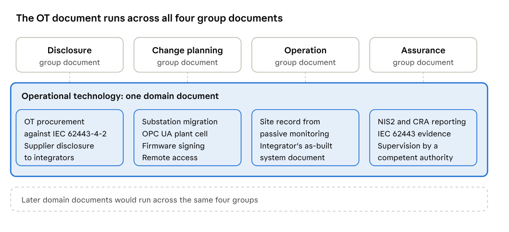
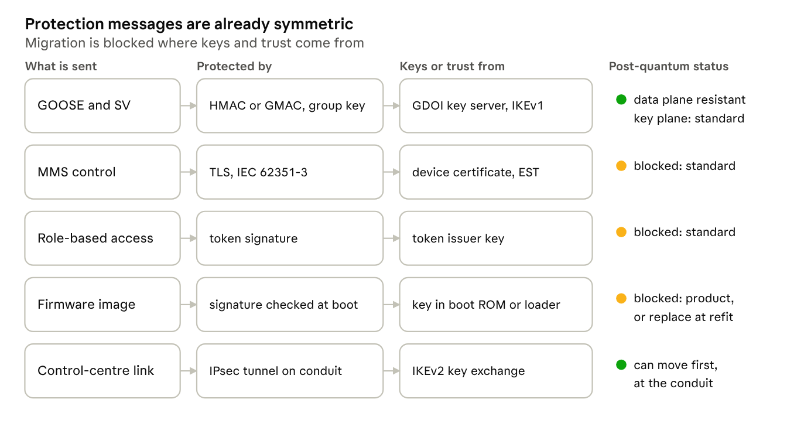
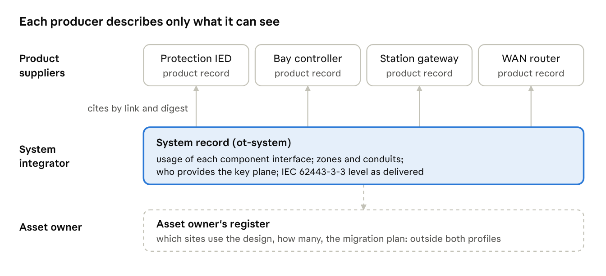

CBOM Profiles — Application domain: Operational technology
==========================================================

Working Draft 0.2 · Nov 17, 2026 · \@Mike

Purpose
-------

The four group documents each cover one kind of decision across all sectors. A domain document covers one application domain across all four groups. It collects what is specific to that domain in one place: the system model, the protocols, the constraints, the standards, and the profiles that apply at each stage of a system's life. Profiles written for this sector live here. Profiles that serve every sector stay in Release 1, and this document builds on them.

Operational technology is the first domain document, for three reasons. The substation work has already shown that OT needs facts other sectors do not, such as certification impact and whether a firmware verifier can be replaced. The supply chain has three producers, not one: the product supplier, the system integrator and the asset owner. And OT systems stay in service for decades, so the same system passes through procurement, change planning, operation and assurance during its life.

The domain document would follow the group documents' conventions. It sits outside Release 1, starts from the Release 1 positions, and is numbered on its own. A sector body could take it over.

{width="6.0in" height="2.7410706474190727in"}

group documents and the OT domain document

The group documents hold the profile mechanics for each kind of decision. The OT document collects the OT use cases from all four, with the context they share.

1. Scope and readers
--------------------

*Outline.*

-   What counts as OT here: control systems, SCADA, distributed control, PLCs, IEDs, safety systems, and the networks between them.

-   Sectors. The first version covers electricity: generation, transmission and distribution substations, and the link to the control centre. Water and manufacturing follow once the electricity chapters have been reviewed.

-   Readers: asset owners, system integrators, product suppliers, certification bodies and national competent authorities.

2. CBOM profiles in brief
-------------------------

A cryptographic bill of materials (CBOM) lists the cryptography a product or system uses. It is usually written in CycloneDX. On its own, a CBOM does not say whether it contains what a reader needs. Two CBOMs of the same device can describe different things in different places.

A **profile** fixes that. It states, for one decision, which facts a CBOM must contain and how they are written. A tool can then check a CBOM against the profile and give a **verdict**: conforms or does not conform, with the rule that failed. A profile asks only for facts. Judgements, such as whether an algorithm is still acceptable, are made by a separate **policy**, which reads the facts and gives a dated result.

A CBOM describes its subject one **interface** at a time. An interface is a place where the subject uses cryptography with another party: a TLS session, a group key used to authenticate messages, a firmware update path. For each interface it records the protocol, the algorithms for each purpose, and the library that implements them. A profile for change planning also asks what the interface could support, what is in the way, and who can clear it.

Three kinds of record matter in OT:

-   a **product record**, written by the supplier of a device at one firmware version;

-   a **system record**, written by the integrator, which cites the product records and adds how they are put together;

-   a **deployment record**, written by the asset owner, which describes a site as configured or as observed.

Records cite each other by link and digest. They are joined when read, never merged.

PKI Consortium Publications 1 to 3 define all of this in full. This document uses only what an OT reader needs to apply it.

3. What is different about cryptography in OT
---------------------------------------------

Seven conditions shape how cryptography can be described and changed in OT. Each one has a consequence for what a profile asks for.

| Condition                                                | Consequence                                                                                                                                                                          |
|-----------------------------------------------|-----------------------------------------------------|
| Devices stay in the field for 20 to 30 years             | Trust-anchor lifetimes and refurbishment dates matter more than product release dates. A device can outlive an algorithm transition plan.                                            |
| Devices are certified per product version                | A change to cryptography can trigger re-testing or re-certification. The cost of a change includes that.                                                                             |
| Some traffic has hard real-time limits                   | Some algorithms cannot be used on some paths. GOOSE trip messages must arrive within 3 ms, and an ML-DSA-44 signature is 2,420 bytes.                                                |
| Integrity and authority matter more than confidentiality | Most control traffic needs to stay confidential only briefly. The quantum risk is forgery of firmware, configuration, commands or keys. Links that leave the site are the exception. |
| Change happens in planned outages                        | A capability that ships in a release is used only at the next outage or refurbishment.                                                                                               |
| Many devices can only be observed passively              | Active probing can disturb a process. Observed records rely on passive monitoring and inspection, which cannot see everything (8.5).                                                 |
| Many protocols have no cryptography                      | For those paths the decision is about the conduit that carries them, not the device.                                                                                                 |

In many systems the protected messages already use symmetric cryptography, and the asymmetric cryptography sits in how keys and trust are delivered. A substation shows this clearly:

{width="6.0in" height="3.276784776902887in"}

a substation · data plane and key plane

The messages under the 3 ms budget are not the migration target. Each asymmetric dependency sits where the keys or the trust come from, and most of those wait for a standard. Values are illustrative.

Two standards conditions decide much of this:

-   IEC 62351-3 profiles TLS for MMS and IEC 60870-5-104. A device can claim 62351-3 conformance only for the groups that profile lists, and it lists no post-quantum groups. Conformance itself blocks migration, even when the device's TLS library could do more.

-   GDOI, used for group keys under IEC 62351-9, has no post-quantum key exchange. Its successor, G-IKEv2 (RFC 9838), does not define an ML-KEM exchange either.

4. The OT system in the methodology's terms
-------------------------------------------

*Outline.*

-   How the IEC 62443 roles map to producers: product supplier to product record, system integrator to system record, asset owner to deployment record.

-   How zones and conduits map to interfaces. A conduit is an interface of the device that implements it.

-   A component, a system design, a site and a fleet, and which record describes each. A fleet is a set of records, not a record of its own.

-   The data plane and the key plane as separate interfaces.

5. Protocols and their cryptography
-----------------------------------

*Outline.*

-   One entry per protocol: what cryptography it defines, which standard profiles it, whether a post-quantum option exists, and what blocks it.

-   Candidates: IEC 61850 MMS, GOOSE and sampled values with IEC 62351; IEC 60870-5-104 with IEC 62351-3; DNP3 Secure Authentication; Modbus/TCP Security; OPC UA security policies; CIP Security; PROFINET security; IEEE 1588; GDOI and G-IKEv2; IKEv2 and IPsec for conduits; EST and SCEP for enrolment; firmware signing.

-   The OT names this document would add to the working group's list of protocol names, such as IEC 60870-5-104, DNP3, OPC UA and CIP Security. GOOSE, SV, R-GOOSE, R-SV, MMS, GDOI, EST and PTP are already in the list (Publication 2, C.2). The list holds the name; this document holds the detail.

-   The full table goes in Annex A.

6. OT use cases
---------------

*Outline.* For each use case: the reader, the decision, and the profile that serves it.

-   Buying: OT procurement against IEC 62443-4-2; supplier disclosure to integrators.

-   Responding: vulnerability response for cryptographic libraries in embedded firmware.

-   Planning a change: substation migration (chapter 11); a plant cell using OPC UA; firmware and code signing for field devices; certificate estates; remote access into OT.

-   Running: the asset owner's site record built from passive monitoring; the integrator's as-built system record; what changed since the last report.

-   Showing compliance: NIS2 and CRA reporting for essential entities; IEC 62443 certification evidence; supervision by a national competent authority.

-   Which device profile applies. A component of an engineered system, such as a protection IED, follows the substation component profile, because certification impact and real-time limits decide its migration. A device model in a fleet, such as a water telemetry RTU, follows IoT Device Estate, because the decision is update, replace, shield or accept per model. A device may be evaluated against both.

7. Records across the life of an OT system
------------------------------------------

*Outline.*

-   Which record is produced and read at each stage: tender, factory and site acceptance, operation, change, and refurbishment.

-   Who writes each record, and which records it cites.

-   A diagram of the chain from product record to system record to site record.

8. OT profiles
--------------

The OT profiles build on two generic profiles. The interface disclosure baseline sets what every record must disclose. The change core adds what a change-planning reader needs: for each purpose, what an interface could support, what is in the way and who can clear it, and how updates reach the device. An OT profile extends one of them and relaxes nothing, so a record that conforms to an OT profile also conforms to the generic one below it.

### 8.1 Three producers

The IED supplier describes one product at one firmware version. It does not know the site. The integrator knows which product interfaces are in use, how the system is split into zones, and which device carries each conduit. It does not see inside the products. The asset owner knows how many sites share a design and what it plans to do. No profile covers that.

{width="6.0in" height="2.7410706474190727in"}

three producers · product records, system record, asset owner's register

### 8.2 Component profile: `pqc-migration-ot` v0.2 (in Release 1)

Release 1 publishes the component profile as PQC Migration for substation components (Publication 2, 8.2 and Annex A), and this document applies it. It extends the change core. It raises certificationImpact, which the change core and PQC Migration share at SHOULD, to MUST, and adds two rules of its own:

| Rule             | Requirement                                                                                                                                                                                                                                                                                 | Level  |
|------------------------|--------------------------------------------------------------|---------------|
| change-core\#I17 | `certificationImpact` on every interface except a peer interface: `none`, `retest`, `recertification`, or `not-applicable` where no capability is planned | MUST   |
| change-core\#I18 | `certificationScheme` where the impact is a re-test or a re-certification                                                                                                                                                                                         | SHOULD |
| I3               | `keyStoreRef` on every service interface, naming the interface that delivers or holds its keys                                                                                                                                                                    | MUST   |
| I4               | `verifierReplaceable` on every interface that carries updates: `yes`, `via-bootloader-update` or `no`                                                                               | MUST   |

The change core already supplies the update path: `updateMechanism` for the product and each management interface, `updateAuthority` where an interface carries updates, and `keyReplaceable` on storage.

### 8.3 System profile: `ot-system`

There is one OT system profile, `ot-system`, not one for each sector. It extends System Disclosure, the generic system profile published in Release 1. The substation system is its first worked example (chapter 11), not a profile of its own. Earlier drafts called it `sas-system`.

Three reasons decide this. Only one clause of the substation rules was specific to substations: the naming of the GDOI key server. Written generally, the same rule covers GDOI, a DNP3 key distribution or an OPC UA certificate manager. A separate form for each sector would repeat the same rules for water and manufacturing, and each rule should have one home. And the sector detail already has a place: the protocol catalogue (Annex A) and the worked examples.

The profile's subject is one system design, not a site. A system record cites the product records and does not repeat them.

| Rule | Requirement                                                                                                                                                                                                   | Level  |
|-----------|------------------------------------------------------------------------|-----------------|
| S1   | Cite every product record by link and digest                                                                                                                                                                  | MUST   |
| S2   | State `usage` for every interface of every cited product: `in-use`, `disabled` or `not-connected`     | MUST   |
| S3   | Declare the zones, and name the conduit each path between zones crosses with `conduitRef`                                                                                           | MUST   |
| S4   | For every interface in use, name the system component that provides its keys or trust, or state `product` (held in the product alone) or `none` (no keys) | MUST   |
| S5   | State the IEC 62443-3-3 security level of the system as delivered                                                                                                                                             | SHOULD |

The verdict on a system record covers the integrator's own statements. Each product record's verdict is reported beside it, including a product that conforms to no profile.

Some attributes were considered and dropped. A separate attribute for the plane is not needed, because the data plane and the key plane are already separate interfaces. A timing class is an integration constraint. Latency budgets and compensating controls belong in the asset owner's register.

There is no object for a connection between devices. A conduit is an interface of the device that implements it: a firewall, a VPN router or a gateway.

`ot-system` is drafted as a rules file, now v0.2-draft. S1, S2 and S4 are not specific to OT. They are in System Disclosure v0.1, published in Release 1 (Publication 2, 8.2), which the telecom service-assurance profile also extends. `ot-system` extends it and keeps S3 and S5. System Disclosure extends the interface disclosure baseline v0.10 and narrows it to the subject type `system` and the stage `configured`. The methodology numbers rules by section, so the rules files use P and I numbers. Each rule names the S-rule it implements.

| Rule | Rules file               | Attribute                                                                                                                                                                                                         |
|--------|----------------------------------|----------------------------------------------------------|
| S1   | system-disclosure P1, I1 | the citations, each with its digest; `correspondsTo`                                                                                                                                    |
| S2   | system-disclosure P2, I2 | `usage`; each interface of a cited record matched by a `correspondsTo`                                                                                        |
| S3   | ot-system P1, I1, I2, I3 | `zones` on the system; `zone` and `zonePath` on each interface; `conduitRef` where the path crosses zones |
| S4   | system-disclosure I3     | `keyProvider` on each interface in use                                                                                                                                                  |
| S5   | ot-system P2             | `claimedLevel62443`, from `SL-C 1` to `SL-C 4`                                                                                      |

Writing the rules showed four things. Three of them led to new checks in the reference evaluator for Release 1.

-   S4 asks every interface in use where its keys or trust come from. `keyProvider` names a component of the same record, or states `product` or `none`. The evaluator checks this with `refersToLocal`.

-   The methodology rejects attribute names that suggest a judgement, and `securityLevel` is one. The attribute for S5 is `claimedLevel62443`: the record reports the integrator's claim and judges nothing.

-   S2 asks that every interface of every cited product is listed. The product rule `coversCitedInterfaces` reads each cited record and fails if one of its interfaces has no `correspondsTo` pointing at it. With `--cited-profile`, the evaluator also reports each cited record's verdict beside the system record's.

-   An interface's `zone` must be one of the system's `zones`, which `inSubjectList` checks. A `conduitRef` must name a component of the same record, which `refersToLocal` checks.

The first system record is the reference substation (chapter 11). It cites two product records: the protection IED, and lib60870, which the substation gateway embeds (12.1). It lists their thirteen interfaces. Nine are in use. Sampled values and IEC 60870-5-101 are `not-connected`, and the design turns off the firmware update interface and IEC 60870-5-104 without TLS. Three paths cross from the station bus to the control centre, all through the substation gateway: certificate enrolment, remote engineering and IEC 60870-5-104 over TLS. GOOSE and the GDOI interface name the station server's group key server as their key provider. TLS, MMS, enrolment, engineering and the IEC 104 link name the enrolment service. The record conforms to the baseline, System Disclosure and `ot-system`. Two variants fail: one has no conduit on the enrolment path, and one has no key provider on GOOSE.

The gateway's supplier has published no record, so the integrator joins the gateway's interfaces to the record of the library it embeds. That gives the implementing library, Mbed TLS 3.6, but not the gateway's own update path or key storage. A record from the gateway's supplier would replace the join.

### 8.4 Proposed profiles

*Outline.*

-   OT procurement: procurement with IEC 62443-4-2 requirements added.

-   OT deployment: deployment disclosure for a site. Its rules would cover the site, such as interface usage and zones. It has no rule on observation methods (8.5).

### 8.5 Passive observation

An OT deployment profile has no rule of its own on observation methods. A site record uses the `observationMethod` values that deployment disclosure already defines, and states `unknown` where the wire hides a value.

Two options were considered: a profile that accepts only `passive-sensor` and `inspection`, or no new rule. No new rule was chosen, for three reasons.

-   A profile states what a record must disclose, not how the operator works. Which methods are safe on a given network is the asset owner's operating rule. A rule in the profile would not stop a probe. It would only reject a record that was honest about one.

-   `observationMethod` is already required for every observed value. A reader can see how each value was obtained and weigh it.

-   What passive observation changes is what can be seen. The existing disclosure states already cover that.

| Path                            | Passive monitoring sees                                                                | It does not see                                        |
|------------------------|----------------------------------------------------|------------------------|
| TLS 1.2 (IEC 62351-3)           | Version, cipher suite, key exchange group, certificates and their signature algorithms | —                                                      |
| TLS 1.3                         | Version, cipher suite, key exchange group                                              | The certificate and its signature, which are encrypted |
| GOOSE and SV with IEC 62351-6   | That the messages carry a MAC, and the key identifier                                  | The key, and where it came from                        |
| GOOSE and SV without protection | That they carry no cryptography                                                        | —                                                      |
| GDOI key distribution           | The IKE exchange and the proposals offered                                             | The group keys                                         |

A passively observed TLS 1.3 interface therefore has `authentication` stated as `unknown`. Its record fails the baseline's I5 and conforms to the entry profile, like the Keycloak record that was observed through `pg_stat_ssl` alone. The asset owner pairs it with a configured record read by inspection, and the readiness-gap policy reads both.

9. Policies in OT
-----------------

*Outline.*

-   How the algorithm-transition policy applies when a device outlives the transition dates.

-   Readiness gap for each communication path, not each interface.

-   Edge posture across a conduit, read from both ends.

-   Why forgery weighs more than harvest-now-decrypt-later for most OT traffic, and where links leaving the site are the exception.

10. Worked example: an open-source IEC 61850 stack
--------------------------------------------------

The first OT example with real values is [libIEC61850](https://github.com/mz-automation/libiec61850) v1.6.2, an open-source (GPLv3) IEC 61850 library from MZ Automation, built with Mbed TLS 3.6. Device makers embed it to give a product MMS, GOOSE and sampled values. The working group wrote the record from the project's public source. The maintainers have not reviewed it.

### 10.1 Why a library first

Real values need a real product, and no IED supplier has offered one yet. An open-source stack has public source, so every value in the record can be checked. Many devices embed it, so its limits pass to them. And a library has no management interface of its own, so the record shows how a product states an absence instead of leaving it out.

### 10.2 The record

The record describes five interfaces at the stage `implemented`. Where the library leaves a value to the application or to the other endpoint, the record says so with a literal and points to where the application decides it.

| Interface                                                                 | Protocol                                | What the record states                                                                                                                                                                                                                                    | Source                                                                                                         |
|-----------------------|------------|----------------------------------------|-------------------------|
| `tls-mms`                                       | TLS 1.2 and 1.3 (IEC 62351-3/4)         | Key exchange and cipher are agreed with the peer (`peer-defined`) from the Mbed TLS 3.6 defaults, none of them post-quantum. The application supplies the certificate and key (`deployment-defined`). | `hal/tls/mbedtls3/tls_mbedtls.c`, `hal/inc/tls_config.h` |
| `svc-mms`                                       | MMS                                     | No cryptography. An optional ACSE password is sent in clear unless MMS runs over `tls-mms`.                                                                                                                                     | README                                                                                                         |
| `svc-goose`, `svc-sv` | GOOSE, sampled values (layer 2)         | No cryptography. The library implements no IEC 62351-6 protection for layer-2 messages.                                                                                                                                                                   | README                                                                                                         |
| `svc-rsession`                                  | R-GOOSE and R-SV (beta, off by default) | HMAC-SHA256-128 or HMAC-SHA256-256 and, in session protocol version 2, GCM encryption, chosen by the application. The application provisions the keys; the library has no group key distribution.                                                         | `src/r_session/r_session.c`                                                        |

The record names Mbed TLS 3.6.0 as the implementing library of `tls-mms` and `svc-rsession`, and libIEC61850 itself for the other three. It states its management interface as absent (`not-applicable-to-subject`). It cites a companion SBOM, the project's GitHub security advisories and its security policy, and states that no vulnerability statements are published.

### 10.3 Verdicts

| Profile                                 | Verdict          | Why                                                                                                                                      |
|-------------------------|----------------------|-----------------------------------------------------|
| Interface Enumeration                   | Conforms         |                                                                                                                                          |
| Interface Disclosure Baseline           | Conforms         | P2 is met by the stated absence. R5 is met by the pointers to `tls_config.h` and the R-session source.        |
| Change core                             | Does not conform | No capability per purpose, enablement method or coexistence, and no update mechanism. Public source cannot state the maintainer's plans. |
| PQC Migration for substation components | Does not conform | The change core's failures, plus `certificationImpact`                                                         |

A record written from public source stops at the baseline. The change-planning facts come from the maintainer, or from the supplier of a device that embeds the library.

MMS, GOOSE and SV use no key at all. The record states their `keyStoreRef` as `none`, the literal PQC Migration Extended already defines for an interface that uses no keys, and the component profile's rule I3 accepts it.

### 10.4 What a planner can already see

-   GOOSE and sampled values from this library carry no protection. For a device built on it, the first question for those paths is not migration but protection, and the answer is the conduit that carries them.

-   TLS key exchange is blocked twice. Mbed TLS 3.6 has no post-quantum group. In July 2026 its maintainers planned ML-KEM in the crypto library after ML-DSA, with TLS and X.509 support not yet on the roadmap. And libIEC61850 integrates only Mbed TLS 2.28 and 3.6, not 4.x. The provider has to move first, then the library.

-   The default maximum certificate size is 8,192 bytes. An ML-DSA-87 public key and signature alone take 7,219 bytes, before names and extensions. A deployment that moves to ML-DSA certificates has to raise the limit.

-   The default minimum key length is 1,024 bits, and TLS 1.2 renegotiation, including legacy renegotiation, is on. These are findings for a configured record and a policy, not for migration.

-   R-GOOSE keys come from the application. The key plane lives outside the library, which the record states with `keyStoreRef` set to `out-of-band`.

None of this needed the maintainer. What the record cannot show is whether the maintainer plans post-quantum support, and when.

### 10.5 Files and next records

The build script, the record and its SBOM are in the repository under [`drafts/ot-libiec61850/`](../../drafts/ot-libiec61850/). Both documents validate against the pinned CycloneDX 2.0 schema.

-   Ask MZ Automation to review the record and to supply the change-core facts.

-   Write a record for [lib60870](https://github.com/mz-automation/lib60870), the same maintainer's IEC 60870-5-104 library, which carries the control-centre link over IEC 62351-3 TLS.

Sources: the libIEC61850 [README](https://github.com/mz-automation/libiec61850), [CHANGELOG](https://github.com/mz-automation/libiec61850/blob/v1.6/CHANGELOG), [TLS integration](https://github.com/mz-automation/libiec61850/blob/v1.6/hal/tls/mbedtls3/tls_mbedtls.c) and [R-session source](https://github.com/mz-automation/libiec61850/tree/v1.6/src/r_session); the Mbed TLS [mailing list, July 2026](https://lists-ec2.trustedfirmware.org/archives/list/mbed-tls@lists.trustedfirmware.org/thread/64SPHA7HRNLHFMIVFWET6YH6HQZK3ACY/) and [roadmap](https://mbed-tls.readthedocs.io/en/latest/roadmap/).

11. Worked example: a reference substation
------------------------------------------

### 11.1 The decision

A grid operator plans the post-quantum migration of one substation automation system: the station level, the bay level and the link to the control centre. For each communication path it chooses one of four actions:

-   migrate it in place, by configuration or firmware;

-   migrate only the key plane, where the messages are already protected with symmetric cryptography;

-   carry the path on a conduit, such as the protected WAN tunnel to the control centre;

-   replace the device at its next planned refurbishment.

The operator also needs to know whether any trust anchor will stay in service longer than its algorithm stays safe. The national competent authority under NIS2 uses the same facts in less detail.

The case was chosen because energy is the first sector listed in NIS2, protection traffic is the hardest real-time case in OT, and the security standards are published, so capability can be checked against them.

### 11.2 The reference system

The reference system has six components: a protection IED, a bay controller, a station gateway that talks IEC 60870-5-104 to the control centre, a station server that hosts the GDOI key server and the HMI, an engineering workstation, and a WAN router that carries the conduit to the control centre. It has two zones: the station and the WAN. Values are taken from the published standards and are illustrative until a supplier offers a real product.

### 11.3 The protection IED

The published record describes the protection IED, with ten interfaces:

| Interface                                                                 | Type         | Protocol                         | Expected finding                                                                                                             |
|-----------------------|-----------------|------------------|------------------------------------------|
| `svc-goose`, `svc-sv` | service      | GOOSE, sampled values            | Integrity by HMAC-SHA256 under a group key, which is already resistant. Keys come from `int-gdoi`. |
| `tls-mms`                                       | service      | TLS 1.2 and 1.3, IEC 62351-3     | ECDHE and ECDSA. Blocked by a standard.                                                                                      |
| `svc-mms`                                       | service      | MMS with IEC 62351-8 role tokens | The token signature grants authority. Blocked by a standard.                                                                 |
| `int-gdoi`                                      | interconnect | GDOI over IKEv1                  | The key plane. Blocked by a standard.                                                                                        |
| `mgmt-enrol`                                    | management   | EST or SCEP                      | Device certificates with long validity                                                                                       |
| `upd-fw`                                        | management   | firmware update                  | `verifierReplaceable` decides between update and replacement                                       |
| `mgmt-eng`                                      | management   | engineering download             | Often protected only by TLS and access control                                                                               |
| `peer-ptp`                                      | peer         | IEEE 1588                        | Usually no cryptography                                                                                                      |
| `sto-keys`                                      | storage      | —                                | The device private key and trust anchors                                                                                     |

The record conforms to interface enumeration, the baseline, the change core and `pqc-migration-ot`. Two variants each leave out one fact. `…-fail-core-I13` has no `updateMechanism` on the enrolment interface, and fails the change core and the component profile. `…-fail-ot-I4` has no `verifierReplaceable` on the firmware update interface, and fails the component profile only.

### 11.4 What a planner can see

Read with a system record, the product record shows the following:

-   The protection traffic does not need to change, because its integrity protection is already symmetric.

-   The key plane will take longest. Group key distribution, role tokens and certificate enrolment are all waiting for standards.

-   The control-centre link can be protected now at the conduit, while the gateway's 62351-3 TLS waits for its standard.

-   For each device model, `verifierReplaceable` separates devices that can be updated from devices that have to be replaced at refurbishment.

-   `certificationImpact` shows what testing and certification each action will need, so the actions can be scheduled.

A list of algorithms alone would show none of these points.

### 11.5 How it is written in CycloneDX

TLS is a protocol component. GOOSE, sampled values, MMS, IEC 60870-5-104 and GDOI are services, because the CycloneDX protocol types do not include them. Each service depends on the component that carries it. The group key is a dependency: `svc-goose` depends on the key material, and the key material on `int-gdoi`. The system record is a separate document that cites the product records by BOM-Link and hash. CycloneDX 1.7 cannot express zones. In CycloneDX 2.0 the blueprint model, with zones, boundaries and flows, is the candidate. Until it is settled, the draft system record states zones and conduits as properties.

### 11.6 What the example leaves out

Migration priority, risk scores, target dates and compensating controls belong in the asset owner's register. Latency budgets and safety analysis are the operator's requirements. Product records carry no site topology. Exploitability stays a separate artefact.

12. Further examples
--------------------

*Outline.*

-   For the sectors that follow electricity: an OPC UA plant cell on an open-source stack, and water telemetry over DNP3, where most paths have no cryptography and the decision is about conduits.

### 12.1 The control-centre link: lib60870

lib60870 v2.4.1 (July 2026) is the open-source IEC 60870-5-101 and IEC 60870-5-104 library from the maintainer of libIEC61850. The record is written from its public source at the v2.4.1 tag, built with Mbed TLS 3.6. It has three interfaces: TLS after IEC 62351-3, IEC 104 without TLS, and IEC 101 on a serial line. The library was not built, so its named groups and TLS 1.3 support follow from the Mbed TLS 3.6 defaults and are marked to confirm. The verdicts match libIEC61850: the record conforms to the baseline and fails the change core.

Three findings:

-   The default cipher suites include `TLS_RSA_WITH_AES_128_CBC_SHA256`, which IEC 62351-4:2018 makes mandatory. It uses RSA key transport, so a session recorded today can be decrypted once the server's RSA key is broken.

-   The README names only Mbed TLS 2.28, whose support ended at the end of 2024. The code has supported 3.6 since v2.4.0, but a build that follows the README, or a CMake build with both present, uses 2.28.

-   Application-layer authentication after IEC 60870-5-7 (IEC 62351-5) is a commercial add-on. Without it, IEC 104 outside TLS and IEC 101 have no cryptography.

In the reference substation, the gateway embeds lib60870, and the control centre's front end accepts only the mandatory suite. The system record therefore shows RSA key transport on the one link that leaves the substation (8.3).

[`tools/build_lib60870_example.py`](../../tools/build_lib60870_example.py) in the repository writes both documents into [`examples/`](../../docs/methodology/examples/). Sources: the project's [README](https://github.com/mz-automation/lib60870) and the CHANGELOG, Makefile and TLS integration code at the v2.4.1 tag.

13. Standards and regulation
----------------------------

*Outline.*

-   IEC 62443 (in particular 3-2, 3-3, 4-1 and 4-2), IEC 62351, IEC 61850.

-   NIS2, the Cyber Resilience Act and the EU PQC roadmap.

-   Certification schemes such as ISASecure and the IECEE scheme for IEC 62443.

-   For each: what it asks for that a CBOM can supply, and what it does not.

14. Positions and open work
---------------------------

### 14.1 Positions this document starts from

The working group adopted these positions provisionally on 16 November 2026, with the substation example. They were first drafted for Release 1 and now sit with this document. Like every position in a domain document, they change through the question register.

| Position                                                                                                                                           | Chapter                         |
|-----------------------------------------------------------|-----------------------------------------|
| The OT use case is the substation automation system, named by its decision.                                                                        | 11                              |
| It has two profiles: the component profile, published in Release 1 and extending the change core, and the system profile, ot-system, drafted here. | 8                               |
| The data plane and the key plane are separate interfaces, linked by `keyStoreRef`.                                       | 3, 8                            |
| Real-time limits are integration constraints, not a new attribute.                                                                                 | 3, 8                            |
| A conduit is an interface of the device that implements it. There is no connection object.                                                         | 8                               |
| Values are illustrative until a supplier offers a real product.                                                                                    | 11                              |
| The supplier states the certification impact for its product. The operator's type approval stays in its register.                                  | 8                               |
| Interface usage is stated in the system record.                                                                                                    | 8                               |
| A sector profile extends a Release 1 profile, directly or through another, and adds only rules specific to its sector.                             | 8                               |
| A system record's verdict is reported with the verdict of each record it cites.                                                                    | 8                               |
| S1, S2 and S4 apply to any system. They sit in System Disclosure, which ot-system and the telecom service-assurance profile extend.                | 8.3; Publication 2, position 37 |
| R-GOOSE and R-SV are in the list of protocol names.                                                                                                | 5, 10; Publication 2, C.2       |

### 14.2 Positions this document proposes

These positions are new. The working group takes them up through its question register.

| Position                                                                                                                                                                      | Chapter |
|-----------------------------------------------------------------------------------|-----------------|
| The first sector is electricity. Water and manufacturing follow.                                                                                                              | 1       |
| The first example with real values is an open-source IEC 61850 stack, described from its public source.                                                                       | 10      |
| A record written from public source stops at the baseline. Change-planning facts come from the maintainer or the device supplier.                                             | 10      |
| There is one OT system profile, `ot-system`, which extends System Disclosure. The substation is its first worked example, not a profile of its own. | 8.3     |
| Every interface a system uses names the component that provides its keys or trust, or states that the product holds them or that it uses none.                                | 8.3     |
| An OT deployment profile has no rule on observation methods. Values the wire hides are stated as `unknown`.                                         | 8.5     |

### 14.3 Open work

-   Review `ot-system` v0.2-draft and the reference substation's system record against System Disclosure (8.3).

-   Ask MZ Automation to review the libIEC61850 and lib60870 records and supply the change-core facts.

-   Build libIEC61850 and lib60870 with Mbed TLS 3.6, and confirm the named groups and TLS 1.3 support stated in both records.

-   Ask a supplier for a real IED record to replace the illustrative one.

-   Draft the outline chapters, starting with the protocol catalogue (chapter 5 and Annex A).

This is a working draft. The first version covers electricity. Chapters 2, 3, 8, 10, 11 and 14 are drafted, with section 12.1. Chapter 10 is the first example with real values, from an open-source IEC 61850 stack. Chapter 11 takes over the substation material first developed in the Change planning group document. Working Draft 0.2 adds the system profile as a rules file, extending System Disclosure from Release 1, with the reference substation's system record (8.3), and a second open-source record, lib60870, for the control-centre link (12.1). The other chapters are still an outline: each lists what it would cover.

Annexes
-------

-   **A. Protocol catalogue.** One row per OT protocol: cryptography defined, governing standard, post-quantum status, what blocks it, and the CycloneDX component type used to represent it.

-   **B. IEC 62443 terms and methodology terms.** Product supplier, system integrator, asset owner, zone, conduit and security level, each matched to the methodology's term, or marked as having none.

-   **C. Sector notes.** Electricity first: typical systems, protocols and regulators. Water and manufacturing are added with their chapters.

-   **D. Example documents.** The libIEC61850 and lib60870 records and their SBOMs, the protection IED records, the reference substation's system record, and the records still to come from chapter 12.

Decisions
---------

1.  **Sectors.** Decided: electricity first. Water and manufacturing follow once the electricity chapters have been reviewed.

2.  **Where profiles live.** Decided: OT-specific profiles live in this document, and generic profiles stay in Release 1. The substation component profile is published in Release 1, and this document applies it. Each rule has one home.

3.  **A general OT system profile.** Decided: one profile, `ot-system`, with the substation as its first worked example (8.3). Drafted as a rules file in Working Draft 0.2, extending System Disclosure from Release 1.

4.  **Passive observation.** Decided: no OT rule on observation methods. The existing values record how each value was obtained, and hidden values are stated as `unknown` (8.5).

5.  **A real product.** Decided: start with libIEC61850, an open-source IEC 61850 stack (chapter 10). The OPC UA example moves to the manufacturing chapters.

6.  **Ownership.** Open: whether to approach a sector body to co-own the document.
