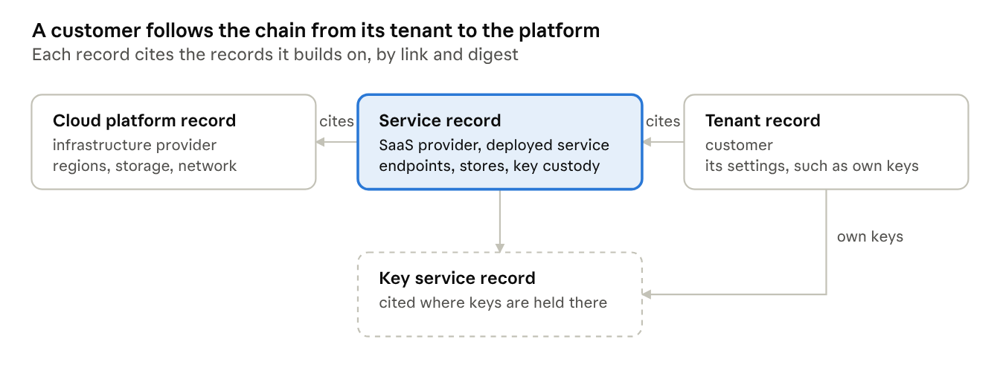

CBOM Profiles — Application domain: SaaS and cloud services
===========================================================

Working Draft 0.1 · Nov 16, 2026 · \@Mike

Purpose
-------

This document would cover software and platforms delivered as a service, across all four use-case groups. It is written for readers outside the working group: customers who rely on a service they do not run, the providers who run it, auditors, and the regulators of regulated customers. It follows the shape of the OT and telecom documents. The two service disclosure profiles are published in Release 1, because a service in any sector can use them. This document applies them to cloud services and holds the profiles written only for those.

SaaS tests the methodology in ways no other domain does:

-   The subject is a running service, not a product. The methodology has a subject type for a service, which the interface disclosure baseline accepts from v0.10. Release 1 publishes two profiles for it: Service Disclosure and Service Disclosure Restricted.

-   The provider writes the record and the customer cannot inspect the service. The customer sees only the interfaces the service exposes to it.

-   What matters most to the customer is often not the traffic but the data at rest: where it is stored, for how long, and whose keys protect it.

-   A service has no releases in the usual sense. It changes continuously, so how current a record is becomes an everyday question.

The domain also absorbs the use case registered so far as "managed and cloud service disclosure".

This is a working draft. It sits outside Release 1 and starts from the positions Release 1 ratified. Positions proposed here are listed in chapter 12.

1. Scope and readers
--------------------

This document covers services that a customer uses but does not run:

-   **software services**, such as collaboration, identity, customer relationship and payment services;

-   **platform services**, such as managed databases, message queues and serverless runtimes;

-   **infrastructure services**, such as compute, storage and networking;

-   **managed security services**, such as key management, certificate services and identity providers.

All three layers are in scope. A service built on another service cites the record of the service beneath it, so a customer can follow the chain down to the platform.

The readers are:

-   customers that rely on a service, and in particular regulated customers that must account for their providers;

-   providers that want to answer customers once rather than in a different questionnaire for each;

-   auditors who assess a provider against a scheme;

-   regulators of financial and other critical-sector customers.

2. CBOM profiles in brief
-------------------------

A cryptographic bill of materials (CBOM) lists the cryptography a product or service uses. It is usually written in CycloneDX. On its own, a CBOM does not say whether it contains what a reader needs. Two CBOMs of similar services can describe different things in different places.

A **profile** fixes that. It states, for one decision, which facts a CBOM must contain and how they are written. A tool can then check a CBOM against the profile and give a **verdict**: conforms or does not conform, with the rule that failed. A profile asks only for facts. Judgements, such as whether an algorithm is still acceptable or whether a record is recent enough, are made by a separate **policy**, which reads the facts and gives a dated result.

A CBOM describes its subject one **interface** at a time. An interface is a place where the subject uses cryptography with another party: a public API endpoint, a federation link with an identity provider, the store where customer data is kept. For each interface it records the protocol, the algorithms for each purpose, and the library that implements them.

Three kinds of record matter for services:

-   a **service record**, written by the provider, which describes the service as it runs;

-   a **tenant record**, which describes one customer's settings and cites the service record;

-   the **records of the services underneath**, which the service record cites.

Records cite each other by link and digest. They are joined when read, never merged. A producer that does not want to disclose a fact can mark it as withheld, where the profile allows it, and still conform.

PKI Consortium Publications 1 to 3 define all of this in full. This document uses only what a reader needs to apply it to services.

3. What is different about cryptography in services
---------------------------------------------------

Seven conditions shape how a service's cryptography can be described. Each has a consequence for what a service profile asks for.

| Condition                                                                                                                         | Consequence for a profile                                                                                                                                    |
|-----------------------------------------------|-----------------------------------------------------|
| Responsibility is shared. The provider runs the service; the customer controls its tenant settings, its users and often its keys. | Facts are split between a service record and a tenant record, each stating what its writer knows.                                                            |
| The provider writes the record, and the customer can check only what it can observe at the endpoints.                             | Endpoint facts can be compared with what the customer sees. Facts behind the endpoints rest on the provider's word and on audit.                             |
| One service serves many customers.                                                                                                | The service record describes what every tenant gets and what each tenant can choose. The tenant record describes one tenant's choices.                       |
| Data at rest matters more than for most products.                                                                                 | Storage interfaces, regions, retention and key custody are central, not secondary.                                                                           |
| Services run on other services.                                                                                                   | A service record cites the records of the services beneath it, as a system record cites its components.                                                      |
| A service has no releases, only continuous change.                                                                                | A record must say when it was produced and what makes the provider produce a new one.                                                                        |
| Providers protect their internals.                                                                                                | A public variant describes the customer-facing interfaces and may leave internal ones out; a restricted variant, shared under agreement, describes them all. |

The fourth condition is the one most customers care about. A service that encrypts its traffic with a post-quantum key exchange still exposes stored data if the keys that protect that data, or the backups of it, rely on classical cryptography. For a long-lived record, such as a contract, a health file or an archive, the store matters more than the session.

Key custody decides who could expose that data and who can change how it is protected. This document uses three custody models:

-   **provider-managed keys**: the provider generates and holds the keys;

-   **customer-managed keys**: the keys sit in the provider's key service, under the customer's control;

-   **external keys**: the keys stay outside the provider, in the customer's own key service or hardware.

A service usually supports some of these models and not others, and the choice is made tenant by tenant.

4. The service in the methodology's terms
-----------------------------------------

A service record describes a running service with the subject type `service`. It differs from a product record in three ways: the provider is also the operator, so values are configured or observed rather than only implemented; the record covers one or more regions; and the service changes without a version number.

The record's coverage statement names the regions, editions and service tiers it describes. Where the cryptography differs between regions, for example because a region uses a different key service, the provider writes one record for each group of regions.

The interfaces of a service fall into three kinds:

-   **customer-facing interfaces**: the web front end, APIs, federation with identity providers, and webhooks the service sends;

-   **storage interfaces**: where customer data is held, including backups and copies replicated between regions, each with its key custody;

-   **interfaces to the services beneath**: the platform, the key service and other sub-processors, each a connection to a record the service record cites.

The records fit together as follows:

{width="6.0in" height="2.330356517935258in"}

service records and the records they cite

The service record states what any tenant can choose, such as which key-custody models are offered, as a set of supported values. The tenant record states what one tenant chose, and cites the service record. This is the same split Release 1 makes between a product, which states what it supports, and a deployment, which states what is configured.

Either party may write the tenant record, and the record names who did. In practice the provider will often produce it on request, because it holds the tenant's settings. A customer that holds its own keys outside the provider can state the external half itself.

A customer that wants to know how its data is protected therefore reads three records: its tenant record for what it chose, the service record for what the service does with that choice, and the key service's record for how the keys themselves are held.

5. Interfaces and their cryptography
------------------------------------

The table lists the interfaces a service typically has. The last two columns show where the line falls between what a customer can check and what only the provider can state.

| Interface                     | Cryptography involved                                             | A customer can observe                              | Only the provider can state                                                                                                        |
|------------------|------------------------------|--------------------|-------------------------------|
| Web front end and public APIs | TLS: protocol versions, key exchange groups, signature algorithms | The negotiated group and certificate, by connecting | Where TLS ends inside the service, and how traffic is protected after that, recorded with `terminatedBy` |
| API authentication            | OAuth 2.0 access tokens, signed tokens (JWS), mutual TLS          | Token signature algorithms, from tokens it receives | Where signing keys are held and how often they change                                                                              |
| Federation                    | SAML assertions, OpenID Connect ID tokens                         | Signature algorithms in the metadata and tokens     | The service's own signing and decryption keys                                                                                      |
| Webhooks and callbacks        | HMAC or signature over each message                               | The algorithm, from messages it receives            | How the shared secret or signing key is stored                                                                                     |
| Stored customer data          | Envelope encryption: data keys wrapped by key-encryption keys     | Nothing directly                                    | The data and wrapping algorithms, and the key custody                                                                              |
| Backups and replicas          | Encryption of backups; protection of replication between regions  | Nothing directly                                    | Whether backups use the same keys and algorithms as live data                                                                      |
| Key service interface         | Wrap and unwrap calls to a key service, often backed by hardware  | The key service named in its tenant settings        | Which key service, which key types, and module validation                                                                          |
| Secrets used internally       | Credentials the service holds for other services                  | Nothing                                             | How they are stored and rotated                                                                                                    |

The first four rows face the customer. Their facts can be compared with what the customer observes, so a service profile should not let the provider withhold them. The last four sit behind the endpoints. Their facts rest on the provider's word and on audit. The public variant of a record may leave them out, and the restricted variant must include them (chapter 8).

The working group keeps one list of protocol names. Service names such as OAuth 2.0, OpenID Connect and SAML are added to that list, and this document holds the detail.

6. Service use cases
--------------------

Each use case names the reader, the decision and the profile that serves it.

| Use case                  | Who decides, and what                                                                                 | Profile                                                                             |
|--------------------------------|----------------------------------------|----------------------------|
| Provider due diligence    | A customer: whether to rely on the service, and what to require in the contract                       | Service disclosure (8.2), with the restricted profile under agreement               |
| Questionnaire replacement | A provider: how to answer every customer once                                                         | Service disclosure (8.2)                                                            |
| Vulnerability response    | A customer or provider: which services and tenants a published advisory reaches                       | Service disclosure, implementing library not withholdable in the restricted profile |
| Endpoint migration        | A customer: when the service's endpoints will support post-quantum cryptography, and what blocks them | Service change planning (8.5)                                                       |
| Key custody choice        | A customer: which custody model to use for which data                                                 | Key-custody depth (8.4) and the tenant record                                       |
| Stored data protection    | A customer: which data held by the service to re-encrypt or move first                                | Key-custody depth (8.4), with the customer's own data register                      |
| Tenant record             | A customer: what its own tenant is set to, for its records and its auditors                           | Tenant record, citing the service record                                            |
| Third-party register      | A regulated customer: what to record about each ICT provider                                          | Service disclosure (8.2) and the tenant record                                      |
| Audit evidence            | An auditor: whether the provider's cryptographic controls match what the record states                | Restricted profile, with assurance context pointers                                 |

Two of these change what a customer can do today. Questionnaire replacement turns a set of differently worded spreadsheets into one record that each customer evaluates against its own profile. Key custody choice lets a customer decide per data set, because the tenant record shows which custody model each store uses and the key service's record shows how the keys are held.

7. Records across the life of a service relationship
----------------------------------------------------

| Stage      | Record produced                                                                                                                         | Read by                                                                     |
|---------------|-------------------------------------------------|------------------------------------|
| Selection  | Public variant of the service record                                                                                                    | Prospective customers                                                       |
| Contract   | Restricted variant, shared under agreement                                                                                              | The customer's security and procurement teams                               |
| Onboarding | Tenant record, once the tenant is set up                                                                                                | The customer, its auditors and, where required, its regulator               |
| Operation  | A new service record whenever an interface changes or on the stated schedule; a new tenant record whenever the tenant's settings change | The customer's policy, which decides whether the record it holds is current |
| Renewal    | The current service and tenant records                                                                                                  | The customer, against its renewal requirements                              |
| Exit       | A final tenant record, stating how the customer's data and keys were returned or destroyed                                              | The customer and its auditors                                               |

A service record states when it was produced and what makes the provider produce a new one: a fixed schedule, any change to an interface, or both. It also points to where the provider announces changes. With those three facts a customer's policy can decide how old a record may be before it is treated as out of date. The service profile does not set that age, because the right answer differs between a payroll service and a public web site.

The pointer to the change announcements is the context kind `change-notice`, which Service Disclosure requires (`service-disclosure#R1`). It sits beside the other kinds, such as the companion SBOM and the vendor's vulnerability statements.

8. Service profiles
-------------------

The service disclosure profile and its restricted pair (8.2 and 8.3) are published in Release 1 (Publication 2, 8.2), and the example in chapter 10 tests them. The other profiles in this chapter are drafted as rules files, outside Release 1, in the repository under drafts/saas-services/.

### 8.1 What they build on

A service profile should extend the interface disclosure baseline, directly or through another Release 1 profile, as the OT, telecom and SaaS drafts do. A profile that extends another may narrow what it accepts but never widen it, because widening would relax a rule. The baseline accepts the subject type `service` from v0.10, so a service profile can extend it. The change core accepts `service` from v0.2, with the update mechanism `provider-managed`, so a service profile can extend the change core too.

The working group added `service` to the baseline and to the change core in Release 1. Adding a subject type alters no rule a product or deployment record has to meet, so existing records and verdicts are unaffected.

### 8.2 Service disclosure

The service disclosure profile extends the baseline with the subject type `service` and the stages `configured` and `observed`. Its orientation is both: it asks what a tenant can choose as well as what is in place. It adds:

| Rule           | Requirement                                                                                                                                                                                                                                                   | Level  |
|---------------------|---------------------------------------------------------------|---------------|
| P1             | `serviceRegions`: the regions the record describes. Editions and service tiers go in the coverage statement                                                                                                                         | MUST   |
| P2             | At least one storage interface for customer data, or `absent:storage-interface` stating `stores-no-customer-data`                                                                                          | MUST   |
| P3             | A citation, by link and digest, of the record of each service it runs on, or a statement that it runs on infrastructure the provider operates itself                                                                                                          | MUST   |
| P4             | `recordRefreshTrigger`: what makes the provider produce a new record: `schedule`, `interface-change` or `schedule-and-interface-change`                | MUST   |
| I1             | On every storage interface, `keyCustodySupported`: the custody models a tenant can choose, from `provider-managed`, `customer-managed` and `external` | MUST   |
| I3             | On every storage interface, `keyCustody`: the custody model a new tenant gets unless it chooses another. The present-state attribute behind I1.                                                                                     | MUST   |
| I2             | On every storage interface, `storageRegion`: where the data is held                                                                                                                                                                 | SHOULD |
| I14 (baseline) | On every interface except storage, `terminatedBy`: what terminates its cryptography, such as the service itself or the ingress in front of it                                                                                       | SHOULD |
| R1             | A pointer to where the provider announces changes (context kind `change-notice`)                                                                                                                                                    | MUST   |

The table summarises the profile. The rules file in Release 1, [`profile-service-disclosure.rules.json`](../../docs/methodology/profile-service-disclosure.rules.json), is the authority where the two differ.

The baseline already requires the protocol, key exchange, encryption and authentication of every interface, and does not let them be withheld. That suits a service, because a customer can observe the first three of them at the endpoints anyway.

### 8.3 The public and restricted pair

The pair uses the coverage statement that every record already carries:

-   The **public variant** declares coverage `all-external`. It describes every customer-facing interface in full, and may leave internal interfaces out. It may withhold the implementing library, as the baseline allows.

-   The **restricted variant** declares coverage `all`. It describes the storage, backup and replication interfaces and the interfaces to the services beneath, and does not withhold the implementing library.

The restricted profile is derived from the service disclosure profile. It requires coverage `all` and removes the permission to withhold the implementing library. Both are tightenings, so the restricted variant passes both profiles and the public variant passes the public one.

### 8.4 Key-custody depth

A deeper profile for customers whose main concern is stored data, drafted as `service-key-custody` v0.1-draft. It extends Service Disclosure, Restricted, because the facts it asks for are internal ones. The baseline already requires the algorithms that wrap the data keys (`keyWrapping`) on every storage interface, so the depth does not repeat them. It adds, on every storage interface:

| Rule | Requirement                                                                                                                                                                                                                                                                                                                                                                                                                                                                   | Level  |
|-----------|------------------------------------------------------------------------|-----------------|
| I1   | `keysStoredIn`: the interface of the key service that holds the keys, as a component of the same record or, by BOM-Link, of a record the document cites; `out-of-band` where the tenant's own service holds them and no record of it is cited; `product-managed`; or `none`. The literals are those of PQC Migration Extended I8 (question register, R2-22 and R2-27). | MUST   |
| I2   | `replicaProtection`: whether backups and replicas are protected as the live data is: `same-as-primary`, `differs-from-primary` or `no-replicas`                                                                                                                                                                                                                       | MUST   |
| I3   | `moduleValidationScheme` of the module that holds the keys, with the vocabulary of PQC Migration                                                                                                                                                                                                                                                                                                                                                    | SHOULD |

### 8.5 Service change planning

A profile for customers planning around the provider's post-quantum work, drafted as \`service-change-planning\` v0.1-draft. It extends the change core, which accepts `service` from v0.2, and needs no new attributes: capability, blocker and roadmap per purpose apply to a service endpoint as they do to a product interface. It narrows the change core to the subject type service and the stage configured, and adds one rule: the record cites the records it builds on, by hash.

### 8.6 Tenant record

The tenant record is a deployment record with the service record as the record it cites. It is drafted as `tenant-disclosure` v0.1-draft, extending Deployment Disclosure with two rules. Every storage interface states the custody model the tenant chose (`keyCustody`, I1). Where that is `external`, the interface names the tenant's key service, in a record the tenant record cites (`keysHeldBy`, I2). The chosen model should be one the service record offers; the evaluator does not compare the two records.

9. Policies for services
------------------------

The three published policies apply to services without change. A fourth is proposed.

-   **Algorithm transition.** Reads the algorithms on each interface and says, for a stated date, whether each is acceptable under the transition schedule. For a service, the customer-facing interfaces and the storage interfaces are read separately, because they are replaced on different timetables.

-   **Readiness gap.** Reads the service record and a tenant record together. For each interface and purpose it reports whether the service could use post-quantum cryptography, whether the tenant's settings allow it, and whether it is in use.

-   **Edge posture.** Reads both ends of a connection. For a federation link, one end is the service and the other is the customer's identity provider, so each party holds one record.

-   **Record currency (proposed).** Reads when a service record was produced, what triggers a new one and when the provider last announced a change. It reports whether the customer holds the current record, against an age the customer sets.

For stored data the customer adds what only it knows: what the data is and how long it must stay confidential. Release 1 places that in the customer's own data register, linked from the tenant record. A harvest-now-decrypt-later assessment then reads the register's confidentiality lifetime against the wrapping algorithms the key-custody depth records.

10. Worked examples
-------------------

The first example is published with Release 1. The second, and the records for the key-custody depth and service change planning, are drafts in drafts/saas-services/.

### 10.1 Keycloak as a managed service

A provider runs Keycloak 26.7.3 as a managed identity service for many customers. Release 1 already publishes the Keycloak product record and two deployment records for one operator. The service example turns them into a service record:

-   the product record stays as it is, and the service record cites it for each interface Keycloak provides;

-   the provider's configured and observed records become the evidence for the service record's values;

-   the realm-key store becomes a storage interface with its key custody. Keycloak keeps realm keys in its database without wrapping them, so the record shows `provider-managed` custody and no key wrapping, unless the provider adds a key service in front;

-   the cluster transport and database connection become internal interfaces, present in the restricted variant and left out of the public one.

This tests the subject type `service`, the coverage-based pair, and the citation of a product record from a service record.

**Result.** [`tools/build_service_examples.py`](../../tools/build_service_examples.py) in the repository writes the two service profiles and three service records, built from the configured deployment record. Both profiles extend the baseline v0.10 and are published in Release 1.

| Record                                                                                     | Service disclosure                                                                                          | Restricted                                             |
|-----------------------------------------|---------------------------|--------------------------------|
| Restricted variant, coverage `all`                               | Conforms                                                                                                    | Conforms                                               |
| Public variant, coverage `all-external`, internal links left out | Conforms                                                                                                    | Fails: coverage is not `all` |
| Restricted variant without key custody on the realm-key store                              | Fails I1 and I3                                                                                             | Fails I1 and I3                                        |
| Restricted variant, against the baseline v0.9                                              | Fails: v0.9 does not accept the subject type `service`. Against v0.10 it conforms | —                                                      |

The example showed four things:

-   Accepting the subject type in the baseline was needed and was enough. The evaluator already handled a service subject. Only the baseline's accepted subject types and its identifier form stopped a service record.

-   `keyCustodySupported` is a capability under the methodology's naming convention, so an inventory profile may not require it. The service profiles therefore declare orientation `both` and also require `keyCustody`, the present-state attribute behind it.

-   The public variant can keep the storage interface and still leave out the internal links, which coverage `all-external` permits.

-   The realm-key store records keyWrapping `none` under provider-managed custody. That is exactly what a customer of this service would want to know before placing its users' credentials there.

### 10.2 A tenant with provider-managed keys

A tenant record for one customer of the managed service. It cites the restricted service record and keeps the five interfaces the tenant uses: the ingress, OIDC, SAML, the admin interface and the realm-key store. Keycloak keeps realm keys in its database, so the service offers only `provider-managed` custody, and that is the tenant's choice.

| Record                                                         | Profile                 | Verdict                                                    |
|---------------------------------------------|------------------------------|-------------------------|
| Tenant record                                                  | Tenant disclosure       | Conforms                                                   |
| Tenant record without its custody choice                       | Tenant disclosure       | Fails I1                                                   |
| Restricted service record with the depth's facts               | Key custody             | Conforms                                                   |
| The same without `replicaProtection` | Key custody             | Fails I2                                                   |
| Service record with the change core's facts                    | Service change planning | Conforms, and conforms to both service disclosure profiles |

The change-planning record takes its capability facts from the Keycloak product record, interface by interface, through `correspondsTo`. Only the ingress, which the provider runs itself, needs facts of its own. The provider writes little that the vendor has not already written.

The external-key case is not tested: a service that offers external keys is needed for it. Nothing checks that a tenant's choice is one the service offers. That would need a constraint that compares a value with a list in a cited record.

11. Standards, schemes and regulation
-------------------------------------

A service record does not replace an audit or a certification. It gives an auditor and a customer the same facts, in a form a tool can read, and binds them to a dated document. The table shows where it helps.

| Scheme or law                          | What it asks for                                                                     | What a service record can supply                                                                           |
|----------------|------------------------------------|------------------------------------------------|
| SOC 2                                  | A report on the provider's controls, including encryption                            | The cryptographic facts the controls rest on, per interface, which an auditor can compare with the report  |
| ISO/IEC 27001, 27017 and 27018         | An information security management system, with cloud and personal-data guidance     | Evidence for the cryptographic controls, and the key custody of stores holding personal data               |
| CSA STAR and the Cloud Controls Matrix | Self-assessment or audit against the matrix                                          | Answers to the matrix's encryption and key-management controls, from the record instead of a questionnaire |
| FedRAMP                                | Authorisation for US federal use, with validated cryptographic modules               | Module validation of the key service and the implementing libraries                                        |
| EU cloud certification scheme (EUCS)   | Not yet adopted                                                                      | To be mapped once the scheme is final                                                                      |
| DORA                                   | A register of information on contractual arrangements with ICT third-party providers | The service and tenant records as the cryptographic part of each entry                                     |
| NIS2                                   | Supply-chain security measures for essential and important entities                  | Evidence of what each provider's service uses, and how current it is                                       |
| Data protection law                    | Encryption as a measure to protect personal data                                     | Which stores hold personal data, how they are encrypted, and who holds the keys                            |

The mapping to the Cloud Controls Matrix is the most useful first step. The Cloud Security Alliance's Quantum-safe Security Working Group has already identified the matrix's controls that bear on quantum-safe security, so a service profile can be lined up with work the cloud community already uses.

12. Positions and open work
---------------------------

### 12.1 Release 1 positions this document starts from

| Position                                                                                                                                                                                      | Ratified in   |
|---------------------------------------------------------------------------|-------------------------|
| Each party states what it knows.                                                                                                                                                              | Publication 2 |
| A public and a restricted variant of one record; the restricted profile derives from the public one by tightening.                                                                            | Publication 2 |
| Freshness is a policy matter. Nothing happens to a claim when a newer record appears.                                                                                                         | Publication 3 |
| Records cite each other by link and digest, and are joined, not merged.                                                                                                                       | Publication 2 |
| A sector profile extends a Release 1 profile, directly or through another, and adds only rules specific to its sector.                                                                        | Publication 3 |
| The operator's data register holds what data each interface carries, linked by a context pointer.                                                                                             | Publication 2 |
| The public variant declares coverage `all-external`; the restricted variant declares `all` and may not withhold the implementing library. | Publication 2 |
| The context kind `change-notice` points to the provider's change announcements.                                                                                     | Publication 2 |
| The change core accepts the subject type `service`.                                                                                                                 | Publication 2 |

### 12.2 Positions proposed in this document

| Position                                                                                                                                                                                                      | Chapter |
|-----------------------------------------------------------------------------------|-----------------|
| Software, platform and infrastructure services are all in scope. A service built on another cites its record.                                                                                                 | 1       |
| A service record uses the subject type `service`. Its coverage names the regions, editions and tiers it describes; where the cryptography differs, one record per group of regions. | 4       |
| The service record states what any tenant can choose. A tenant record states what one tenant chose. Either party may write the tenant record and names who did.                                               | 4, 8.6  |
| A service profile does not set a maximum age. The record states when it was produced, what triggers a new one, and where changes are announced.                                                               | 7       |
| Tenancy is a separate record, not a boundary inside the service record. A managed service therefore needs no boundary rule (Publication 3, Step 2; question register, R2-25).                                 | 4, 8.6  |
| The working group approaches the Cloud Security Alliance, through its Quantum-safe Security Working Group, to co-own this document.                                                                           | 11      |

### 12.3 Questions for the working group

The three questions raised in earlier drafts were settled in Release 1. The change core accepts `service`, `keyCustody` and `keyCustodySupported` are in the attribute list, and `change-notice` is a context kind. No question is open.

### 12.4 Open work

-   Find a service that offers external keys, to test the external-key rule of the tenant record (10.2). The managed-service example (10.1) is published with Release 1.

-   Review the three draft profiles (8.4, 8.5, 8.6) and their examples, and decide whether the tenant record's custody choice should be checked against the service record.

-   Map the service disclosure profile to the Cloud Controls Matrix.

Annex A. Service terms and methodology terms
--------------------------------------------

| Service term                             | Methodology term                                                           | Note                                                             |
|-----------------------------|------------------------------------------|-----------------------------|
| Service, offering                        | Subject of type `service`                        | One record per group of regions where the cryptography differs   |
| Tenant, account, subscription            | Subject of a tenant record (a deployment record citing the service record) | Either party may write it                                        |
| Region                                   | Part of the coverage statement; an attribute of a storage interface        |                                                                  |
| Edition, tier                            | Part of the coverage statement                                             |                                                                  |
| Endpoint, API                            | Customer-facing interface                                                  | Observable by the customer                                       |
| Data store, bucket, database             | Storage interface                                                          | Carries key custody and key wrapping                             |
| Sub-processor, underlying platform       | A cited record                                                             | Cited by link and digest                                         |
| Customer-managed key, bring your own key | Custody model `customer-managed`                 | Keys in the provider's key service, under the customer's control |
| Hold your own key, external key          | Custody model `external`                         | Keys outside the provider                                        |
| Shared responsibility                    | The split between service record and tenant record                         | Each states what its writer knows                                |
| Trust portal, security page              | Where the public variant is published                                      |                                                                  |
| Change log, status page                  | Target of a `change-notice` pointer              |                                                                  |

Annex B. Service attributes
---------------------------

These attributes are defined in Release 1 (Publication 2, C.1) and used by the two service disclosure profiles. The draft profiles add `replicaProtection` (8.4) and `keysHeldBy` (8.6), and use `keysStoredIn` and `moduleValidationScheme` from Release 1 on storage interfaces.

| Attribute                                           | Where                                                                          | Values                                                                                                                                          | Level                                 |
|-------------------------|----------------------------|----------------------------------|-------------|
| `keyCustodySupported`     | Storage interface, service record                                              | `provider-managed`, `customer-managed`, `external` (a set)        | MUST                                  |
| `keyCustody`              | Storage interface, service record (the default) and tenant record (the choice) | one of the values above                                                                                                                         | MUST                                  |
| `storageRegion`           | Storage interface, service record                                              | a region identifier, as the provider names it                                                                                                   | SHOULD                                |
| `recordRefreshTrigger`     | Document                                                                       | `schedule`, `interface-change` or `schedule-and-interface-change` | MUST                                  |
| `serviceRegions`          | Service record                                                                 | region identifiers, as the provider names them                                                                                                  | MUST                                  |
| `absent:storage-interface` | Service record, when it has no storage interface                               | `stores-no-customer-data`                                                                                             | MUST, in place of a storage interface |

Attribute names follow the methodology's convention: the bare name states what is in use, and the `Supported` form states what can be chosen.
