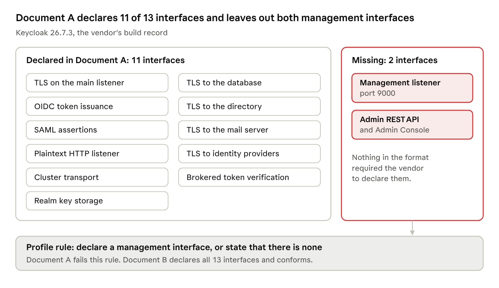
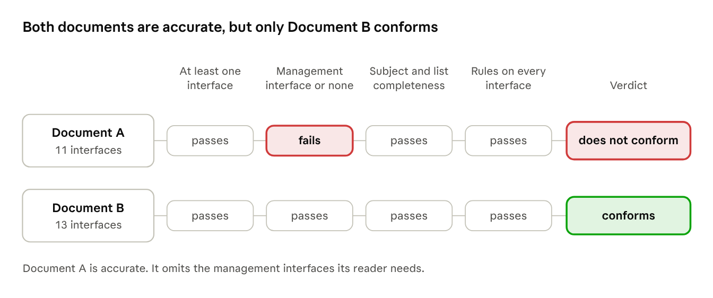
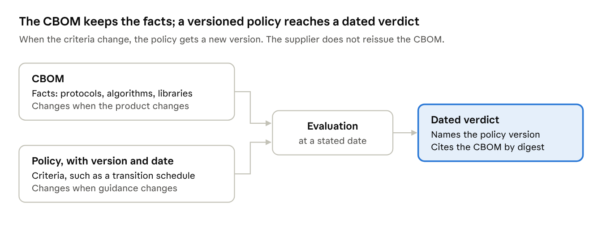
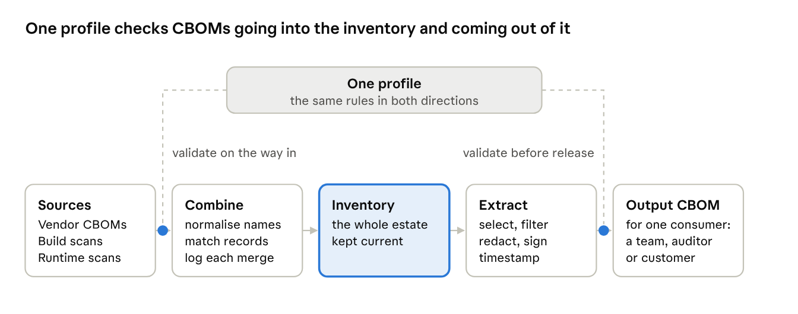
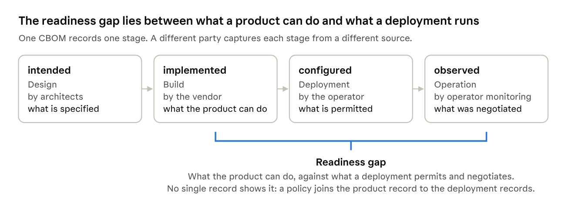

CBOM Profiles — Publication 1: Foundations
==========================================

Working Draft 0.1 · Nov 13, 2026 ·

Status of the draft
-------------------

Working Draft 0.1 is a draft for comment from the PKI Consortium (PKIC) CBOM Profiles Working Group. It is the first of three publications that together form Release 1: Publication 1, Foundations; Publication 2, Profiles and conformance; and Publication 3, Applying the methodology. Release 1 records the methodology as the working group has applied it so far. When the publications are issued, they will move to a separate part of the PKI Consortium platform, where they will be governed. Later work on the methodology will start from these publications.

Each publication has its own status section, summary and version, and each publication can be reviewed independently of the others.

| No. | Publication              | Covers                                                                                                                                   |
|--------|----------------------------------|---------------------------------------------------------|
| 1   | Foundations              | The problem, the scope, the terms, and the reasons why CBOM data is difficult to use today                                               |
| 2   | Profiles and conformance | The model, profiles and their rules, attributes, depth families, conformance, facts and judgements, confidentiality and context pointers |
| 3   | Applying the methodology | Writing a profile, encoding it in a format, versions and governance, use cases and profile families, related work                        |

Publication 1 defines the vocabulary that the other two publications use. Its only requirement is that a profile which uses a term marked as normative uses that term with the meaning given in this publication.

**Ratification.** The working group ratifies its positions through this document. Every position is listed in *Positions put forward for ratification* at the end. The group works by lazy consensus: a position is ratified unless a member objects before comments close. Comments close four weeks after the draft is circulated to members. An objection names the position, says what is wrong with it, and proposes an alternative.

**Carrier format.** The examples, schemas and rules files are written in CycloneDX 2.0. Until Ecma International ratifies that release, field names follow the `2.0-dev` branch of the CycloneDX specification at commit `76f185c` (23 October 2026), and the working group's tests validate every example against that schema. When the release is published, the working group will compare the field names with the released schema and publish any changes as an editorial revision.

**Readers.**

-   **Profile authors:** sector bodies, buyers and regulators that want to write a profile to support their own decisions.

-   **CBOM producers:** vendors and tool makers that have to produce CBOMs which conform to a profile.

-   **CBOM consumers:** buyers, operators and auditors that evaluate a CBOM against a profile and act on the result.

The following table suggests where each kind of reader should start.

| Reader         | Read first                                                                                           | Then use as reference                                             |
|---------------------|------------------------------------------|------------------------------------|
| Profile author | Publication 1, chapters 1 to 3; Publication 3, chapter 13                                            | Publication 2, chapters 6 to 8; Publication 3, chapters 14 and 15 |
| CBOM producer  | Publication 1, chapters 1 and 2; Publication 2, 8.2, for the profile that the consumer has asked for | Publication 2, chapters 6 and 7; Publication 3, chapter 14        |
| CBOM consumer  | Publication 1, chapter 1; Publication 2, 6.7 and chapters 9 and 11                                   | Publication 2, chapter 10; Publication 3, chapter 16              |

**How to comment.** Open a discussion in the working group repository at [github.com/pkic/cbom](https://github.com/pkic/cbom), or write to the working group mailing list, cbom\@lists.pkic.org. Cite the chapter and paragraph.

Executive summary
-----------------

Regulators and buyers now ask suppliers for a cryptographic bill of materials (CBOM), and national migration plans call for one. The NIS Cooperation Group's coordinated implementation roadmap for post-quantum cryptography (June 2025) recommends a standardised format for cryptographic inventories. US memorandum OMB M-26-15 (24 June 2026, Appendix A, section 6) states that inventory data should populate a central CBOM, but it does not name a format.

A CBOM format states what a document may record, but it does not state what a document must record. A supplier can therefore deliver a CBOM that describes every declared interface accurately, and the reader may still be unable to make the decision for which the CBOM was requested. Asking for everything does not solve the problem, because the few facts that matter are then lost among thousands of others.

A **CBOM profile** addresses this problem. A profile is a short list of rules that states which attributes a CBOM must contain to support one stated decision by one stated reader. A profile is a minimum reporting requirement; it is neither a new format nor a schema. A profile sets a floor that protects the reader's ability to act, and it tells a producer what the producer is expected to disclose for that decision.

Each sector needs its own profiles, so the number of profiles grows quickly. For example, telecommunications, financial services and national regulators each need several. If every author defines profiles from the beginning, each in a different style, the profiles themselves become fragmented. Profiles would then recreate the fragmentation that they were intended to remove.

The working group therefore offers a **method** that any profile author can follow, instead of a catalogue of profiles. The method gives every author the same way to:

-   state the reader, the decision, and the actions between which the reader chooses;

-   choose the attributes that the decision needs, and define the meaning of each attribute;

-   state how a producer reports a value that it does not know or will not publish;

-   map the profile onto CycloneDX and SPDX without inventing a new format;

-   evaluate a document against the profile with a tool, and manage versions of the profile over time.

Profiles that are written with the same method can be compared, combined and checked by the same tools. The working group demonstrates the method on two examples: Keycloak 26.7.3, from the vendor's build record to an operator's observed deployment, and a protection IED for substation automation.

1. Introduction
---------------

A buyer may ask a question about a product that the product's CBOM cannot answer. A profile prevents this, because it states which facts the CBOM must contain.

### 1.1 The problem in one example

A vendor supplies Keycloak, an open-source identity server, as a container image, together with a CBOM. Keycloak 26.7.3 is the main example used throughout the methodology. The CBOM tells the buyer three things. First, the main HTTPS listener runs TLS 1.3, using the key exchange of the JDK 21 runtime in the image, with X25519 preferred. Second, tokens are signed with RS256 by default. Third, the operator supplies the server certificate. Every statement in the CBOM is true.

| Document A, as supplied |                                                                                                                                                                                                                                                                                      |
|-------------------------------------|---------------------------------------------------------------|
| Subject                 | Keycloak 26.7.3 (container image)                                                                                                                                                                                                                                                    |
| Stage                   | implemented (the vendor's build record)                                                                                                                                                                                                                                              |
| Interfaces declared     | 11: TLS on the main listener, OIDC token issuance, SAML, the plaintext HTTP listener, the connections to the database, directory, mail server and identity providers, brokered verification of tokens from those identity providers, the cluster transport and the realm key storage |
| Not declared            | The Admin REST API and Admin Console, and the management listener on port 9000                                                                                                                                                                                                       |

Three months later, a weakness is published that affects the interfaces an administrator uses to manage the server. The buyer must first decide whether this product is affected. If it is, the buyer must then find out which of the several hundred instances that it operates are exposed. The vendor's product record can answer the first question. Only the buyer's own deployment records can answer the second.

Document A cannot answer the first question. It describes the interfaces that serve users and the interfaces that connect to other systems, but it says nothing about the interfaces to which an administrator connects. The vendor was not careless: it described eleven interfaces accurately and completely. However, nothing required the vendor to declare the management interfaces as well.

{width="6.0in" height="3.464284776902887in"}

Document A against the full product: 11 interfaces declared, 2 management interfaces missing

A CBOM format defines what a document may record, but it does not define what a document must record. A vendor that responds to a request for a CBOM with Document A has complied with the format, but the buyer is no better informed. Document A is not unusual. It is the normal result when a buyer asks a supplier for a CBOM without stating what the CBOM is for.

### 1.2 Why asking for everything does not work

The obvious remedy is to ask for everything, but this makes the problem worse. A large product performs thousands of cryptographic operations. A document that lists all of them hides the two or three facts on which a particular decision depends. Moreover, in practice no supplier would produce such a document.

There is no absolute standard of completeness for a CBOM, because completeness can be judged only in relation to a purpose. The question "does this document contain everything?" cannot be answered. The question "does this document contain what this decision needs?" can be answered, but only if the decision has first been written down in a form that a machine, and not only a person, can check.

### 1.3 What a profile does

A profile names its reader, the decision that the reader makes, and the actions between which the reader chooses. It then lists the attributes that the decision needs. The example profile used in the methodology is the Interface Disclosure Baseline, which is summarised in the following table.

| The Interface Disclosure Baseline |                                                                                                                                                                                   |
|--------------------------------------------|--------------------------------------------------------|
| Reader                            | An operator or purchaser that holds a product which it did not build and cannot inspect, and that maintains a cryptographic inventory across an estate                            |
| Decision                          | When a weakness is published that affects an algorithm, a protocol version or a library: which deployed interfaces are affected, and what has changed since the previous record   |
| Actions                           | Record the interfaces and do nothing more. Reconfigure, upgrade or isolate an affected interface. Ask the producer for a fuller disclosure. Reject the submission as insufficient |

Because the actions are named, anyone can justify or challenge each rule in the profile by asking whether the rule helps the reader to choose between them. A reader that has only one available action is not making a decision. A profile written for such a reader therefore has no means of testing whether it asks for the right information.

One rule in the baseline requires a document either to declare at least one management interface or to state that there is none. Document A fails that rule. The vendor's complete build record, Document B, declares all thirteen interfaces and passes the rule.

| Check                                                         | Document A             | Document B             |
|----------------------------------------------|---------------------------|---------------------------|
| At least one cryptographic interface                          | passes                 | passes                 |
| A management interface, or a statement that there is none     | **fails**              | passes                 |
| Subject identified, completeness of the interface list stated | passes                 | passes                 |
| Attribute rules on every declared interface                   | passes (11 interfaces) | passes (13 interfaces) |
| Verdict                                                       | does not conform       | conforms               |

{width="6.0in" height="2.508928258967629in"}

Document A and Document B against the baseline · four checks

Both documents pass three of the four checks. Document A fails the management-interface check, and therefore only Document B conforms.

Document A contains no false statement. It fails because conformance is measured against what a decision needs. Whether the statements in a document are true is a separate question. The purpose of a profile is to detect exactly this kind of failure, in which an accurate document omits the one thing that its reader needs. A check based only on the format cannot detect such an omission.

### 1.4 Facts in the CBOM, judgements in policy

No rule in the baseline asks whether the cryptography is adequate. Whether a product is ready for post-quantum cryptography is not a fact about the product; it is a judgement made against criteria that change over time. The CBOM therefore contains only the facts. A separate, versioned policy reaches the verdict, and the verdict records the date on which it was reached. As a result, a reader can tell which criteria produced the verdict, and a supplier never has to reissue a CBOM because the criteria have changed.

{width="6.0in" height="2.267856517935258in"}

Facts in the CBOM, judgement in a versioned policy

### 1.5 Four disclosure states

For a single attribute, neither CycloneDX 2.0 nor SPDX 3.0.1 distinguishes a withheld value from an unknown value. SPDX has the values NOASSERTION and NONE, and CycloneDX records completeness only for whole sets of components. The methodology distinguishes four disclosure states, because the reader acts differently in each case. Section 3.3 defines the four states.

A reader can act on each of the first three states. For the fourth state, the reader can only guess at the reason for the missing value. For example, a buyer that cannot distinguish a deliberate omission from an oversight has no basis on which to ask the supplier to correct it.

2. Scope
--------

The methodology defines how to write CBOM profiles for existing bill of materials formats. It does not create a new format, a new data model or a new standard. A profile written with the methodology states which attributes an existing CycloneDX or SPDX document must contain for one stated purpose.

### 2.1 What the methodology covers

-   **A method for defining profiles.** Every profile author follows the same steps to state the reader, the decision, the attributes, the meaning of each attribute, and the rules that a document must meet.

-   **Mapping to existing formats.** Every attribute is defined once, independently of any format. Mapping guidance then shows where the attribute is written in CycloneDX and in SPDX, which are the two initial target formats.

-   **Conformance.** A tool can evaluate a document against a profile and report, rule by rule, which rules passed, which failed, and the reason for each failure.

-   **Worked examples.** Reference profiles show how the method is applied. The methodology works through two examples: Keycloak 26.7.3, from the vendor's build record to an operator's deployment records, and a protection IED for substation automation.

-   **Change over time.** Profiles have versions. The methodology states how a profile changes, how a producer can tell whether a new version requires more work from it, and how older CBOMs are to be read.

### 2.2 What the methodology does not cover

-   **A base BOM standard or a cryptographic ontology.** The working group builds on CycloneDX and SPDX. Where a format cannot carry a fact, the methodology states this instead of extending the format.

-   **Profiles for every industry.** The working group supplies the method and the examples. Sector bodies, buyers and regulators write the profiles that support their own decisions.

-   **Certification.** The working group does not certify profiles written by others, or CBOMs produced against those profiles, and it does not operate a validation service.

-   **Judgements about cryptography.** A profile requires facts. Whether those facts represent an acceptable risk, a compliant product or post-quantum readiness is decided by a separate, versioned policy.

-   **Secrets.** Private keys, key material and seeds are outside every profile. A CBOM describes how keys are used and protected, but it never contains the keys themselves.

### 2.3 What a profile applies to

A profile is written for a kind of subject, and not for a particular subject. For example, the baseline names no product and no particular interface. It applies to any product or deployment that applies cryptography at an interface, whether through TLS, SSH, IPsec, signed tokens or protected storage. Keycloak is used only as the example subject.

A profile declares three properties of the documents that it accepts, as shown in the following table.

| Declaration     | Values                                        | Why the reader needs it                                                                                                                                                                                                                                                                                                          |
|--------------------|----------------------------|-----------------------------------------------------|
| Subject type    | product, deployment, service or system        | A vendor writes a product record. An operator writes a deployment record, a provider writes a service record, and an integrator writes a system record. Each of these three kinds of record cites the product records on which it builds. A product is identified by a Package URL, and each of the other subjects by a tag URI. |
| Lifecycle stage | intended, implemented, configured or observed | The same attribute has a different meaning at each stage. At implemented, it records the default as shipped. At configured, it records what the deployment permits. At observed, it records what was seen in use.                                                                                                                |
| Orientation     | inventory, migration or both                  | An inventory profile describes the current state. A migration profile also asks about capability, readiness and obstacles to migration. The orientation therefore determines whether information about future states is in scope.                                                                                                |

A single CBOM can satisfy several profiles at the same time. For example, a document written for the baseline can also satisfy a procurement profile if it contains the additional attributes that the procurement profile requires.

### 2.4 Design principles

-   **Format independence.** A profile is defined in terms of attributes, and a mapping relates each attribute to a field in CycloneDX or SPDX. The design of a profile therefore does not depend on the release cycle of any one format.

-   **Simple mapping.** Every attribute must map cleanly onto both formats. An attribute that cannot be expressed simply in both formats is treated with suspicion.

-   **Practical definitions.** The method prefers definitions that a practitioner can apply to formal ontologies.

-   **Neutrality.** The method favours no vendor, tool or standards body. The deliverables are published openly in the PKI Consortium organisation on GitHub, under CC BY 4.0 or MIT.

-   **Facts, not judgements.** A CBOM records facts, which change when the product or deployment changes. Judgements, plans and context information change at other times or are held by other parties. They are therefore kept in separate documents, to which the CBOM points.

### 2.5 Conventions

Publication 1 is informative, except for the definitions in Chapter 3 that are marked *(normative)*. When a profile uses a term marked *(normative)*, it MUST use the term with the meaning given in this publication.

The key words MUST, MUST NOT, SHOULD, SHOULD NOT and MAY are to be interpreted as described in BCP 14 (RFC 2119 and RFC 8174) when, and only when, they appear in capitals.

Text in `code font` is an attribute name, a controlled value or a literal, and it appears in a CBOM document exactly as shown.

3. Terms and definitions
------------------------

The terms in this chapter are used in all three publications. Where a term is taken from another source, that source is named. Attribute names follow one convention. A name without a suffix, such as `keyExchange`, records the present state. A name with the suffix `Supported`, such as `keyExchangeSupported`, records a declared capability.

The definitions in 3.1, and the definition of *join* in 3.4, are marked *(normative)*. The other definitions summarise terms that are developed in Publications 2 and 3.

### 3.1 The model (normative)

| Term                                      | Definition                                                                                                                                                                                                                                                                                                                                                                                                                                                |
|-----------------------------------------------|-----------------------------------------------------|
| Cryptographic relationship (also: edge)   | The place where cryptography is applied between parties. A relationship is not itself a cryptographic asset; it uses cryptographic assets.                                                                                                                                                                                                                                                                                                                |
| Endpoint (also: node)                     | A party to a cryptographic relationship. An endpoint does not have to be a running host, and the parties to a relationship do not have to exist at the same time.                                                                                                                                                                                                                                                                                         |
| Cryptographic asset                       | An algorithm, protocol, certificate or key that a relationship uses. The term corresponds to the CycloneDX component type of the same name.                                                                                                                                                                                                                                                                                                               |
| Cryptographic interface (also: interface) | A cryptographic relationship through which two parties exchange data, either live, as in a TLS session, or across time, as when key material is written to storage and read back later. An interface is a logical boundary and is not the same as a port. Two layers of cryptography on one port are two interfaces. For example, the TLS session on Keycloak's HTTPS listener and the signed OIDC tokens carried inside that session are two interfaces. |
| Application-layer interface               | An interface whose protocol operates above the transport layer, such as OIDC, SAML, an administrative API or plain HTTP. An application-layer protocol is counted as an interface when it applies cryptography of its own, or when anyone can reach it without transport protection.                                                                                                                                                                      |
| Node fact and edge fact                   | A node fact is a property of a thing, for example "the product supports AES-256-GCM". An edge fact is a property of one use of that thing, for example "this connection negotiated AES-256-GCM". An asset inventory records node facts, but a migration decision needs edge facts.                                                                                                                                                                        |

### 3.2 Profiles and conformance

| Term                                       | Definition                                                                                                                                                                                                                                                                                                                                                                                                                                  |
|-----------------------------------------------|-----------------------------------------------------|
| Profile (also: PKIC CBOM profile)          | A set of rules, expressed independently of any format, that states which attributes a CBOM must contain for a stated objective. A profile sets a minimum reporting requirement. The machine-readable rules file of a profile is normative.                                                                                                                                                                                                  |
| CycloneDX profiles                         | A different concept from a PKIC CBOM profile. CycloneDX 2.0 has a `profiles` element, which holds reusable data and threat characterisations. Where the two concepts could be confused, authors should write "PKIC CBOM profile".                                                                                                                                                                                 |
| Objective                                  | The reader that a profile serves, the decision that the reader makes, and the decision options, which are the actions between which the reader chooses.                                                                                                                                                                                                                                                                                     |
| Profile scope                              | The boundary that a profile declares: the subject types that it accepts, its orientation, the relationship types that its rules constrain, and the lifecycle stages that it accepts.                                                                                                                                                                                                                                                        |
| Orientation                                | Whether a profile reports the present state (`inventory`), capability for a future state (`migration`), or `both`.                                                                                                                                                                                                                                            |
| Subject type                               | The kind of thing that one document describes, such as a `product` or a `deployment`. Each document declares its own subject type.                                                                                                                                                                                                                                                      |
| Deployment                                 | One installation of one or more products, run by an operator. A deployment has no Package URL. Instead, it is identified by a tag URI (RFC 4151), such as `tag:example.org,2026:deployment/sso-prod`.                                                                                                                                                                                                             |
| Conformance level                          | MUST, SHOULD or MAY. Only rules at the MUST level determine the verdict.                                                                                                                                                                                                                                                                                                                                                                    |
| Product-level rule (also: structural rule) | A rule about the set of interfaces that a document declares, such as a rule that requires a particular kind of interface. A product-level rule can detect an omitted interface, which a rule about one attribute cannot do.                                                                                                                                                                                                                 |
| Per-interface rule                         | A rule applied in the same way to every declared interface.                                                                                                                                                                                                                                                                                                                                                                                 |
| Reference rule                             | A rule that requires a document to point to an artefact that the document does not contain, such as its SBOM or the place where its vulnerability statements are published. Conformance checks the pointer, but does not evaluate the content of the artefact to which it points.                                                                                                                                                           |
| Stated absence                             | A structural rule is met either when the required item is present, or when the document states explicitly that the item is absent. A document that says nothing about the item meets neither condition.                                                                                                                                                                                                                                     |
| Withholdable                               | A property of a rule. A withholdable rule accepts a `withheld` marker in place of a value.                                                                                                                                                                                                                                                                                                                        |
| Literal value                              | A fixed word that is accepted in place of an algorithm: `none` (no algorithm performs this function), `deployment-defined` (the operator chooses) or `peer-defined` (the other endpoint decides). The last two values are accepted only in a product record at the implemented stage. In a deployment record, the operator knows the value and must state it. |
| Cryptographic purpose                      | The function that cryptography performs at a relationship, such as establishing a key, encrypting data or proving identity. A migration timetable applies to a purpose, and not to an operation. For example, a certificate signature and a firmware signature use the same operation, but they are migrated years apart.                                                                                                                   |
| Verdict                                    | The result of evaluating one document revision against one profile version: conforms, does not conform, or refused.                                                                                                                                                                                                                                                                                                                         |
| Refused                                    | The outcome when the format version of a document is below the minimum that the profile accepts. No evaluation takes place, and the refusal makes no statement about the content of the document.                                                                                                                                                                                                                                           |
| Conformance claim                          | A statement by a named party that one revision of a document was evaluated against one version of a profile, together with the verdict. A claim is self-declared when the producer makes it, and attested when another party makes it.                                                                                                                                                                                                      |
| Extension                                  | A profile that inherits every rule of another profile, called its base, and that states only additions and tightenings.                                                                                                                                                                                                                                                                                                                     |
| Monotonic extension                        | The rule that a derived profile may add rules and tighten them, but may never relax them. As a result, a document that conforms to the derived profile also conforms to the base profile.                                                                                                                                                                                                                                                   |
| Profile family                             | A set of profiles related by extension.                                                                                                                                                                                                                                                                                                                                                                                                     |
| Depth                                      | The amount of information that a profile asks for about the same decision. A deeper profile adds rules without changing the decision that the family serves. The shallowest member of a family is its entry profile.                                                                                                                                                                                                                        |
| Branch                                     | A derived profile that serves a different decision, which can be recognised by its different objective or orientation. A branch is a different kind of extension from a deeper profile.                                                                                                                                                                                                                                                     |
| Audience                                   | The parties that may hold a document, which determines what the document may contain. A profile expresses its audience through its choice of withholdable rules.                                                                                                                                                                                                                                                                            |

### 3.3 Disclosure states

Any attribute can be in one of four disclosure states. The 2026 SBOM minimum elements require an author to state whether missing information is unknown or has been deliberately withheld. However, neither CycloneDX 2.0 nor SPDX 3.0.1 has a marker for these states on individual attributes.

| State      | Meaning                                                       | What the reader can do                                                            |
|--------------|---------------------------------------|----------------------------------------------|
| value      | The producer knows the value and has published it             | Use the value                                                                     |
| withheld   | The producer holds the information and declines to publish it | Negotiate access to the information, for example under a non-disclosure agreement |
| unknown    | The producer does not have the information                    | Give less weight to the record, or ask the producer to improve its tooling        |
| undeclared | Neither a value nor a marker was supplied                     | Only guess which of the other three states applies                                |

Publication 2, 6.6 describes how each state affects the outcome of a rule.

### 3.4 Lifecycle and records

| Term                            | Definition                                                                                                                                                                                                                                                                                                                                                                                                                                                                                                                                          |
|------------------------------------------|----------------------------------------------------------|
| Lifecycle stage (capture phase) | The source of the facts in a document: `intended`, `implemented`, `configured` or `observed`. Each document has exactly one stage.                                                                                                                                                                                                                                                                                                          |
| intended                        | Cryptography specified at design time. A record at this stage makes no statement about what was built.                                                                                                                                                                                                                                                                                                                                                                                                                                              |
| implemented                     | Cryptography present in the product as built. At this stage, a value records the default as shipped.                                                                                                                                                                                                                                                                                                                                                                                                                                                |
| configured                      | Cryptography that the deployed configuration permits.                                                                                                                                                                                                                                                                                                                                                                                                                                                                                               |
| observed                        | Cryptography seen on the network or in the running system during a stated period. A record at this stage is a snapshot.                                                                                                                                                                                                                                                                                                                                                                                                                             |
| Product record                  | A CBOM that describes a product as built. The vendor writes it at the `implemented` stage, and identifies the product by a Package URL.                                                                                                                                                                                                                                                                                                                                                                                   |
| Deployment record               | A CBOM that describes one deployment. The operator writes it at the `configured` or `observed` stage, and cites the records on which it builds.                                                                                                                                                                                                                                                                                                                                                 |
| Service record                  | A CBOM that describes a managed service as its provider runs it for customers. The provider writes it at the `configured` or `observed` stage, and cites the records on which it builds. Publication 2 defines a profile for service records, Service Disclosure, which has a restricted variant.                                                                                                                                                                                               |
| System record                   | A CBOM that describes one system design as its integrator delivers it, for example a substation automation system that is built at many sites. The integrator writes it at the `configured` stage, and cites the product records of the system's components. A system record lists every interface of each component, states whether the design uses that interface, and names the component that provides its keys. Publication 2 defines a profile for system records, System Disclosure, which sector overlays extend. |
| Cited document                  | A record on which a deployment record builds. The deployment record cites it by a document reference and a SHA-256 hash of the cited document. In CycloneDX, the document reference is a BOM-Link.                                                                                                                                                                                                                                                                                                                                                  |
| Join (normative)                | Reading two records together, without merging them, by following the pointer from a deployment interface to the product interface that it realises. Only implementation facts, such as the implementing library, are carried across a join. A pointer to the interface at the other end of a connection joins the two ends of that connection in the same way.                                                                                                                                                                                      |
| Readiness gap                   | The difference between what a product can do and what a deployment permits and negotiates. A policy computes the readiness gap from joined records, and no record stores it.                                                                                                                                                                                                                                                                                                                                                                        |
| Revision state                  | The states through which a document passes: created, signed, published and superseded. The revision state is distinct from the lifecycle stage.                                                                                                                                                                                                                                                                                                                                                                                                     |
| Provenance                      | The record of how a CBOM was produced: the generating tool and its version, the tool's inputs, the lifecycle stage, and any mechanical upgrade that was applied.                                                                                                                                                                                                                                                                                                                                                                                    |

### 3.5 Formats and versions

| Term                   | Definition                                                                                                                                                                                                              |
|-----------------------------------|-----------------------------------------------------------------|
| Carrier format         | The format in which a CBOM is written, such as CycloneDX or SPDX. The carrier format is distinct from the profile that is expressed in it.                                                                              |
| Mapping                | The statement of where each profile attribute is written in a given format. Where the format permits several locations, the mapping names one canonical location.                                                       |
| Acceptance range       | The format versions that a profile accepts, stated as a minimum version and a tested version.                                                                                                                           |
| Version bands          | The four bands into which a format version can fall: refused, below the minimum version; legacy, from the minimum version up to the tested version; target, at the tested version; and newer, above the tested version. |
| BOM-Link               | A CycloneDX URN that identifies a document by its serial number and version (`urn:cdx:<serial>/<version>`), and optionally identifies one element within it.                              |
| Encoding normalisation | Agreement on where a value is written, in cases where a format permits more than one valid location.                                                                                                                    |
| Naming normalisation   | Agreement on how a value is expressed, so that equal values can be matched. For algorithms, the CycloneDX Cryptography Registry provides this agreement.                                                                |
| Content revision       | One of a succession of versions of a CBOM for the same subject.                                                                                                                                                         |

### 3.6 Inventory and exchange

| Term                                         | Definition                                                                                                                                                                                                                                                    |
|-----------------------------------------------|-----------------------------------------------------|
| Cryptographic inventory                      | An organisation-wide, continuously maintained record of the cryptography in use, built from CBOMs and other sources.                                                                                                                                          |
| Extracted CBOM                               | A snapshot, limited in scope, that is taken from an inventory for one consumer, and filtered and redacted as required.                                                                                                                                        |
| Disclosure variant                           | One of two or more documents about the same subject and revision that differ only in which values are replaced by a `withheld` marker. For example, a public variant and a restricted variant are prepared for different audiences. |
| Redaction                                    | Replacing a value with a `withheld` marker when the document is released. Publication 2, 11.1 explains why deleting the value instead is worse.                                                                                     |
| Central, distributed and federated inventory | Arrangements for where inventory data is held. In a federated arrangement, a profile defines the subset of data that is passed up to the higher level, so that separate inventories can be compared.                                                          |

### 3.7 Judgements and policy

| Term                                | Definition                                                                                                                                                                                                                                                                                                                   |
|---------------------------------------------|-------------------------------------------------------|
| Fact                                | Something that a producer observes or declares, and records in the CBOM.                                                                                                                                                                                                                                                     |
| Derived judgement (also: judgement) | A conclusion drawn from facts by applying criteria that change over time. An external policy produces the judgement at the time when the question is asked, and records the date. A judgement is never stored as a CBOM attribute.                                                                                           |
| Policy                              | Versioned data, together with the name of the evaluation method that applies it.                                                                                                                                                                                                                                             |
| Policy result                       | The output of a policy evaluation. A policy result names the policy version and the evaluation date, and identifies by digest every CBOM that was read.                                                                                                                                                                      |
| Post-quantum posture                | Whether the algorithms at an interface are considered quantum-safe under current guidance. Post-quantum posture is a judgement, and is therefore never recorded as an attribute.                                                                                                                                             |
| Advisory                            | A statement by a third party that a named component, in a stated range of versions, has a named weakness.                                                                                                                                                                                                                    |
| VEX statement                       | A producer's judgement that its product is, or is not, affected by a named advisory. VEX statements are kept separate from the CBOM.                                                                                                                                                                                         |
| Implementation defect               | A weakness in code that performs cryptography. An implementation defect has a range of affected versions, a patch, and an identifier in a vulnerability feed.                                                                                                                                                                |
| Algorithm or parameter weakness     | A weakness in a choice of algorithm or parameter, as distinct from a weakness in code. Examples are a deprecated algorithm, or a classical key exchange when the adversary has a quantum computer. A weakness of this kind usually has no identifier, and the remedy is usually a configuration change or a product upgrade. |
| Harvest now, decrypt later          | Capturing encrypted traffic or stored ciphertext now, in order to decrypt it once a cryptographically relevant quantum computer exists. The exposure depends on how long the data must remain confidential.                                                                                                                  |

Publication 2 defines the attributes that profiles use, the controlled vocabularies of permitted values, and the literal values that are accepted in place of an algorithm.

### 3.8 Related artefacts

| Term                            | Meaning                                                                                                                                                                         |
|-------------------------------------------|---------------------------------------------------------|
| CBOM                            | Cryptography bill of materials: a structured description of the cryptography that a subject contains or uses, at a point in time.                                               |
| SBOM                            | Software bill of materials. A CBOM is read together with an SBOM, so that cryptography can be linked to the components that implement it.                                       |
| HBOM                            | Hardware bill of materials. An HBOM is needed where cryptography runs in hardware, or is bound to hardware.                                                                     |
| VEX                             | Vulnerability Exploitability eXchange: a statement that a product is or is not affected by a known vulnerability.                                                               |
| CSAF                            | OASIS Common Security Advisory Framework 2.0, a machine-readable format for advisories.                                                                                         |
| CVE                             | An identifier for one vulnerability in a component. A CVE is rarely issued only because a product uses an algorithm that guidance has deprecated.                               |
| CWE                             | A classification of weakness types. Cryptographic weakness types include CWE-326 (inadequate encryption strength), CWE-327 (broken or risky algorithm) and CWE-328 (weak hash). |
| purl                            | Package URL, the scheme used to name products and libraries.                                                                                                                    |
| OSV                             | Open Source Vulnerabilities, an advisory database that can be queried by Package URL.                                                                                           |
| CycloneDX Cryptography Registry | The registry of algorithm families and curves that was introduced with CycloneDX 1.7.                                                                                           |

### 3.9 Terms considered and not used

| Term                                                                 | Why it is not used                                                                                                                                                                                                                                                                                        |
|------------------------------------------------|----------------------------------------------------|
| Interface, as the general term                                       | The term is too narrow to serve as the general term, because it suggests two parties communicating at the same time. The methodology nevertheless treats storage as a type of interface, because the party that writes stored data and the party that later reads it are two parties to one relationship. |
| Cryptographic context, for a relationship                            | The term conflicts with its established use, in which a context is the runtime state of a cipher implementation.                                                                                                                                                                                          |
| Service CBOM                                                         | Replaced by *deployment record* for what an operator runs. A managed service that a provider offers to customers has its own subject type, and is described by a *service record*. In CycloneDX 2.0, "service" is a component type, so the earlier name could be misunderstood.                           |
| `pqcPosture`                               | It records a judgement. Its correct value changes when guidance changes, even though the product has not changed.                                                                                                                                                                                         |
| `vulnerable`, and any vulnerability status | It records a judgement that combines the facts in the CBOM with a third party's advisory. This judgement is carried in a VEX statement, separately from the CBOM.                                                                                                                                         |
| `plannedAvailability`                      | Replaced by `capabilityStatus`, `blockedBy` and `roadmapRef`. A date recorded on an interface copies one change event onto every interface that inherits the value.                                                         |
| Maturity level, for a profile                                        | A maturity level is a judgement about a product, made by an external policy. A level within a profile family is therefore called a depth.                                                                                                                                                                 |
| Tier, for a depth                                                    | The term is already used for a supplier's position in a supply chain.                                                                                                                                                                                                                                     |

### 3.10 Abbreviations

The three publications use the following abbreviations. Algorithm names, such as `AES-256-GCM`, and document numbers, such as RFC 8174, are not listed.

| Abbreviation  | Meaning                                                                    |
|-----------------------------|-----------------------------------------------------------------------|
| AEAD          | Authenticated encryption with associated data                              |
| ANSSI         | Agence nationale de la sécurité des systèmes d'information (France)        |
| API           | Application programming interface                                          |
| BCP           | Best Current Practice, an IETF document series                             |
| BOM           | Bill of materials                                                          |
| BSI           | Bundesamt für Sicherheit in der Informationstechnik (Germany)              |
| CA            | Certification authority                                                    |
| CBOM          | Cryptography bill of materials                                             |
| CDN           | Content delivery network                                                   |
| CISA          | Cybersecurity and Infrastructure Security Agency (United States)           |
| CRA           | Cyber Resilience Act (European Union)                                      |
| CSAF          | Common Security Advisory Framework                                         |
| CVE           | Common Vulnerabilities and Exposures                                       |
| CWE           | Common Weakness Enumeration                                                |
| DTLS          | Datagram Transport Layer Security                                          |
| EO            | Executive Order (United States)                                            |
| EST           | Enrollment over Secure Transport                                           |
| FBI           | Federal Bureau of Investigation (United States)                            |
| GDOI          | Group Domain of Interpretation                                             |
| GOOSE         | Generic Object Oriented Substation Event (IEC 61850)                       |
| HBOM          | Hardware bill of materials                                                 |
| HSM           | Hardware security module                                                   |
| HTTP, HTTPS   | Hypertext Transfer Protocol; HTTP over TLS                                 |
| IEC           | International Electrotechnical Commission                                  |
| IED           | Intelligent electronic device                                              |
| IEEE          | Institute of Electrical and Electronics Engineers                          |
| IETF          | Internet Engineering Task Force                                            |
| IR            | Interagency or Internal Report, a NIST document series                     |
| ISO           | International Organization for Standardization                             |
| JDK           | Java Development Kit                                                       |
| JOSE          | JSON Object Signing and Encryption                                         |
| LDAP          | Lightweight Directory Access Protocol                                      |
| ML-DSA        | Module-Lattice-Based Digital Signature Algorithm                           |
| ML-KEM        | Module-Lattice-Based Key-Encapsulation Mechanism                           |
| MMS           | Manufacturing Message Specification (ISO 9506)                             |
| NCSC-NL       | National Cyber Security Centre (Netherlands)                               |
| NIS           | Network and information systems, as in the EU NIS Cooperation Group        |
| NIST          | National Institute of Standards and Technology (United States)             |
| NSA           | National Security Agency (United States)                                   |
| NTIA          | National Telecommunications and Information Administration (United States) |
| OASIS         | Organization for the Advancement of Structured Information Standards       |
| OIDC          | OpenID Connect                                                             |
| OMB           | Office of Management and Budget (United States)                            |
| OSV           | Open Source Vulnerabilities                                                |
| OWASP         | Open Worldwide Application Security Project                                |
| PKI           | Public key infrastructure                                                  |
| PKIC          | PKI Consortium                                                             |
| PQC           | Post-quantum cryptography                                                  |
| PQCMM         | PQC Maturity Model of the PKI Consortium                                   |
| PTP           | Precision Time Protocol                                                    |
| PURL          | Package URL                                                                |
| RAM           | Random-access memory                                                       |
| REST          | Representational state transfer                                            |
| RFC           | Request for Comments, an IETF document series                              |
| R-GOOSE, R-SV | Routable GOOSE; routable SV                                                |
| SAML          | Security Assertion Markup Language                                         |
| SBOM          | Software bill of materials                                                 |
| SCITT         | Supply Chain Integrity, Transparency and Trust (IETF)                      |
| SLSA          | Supply-chain Levels for Software Artifacts                                 |
| SMTP          | Simple Mail Transfer Protocol                                              |
| SPDX          | Software Package Data Exchange                                             |
| SSH           | Secure Shell                                                               |
| SV            | Sampled Values (IEC 61850)                                                 |
| TC54          | Technical Committee 54 of Ecma International, which maintains CycloneDX    |
| TEE           | Trusted execution environment                                              |
| TLS           | Transport Layer Security                                                   |
| URI           | Uniform Resource Identifier                                                |
| URL           | Uniform Resource Locator                                                   |
| URN           | Uniform Resource Name                                                      |
| VEX           | Vulnerability Exploitability eXchange                                      |

4. Why CBOM data is hard to use today
-------------------------------------

CBOMs inherit both the strengths and the weaknesses of software bills of materials, and cryptography adds difficulties of its own. These difficulties are the reason why the methodology is based on profiles and is independent of any format. This chapter describes the position in November 2026. CycloneDX and SPDX are both under active development, and their maintainers are already closing several of the gaps described here. When a format adds a capability, the mapping for that format changes, but the profile remains the same.

### 4.1 Lessons from SBOM adoption

Experience with SBOMs since 2021 points to four properties that determine whether bills of materials can be used at scale. Each property applies equally to CBOMs that are exchanged between many suppliers and many consumers.

| Lesson        | What went wrong with SBOMs                                                                                                                                                          | What it means for CBOMs                                                                                                                                                                                      |
|-------------------|---------------------------------------|------------------------------------------|
| Harmonisation | Formats and delivery methods specific to individual vendors made it impossible to reconcile SBOMs at scale.                                                                         | Agree how each attribute is expressed, instead of mandating one format. A profile states what must be disclosed, and a mapping fixes where each attribute is written in each format.                         |
| Profiling     | Listing everything did not make a bill of materials more useful, because the many entries hid the few that mattered for a given decision.                                           | Define, for each objective, a minimum set of attributes specific to that purpose. A profile does exactly this.                                                                                               |
| Sequencing    | Many producers treated the published minimum as the most that they needed to supply. They met the minimum and went no further, and consumers had no basis on which to ask for more. | A profile may ask for part of the information first and defer the rest. However, it should still require a short status for the deferred part, so that the first stage does not become the permanent answer. |
| Normalisation | Producers represented the same value in different ways, which prevented automated processing.                                                                                       | Agree identifiers and attribute meanings, so that CBOMs from different producers can be compared.                                                                                                            |

Harmonisation is often understood as a demand for a single format. A single format is neither achievable nor necessary, for three reasons: organisations already use CycloneDX or SPDX, regulators and customers ask for different things, and the formats continue to change. What has to be consistent is the information, that is, which attributes are disclosed and where each attribute is written in a given document. A profile that is written once, with a mapping for each format, provides that consistency.

The 2026 Minimum Elements for a Software Bill of Materials take the same position. This guidance was published on 29 July 2026 by CISA, the NSA and the FBI, and co-sealed by agencies including ANSSI, BSI, NCSC-NL and NÚKIB. It states that supporting automation means supporting all widely used open formats, and it names both SPDX and CycloneDX. The same guidance supports four further positions that the methodology takes:

-   **Lifecycle stage on the document.** The new element *SBOM Generation Context* records the lifecycle phase at which the data was captured. For the same reason, the methodology records the stage of every CBOM.

-   **Format name and version as data.** A consumer needs to know which format and which version it is reading before it can evaluate the document.

-   **Signing and provenance.** The author's signature, the generating tool and the tool version, which were previously recommended as good practice, are now minimum elements.

-   **Unknown is not withheld.** The author must state whether missing information is unknown or has been deliberately withheld. A CBOM needs the same distinction.

The guidance also requires an SBOM to cover all components, including transitive dependencies, with no minimum depth. This requirement does not conflict with profiling. The guidance sets a floor for which components appear, whereas a profile states which attributes are mandatory for a stated purpose. A profile never allows a producer to omit components.

### 4.2 Difficulties specific to cryptography

**The formats model assets, not relationships.** CycloneDX models algorithms, keys, certificates and protocols as assets. Neither CycloneDX 2.0 nor SPDX 3.0.1 has an object for the place where cryptography is applied between two parties, such as one TLS connection. As a result, facts that belong to the connection, such as the roles of the endpoints in a session, are attached to a protocol asset instead.

**Cryptographic coverage differs between the formats.** SPDX 3.0.1 has no cryptographic model equivalent to the one in CycloneDX. Organisations that standardise on SPDX therefore often pair an SPDX document with a CycloneDX CBOM, which is referenced as a linked document. The SPDX 3.1 release candidate, published in January 2026, adds a vetted list of cryptographic algorithms. However, SPDX 3.1 had not been released in final form by November 2026.

**The same algorithm has many names.** For example, deployments show the same algorithm as `AES-256-GCM`, `AES256-GCM` and `aes_256_gcm`, and the bare name `AES256` omits the mode altogether. The CycloneDX Cryptography Registry, introduced with CycloneDX 1.7, provides stable identifiers for algorithm families and curves. CBOMs written to earlier versions contain free text, which the consumer has to normalise.

**The same fact can be written in several valid places.** Both formats allow one fact, such as the link between a certificate and its signature algorithm, to be encoded correctly in more than one way. A consumer that must accept every valid encoding has to maintain parsing logic for each of them. A mapping that fixes one canonical location for each attribute removes this cost.

**"Uses this algorithm" means four different things.** An algorithm may be intended in the design, implemented in the binary, configured in a deployment, or observed on the network. A vendor's build record and an operator's runtime scan can therefore both be correct and still differ. Unless the stage is stated, a consumer cannot tell whether a product is merely capable of something or is actually doing it.

**How much to disclose pulls in two directions.** Reporting too much hides the useful facts and can expose intellectual property, while reporting too little hides risk. Time adds a third pressure. Few suppliers can meet a mature profile today. However, a profile set at today's level will remain at that level in three years' time unless it states how the requirement will increase.

**Present and missing are not enough.** Most tooling treats an attribute as either present or missing, which reduces the four disclosure states in 3.3 to two. However, a vendor whose scanner cannot detect hardware cryptography is in a different position from a vendor that has chosen not to publish a library version. Neither CycloneDX 2.0 nor SPDX 3.0.1 has a native field for these cases, so the mapping has to define one.

**Tools miss some cryptography.** Automated tools can fail to detect cryptography that is loaded at runtime, that depends on configuration, or that is provided by hardware. A CBOM is therefore no more reliable than the process that produced it. Provenance, signing and the stage of capture determine how much weight a consumer can give to a CBOM.

**The algorithm alone is not enough.** A consumer also needs the library version, because the version determines whether a mode such as hybrid key exchange is available. The consumer also needs to know whether the algorithm runs in software, in a hardware security module or in a trusted execution environment, because the last two may require hardware to be replaced. CBOMs are therefore read together with SBOMs and hardware bills of materials, and the links between these documents are not yet mature.

**"Older" has three meanings.** A CBOM can be older because the format has been revised, because the profile has been tightened, or because the product's CBOM has been regenerated. Treating these three cases as one produces incorrect verdicts.

**The same asset is hard to recognise across tools.** An inventory is built from sources such as a vendor CBOM, a build scan and a runtime discovery tool, and each source names things in its own way. When nobody can show that two records describe the same asset, the inventory either counts the asset twice or merges two assets into one, and it reports neither error. The following table summarises the position for each class of asset.

| Asset class         | Identity available today                         | Assessment                                                                                                                                                                                        |
|---------------------------|---------------------|-----------------------------------------------------|
| Software components | Package URL                                      | Workable. A profile can require a Package URL for the implementing library.                                                                                                                       |
| Certificates        | SHA-256 fingerprint, or issuer and serial number | Workable, but tools disagree on which identifier to use.                                                                                                                                          |
| Keys                | No agreed identifier                             | The most difficult case. The methodology identifies an asymmetric key by the fingerprint of its public key, and a symmetric key by its role and storage location.                                 |
| Algorithms          | Several competing registry identifiers           | Use the format's registry where it has an entry for the algorithm, and otherwise use the protocol's own registry.                                                                                 |
| Interfaces          | A label that the producer chooses                | The label has no meaning outside its document. A deployment record therefore links each of its interfaces to the product interface that it realises, by an exact reference to the product record. |

### 4.3 CBOMs and the cryptographic inventory

A CBOM and a cryptographic inventory are related, but they are different things. The following table compares them.

| Property | CBOM                                         | Cryptographic inventory                                      |
|------------|-------------------------------------------|---------------------------------------------|
| Scope    | One product or system                        | The whole estate                                             |
| Form     | A document, such as a CycloneDX file         | A maintained dataset or register                             |
| Producer | A build pipeline, or a scan of one component | A central function that combines many sources                |
| Time     | A point in time, in versioned revisions      | Continuously maintained                                      |
| Purpose  | Disclosure and conformance for one subject   | Risk, compliance and migration planning for the organisation |

CBOMs are one of the main inputs to an inventory. The inventory normalises and correlates CBOMs from across the estate, together with the results of network and configuration discovery. Most of the difficulty lies in correlation, that is, in deciding which records describe the same thing. An inventory should therefore choose a join key for each class of asset, and record which key it used for each merge, so that every merge can be audited and corrected later.

Correlation has to be reliable over time as well as across tools. For example, to report migration progress, an inventory compares this quarter's records with the previous quarter's records. If the inventory cannot tell whether two records describe the same interface, it reports changes that did not happen and misses changes that did.

An inventory is also a source of CBOMs. An organisation extracts a CBOM from its inventory for one consumer, such as an internal team, an auditor, or a customer that has made a supply-chain request. The extracted CBOM is limited to its subject, filtered to what the consumer needs, redacted where confidentiality requires it, marked with its provenance, and signed where appropriate.

The same profile can be used in both directions. When CBOMs are supplied to the inventory, the inventory owner evaluates them against the profile. When a CBOM is extracted from the inventory, the owner evaluates it against the profile before releasing it. Similarly, a customer can name the profile that the CBOM it receives must satisfy, and the producer can evaluate the CBOM against that profile before sending it.

{width="6.0in" height="2.3660706474190727in"}

CBOMs into and out of a cryptographic inventory, checked by one profile

An inventory does not have to be a single database. In a federated arrangement, each business unit keeps its own detailed data and passes an agreed subset up to the higher level. A shared profile is most useful in this arrangement, because it makes the separately held subsets comparable.

### 4.4 Who knows what at each lifecycle stage

The meaning of a cryptographic fact depends on when it was captured and by whom. As the following table shows, each stage has its own producer and its own source of data.

| Stage       | Phase      | Producer                    | A value means                                                 | It does not establish                                                                         |
|-----------------|----------------|--------------|--------------------------|---------------------------|
| intended    | Design     | Architects                  | What the design specifies                                     | What was built                                                                                |
| implemented | Build      | The vendor's build pipeline | The product's default as shipped, and what the product can do | What any deployment enables                                                                   |
| configured  | Deployment | The integrator or operator  | What the deployed configuration permits                       | Whether live sessions match the configuration                                                 |
| observed    | Operation  | The operator's monitoring   | What was negotiated during an observation window              | Whether the value remains true, or what happens on paths that were not used during the window |

{width="6.0in" height="2.142856517935258in"}

The four lifecycle stages and the readiness gap

The four stages correspond to the *SBOM Generation Context* values in the 2026 minimum elements: *before build*, *build* and *after build*. The methodology divides *after build* into configured and observed, because post-quantum migration depends on the difference between what a deployment permits and what it actually negotiates.

At every stage, two kinds of error can occur. A false positive reports cryptography that is not in effect. A false negative misses cryptography that is in effect. The following table gives typical examples of each.

| Stage       | Typical false positive                                                     | Typical false negative                                                                                                |
|-----------------|----------------------------------|-------------------------------------------------|
| intended    | An algorithm specified but never implemented                               | Cryptography inside libraries that the design did not foresee                                                         |
| implemented | Compiled-in cipher suites that no deployment uses                          | Cryptography loaded at runtime, provided by hardware, or reached through dependencies that the scanner does not cover |
| configured  | An algorithm that the configuration permits but that no session negotiates | Built-in defaults and channels outside the inspected configuration                                                    |
| observed    | Cryptography seen only in a probe or a transient session                   | Failover, administrative and rarely used paths that were not used during the observation window                       |

False positives are most common at the early stages, where a design or a build reports what is possible instead of what actually runs. False negatives do not become less frequent at later stages, but they are of different kinds. For this reason, a consumer reads a vendor's product record together with an operator's deployment records, instead of relying on either alone. The difference between what a product can do and what a deployment permits and negotiates is called the *readiness gap*. Much of the work of post-quantum migration lies in this gap, and no single document shows it.

### 4.5 What a methodology has to provide

To remove these difficulties, a methodology has to provide the following seven things.

1.  **Profiling.** Limit what must be disclosed to what a stated decision needs, and state how the requirement will increase over time.

2.  **Normalisation.** Fix where each value is written in each format, and how each value is named.

3.  **Four disclosure states.** Allow a producer to state that a value is withheld or unknown, and allow a consumer to distinguish those states from silence.

4.  **Lifecycle stage.** Record the stage of every document, and join records from different stages instead of merging them.

5.  **Relationships.** Describe cryptography at the boundary where it is applied between parties, in addition to listing the assets.

6.  **Identity.** Require forms of identifier that allow records about the same asset to be matched across tools and over time.

7.  **Format independence.** Keep the profile separate from the formats, so that a change to a format requires a change to the mapping but not to the profile.

Publication 2 builds the profile and its conformance rules on these seven requirements.

Positions put forward for ratification
--------------------------------------

Each row is a position this publication takes. A position is ratified unless a member objects before comments close.

| \#  | Position                                                                                                                                                     | Section  |
|-----------|--------------------------------------------------------------------------|---------------|
| 1   | "Interface" is not used as the general term for a cryptographic relationship, and "cryptographic context" is not used for one.                               | 3.9      |
| 2   | "Service CBOM" is not used. An operator's record is a deployment record, and a provider's managed service has a service record.                              | 3.9      |
| 3   | A level within a profile family is called a depth. "Maturity level" is kept for a judgement about a product made by external policy, and "tier" is not used. | 3.2, 3.9 |
| 4   | A CBOM has one of four lifecycle stages. The *after build* phase of the 2026 minimum elements is split into configured and observed.                         | 3.4, 4.4 |
| 5   | Deliverables are published openly in the PKI Consortium organisation on GitHub, under CC BY 4.0 or MIT.                                                      | 2.4      |

Acknowledgements
----------------

The CBOM Profiles Working Group is chaired by Michael Osborne (IBM), with William (Bill) Turner as vice-chair. The full list of members and contributors will be added from the working group roster before release.

References
----------

### Normative references

A profile written with the methodology depends on the following documents.

-   IETF, RFC 2119, Key words for use in RFCs to Indicate Requirement Levels, March 1997; and RFC 8174, Ambiguity of Uppercase vs Lowercase in RFC 2119 Key Words, May 2017. Together they form BCP 14.

-   IETF, RFC 4151, The 'tag' URI Scheme, October 2005.

-   Ecma International, ECMA-424, CycloneDX Bill of Materials Standard, 2nd edition (CycloneDX 1.7), December 2025.

-   OWASP CycloneDX, CycloneDX Specification 2.0, branch 2.0-dev at commit 76f185c, 23 October 2026. Used until Ecma International ratifies the release.

-   OWASP CycloneDX, CycloneDX Cryptography Registry, 2025 onwards. https://cyclonedx.org/registry/cryptography/

-   Linux Foundation, SPDX Specification 3.0.1, December 2024. https://spdx.dev/

-   Package URL community, Package URL specification, current. https://github.com/package-url/purl-spec

### Informative references

-   Linux Foundation, SPDX Specification 3.1, release candidate, January 2026.

-   CISA, NSA, FBI and international partners, 2026 Minimum Elements for a Software Bill of Materials, 29 July 2026.

-   NTIA, The Minimum Elements for a Software Bill of Materials, July 2021.

-   NIS Cooperation Group, A Coordinated Implementation Roadmap for the Transition to Post-Quantum Cryptography, June 2025.

-   US Office of Management and Budget, M-26-15, Execution of the Migration to Post-Quantum Cryptography, 24 June 2026.

-   OASIS, Common Security Advisory Framework (CSAF) 2.0, 2022.

-   MITRE, Common Weakness Enumeration (CWE), current. https://cwe.mitre.org/

-   OpenSSF, Open Source Vulnerabilities (OSV) schema, current. https://osv.dev/

-   IETF, RFC 9846, The Transport Layer Security (TLS) Protocol Version 1.3, July 2026.

The working group's full reference register, with status and notes for each entry, is published at [github.com/pkic/cbom](https://github.com/pkic/cbom).
