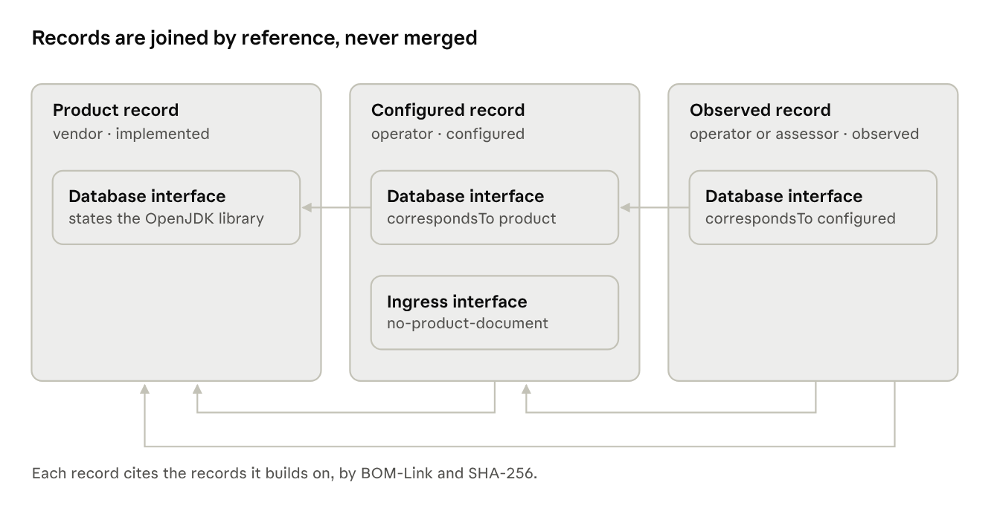
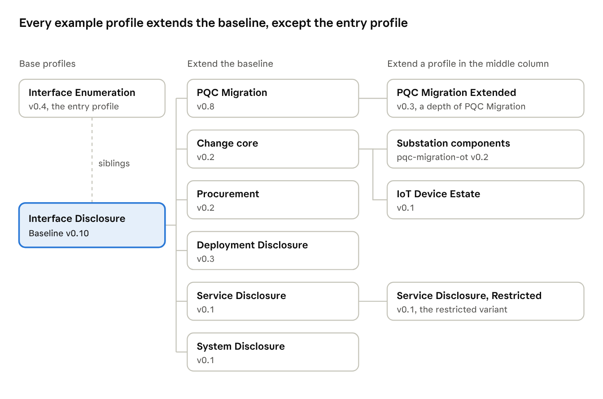
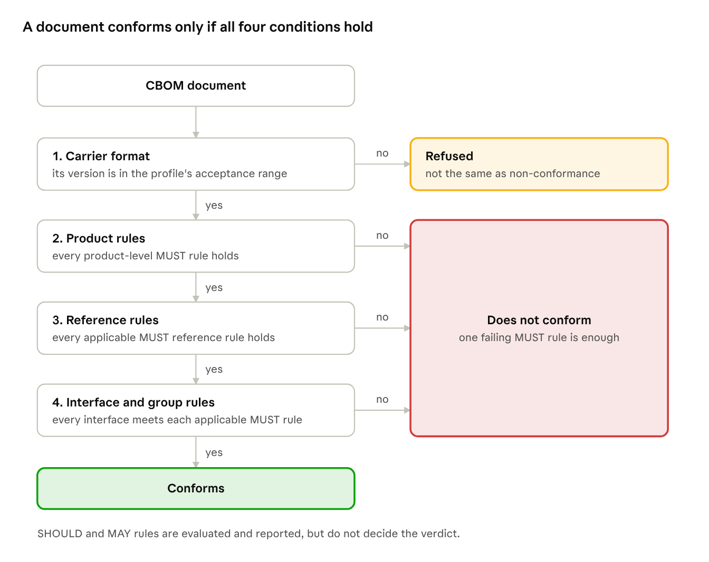
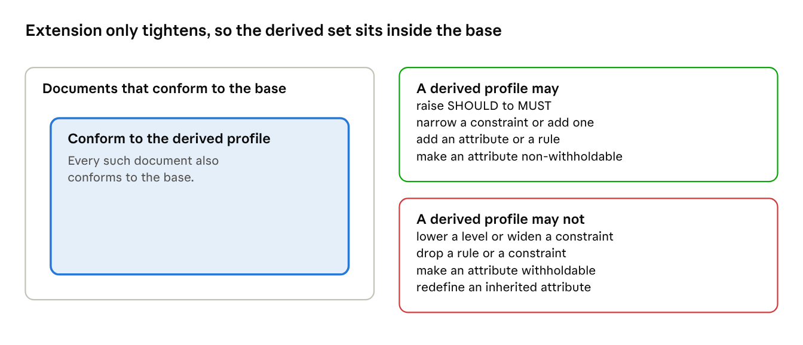
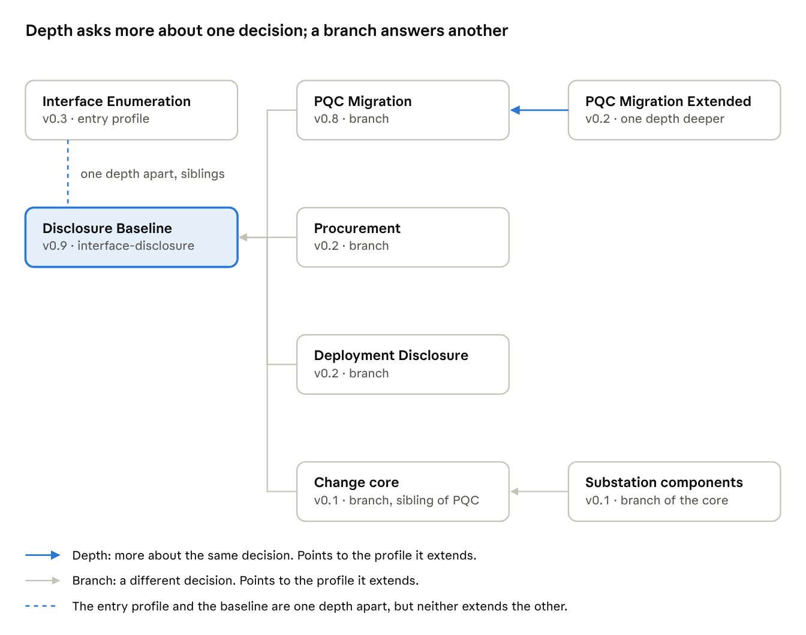
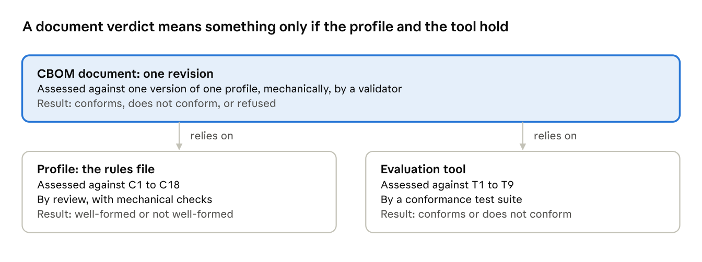

CBOM Profiles — Publication 2: Profiles and conformance
=======================================================

Working Draft 0.1 · Nov 15, 2026 · \@Mike

Status of the draft
-------------------

Working Draft 0.1 is a draft for comment from the PKI Consortium (PKIC) CBOM Profiles Working Group. It is the second of three publications that together form Release 1: Publication 1, Foundations; Publication 2, Profiles and conformance; and Publication 3, Applying the methodology. Release 1 records the methodology as the working group has applied it so far. When the publications are issued, they will move to a separate part of the PKI Consortium platform, where they will be governed. Later work on the methodology will start from these publications.

**Ratification.** The working group ratifies its positions through this document. Every position is listed in *Positions put forward for ratification* at the end. The group works by lazy consensus: a position is ratified unless a member objects before comments close. Comments close four weeks after the draft is circulated to members. An objection names the position, says what is wrong with it, and proposes an alternative.

**Carrier format.** The examples, schemas and rules files are written in CycloneDX 2.0. Until Ecma International ratifies that release, field names follow the `2.0-dev` branch of the CycloneDX specification at commit `76f185c` (23 October 2026), and the working group's tests validate every example against that schema. When the release is published, the working group will compare the field names with the released schema and publish any changes as an editorial revision.

**How to comment.** Open a discussion in the working group repository at [github.com/pkic/cbom](https://github.com/pkic/cbom), or write to the working group mailing list, cbom\@lists.pkic.org. Cite the chapter and paragraph.

Executive summary
-----------------

A CBOM profile states the minimum information that a document must disclose to support one decision, such as procurement or post-quantum migration. The rules of a profile describe cryptographic interfaces, which are the places where a product uses cryptography with another party. Each required attribute ends in one of four states: a value, `withheld`, `unknown` or `undeclared`. A `withheld` marker passes where the rule allows withholding. The states `unknown` and `undeclared` fail, and they are reported separately. A producer can therefore keep a fact confidential, where the rule permits it, and still conform, provided that the producer declares that the fact is withheld.

Profiles are extended monotonically. A derived profile adds rules or tightens them, and never relaxes them. As a result, a document that meets a deeper profile also meets that profile's base. Profiles form families at named depths. A restricted profile, intended for a named audience, derives from the corresponding public profile.

A verdict states that one revision of one document discloses at least what one version of one profile requires. A verdict does not state that the facts are true, that the cryptography is adequate, or that the product has no known vulnerabilities. Those statements are judgements. Judgements are made by an external, versioned policy and recorded in a dated result, and they are never stored in the CBOM. The example algorithm-transition policy now follows the final version of NIST IR 8547, under which every quantum-vulnerable algorithm is deprecated after 2030 and disallowed after 2035.

A CBOM points to the context information that it does not itself contain, such as the SBOM, VEX statements, advisories, the configuration source and the operator's data register. The rules of a profile check those pointers, but they do not evaluate the content of the artefacts to which the pointers lead.

The examples are pinned to the CycloneDX 2.0 draft at commit `76f185c`. The working group ratifies the positions in this document by lazy consensus. They are listed together at the end.

Conventions
-----------

Requirements in Publication 2 are normative. They are numbered (C1 to C18 for a profile, T1 to T11 for an evaluation tool) and use the key words MUST, MUST NOT, SHOULD, SHOULD NOT and MAY as described in BCP 14 (RFC 2119 and RFC 8174), when, and only when, they appear in capitals. Definitions marked *(normative)* bind any profile that uses the term. All other text, the examples and the diagrams are informative.

Publication 1 defines the terms used here, and its section 3.10 lists the abbreviations.

Text in `code font` is an attribute name, a controlled value, a literal or a file name, and it appears in a CBOM document or in the repository exactly as shown. A rule is cited in the form `tag#id`, for example `interface-disclosure#P2`. The tag identifies the profile, and the identifier identifies the rule within that profile.

The example profiles are the twelve profiles published in the working group repository. Their machine-readable rules files are normative for the examples. Where this text and a rules file disagree, the rules file is correct, and the text will be corrected.

This publication uses four verbs with distinct meanings. A tool *evaluates* a document against a profile, or a set of CBOMs against a policy, and the outcome is a verdict or a result. A rule, or a named checker such as [`check_profile.py`](../../docs/methodology/check_profile.py), *checks* one condition. Anyone who holds a claim *verifies* the claim by running the evaluation again. A schema *validates* the format of a document.

5. The model
------------

Most of the questions that a CBOM is used to answer concern how a product uses cryptography, rather than which cryptography the product contains. The question "Which algorithms does this product implement?" is about the product's inventory. The question "Which of our connections could an adversary read if it recorded them today?" is about where the product applies cryptography, which parties are involved, and which algorithms and parameters those parties negotiate. Migration planning, procurement and incident response depend mainly on questions of the second kind.

CycloneDX is well suited to questions of the first kind, because it has objects for algorithms, keys, certificates and protocols. SPDX 3.0.1 has no such objects, and the SPDX 3.1 release candidate adds only a list of algorithm names. Neither format has an object that describes how two parties use those assets. As a result, facts about a connection are attached to whichever asset is closest to it. This works while a product has one obvious connection, but it becomes unreliable when a product has several. A profile rule such as "declare a management interface" can be evaluated only if the producer and the consumer count the product's interfaces in the same way.

### 5.1 The three terms in the Keycloak example

Publication 1, 3.1 defines the cryptographic relationship, the endpoint and the cryptographic asset. The table shows each in the Keycloak example.

| Term                       | In the Keycloak example                                                                                        |
|--------------------------------------|--------------------------------------------------------------|
| Cryptographic relationship | The TLS 1.3 session on Keycloak's HTTPS listener, and the OIDC token signature carried inside it               |
| Endpoint                   | The browser and Keycloak for TLS; Keycloak as issuer and the client application as relying party for the token |
| Cryptographic asset        | X25519, AES-256-GCM, RS256, the server certificate, and OpenJDK 21, which implements the TLS layer             |

Most rules in a profile are written about cryptographic interfaces, which Publication 1, 3.1 also defines. CycloneDX 2.0 has a separate blueprint object called "interface", with types such as `rest` and `cli`, which describes a deployed system for threat analysis. Where the two meanings could be confused, this publication writes "cryptographic interface" in full.

### 5.2 What counts as one interface *(normative)*

An interface is a logical boundary at which cryptography is applied. An interface is therefore not the same as a port, a listener or a socket. When two layers of cryptography protect the traffic on one port, each layer is a separate interface. For example, Keycloak's HTTPS listener on port 8443 carries three interfaces:

-   the TLS layer, whose key exchange comes from the JDK 21 in the image;

-   the OIDC token layer, whose authentication is the token signature, RS256 by default;

-   the SAML layer, with RSA-SHA256 signatures.

Each layer is recorded as a separate interface because each layer can move to post-quantum cryptography at a different time. The key exchange in Keycloak's TLS layer can change only when the Java runtime provides a post-quantum key exchange. ML-DSA token signing has been committed to the Keycloak source, but it depends on a JOSE key type that is still an Internet-Draft. A single entry for "port 8443" could not record both of these situations.

An application-layer interface is counted as a separate interface in two cases: when it applies cryptography of its own, or when anyone can reach it without transport protection. Keycloak's plaintext HTTP listener can be reached without protection, so it is counted as an interface and declares `none` for every algorithm. Keycloak's health and metrics endpoints apply no cryptography of their own and are served through the management listener, so the management listener's interface covers them. Without this rule, two producers that describe the same product could count different numbers of interfaces.

### 5.3 What the cryptography is for

A cryptographic relationship records where cryptography is applied, and a cryptographic asset records which cryptography is applied. A **cryptographic purpose** records what the cryptography is used for. There are seven purposes: establishing a key, encrypting data, proving identity, protecting integrity, producing a signature that must still verify years later, protecting keys, and deriving keys.

A purpose is different from a cryptographic operation. A signature on a TLS certificate and a signature on a firmware image use the same operations, sign and verify. The certificate signature proves identity for the duration of one session, and it can be changed whenever the certificate hierarchy changes. The firmware signature must still verify long after it was made, and it can be changed only when the last device in the field that verifies it has been upgraded. Although the operation is the same, the two signatures may need to migrate decades apart. For this reason, the purpose of a signature determines its migration timetable; the operation alone does not.

This has two consequences for profile authors. First, purposes do not divide assets into separate groups. AES-GCM, for example, provides encryption and integrity at the same time, so a rule such as "each algorithm has exactly one purpose" would be wrong. Second, a purpose is a property of a relationship and not of a product. The same product can therefore have a purpose that is settled at one interface and still open at another.

### 5.4 Node facts and edge facts

A node fact is a property of a thing, such as a product, a library or a certificate. An edge fact is a property of one use of that thing between two parties. An asset inventory records node facts, but a migration decision needs edge facts.

| Node fact                                  | Edge fact                                                                                         |
|-----------------------------------------------|-----------------------------------------------------|
| The product supports AES-256-GCM.          | This connection negotiated AES-256-GCM.                                                           |
| OpenJDK 21 is in the Keycloak image.       | OpenJDK 21 performs the key exchange on this interface.                                           |
| The device holds an ML-KEM implementation. | This link to the peer falls back to a classical group.                                            |
| The archive is encrypted with AES-256.     | The key that protects the archive is wrapped with RSA-2048 and must survive the retention period. |

The most common modelling error is to record a node fact and then use it to answer a question about an edge. The fact that a product can perform an operation does not show that a particular connection performs it.

A CBOM may state who is permitted to use a technical capability of the product, for example the parties from which the update mechanism accepts firmware. A CBOM does not record commercial terms, such as support periods, prices or service levels. Those terms are recorded in the contract between the parties.

### 5.5 How far the model reaches

A single TLS session makes the terms easy to state and easy to underestimate, because there are two obvious parties present at the same moment. Each case in the table breaks one assumption that the TLS case makes seem true.

| Relationship                              | Parties      | At the same time | What passes                              | What it shows                                                                             |
|-----------------------|----------------|---------|--------------|---------------------------------------|
| TLS session to a service                  | 2            | yes              | data in transit                          | the base case                                                                             |
| Termination at a proxy or CDN             | 2 per leg    | yes              | data in transit                          | one apparent connection is several relationships, and the hidden leg may be unprotected   |
| Encrypted backup or archive               | 2            | no               | data at rest                             | the parties are separated in time; the relationship lasts as long as the retention period |
| Code or firmware signing                  | 2            | no               | a signed artefact                        | the verifier, not the signer, limits which algorithm can be used                          |
| Token signature inside TLS                | 2 per layer  | yes              | data in transit                          | relationships overlap on one path, each with its own endpoints                            |
| IPsec gateway with many peers             | 2 per tunnel | yes              | data in transit                          | one asset supports many relationships with different posture                              |
| Negotiated fallback between capable peers | 2            | yes              | data in transit                          | capability is not the negotiated outcome                                                  |
| Modern gateway to legacy controller       | 2            | yes              | data in transit                          | the less capable party fixes what the relationship can use                                |
| Application to HSM or TEE                 | 2            | yes              | operation requests; the key stays inside | a relationship that carries no protected data                                             |

The Keycloak deployment example contains several of these cases. The operator ends TLS at an ingress and forwards plain HTTP to Keycloak inside the cluster. The ingress permits a hybrid post-quantum key exchange, but 29% of sessions observed between 18 and 25 October 2026 still negotiated X25519 alone. The corporate directory accepts TLS 1.2 only, so it fixes the protocol version on Keycloak's directory connection whatever Keycloak supports.

### 5.6 Product records, deployment records and joins

What a product can do and what a deployment does are kept in different documents, written by different parties. One document has one subject and one lifecycle stage.

| Record                       | Written by                        | Subject type                           | Stage                                                                          | A value means                                   | Subject identifier   |
|---------------|--------------|----------------|-----------------|-------------------------|-------------|
| Product record               | the vendor                        | `product`    | `implemented`                                        | the default as shipped                          | a Package URL        |
| Configured deployment record | the operator                      | `deployment` | `configured`                                         | what the deployment permits                     | a tag URI (RFC 4151) |
| Observed deployment record   | the operator or an assessor       | `deployment` | `observed`                                           | what was seen during the observation window     | the same tag URI     |
| Service record               | the provider of a managed service | `service`    | `configured` or `observed` | what the service runs for its customers         | a tag URI            |
| System record                | the integrator                    | `system`     | `configured`                                         | what one system design configures, as delivered | a tag URI            |

**Join** *(normative)*. Records are joined, not merged:

-   A deployment, service or system record cites each record it builds on by a document reference and a SHA-256 hash. In CycloneDX the reference is a BOM-Link, `urn:cdx:<serial>/<version>`, carried as an external reference of type `bom`.

-   Each interface of such a record names the product interface it realises in `correspondsTo`, or states `no-product-document` where the supplier of that part publishes no CBOM.

-   Only implementation facts, such as the implementing library, follow a join. Present-state facts never do, because each belongs to one stage.

-   If an evaluator is not given a cited record, it reports an inherited value as unresolved. An unresolved value does not fail the rule.

-   A deployment interface may name the interface at the far end of its connection in `peerInterface`. An evaluation that needs a fact about the connection joins the two ends. The connection is not an object of its own.

In the Keycloak example, the observed record's database interface names the configured record's database interface, which names the product record's database interface, which states the OpenJDK library. The configured record's ingress interface states `no-product-document`, because the ingress is not part of the Keycloak product.

{width="6.0in" height="3.089284776902887in"}

product, configured and observed records · joined by correspondsTo and by citation

The implementing library reaches the observed record only by following the joins. No record copies another.

### 5.7 Objects and how each is identified

| Object                  | Written by                        | Identified by                                                                                                                     |
|----------------------------|----------------------|--------------------------------------------------|
| Subject                 | nobody; it is the thing described | a Package URL for a product, a tag URI for a deployment, a service or a system                                                    |
| Cryptographic interface | the producer                      | `interfaceId`, a label with no meaning outside its document; across a join, a BOM-Link to the interface |
| CBOM revision           | the producer                      | serial number and version, and a SHA-256 digest when another artefact cites it                                                    |
| Profile                 | the profile author                | `profileId` and version                                                                                 |
| Rule                    | the profile author                | `tag#id`; an identifier is never reused                                                                |
| Conformance report      | an evaluation tool                | the document and profile it evaluated                                                                                             |
| Conformance claim       | whoever ran the evaluation        | the digest of the document it is bound to                                                                                         |
| Policy                  | the consuming organisation        | id, version and digest                                                                                                            |
| Policy result           | whoever evaluated the policy      | the policy, the evaluation date and the digests of the CBOMs it read                                                              |

Three things are deliberately not objects. A **judgement**, such as whether an interface is adequate, is produced by policy when the question is asked. An **attestation** that a value is true does not exist: a signature shows where a document came from, and a claim shows what was evaluated, but neither shows the facts are right. A **registry** for storing profiles and documents is left to whoever runs the inventory.

### 5.8 Limitation of this version

Version 1 of the model treats every relationship as pairwise. Some cryptography is shared by more than two parties at once: a broadcast or multicast group, or a group chat with one shared key. Splitting such a group into pairwise relationships loses what matters, which is the shared key and the set of parties that hold it. Group relationships are therefore not described in this version.

A signature verified by many parties is different. Each signer-to-verifier leg is pairwise and loses nothing. The attribute `verifierPopulation` (7.4), which PQC Migration Extended asks for at SHOULD, names who must verify, because the weakest verifier limits what the signer can use.

6. CBOM profiles
----------------

A profile is a short list of rules that states which attributes a CBOM must carry for one reader and one decision. The same rules serve two parties. For the producer, they are a specification of what to put in the document. For the consumer, they are a checklist of what to check before relying on the document. The example used throughout this chapter is the Interface Disclosure Baseline, version 0.10.

Rules describe kinds of interface and kinds of attribute. No rule may name a specific product, vendor or interface instance. The baseline therefore applies to any product, deployment, service or system that applies cryptography at an interface. Keycloak 26.7.3 is used only as an example subject.

{width="6.0in" height="3.9732141294838144in"}

the twelve example profiles and what each extends

In the figure, each line joins a profile to the profile that it extends. The entry profile and the baseline are siblings. Annex A gives the identifier and the file of each profile, and 8.2 describes the profiles.

### 6.1 Subjects and stages

A single baseline serves four types of subject. The rules describe an interface in the same way for every subject type. Only the form of the subject identifier and some of the reference rules differ.

| Subject type                           | Written by     | Stages                                                                       | Identifier                                                                                                               |
|----------------|-----------------|-----------------|--------------------------------------------------|
| `product`    | the vendor     | `implemented`                                      | a Package URL, such as `pkg:oci/keycloak?repository_url=quay.io/keycloak/keycloak&tag=26.7.3` |
| `deployment` | the operator   | `configured`, `observed` | a tag URI, such as `tag:example.org,2026:deployment/sso-prod`                                  |
| `service`    | the provider   | `configured`, `observed` | a tag URI, such as `tag:example.org,2026:service/managed-identity-eu`                          |
| `system`     | the integrator | `configured`                                       | a tag URI, such as `tag:integrator.example,2026:system/sas-110kv-reference`                    |

Each document records a single lifecycle stage, which is declared in the native CycloneDX field `metadata.lifecycles`: `build` for implemented, `operations` for configured and `discovery` for observed. A vendor's build record and an operator's scan are produced by different parties at different times. If both were combined in one document, the same boundary would be counted twice, and a producer could fill a gap at one stage with a value taken from another stage.

The baseline does not accept the stage `intended`, because a design intention says nothing about the interfaces that are actually deployed. A vendor's intention is recorded instead as a capability status under the PQC migration profile. An operator's intention is a requirement, stated in a policy or a tender. A design document is context, to which the record can point.

A document that records a stage which the profile does not accept does not conform to the profile. The evaluator reports this as a failure of I8 on each interface. The document is not refused, because its format is valid.

### 6.2 Four kinds of rule

| Kind               | Letter                        | Evaluated                                | What it can catch                                                             |
|----------------------|---------|----------------------|----------------------------------------------|
| Product rule       | `P` | once per document                        | an interface that was left out, or a missing identifier or stage              |
| Per-interface rule | `I` | once per declared interface              | a declared interface with a missing or invalid attribute                      |
| Group rule         | `G` | once per entry in a keyed group          | a missing answer for one purpose on an interface that serves several purposes |
| Reference rule     | `R` | once per document, or once per interface | a missing pointer to context that the document itself does not carry          |

The baseline contains the following product rules:

| Rule | The document must                                                                                                                                          | Level |
|-----------|---------------------------------------------------------------------------|--------------|
| P1   | declare at least one cryptographic interface                                                                                                               | MUST  |
| P2   | declare at least one management interface, or state why there is none                                                                                      | MUST  |
| P3   | identify its subject: a Package URL for a product, a tag URI for a deployment, a service or a system                                                       | MUST  |
| P4   | state how complete its interface list is: `all`, `all-external` or `partial` | MUST  |
| P5   | declare its subject type                                                                                                                                   | MUST  |
| P6   | declare one lifecycle stage, and report that stage on every interface                                                                                      | MUST  |

P1 and P2 detect omissions. Per-interface rules cannot detect an omission, because they see only the interfaces that a document declares. A product that has no configuration surface satisfies P2 by stating that it has none. What P2 prohibits is a document that says nothing about management interfaces at all.

**Product rules require disclosure.** P2 does not require a product to have a management interface. It requires the document to state whether the product has one, and to declare the interface if it does. If a document falsely states that there is no management interface, that is a misstatement by the producer, which the consumer can pursue under its contract. Whether a product should have a particular interface is a purchasing requirement, and it belongs in the contract.

An observed record can satisfy P2 in two further ways. If the observer could not reach the management interface, P2 passes when a configured record that the document cites declares a management interface. If an outside assessor has no configured record to cite, it states the reason `not-reached`, and the evaluator accepts this reason only when the document declares its coverage as `partial`.

The baseline contains the following per-interface rules:

| Rule | Attribute                                      | Level                                              | Notes                                                                                                                                    |
|--------|-------------------------|-----------------|---------------------------------------------------|
| I1   | `protocol`           | MUST                                               | not required on a storage interface                                                                                                      |
| I2   | `protocolVersion`    | MUST                                               | not required on a storage interface                                                                                                      |
| I3   | `keyExchange`        | MUST                                               | a registry identifier or a literal; not required on a storage interface                                                                  |
| I4   | `encryption`         | MUST                                               | a bulk encryption or AEAD algorithm, or a literal                                                                                        |
| I5   | `authentication`     | MUST                                               | the signature algorithm that proves the identity of the sender, or a literal; not required on a storage interface                        |
| I6   | `endpointRoles`      | MUST                                               | at least two endpoints; not required on a storage interface                                                                              |
| I7   | `interfaceType`      | MUST                                               | from the controlled vocabulary                                                                                                           |
| I8   | `lifecycleStage`     | MUST                                               | must agree with the document's stage                                                                                                     |
| I9   | `implementationPurl` | MUST                                               | the Package URL of the library that implements the interface; the only withholdable rule in the baseline                                 |
| I10  | `keyWrapping`        | MUST on storage                                    | how the keys that protect stored data are themselves protected; takes the place of I3                                                    |
| I11  | `defaultState`       | SHOULD, at `implemented` | whether the interface is enabled as shipped                                                                                              |
| I12  | `intrinsicData`      | MAY                                                | the data that the interface exists to carry for the product's own operation                                                              |
| I13  | `credentialLifetime` | MAY                                                | how long a credential, key or token carried by the interface remains valid                                                               |
| I14  | `terminatedBy`       | MAY                                                | the component that terminates the interface's cryptography; not required on a storage interface; Deployment Disclosure raises it to MUST |

A storage interface has no protocol, no peer and no handshake. The rules for communication channels therefore do not apply to it, and I10 takes the place of I3. I11 is needed because some interfaces are present in a product but switched off by default. Keycloak's plaintext HTTP listener is an example. If the listener were declared without `defaultState`, a consumer would read it as active. If it were left out of the document, the document would hide the interface that becomes the unencrypted hop when Keycloak runs behind a proxy.

Three kinds of check compare a value with the rest of the record. First, a reference can be required to name an element of the same record, as `pqc-migration-extended#I8` and `system-disclosure#I3` require. With the option `orCited`, the reference may instead name an interface of a record that the document cites by BOM-Link; `pqc-migration-extended#I8` allows this for a key store that is described in an HSM's own record. Second, a value can be required to come from a list that the record declares on its subject, such as a zone taken from a system's list of zones. Third, a product rule can require that every interface of each cited record is listed, as System Disclosure P2 does. If the evaluator is not given a cited record, it cannot check that record, and the report says so.

### 6.3 Literal values

I3, I4 and I5 accept three literal values in place of an algorithm. A literal is a value in its own right. It is not one of the disclosure markers.

| Literal                                        | Meaning                                                                  | Accepted at                                  | Keycloak example                                                                                                                             |
|-----------------|----------------------------|----------------------|---------------------------------|
| `none`               | No algorithm performs this function on the interface.                    | any stage                                    | Token encryption is off by default, so the OIDC interface declares `keyExchange` `none`. |
| `deployment-defined` | The product does not fix the value; the operator chooses it.             | `implemented` only | The operator supplies the server certificate.                                                                                                |
| `peer-defined`       | The other endpoint decides the value, or negotiates it with the product. | `implemented` only | On Keycloak's database connection, the database decides the key-exchange group.                                                              |

At the `configured` and `observed` stages, the producer knows the actual value and must state it. Without the two literals that are restricted to the `implemented` stage, an accurate build record of Keycloak failed I5 on 7 of its 13 interfaces. A rule that an accurate document cannot satisfy is a faulty rule.

### 6.4 Group rules

Some questions have more than one answer for each interface. For example, a producer may have finished the post-quantum work on an interface's key agreement while the proof of identity on the same interface is still waiting for a certificate authority. A single answer would report the worse of the two states, and a planner would conclude that no work can proceed when half of it can.

A group rule requires one entry for each key in a controlled vocabulary, such as the vocabulary of cryptographic purposes. Member rules are evaluated within each entry. For example, the PQC migration profile's rule `pqc-migration#G1` requires one entry for each purpose, and its member rule G1.2 requires a blocker wherever the status for that purpose is not `available`.

A group rule also declares its **key coverage**: whether an entry is required for every key in the vocabulary (`all-purposes`), or only for the keys that the profile's scope declares (`in-scope`). With full coverage, a profile that defers a purpose still requires a status for that purpose, so the consumer learns how far it has progressed. With coverage limited to the scope, the deferred purposes do not appear in the document at all, and a later profile has nothing to build on. C13 therefore requires `all-purposes` coverage from any profile that defers a purpose.

A derived profile may add member rules to a group that it inherits. Adding a member asks for one more fact for each key, so it is a tightening. An added member may apply to some keys only. For example, PQC Migration Extended adds `verifierPopulation` (G1.5) and `trustDomain` (G1.6) to the inherited capability group in this way, for the `entity-authentication` and `non-repudiation` purposes only. An added member carries the tag of the profile that added it, so it is cited as `pqc-migration-extended#G1.5`.

### 6.5 Reference rules

A reference rule requires the document to point to an artefact that the document itself does not contain. A CBOM records facts that change when the product or the deployment changes. Context that changes for other reasons, or that another party holds, is linked to the CBOM by a pointer and remains in its own document.

| Rule | Context kind                                                                                                                         | Level  | Applies to                                                                          |
|--------|--------------------------------------------------|-------------|------------------------------|
| R1   | `sbom`                                                                                                     | MUST   | product                                                                             |
| R2   | `vulnerability-statements`, or an explicit statement of absence, `not-published` | MUST   | product                                                                             |
| R3   | `advisories`                                                                                               | SHOULD | product                                                                             |
| R4   | `security-contact`                                                                                         | SHOULD | product                                                                             |
| R5   | `configuration-guidance`                                                                                   | MUST   | each interface where I3, I4 or I5 is `deployment-defined` |
| R6   | `design-intent`                                                                                            | MAY    | any                                                                                 |

### 6.6 Disclosure states *(normative)*

Publication 1, 3.3 defines the four disclosure states. The states meet the requirement in the 2026 SBOM minimum elements that an author must state whether missing information is unknown or has been withheld. The table gives the effect of each state on a MUST rule.

| State                                  | Effect on a MUST rule                                               |
|-----------------------|-----------------------------------------------------------------------------|
| `value`      | Passes if the value is valid.                                       |
| `withheld`   | Passes only where the rule is withholdable.                         |
| `unknown`    | Fails, and is reported separately from an attribute that is absent. |
| `undeclared` | Fails.                                                              |

In the baseline, only I9 is withholdable. A producer can therefore decline to publish the version of a library and still meet part of the purpose of the disclosure. The PQC migration, procurement, change core and Service Disclosure, Restricted profiles make I9 non-withholdable, and PQC Migration Extended, the substation component profile and IoT Device Estate inherit that change. A record that contains unknown values may still conform to a shallower profile. For example, [`cbom-keycloak-deployment-observed-fail-unknown.cdx.json`](../../docs/methodology/examples/cbom-keycloak-deployment-observed-fail-unknown.cdx.json) reports the key-exchange group of the database connection as `unknown`. It therefore fails baseline I3, but it conforms to the entry profile.

### 6.7 When a document conforms

A CBOM conforms to a profile if, and only if, all four of the following conditions hold:

1.  its carrier format version is in the profile's acceptance range;

2.  every product-level MUST rule holds;

3.  every applicable MUST reference rule holds;

4.  every declared interface satisfies every applicable per-interface and group MUST rule.

SHOULD and MAY rules are evaluated and reported, but they do not affect the verdict. Section 9.6 lists what a passing verdict does not assert.

{width="6.0in" height="4.758928258967629in"}

conformance · four conditions in order, refusal kept apart

A format version outside the acceptance range gives a refusal, which 9.2 keeps apart from non-conformance.

### 6.8 Combining profiles

The phrase "combining profiles" is used for two different things, and each gives different guarantees.

**Independent evaluation.** One CBOM can be evaluated against any number of profiles, and each evaluation gives its own verdict. A vendor publishes the CBOM once. A procurement team, a migration planner and a vulnerability responder then each apply the profile that serves their own decision. This works because attribute names are global: each name has the same meaning in every profile.

**Extension.** A profile may declare that it extends another profile. The derived profile inherits every rule of its base profile and states only what it adds or tightens. Extension is **monotonic**: a derived profile may add rules and tighten rules, but it may never relax a rule. This guarantees the property that makes extension useful, namely that a document that conforms to the derived profile also conforms to the base profile.

| Change to an inherited rule                                                                                 | Permitted |
|-------------------------------------------------------------------------------|---------------------|
| Raise the level, SHOULD to MUST                                                                             | yes       |
| Narrow a constraint, such as a smaller list of permitted values or a higher minimum                         | yes       |
| Add a constraint the base did not carry                                                                     | yes       |
| Make a withholdable attribute non-withholdable                                                              | yes       |
| Add a new attribute or rule                                                                                 | yes       |
| Remove a condition that limits when a rule applies                                                          | yes       |
| Add a value to an inherited vocabulary that keys a group, such as a new cryptographic purpose               | yes       |
| Add a member to an inherited group, for all of its keys or for some                                         | yes       |
| Take a further cryptographic purpose in depth                                                               | yes       |
| Lower the level, widen a constraint, or remove a rule                                                       | no        |
| Drop a constraint the base carried                                                                          | no        |
| Drop a purpose the base takes in depth                                                                      | no        |
| Make a non-withholdable attribute withholdable                                                              | no        |
| Add or narrow a condition that limits when a rule applies                                                   | no        |
| Add a value to a vocabulary that constrains an attribute, such as `interfaceType` | no        |
| Redefine what an inherited attribute means                                                                  | no        |

If an evaluator meets an override with a constraint that it cannot compare with the base constraint, it refuses the override instead of assuming that the override is safe. An evaluator that passed whatever it could not evaluate would give the same green report as an evaluator that had actually evaluated it. A profile that genuinely needs to relax a rule of its base profile is therefore not an extension. It is an independent profile, and conformance to it is claimed as such.

{width="6.0in" height="2.580356517935258in"}

monotonic extension · what a derived profile may and may not change

Because every change made by a derived profile narrows the set of conforming documents, a document that passes the derived profile also passes the base profile.

Extension is used for two purposes. **Depth** asks for more detail about the same subject matter, once producers are able to supply it. **Coverage** brings more subject matter into scope at the same level of detail, once consumers need it.

The following further rules apply along a chain of profiles:

-   A derived profile pins its base profile by identifier and exact version. A new version of the base profile has no effect on the derived profile until the author updates the pin and runs the profile checks again.

-   The accepted subject types, lifecycle stages and carrier versions may be narrowed, but never widened. For example, the PQC migration and procurement profiles accept only a product at `implemented`, and Deployment Disclosure accepts only a deployment at `configured` or `observed`.

-   An inherited group can be tightened one member at a time, by naming the member, without restating the whole group.

-   A profile extends at most one base profile.

### 6.9 Rule identifiers

A rule identifier is local to the profile that declares the rule, and a rule is cited as `tag#id`, for example `interface-disclosure#I9`. Numbering starts again at 1 in every profile; in the example family, ten profiles each declare a rule I1. The letter in the identifier is fixed by the kind of rule.

A rule keeps the identifier given to it by the profile that introduced it, however far down a family the rule is later tightened. For example, the PQC migration profile makes I9 non-withholdable, and the rule is still cited as `interface-disclosure#I9`. Only the tag must be unique along a chain of profiles, so a family can be three levels deep without reserved ranges of numbers and without a central registry of identifiers.

An identifier is never reused. A conformance report or a stored claim may cite an identifier in relation to a document that was evaluated under an earlier version of the profile, and reusing the identifier would make that report wrong without anyone noticing.

7. Attributes and vocabularies
------------------------------

Every attribute has one name and one meaning across all profiles, and most attributes have a fixed list of permitted values. This is what allows a consumer to compare CBOMs from different producers, and what allows one CBOM to be evaluated against several profiles. A profile that needs a different meaning must therefore define a different attribute.

### 7.1 Naming conventions

-   A bare name states the present state. For example, `keyExchange` is the key exchange that the interface uses now.

-   The suffix `Supported` states a declared capability. For example, `keyExchangeSupported` is the set of key exchanges that the interface can use. A profile with the orientation `both` that asks for a capability attribute must also require the corresponding present-state attribute.

-   Attributes that describe a future state with no present-state counterpart, such as `capabilityStatus`, `blockedBy` and `roadmapRef`, carry no suffix.

-   A protocol version is written in the way that the protocol's own specification writes it, for example `1.3` for TLS rather than `TLSv1.3`.

-   An asymmetric key is identified by the fingerprint of its public key. A symmetric key has no public part, so it is identified by its role and the place where it is stored.

### 7.2 The catalogue

Annex C is the catalogue. C.1 lists every attribute the example profiles use, with its definition and the profile that introduced it. C.2 gives the permitted values of every attribute with a controlled vocabulary. The annex is normative: a profile that uses a listed name uses it with the meaning and values given there.

### 7.3 Adding a vocabulary value

A derived profile may add a cryptographic purpose to the purpose vocabulary, because that vocabulary keys a group. The base profile never asks for an entry under the new value, so a document that conforms to the derived profile still conforms to the base profile. A derived profile may not add a value to any other vocabulary. For example, adding `telemetry` to `interfaceType` would allow a document to pass the derived profile with a value that the base profile rejects.

Randomness is not treated as a cryptographic purpose, because it is not a function performed at one interface and it does not migrate on a timetable of its own. A random bit generator outside the product, such as the operating system's entropy source, a generator in the CPU or an HSM, is treated instead as a run-time dependency. Rule `pqc-migration-extended#I9` names such a dependency as `random-bit-generator`. A CBOM cannot show whether the generator is sound. For that, a CBOM would point to a platform assessment, recorded as `platform-assessment`, which is a context kind that 12.4 names for future profiles.

A new entry is added to the purpose vocabulary only if it passes four tests: a producer can declare it at the interface boundary; it can be migrated independently of the other purposes; a consumer can act on it; and it is not a component of another purpose.

### 7.4 Attributes for signatures and constrained devices

The attributes in the table were introduced for the IoT and substation use cases and for extensions to the model. Each of them is now required by a published profile. `resourceBound` is MUST in the IoT Device Estate profile (P1), and that profile also raises `integrationConstraints` to MUST, because on a constrained device that attribute explains the resource bound. `verifierPopulation` and `trustDomain` are SHOULD in PQC Migration Extended, as members G1.5 and G1.6 of the inherited capability group, and they are asked for only for the `entity-authentication` and `non-repudiation` purposes. Both attributes describe who must accept a signature, which only the migration profiles need to know. They are SHOULD rather than MUST so that producers can reach the extended depth even though no producer reports these attributes yet.

| Attribute                                                                                         | Meaning                                                                                                                                                                                                                                                 |
|-----------------------------------------------|-----------------------------------------------------|
| `resourceBound`                                                         | The hard limits that decide what a device could ever support: usable flash, RAM and the largest frame its link allows, in bytes.                                                                                                                        |
| `verifierPopulation`, `verifierPopulationRef` | On an interface that signs: who must be able to verify the signature (`counterparty`, `scheme-members` or `public`), and optionally the rules that set what they support. |
| `trustDomain`, `trustAnchorRef`               | The kind of trust anchor under which an interface accepts the other party's credentials (`public`, `private` or `scheme-administered`), and optionally the anchor itself. |

8. Depth families
-----------------

A profile sets one requirement, and a document either meets it or does not. This suits a conformance decision, but it makes adoption difficult. For example, a producer that can list its interfaces this quarter, but cannot name each interface's algorithms until it changes its build tooling, conforms to nothing if only a single demanding profile exists. The methodology addresses this with a **family** of profiles, in which each profile asks for more than the one before it. Each step in the family is called a **depth**. Most producers can reach the first depth, the last depth is demanding, and a consumer can see which depth a supplier has reached.

### 8.1 A depth is a profile

A family of profiles needs no new mechanism. Extension is already monotonic, so a document that conforms to a deeper profile also conforms to every shallower profile in the family. A rule keeps its identifier as the family grows. A conformance claim already names each profile and version that it covers, and it therefore already states which depth was reached. A depth is therefore not a new kind of object: it requires no new field, no new artefact and no new kind of verdict.

The concept of depth adds three working rules. First, set the entry depth at a level that a producer starting today can reach. Second, order the family so that each depth contains the depth below it. Third, require the consumer to name the depth that it asks for.

The methodology uses the term *depth* and avoids the term *maturity level*. In this methodology, a maturity level, such as a level in the PKI Consortium's PQC Maturity Model, is a judgement that an external policy derives from disclosed facts. A profile defines the facts that such a judgement reads. Using one term for both would give the term two meanings. Several other words already have fixed meanings in the methodology: *level* means MUST, SHOULD or MAY; *stage* means a lifecycle stage; *band* means a range of format versions; and *tier* means a position in a supply chain.

### 8.2 The family as it stands

| Profile                                      | Asks for                                                                                                                                                                                                                                                                           | Relation                                                                                                                                                       |
|-----------------|-----------------------------------------------------|------------------------------|
| Interface Enumeration v0.4                   | What the subject is, which interfaces it exposes, the protocol and version of each, the stage, and whether the list is complete. Rules P1, P3 to P6, I1, I2, I7 and I8.                                                                                                            | The entry profile. Accepts all four stages, including `intended`.                                                                    |
| Interface Disclosure Baseline v0.10          | Everything above, plus the algorithms for each job, endpoint roles, the implementing library, key wrapping on storage, the default state, a management interface or a stated reason there is none, and pointers to context.                                                        | One depth deeper. Shares nine rules unchanged and adds eleven, plus reference rules R1 to R6.                                                                  |
| PQC Migration v0.8                           | For a product as built: capability per cryptographic purpose, what enabling it requires, what blocks it, module validation, and key wrapping capability.                                                                                                                           | A branch of the baseline.                                                                                                                                      |
| PQC Migration Extended v0.3                  | Everything PQC Migration asks, plus key management and storage: key types the management interfaces can generate, where keys are stored, external dependencies.                                                                                                                    | One depth deeper within the migration branch.                                                                                                                  |
| Procurement v0.2                             | For a product in a tender: a storage interface or a stated absence, coverage of all or all external interfaces, and the implementing library without withholding.                                                                                                                  | A branch of the baseline.                                                                                                                                      |
| Deployment Disclosure v0.3                   | For a deployment at `configured` or `observed`: the records it cites, the product interface each of its interfaces realises, what terminates each interface's cryptography, and how and when each observed value was obtained. | A branch of the baseline.                                                                                                                                      |
| Change core v0.2                             | The facts every change-planning profile asks for: capability per purpose and what blocks it, how a capability is enabled, coexistence, integration constraints, and whether new software and new keys can reach the product.                                                       | A branch of the baseline, and a sibling of PQC Migration. It shares fifteen rules with it under the same ids. It accepts managed services as well as products. |
| PQC Migration for substation components v0.2 | For a substation automation component: certification impact, raised to MUST from the change core, where each service interface's keys come from, and whether the firmware verifier can change in the field.                                                                        | A branch of the change core.                                                                                                                                   |
| Service Disclosure v0.1                      | For a managed service as its provider runs it: the regions covered, the records it builds on, key custody on stores of customer data, what terminates each customer-facing interface, what makes the provider write a new record, and where it announces changes.                  | A branch of the baseline.                                                                                                                                      |
| Service Disclosure, Restricted v0.1          | Everything Service Disclosure asks, for a customer under agreement: coverage of every interface, and the implementing library without withholding.                                                                                                                                 | The restricted variant of Service Disclosure (11.3).                                                                                                           |
| System Disclosure v0.1                       | For one system design as delivered: the product records it is built from, every interface of each, whether the design uses it, and the component that provides its keys or trust.                                                                                                  | A branch of the baseline. Sector overlays extend it.                                                                                                           |
| IoT Device Estate v0.1                       | For a device model as shipped: the hard limits that bound what any firmware could support, whether firmware will still be offered, where keys came from, and whether the cryptography can terminate at a gateway.                                                                  | A branch of the change core.                                                                                                                                   |

The entry profile reuses the baseline's identifiers for every rule that the two profiles share. The gaps in the entry profile's numbering (there is no P2, no I3 to I6 and no I9 to I14) correspond exactly to the rules that the next depth adds.

{width="6.0in" height="4.732142388451444in"}

the example profile family · depths and branches

Only a step in depth can be read as asking for more of the same. Suppliers on different branches answer different questions, so they cannot be ranked against each other.

The entry depth is useful in practice. Document A from Publication 1, [`cbom-keycloak-product-fail-P2.cdx.json`](../../docs/methodology/examples/cbom-keycloak-product-fail-P2.cdx.json), fails baseline P2 but conforms to the entry profile. Six further Keycloak examples fall between the two depths in the same way. Among them are a design record at `intended` and an observed record whose database key-exchange group is `unknown`. At the other extreme, untargeted scanner output in CycloneDX 1.7 conforms to neither profile, because it lists the assets that a scanner found and says nothing about what each interface is for. The entry depth is placed between these documents.

### 8.3 Depth and branch

A step in **depth** asks for more information to support the **same decision**. The entry profile and the baseline serve the same consumer at two different times. The entry profile states which interfaces exist and which protocol each one uses. The baseline adds the information needed to tell which of those interfaces a published weakness affects. A producer moves from the entry profile to the baseline by disclosing more about the same interfaces.

A **branch** serves a **different decision**. The PQC migration profile extends the baseline, but its consumer is planning a migration. The profile therefore declares the orientation `both` and asks about a future state. A producer cannot reach the profile by disclosing more of the same facts. Presenting a branch as the next step in a family would tell producers to work in the wrong order, and it would suggest to buyers that a single number can rank suppliers who are answering different questions.

To decide whether a derived profile is a depth or a branch, compare it with its base profile. If a producer can meet the derived profile by disclosing more about the same interfaces, with the same orientation, the derived profile is a depth. Otherwise it is a branch.

Two further relations between profiles are neither a depth nor a branch:

-   **Audience.** Two profiles may share the same decision and orientation and differ only in whether the contested rules may be withheld. The restricted profile is published as a pair with the public profile, at the same depth (Chapter 11). A producer reaches the restricted profile by signing an agreement with the consumer.

-   **Overlay.** An integrator's system document cites each supplier's component CBOM by digest, and states which interfaces of each component are used and how the components are connected. The verdict on an overlay covers only the integrator's own statements. The verdict on each cited document is reported alongside it, under the profile that the cited document names. As a result, one weak supplier does not prevent the integrator from conforming, and nothing is hidden from the consumer. System Disclosure is the generic form of an overlay, and sector overlays extend it.

### 8.4 What makes a family a ladder

A family claims that a document that conforms at one depth also conforms at every shallower depth. This claim holds only if all of the following conditions hold:

| Condition                                                     | What goes wrong without it                                                                                                    |
|-----------------------------------------------|-----------------------------------------------------|
| A deeper profile drops no rule.                               | A document could conform to the deeper profile and fail the shallower one.                                                    |
| A shared rule is identical, or tightened through an override. | Two rules with the same identifier are in fact two different rules, and a citation no longer identifies a single requirement. |
| The vocabularies a shared rule uses are identical.            | The same rule text could permit different values at two depths, and no reader could see the difference.                       |
| The disclosure marker convention is identical.                | A `withheld` marker written for one depth would be read as an undeclared value at the other depth.  |
| Scope and carrier range do not widen.                         | The deeper profile could accept a stage or a format version that the shallower profile rejects.                               |
| Orientation is the same.                                      | Otherwise the derived profile is a branch.                                                                                    |

Where one profile extends another, the evaluator enforces most of these conditions before it evaluates any document. The entry profile and the baseline, however, are siblings: the baseline was published first and does not extend the entry profile. Making the baseline extend the entry profile would move nine rule identifiers to another tag and change every citation already issued. The working group has provisionally decided to keep the two profiles as siblings. Instead, the test [`tests/check-family.py`](../../tests/check-family.py) checks every condition above for this pair of profiles.

### 8.5 Using a family

A family makes the producer's list of work mechanical. A producer whose document conforms at the entry depth runs the next deeper profile against the same document, and the rule identifiers that fail are the producer's list of work. The family test prints this list:

```
examples/cbom-keycloak-product-fail-P2.cdx.json conforms to interface-enumeration,
and interface-disclosure#P2 stands between it and interface-disclosure
```

The buyer decides how far a supplier must progress through a family. A buyer names the profile and version that it requires now, and the date by which it will require the deeper profile. Nothing in a profile prevents a supplier from treating the entry depth as the most that it needs to provide. Only the buyer, by asking for a deeper profile by name, can require more.

Three further positions complete the model of a family:

-   **Where a family is recorded.** A family is recorded in the profile register, because a shallower profile cannot list deeper profiles that do not yet exist.

-   **Deferral and exclusion.** A rules file has a single `exclusions` list, which covers both what is deferred at this depth and what is excluded at every depth, such as key material. The reason given for each entry states which of the two applies.

-   **Names for depths.** Depths are given names, not numbers, because a number invites a ranking of suppliers, which the depth model is designed to avoid.

9. Conformance
--------------

A verdict states that one revision of one document discloses at least what one version of one profile requires. It does not state that the disclosed facts are true, that the cryptography is adequate, or that the product is fit for a particular purpose. Three things can be evaluated: a document, a profile and a tool. Each of them has its own requirements, and a conformance claim records the result of an evaluation.

### 9.1 Three things can be evaluated

| Target                                        | Evaluated against            | Evaluated by                     | Result                                 |
|-------------------------|-------------------------|-------------------------|--------------------------|
| A CBOM document: one revision of one document | one version of one profile   | an evaluation tool, mechanically | conforms, does not conform, or refused |
| A profile: the rules file itself              | this methodology (C1 to C18) | review, with mechanical checks   | well-formed or not well-formed         |
| An evaluation tool                            | this methodology (T1 to T11) | a conformance test suite         | conforms or does not conform           |

The three depend on each other in one direction only. A verdict on a document is meaningful only if the profile is well-formed and the tool conforms. A statement that something "is conformant" that does not name which of the three was evaluated is not a conformance claim.

{width="6.0in" height="2.2410706474190727in"}

three assessment targets · a document verdict relies on both the profile and the tool

### 9.2 A document conforming to a profile

A document conforms to a profile when the conditions in 6.7 hold. Rules at the SHOULD and MAY levels are evaluated and reported, but they never decide the verdict. An author who wants a requirement to decide the verdict must write it at the MUST level.

| Verdict          | Meaning                                                                               | What it says about the document                                                    |
|----------------------|-------------------------------------|-----------------------------------------|
| Conforms         | Every MUST rule is satisfied, and the carrier version is within the acceptance range. | It discloses at least what the profile requires.                                   |
| Does not conform | At least one MUST rule is not satisfied.                                              | It was evaluated and does not disclose enough. The report names each failing rule. |
| Refused          | The carrier version is below the profile's minimum.                                   | Nothing, because no evaluation was made.                                           |

Refusal and non-conformance MUST NOT be combined into a single result. A refused document may be entirely adequate; the profile simply cannot express its rules for that format version. Treating a refusal as a failure would penalise a producer for the age of its format.

A document can conform to a profile while withholding values, and a consumer who reads only the verdict will not see this. The report therefore states the disclosure state of every rule that was evaluated, and a consumer should read it. A public variant and a restricted variant of one CBOM can both conform, although only one of them may answer the consumer's question.

**Records that cite other records.** A verdict on a deployment record depends on which documents the evaluator was given. When the caller supplies a cited record, the evaluator checks its serial number, version and hash, and if the cited revision has changed, the deployment record fails the deployment profile's P1. When the caller does not supply the cited record, each value that would be inherited from it is reported as unresolved. An unresolved rule does not decide the verdict, and a conformance claim lists it under `unresolved`.

**More than one profile.** Each profile gives its own verdict, and a verdict against one profile implies nothing about a verdict against another. The only exception is extension: conformance to a derived profile implies conformance to the version of the base profile that it pins.

**Scope of a verdict.** A verdict applies to one revision of one document at one point in time. It does not apply to later revisions, to other documents about the same product, or to the product itself. Strictly, a product never conforms to a profile; only a document that describes the product can conform.

### 9.3 Requirements on a profile

A profile is well-formed when it meets the following requirements.

| No. | Requirement                                                                                                                                                                                 | Level  |
|-----------|------------------------------------------------------------------------|-----------------|
| C1  | The profile states the consumer it serves, the decision it supports, and the options the consumer chooses between.                                                                          | MUST   |
| C2  | The profile carries an identifier and a version, and declares an acceptance range for every carrier format it supports.                                                                     | MUST   |
| C3  | No rule refers to a named product, vendor or interface instance.                                                                                                                            | MUST   |
| C4  | Every rule carries a stable identifier, an obligation level, and a statement of whether withholding satisfies it.                                                                           | MUST   |
| C5  | Attribute names follow the naming conventions, and an attribute already defined in the methodology is used with its established meaning.                                                    | MUST   |
| C6  | No rule requires a derived judgement whose criteria are external to the document and subject to change.                                                                                     | MUST   |
| C7  | Where the profile extends another, it pins the base by identifier and version, and no override relaxes an inherited rule. It adds values only to an inherited vocabulary that keys a group. | MUST   |
| C8  | The profile states what it deliberately excludes, and why.                                                                                                                                  | SHOULD |
| C9  | The profile comes with a mapping to at least one carrier format, and with at least one document that conforms and one that does not.                                                        | SHOULD |
| C10 | The profile carries a changelog that classifies each change as tightening, relaxing or editorial.                                                                                           | SHOULD |
| C11 | The profile declares its scope: the subject types it accepts, its orientation, the relationship types its rules constrain, and the lifecycle stages it accepts.                             | MUST   |
| C12 | The rules are consistent with the declared orientation.                                                                                                                                     | MUST   |
| C13 | Every group rule is keyed to a declared vocabulary, and a profile that takes part of that vocabulary in scope still requires an answer for the rest.                                        | MUST   |
| C14 | An identifier scheme is declared for every asset class the rules constrain, and no scheme is declared that no rule applies.                                                                 | MUST   |
| C15 | The profile carries a tag, and no profile it inherits from already uses that tag.                                                                                                           | MUST   |
| C16 | Rule identifiers are local to the profile, and each carries the letter of the kind of rule.                                                                                                 | MUST   |
| C17 | Every rule can pass a document and can fail one: it has a constraint, the evaluator implements that constraint, and any vocabulary it names is declared.                                    | MUST   |
| C18 | Every reference rule names a context kind that the profile or its base defines, and that kind is carried by real CycloneDX reference types.                                                 | MUST   |

Several of these requirements exist because the defect that they detect cannot be seen by reading the rules file:

-   **C3, C6 and C7** are the requirements that reviewers most often have to enforce. A profile that names a particular instance still runs, but it evaluates one deployment instead of the product. A tool cannot fully check C3, but the requirement is binding nevertheless.

-   **C11** requires the scope to be declared as a single object, because the subject types, relationship types, orientation and stages together describe one boundary. If the accepted stages were not declared, a document could report every interface at `intended` and conform, while describing cryptography that does not yet exist.

-   **C12** prevents a profile from requiring capability attributes without the facts they relate to. An `inventory` profile requires no attribute that looks forward to a future state. A `migration` profile requires at least one such attribute. A `both` profile requires, for every capability attribute, the corresponding present-state attribute. Inherited rules are included when these conditions are checked.

-   **C13** detects two failures that would otherwise go unnoticed: a group keyed to a vocabulary that has not been declared, which therefore requires nothing and always passes; and a group with coverage `in-scope`, which drops without warning the purposes that the profile defers.

-   **C14** checks that the declared identifier schemes and the rules are consistent in both directions. It does not check that a value actually appears in a registry. For algorithm names, a profile uses the format's registry, which is the CycloneDX Cryptography Registry, where an entry exists, and otherwise the protocol's own registry.

-   **C15 and C16** make citations unambiguous. They place the requirement for uniqueness on the tag, which an author chooses once, instead of on rule identifiers, which nobody can coordinate across a family.

-   **C17** detects a rule that cannot fail: a rule with no constraint, a rule with a misspelt constraint that the evaluator ignores, or a rule that refers to a vocabulary that does not exist. A rule that cannot fail is worse than a missing rule, because the report states that it passed.

The checker [`check_profile.py`](../../docs/methodology/check_profile.py) tests C1 to C7 and C11 to C18 mechanically, and reports C8 to C10 as warnings. All twelve example profiles pass. The test suite also contains profiles with deliberate defects, so that the checks themselves are tested.

### 9.4 Requirements on an evaluation tool

Two tools that are given the same document, the same profile and the same base profile should return the same verdict. The following requirements apply to an evaluation tool.

| No. | Requirement                                                                                                                                       | Level  |
|-----------|------------------------------------------------------------------------|-----------------|
| T1  | Determine the carrier band before evaluating content, and refuse a document below the declared minimum without issuing a conformance verdict.     | MUST   |
| T2  | Report the four disclosure states distinctly, and do not collapse withheld, unknown and undeclared into one absent state.                         | MUST   |
| T3  | Resolve an extended base, and reject a profile with an override that relaxes an inherited rule before evaluating any document.                    | MUST   |
| T4  | Report, for every rule evaluated, its identifier, the profile that imposed it, its obligation level and the outcome.                              | MUST   |
| T5  | Distinguish, in whatever channel the caller reads, a conformance failure from an invalid profile.                                                 | MUST   |
| T6  | Evaluate SHOULD and MAY rules and report them, without letting them decide the verdict.                                                           | MUST   |
| T7  | Produce identical output for identical inputs, with no dependence on ordering within the document.                                                | SHOULD |
| T8  | Apply the profile's accepted lifecycle stages, and reject a derived profile that accepts a stage its base rejects before evaluating any document. | MUST   |
| T9  | When a stage is rejected, distinguish a stage this profile does not accept from a value that is not a stage at all.                               | SHOULD |
| T10 | Apply a rule's grace period: before the date it ends, report a failure of the rule and do not count it.                                           | MUST   |
| T11 | Where a record cites other records, report each cited record's verdict beside the record's own and do not merge the two.                          | SHOULD |

The reference evaluator, [`validate_cbom.py`](../../docs/methodology/validate_cbom.py), reports these distinctions through its exit code: 0, conforms; 1, does not conform; 2, usage error; 3, profile error; 4, refused; 5, a claim that does not match a fresh evaluation. With the option `--cited-profile`, it evaluates each cited record against a named profile and prints that verdict beside the record's own verdict (T11). Another tool may report the distinctions in a different way. The methodology requires only that each distinction reaches the caller.

### 9.5 Conformance claims

A conformance claim is the artefact that passes from one organisation to another. Its reader is typically a buyer, months after the evaluation, who has neither the document nor the profile to hand. Four properties make a claim checkable:

1.  It is **bound to one document by digest**, so it no longer matches if it is placed beside a different CBOM.

2.  It **lists every profile separately**, each with its own verdict and with the whole pinned chain of its base profiles.

3.  It **carries the disclosure states** together with the verdict, because "conforms" with the library withheld is a different answer from "conforms" with the library supplied.

4.  It **lists, within the claim itself, what it does not assert**, because its reader may never have read the methodology.

A claim also names the carrier format and its version, the content revision, the party that ran the evaluation, the date and the tool. For each profile, it records the hash of the profile text, so that the claim identifies exactly one version of one file. The publisher of a profile also signs the profile, which shows who published it. The example claim uses version 0.2 of the claim format, which records for each profile whether the document was `evaluated`.

```
Document:  cbom-keycloak-product.cdx.json   (Keycloak 26.7.3 product record)
Conforms:  pkic.example.pqc-migration v0.8
             extending pkic.example.interface-disclosure v0.10
Carrier:   CycloneDX 2.0      Content revision: 1
Evaluated: Example Ltd (self-declared), 2026-11-17, validate_cbom.py
```

Anyone who holds both the claim and the document can verify the claim with `validate_cbom.py <cbom> <claim> --verify-claim`. The tool confirms the digest, runs every profile that the claim names again, and reports any disagreement. Verifying a claim cannot show that the disclosed values are true. For example, a producer that states TLS 1.3 for an interface that actually runs TLS 1.2 produces a claim that verifies without error. Proving that values are true is attestation, which is a separate problem, and a claim never implies it.

**Who may claim.** The party that ran the evaluation makes the claim, and the claim names that party. A producer that evaluates its own document makes a **self-declared** claim, which is permitted and is labelled as such. A claim made by another party is **attested**. Each profile states whether it accepts self-declared claims; a procurement profile and a profile for internal reporting may reasonably differ in this respect.

**Claims over time.** A claim is fixed to the revision that was evaluated, and it does not carry forward to later revisions. When a newer revision is published, the earlier claim is not affected: it remains true of the revision that it names. Whether that revision is still recent enough is a judgement for the consumer's policy, which may, for example, accept only claims about a revision issued within the last twelve months. A tightened rule takes effect after a grace period, which is set as described in Publication 3, 15.6. A rules file states the end date of the grace period in the rule's `graceUntil` field. Until that date, an evaluation tool reports any failure of the rule but does not count it towards the verdict (T10). The reference evaluator compares the date with the value of `--as-of`, or with today's date, and a claim lists such rules under `grace`.

**Claims on SPDX documents.** Where an SPDX document carries a CBOM only as a linked document, product-level rules cannot be evaluated from the SPDX document. The claim states this in its list of what it does not assert. Publication 3 describes the mapping.

### 9.6 What a verdict does not assert

| "Conforms" does not assert                                                                       | Because                                                                                                                                                                                                                                      |
|-----------------------------------------------|-----------------------------------------------------|
| That the disclosed values are accurate                                                           | Accuracy depends on the process that produced the document. A signature shows where the document came from, and the lifecycle stage shows how the data was obtained. The profile checks neither.                                             |
| That the values are current                                                                      | A CBOM revision records the state of the subject at one point in time.                                                                                                                                                                       |
| That the cryptography is adequate                                                                | Adequacy is a judgement made by an external, versioned policy (Chapter 10).                                                                                                                                                                  |
| That the document is complete                                                                    | A profile is a minimum reporting requirement, and cryptography outside its scope may exist.                                                                                                                                                  |
| That every relevant interface was declared, or that a statement about the interface list is true | A product rule requires the document to account for each kind of interface that the rule names, and P4 requires the document to state how complete its list is. Neither rule proves that the statement is true.                              |
| That the cryptography is free of known vulnerabilities                                           | Whether a published weakness affects the product is stated in the producer's VEX statements. The profile requires the facts that make it possible to match a CBOM with an advisory, and a pointer to where the VEX statements are published. |
| That a pointed-to artefact is correct, current or reachable                                      | A reference rule checks only that the pointer is present and well-formed.                                                                                                                                                                    |
| Anything inherited from a cited record that the evaluator was not given                          | Such rules are reported as unresolved.                                                                                                                                                                                                       |
| That the product is suitable for a purpose                                                       | Suitability is the consumer's decision.                                                                                                                                                                                                      |

Document A from Publication 1 shows that a verdict does not test whether a statement about the interface list is true. The working group proposes to keep the coverage statement in Document A as `all-external`, so that the example continues to show this. Document A states that its list covers all externally reachable interfaces, but the Admin Console, which can be reached from outside, is missing. Document A fails, but the reason is the management-interface rule P2. The coverage statement itself does not cause the failure, because the evaluator checks only that a coverage statement exists and does not check that the statement is correct. A false coverage statement is a misstatement by the producer, which the buyer can pursue under the contract. Within the methodology, the remedy is for profile authors to write product rules that are strong enough to make the omissions they care about fail the evaluation.

10. Facts, judgements and vulnerabilities
-----------------------------------------

A CBOM records facts, such as the protocols, versions, algorithms and libraries that an interface uses. A judgement about those facts, such as whether an interface is post-quantum safe or whether it is affected by a published weakness, depends on criteria that change over time and that are often held by another organisation. Judgements are therefore made by an external, versioned policy at the time when the question is asked, and they are recorded in a dated result. Judgements are never stored in the CBOM.

### 10.1 Why a judgement stays out of the CBOM

If a judgement such as post-quantum posture is stored in the CBOM as an attribute, three problems arise:

-   **It goes stale.** When an algorithm is reclassified, the stored value no longer reflects current guidance, but the CBOM continues to present the value as current.

-   **Producers judge inconsistently.** Different producers apply different criteria, or outdated criteria. As a result, equivalent facts receive different verdicts, and CBOMs from different producers cannot be compared.

-   **Record and judgement are confused.** A CBOM is intended to be a durable record, and a judgement that depends on the date undermines that purpose.

For this reason, the working group removed a `pqcPosture` attribute from an early working draft of the baseline, before version 0.1. Requirement C6 forbids any rule that requires such a judgement, and the baseline lists derived judgements among its deliberate exclusions.

| Judgement              | Read from these facts                                                                                      | Against these criteria                                          |
|----------------------------|----------------------------------------|--------------------------------|
| Algorithm transition   | every disclosed algorithm, with its family and strength                                                    | a dated transition schedule, such as NIST IR 8547               |
| Readiness gap          | what the product can do, what the deployment permits and what was observed, matched interface by interface | a target for each purpose, such as ML-KEM for key establishment |
| Edge posture           | the two ends of one connection, matched using `peerInterface`                    | the same targets as for the readiness gap                       |
| Post-quantum posture   | the key exchange and authentication algorithms at an interface                                             | current guidance on which algorithms count as quantum-safe      |
| Cryptographic maturity | strength, key sizes, deprecation status, library currency, agility                                         | a maturity rubric, such as the PQC Maturity Model               |

### 10.2 A policy and its result

A policy is a file. It contains versioned data, which defines the criteria, and it names an evaluation method, which defines how an evaluator applies the criteria. The working group publishes three example policies: algorithm transition, readiness gap and edge posture. These policies are marked as illustrative. Their purpose is to show the mechanism, and they do not constitute advice.

**Shared classification.** A policy needs facts about each algorithm name: its family, its security strength, and whether a quantum computer could break it. These facts do not depend on the policy, so several policies can share them. A policy therefore names a classification set under `classificationSource`, by identifier and version, and pins the set by its SHA-256 digest. The evaluator refuses a set whose digest does not match, so a corrected set cannot change a result without a new policy version. The three example policies share the set [`pkic-example-algorithms.classification.json`](../../docs/methodology/policies/pkic-example-algorithms.classification.json). A policy can still carry its own entries, and its own entry wins for a name that both carry. A classification set holds facts only. The schedule or the classes, which are judgements, stay in the policy.

**Status of a policy.** Every policy declares how far it can be relied on, on a ladder of three statuses:

-   `illustrative`: the policy shows how the method works, and it is not advice.

-   `reference`: the policy is the working group's encoding of an instrument. Each rule traces to the clause that it implements, and the rules have been checked against the source text.

-   `endorsed`: the body that issued the instrument, or the sector body responsible for it, has confirmed the encoding in writing. The policy records who confirmed it, when, and where the confirmation can be read.

A policy also declares its `interpretation`. A policy is `mechanical` when its rules are dates, lists or thresholds that are taken from the source without judgement, such as the NIST IR 8547 schedule. It is `interpretive` when its rules depend on a judgement, such as what is appropriate or state of the art, or on the working group's own classes. Only a mechanical policy can have the status `reference`. The working group does not raise an interpretive policy beyond `illustrative` on its own authority, because reading the law is for the body that issued it.

A result is the written record of a judgement. It records the following:

1.  the policy that was applied, identified by identifier, version and SHA-256 digest;

2.  the evaluation date;

3.  every CBOM that was read, identified by name, serial number, version, subject and digest;

4.  the findings, with a count for each class;

5.  what the result does not assert: that the disclosed values are true, anything about what the CBOMs do not disclose, that the policy is correct, or anything about the period after the evaluation date.

References point from the later artefact to the earlier one. A CBOM exists before anyone evaluates it, so a result refers to the CBOM by digest, and a CBOM never refers to a result. All the example results are evaluated on a fixed reference date, 25 October 2026, and the test suite runs them again to check that they reproduce exactly. If an evaluator used today's date instead, it would give a different answer on different days. The reference date falls just before the final version of NIST IR 8547 was published, but the algorithm-transition policy applies the final schedule. The algorithm-transition results apply version 0.4 of that policy, and the readiness-gap and edge-posture results apply version 0.3 of their policies.

### 10.3 Algorithm transition and the final NIST IR 8547

The algorithm-transition method looks up each disclosed algorithm in the policy's classification. The classification gives the algorithm's family, its security strength and whether a quantum computer could break it. The method then applies the policy's schedule as it stands on the evaluation date.

The example schedule follows NIST IR 8547, *Transition to Post-Quantum Cryptography Standards*, which was published in final form on 27 October 2026. Under the final schedule, quantum-vulnerable signature and key-establishment algorithms are deprecated after 2030 and disallowed after 2035, at every approved security strength. The initial public draft, released on 12 November 2024, had deprecated only the 112-bit strength, and had left stronger parameters, such as P-256 and Ed25519, approved until 2035. Version 0.2 of the example policy records this change as a tightening.

On the evaluation date, every classified algorithm in the Keycloak records is still acceptable. The result also records the next transition that will affect each record:

| Result                      | Findings | On 25 October 2026                                                                    | Next transition                                                                                                                  |
|-------------|------------|---------------------------|------------------------------------------------|
| Keycloak product record     | 156      | 126 acceptable; 13 decided by the peer, 2 not fixed by the product, 15 not applicable | 120 quantum-vulnerable values become deprecated after 2030: 53 at 112 bits and 67 at 128 bits or more                            |
| Example Org observed record | 31       | 18 acceptable; 13 not applicable                                                      | 12 quantum-vulnerable values become deprecated after 2030: 6 at 112 bits (RSA-2048, RS256, RSA-SHA256) and 6 at 128 bits or more |

If the observed record is evaluated on 1 January 2031 with the same policy, all twelve of these values are deprecated. Nothing in the CBOM has changed. The status changes because the result records its evaluation date and the policy records its version.

### 10.4 Readiness gap and edge posture

The readiness-gap method matches a product record, a configured record and an observed record using `correspondsTo`. For each interface, it examines key establishment and entity authentication, and places each of them in one of the following classes.

| Class                                              | Meaning                                                                                                                      | Who acts                                                            |
|-------------------------------|------------------------------------------------|---------------------|
| `target-met`             | Every observed value meets the target. Where there is no observed record, every configured value meets the target.           | nobody                                                              |
| `enabled-not-negotiated` | The deployment permits the target, but at least one session still negotiated a classical value.                              | the other endpoint, or the party that controls the fallback path    |
| `capable-not-enabled`    | The product can reach the target, but the deployment does not permit it.                                                     | the operator, by configuration                                      |
| `capable`                | The product can reach the target, but no deployment record was supplied.                                                     | cannot be determined without a deployment record                    |
| `not-capable`            | The product cannot reach the target, and the product record states what prevents it.                                         | the supplier, or the operator by upgrading or replacing the product |
| `unprotected`            | The interface applies no cryptography at the latest lifecycle stage supplied.                                                | the operator                                                        |
| `not-deployed`           | The product has the interface, but the deployment does not use it.                                                           | nobody, for this deployment                                         |
| `not-applicable`         | No algorithm performs this function at this interface.                                                                       | nobody                                                              |
| `unknown`                | A lifecycle stage that is needed to decide the class is missing, or the record for that stage declares the value as unknown. | the party that can supply the missing record                        |

For example, in the illustrative Keycloak deployment, key establishment at the ingress is `enabled-not-negotiated`, because the ingress permits X25519MLKEM768 but 29% of sessions still negotiated X25519 alone. The plaintext hop to Keycloak and the management port are `unprotected`, so the operator must act. Token signing is `not-capable`, because ML-DSA signing is committed upstream but is blocked by the JOSE standard. Keycloak's outbound TLS, to the database, the directory and the cache, is `not-capable`, because post-quantum key exchange is planned but is blocked by the Java runtime. Keycloak's own HTTPS listener is `not-deployed`, because TLS terminates at the ingress.

Where the limit lies with the other endpoint, the edge-posture method identifies which endpoint that is. It matches the two ends of one connection using `peerInterface`, and names the end that limits the connection. For example, on Keycloak's connection to its database, key establishment is limited by Keycloak's end, because the database permits X25519MLKEM768 but Keycloak's Java provider does not yet support it.

### 10.5 Vulnerabilities: three statements by three parties

| Statement     | Written by                                                                 | States                                                                                  | Revised when                                                     |
|-------------------|-------------------|----------------------------------|----------------------------|
| CBOM          | the producer                                                               | This product uses these algorithms at these interfaces, implemented by these libraries. | when the product changes, or when it is observed more accurately |
| Advisory      | a third party, such as a maintainer, a numbering authority or a researcher | This component, in these versions, has this weakness.                                   | when knowledge of the weakness changes                           |
| VEX statement | the producer                                                               | This product is or is not affected by that advisory, and why.                           | when either of the other two statements changes                  |

The producer writes both the CBOM and the VEX statements, and for this reason people often combine them. However, the two change at different times. If they were combined, the producer would have to republish the whole CBOM every time an advisory feed is updated. Otherwise, the document would appear authoritative but would be out of date in the places where readers rely on it most. A profile therefore does not require a vulnerability verdict, and does not permit one as an attribute. Instead, it requires the facts that allow a consumer to match the CBOM with advisories and VEX statements.

Three facts allow that matching to be done mechanically:

-   **A library identifier in a scheme the feeds use.** I9 requires the implementing library to be identified by a Package URL.

-   **A lifecycle stage.** During an incident, the responder needs the record of the running deployment. A deployment interface inherits the library from the product interface that it realises.

-   **A digest.** A VEX statement can record, by digest, which CBOM revision its analysis used, in the same way as a conformance claim does.

The baseline's reference rules provide the rest of the information that a consumer needs. R3 points to an advisory source and states its access protocol. For example, the Keycloak record names the OSV API, which can be queried by Package URL. R2 points to the location where the producer publishes VEX statements, or states `not-published`.

**Two kinds of weakness.** An *implementation defect* is a bug in cryptographic code. It has a range of affected versions, a patch and an identifier. The CBOM narrows the search, because it shows which interfaces use the affected library. An *algorithm or parameter weakness* is a property of a choice, such as SHA-1 signatures, or a classical key exchange when the adversary has a quantum computer. A weakness of this kind usually has no identifier, and the remedy is to use a different algorithm or parameter. For this kind of weakness, the CBOM is the only evidence available, and a policy evaluation is the means of finding it.

### 10.6 Positions on vulnerabilities

-   **A vulnerability-response profile is for a restricted audience.** Such a profile does not allow I9 to be withheld, because a withheld library cannot be matched against any advisory feed. A public reader obtains the answer from the producer's VEX statements, which R2 points to.

-   **Vulnerability assertions in the same file are allowed and not evaluated.** A profile neither requires nor forbids an embedded vulnerability array, and a verdict makes no statement about such an array. An empty or missing array does not mean that there are no vulnerabilities.

-   **A weakness found from a CBOM gets no identifier of its own.** The policy result that reports the weakness can be reproduced and audited, and it is identified by the policy and by the facts that it read.

-   **A superseded revision keeps its statements.** When a new CBOM revision is published, statements that are bound to the earlier revision remain true of that revision. Whether a consumer continues to rely on them is a decision for the consumer's policy.

11. Confidentiality and data exposure
-------------------------------------

A CBOM tells an operator where a product's cryptography is located and what it consists of. For the same reasons, a CBOM is useful to an attacker, and it can also be commercially sensitive. Most producers will therefore maintain two documents about one product: one that they publish, and one that they release only under an agreement.

### 11.1 Two variants of one document

| Variant            | Who receives it                                                                                                                            | What sets its content                                                                         |
|----------------------|-----------------------------------------------|-------------------------------|
| Public variant     | Anyone who asks for it. The producer cannot afterwards list everyone who received it, and cannot revoke the release.                       | The producer's disclosure policy, and the profile that the producer wants to claim in public. |
| Restricted variant | A named recipient on stated terms, such as a customer under a non-disclosure agreement, an auditor, a regulator or a supply-chain partner. | The agreement, and the profile that the recipient asked for.                                  |

Both variants are extracted from the producer's inventory, using two different redaction settings. The public variant has the same structure as the restricted variant, but some of its values are replaced by `withheld` markers.

**Redaction is declared.** If a value is simply deleted, the attribute is read as `undeclared` and fails the rule, and the recipient cannot tell whether the absence reflects a policy decision or a gap in the producer's tooling. If the value is instead replaced by a `withheld` marker, the recipient learns that the fact exists and that the producer is not releasing it on these terms. Where the rule is withholdable, the document still conforms. The marker does confirm that the information exists. The methodology treats this as information to which the consumer is entitled, because it tells a buyer that there is a subject on which to open a discussion with the producer.

### 11.2 A profile sets a floor, never a maximum

No rule in the methodology fails a document because the document contains more than the rule requires. Every count is a minimum. A profile therefore cannot state "do not disclose X", for three reasons:

-   A maximum would break monotonic extension. A deeper profile could not tighten a maximum, and a document could then pass the derived profile while failing the base profile.

-   A profile is a minimum reporting requirement. What a producer must not disclose is a matter for the producer's own policy and its contracts.

-   The consumer runs the evaluation, so a producer cannot rely on the consumer's evaluator to protect the producer's secrets.

Confidentiality is controlled at the point where the document is produced, in the select, filter and redact step. The profile is the acceptance test at the time of release. The only way in which a profile affects confidentiality is by stating which rules are withholdable.

### 11.3 Public and restricted profiles

One rule set produces two profiles. If a profile makes its sensitive rules withholdable, a lawfully redacted public variant can meet it. If a profile removes withholdability from those rules, only a restricted variant can meet it. Removing withholdability is a tightening. Therefore, **the restricted profile derives from the public one**, and conformance to the restricted profile implies conformance to the public profile. A reader may expect the confidential profile to be the complete one, and the public profile to be reduced from it. That expectation reverses the direction of derivation. A public profile derived in that way would add withholdability, which is a relaxation, and the evaluator refuses relaxations.

Audience is a third relation between profiles, in addition to depth and branch. A restricted profile has the same consumer, decision and orientation as the public profile, so it passes the test for depth. It is nevertheless not a deeper profile, because a producer reaches it by signing an agreement and not by disclosing more of what it knows. "Cannot tell you" and "will not tell you" are different findings. The pair of profiles is therefore published at one depth, and a consumer's requirement states separately which profile the consumer needs and on what terms it will receive the document.

### 11.4 What the two variants owe each other

No artefact can verify the following obligations, and a consumer that holds only one variant cannot test them. The obligations therefore fall on the producer:

| Obligation                   | Why                                                                                                                                                                                 |
|---------------------------------------|-------------------------------------------------------------|
| One subject, one revision    | Both variants describe one product at one point in time. If they disagree about the product, the difference is something other than a redaction.                                    |
| A redaction and nothing else | Every value in the public variant is the same as the corresponding value in the restricted variant. Redaction replaces a value with a marker; it never changes a value or adds one. |
| One source                   | Both variants are extracted from the inventory. Neither is produced by editing the other, because two documents maintained by hand will drift apart.                                |
| Both signed                  | A recipient that holds both variants can confirm that they agree, and a restricted variant that has leaked can be attributed to its producer.                                       |
| A variant is not a version   | Version numbers track the format, the profile and the content revision. The audience of a document is not tracked by any version number.                                            |

If two claims about the same subject have different digests and different `withheld` lists, they are claims about the two variants. The difference between the two lists identifies, rule by rule, what was redacted. A buyer that compares suppliers on the verdict alone may therefore find a public document and a restricted document equal, even though only one of them answers the buyer's question.

### 11.5 Limits of the current version

-   **No audience declaration.** A rules file does not record which audience its withholding permissions assume. A public profile and a restricted profile can be distinguished only by their titles and objectives. The working group has provisionally decided to leave this unchanged until a profile needs more.

-   **No variant statement, one completeness vocabulary.** A document does not state which variant it is, and the value `partial` covers both "we did not list everything" and "we will not list everything". The working group has provisionally decided to make no change for now. A profile author that needs the distinction can raise the matter.

-   **No withholding of structure.** Markers apply only to attributes. If an interface of a kind that a product rule requires may not be named at all, the document has no honest way to conform. The working group has provisionally decided to keep structural rules as they are, because accepting a withheld interface would weaken what an interface count asserts. Where a producer may name the interface but not disclose its details, the producer declares the interface and withholds the attributes that may be withheld.

Confidentiality does not justify dropping a marker, publishing nothing, or making every contested rule withholdable, with the result that a conforming public variant answers no question. Key material, including private keys and seeds, is outside every profile and every variant. For example, a restricted variant contains library versions, but it never contains keys.

The argument against publishing a CBOM is rarely about one document. The exposure arises from combining many documents into a list of targets across a whole estate, and from comparing consecutive releases, which reveals what has changed. A profile cannot address either risk, because both are questions of distribution and retention, and they are therefore matters for governance.

### 11.6 Harvest-now-decrypt-later exposure

An adversary that records encrypted traffic today can decrypt it once a cryptographically relevant quantum computer exists. The algorithms alone do not show how exposed an interface is. For example, two interfaces that both use TLS 1.3, X25519, AES-256-GCM and an RSA-2048 certificate are identical for every attribute that the baseline requires. However, if one serves a public status page and the other carries clinical records that must remain confidential for decades, their exposure is very different.

A harvest-now-decrypt-later assessment compares three periods:

| Period                   | Meaning                                                              | Known by                                                                  |
|-----------------------------|---------------------------------------|--------------------------------|
| Confidentiality lifetime | how long the data must remain confidential after it is sent          | the data owner                                                            |
| Migration time           | how long it takes to move the interface to quantum-safe cryptography | partly the vendor, through the migration profile, and partly the operator |
| Time to capability       | how long until a cryptographically relevant quantum computer exists  | nobody; it is an estimate, which changes as research and guidance change  |

If the confidentiality lifetime plus the migration time is longer than the time to capability, data that is sent today will become readable to the adversary before it ceases to be sensitive.

**Who states which data facts.** Each fact is stated by the party that knows it, as follows.

-   The **vendor** states the *intrinsic* data, which is the data that an interface exists to carry for the product's own operation, such as credentials, keys, tokens and configuration. Intrinsic data is the more serious case, because a recorded management session that carries a long-lived credential gives the adversary a secret that still works.

-   The **operator** states the *conveyed payload*, which is the data that its users send, in its own data register. A vendor cannot know this data.

-   On an interface that carries both kinds of data, such as a database connection, the vendor states the session credentials and the operator states the payload.

The operator's data register is kept outside the CBOM, for three reasons. First, a change of data classification is not a cryptographic event, and it should not require a new CBOM. Second, one interface can carry several data flows with different lifetimes. Third, the operator should never have to change a document that the vendor signed. A deployment record points to the register using the context kind `data-register`.

The working group recommends that the register records the following fields for each interface:

| Field                                               | Records                                                                                                                                                                                                                      |
|--------------------------------------|--------------------------------------------------------------|
| `confidentialityLifetime` | the confidentiality lifetime, in one of five bands: under 1 year, 1 to 5 years, 5 to 15 years, over 15 years, or indefinite                                                                                                  |
| `exposure`                | the network over which the traffic runs: `public-internet`, `partner-network`, `private-network` or `physical-local` |
| `dataClassification`      | the operator's own classification, with the classification scheme that it comes from; this field is optional, and its values cannot be compared across organisations                                                         |
| `retentionAtRest`         | whether ciphertext is stored, and for how long                                                                                                                                                                               |

Bands are used instead of dates for two reasons: a date suggests a precision that nobody has, and bands can be counted across suppliers. A consumer can merge bands but can never split them, and for this reason there are five bands. The expected date of a cryptographically relevant quantum computer is not a fact about any product, so no CBOM records it.

For the vendor's intrinsic data, the baseline defines `intrinsicData` and `credentialLifetime` (I12 and I13) at MAY. These attributes record what an interface exists to carry for the product's own operation, and how long that data remains valid. A profile for harvest-now-decrypt-later assessment can raise their level.

12. Context pointers
--------------------

A consumer usually needs more than the cryptographic facts in a CBOM. For example, the consumer may need the SBOM of the same product, the vendor's vulnerability statements, the configuration from which a deployment record was read, or the evidence behind an observation. These artefacts change at their own times, or they are held by another party. A CBOM therefore does not contain them. Instead, it points to them, and a profile states which pointers the CBOM must contain.

### 12.1 Context kinds and reference rules

A profile declares, in a `contextKinds` block, the kinds of context that it recognises. Each kind names the CycloneDX `externalReferences` types that can carry it, and one of the following three forms:

-   **document:** a fixed artefact, bound by a hash so that a consumer can tell whether it has changed;

-   **endpoint:** a feed, API or web page whose content changes, together with the name of its access protocol;

-   **document-or-endpoint:** either a document or an endpoint, as the producer chooses.

A reference rule (R) requires a pointer to one kind of context. The rule states where the pointer is placed (on the document or on each interface), its requirement level, whether a hash is required, whether the pointer is withholdable, whether the producer may instead state that no such artefact exists (`not-published` or `not-applicable-to-subject`), and when the rule applies. Requirement C18 checks that every reference rule names a kind that the family defines and that is carried by existing CycloneDX reference types. As a result, a profile cannot require a pointer that no document can express.

### 12.2 Two principles

**A rule checks the pointer.** The evaluator checks that the pointer is present and well-formed: for example, that a hash is present where the rule requires one, and that an endpoint names its access protocol. Where the evaluator is also given the target itself, it checks that the hash matches. The evaluator never evaluates the content of the target. For example, a Keycloak product record that points to the OSV API passes R3 whether or not OSV holds any advisory for Keycloak.

**Direction follows time.** A record points to targets that already exist when the record is written, such as the companion SBOM or the configuration revision. It also points to places where later statements will be published, such as a VEX feed. Judgements that are made afterwards point in the opposite direction. A claim and a policy result refer to the record by digest, and a record never refers to them. If a record did refer to them, every new judgement would require a new revision of the record.

### 12.3 Three kinds of reference

| Kind           | Points to                                     | Form                                                                    | Examples                                                                       |
|--------------------|--------------------------|-------------------------|-----------------------------|
| Internal       | another object in the same document           | a `bom-ref`                                   | `keyStoreRef`                                        |
| Cross-document | another CBOM or SBOM, or one object within it | a BOM-Link and a SHA-256 hash                                           | `correspondsTo`, cited documents, the companion SBOM |
| Context        | an artefact that is not a BOM                 | a URL, with a hash for a document or an access protocol for an endpoint | advisories, security contact, configuration source, data register              |

Context kinds cover the third kind of reference, and one case of the second kind: the companion SBOM, which R1 requires by BOM-Link and hash. A citation of another CBOM is not a context kind; the Deployment Disclosure profile requires such a citation through its product rule P1. The PQC Migration profile's `roadmapRef` (G1) remains a group attribute that holds a URL. Module validation and product certification are recorded natively in `certifications[]` in CycloneDX 2.0, so they need no pointer.

### 12.4 The catalogue

| Kind                                                                            | Rule                                                                     | Requirement                                                                               | Form                                                                                                                                                                 |
|---------------------|----------------------------|----------------------------|------------------------|
| `sbom`                                                | interface-disclosure\#R1                                                 | MUST, product                                                                             | document, hash required                                                                                                                                              |
| `vulnerability-statements`                            | interface-disclosure\#R2                                                 | MUST, product; or a stated absence                                                        | document with hash, or endpoint                                                                                                                                      |
| `advisories`                                          | interface-disclosure\#R3                                                 | SHOULD, product                                                                           | endpoint: `web-page`, `csaf-provider`, `osv-api`, `ghsa-api` |
| `security-contact`                                    | interface-disclosure\#R4                                                 | SHOULD, product                                                                           | endpoint                                                                                                                                                             |
| `configuration-guidance`                              | interface-disclosure\#R5                                                 | MUST on an interface where I3, I4 or I5 is `deployment-defined` | document or endpoint                                                                                                                                                 |
| `design-intent`                                       | interface-disclosure\#R6                                                 | MAY                                                                                       | document or endpoint                                                                                                                                                 |
| `cited-document` (a product rule, not a context kind) | deployment-disclosure\#P1, service-disclosure\#P3, system-disclosure\#P1 | MUST, deployment, service and system                                                      | BOM-Link and SHA-256 hash                                                                                                                                            |
| `configuration-source`                                | deployment-disclosure\#R1                                                | MUST at configured                                                                        | document or endpoint                                                                                                                                                 |
| `observation-evidence`                                | deployment-disclosure\#R2                                                | SHOULD at observed, per interface; withholdable                                           | document, hash required                                                                                                                                              |
| `data-register`                                       | deployment-disclosure\#R3                                                | SHOULD; withholdable                                                                      | document or endpoint                                                                                                                                                 |
| `issuer-policy`                                       | deployment-disclosure\#R4                                                | MAY                                                                                       | endpoint                                                                                                                                                             |
| `support-lifecycle`                                   | pqc-migration\#R1                                                        | SHOULD; or a stated absence                                                               | endpoint                                                                                                                                                             |
| `roadmap`                                             | pqc-migration\#R2                                                        | SHOULD; or a stated absence                                                               | document with hash, or endpoint                                                                                                                                      |
| `change-notice`                                       | service-disclosure\#R1                                                   | MUST, service                                                                             | endpoint                                                                                                                                                             |

Four further kinds are named for use by future assurance profiles, but no profile requires them yet: `code-analysis`, `protocol-testing` (a test-report reference in CycloneDX 2.0), `build-provenance` and `platform-assessment`.

In the Keycloak example, the product record names its SBOM and an illustrative VEX document by BOM-Link and hash. It also names the project's advisory page and the OSV API, and it names configuration guidance on each listener whose settings are decided by the deployment. Upstream Keycloak publishes no VEX statements, so a real record would state `not-published`. Example Org's configured record names the configuration commit, the data register and the certification practice statement of its certificate authority. The observed record adds sensor evidence for each interface.

Positions put forward for ratification
--------------------------------------

Each row is a position this publication takes. Rows 1, 17, 19, 27, 33, 34 and 35 to 43 are put forward for the first time in this draft. The others were settled provisionally by the working group earlier. A position is ratified unless a member objects before comments close.

| \#  | Position                                                                                                                                                                                                                                                                                                                                                                             | Section    |
|----------|-----------------------------------------------------------------------|------------------|
| 1   | The examples, schemas and rules files are pinned to the CycloneDX `2.0-dev` branch at commit `76f185c` (23 October 2026).                                                                                                                                                                                                        | Status     |
| 2   | A cryptographic interface is the unit of disclosure. Purposes, node facts and edge facts are recorded as the model defines them.                                                                                                                                                                                                                                                     | 5          |
| 3   | Product, deployment, service and system records are separate documents. A deployment, service or system record cites the records it builds on by BOM-Link and hash, and names the product interface each of its interfaces realises in `correspondsTo`. No record copies another.                                                                          | 5.6        |
| 4   | Every required attribute ends in one of four states: a value, `withheld`, `unknown` or `undeclared`. `withheld` passes only where the rule is withholdable; `unknown` and `undeclared` fail and are reported separately. | 6.6        |
| 5   | A management interface is either declared or its absence is stated from a fixed vocabulary (P2).                                                                                                                                                                                                                                                                                     | 6.2        |
| 6   | Extension is monotonic: a derived profile may add or tighten rules and never relax them.                                                                                                                                                                                                                                                                                             | 6.8        |
| 7   | A rule identifier is local to its profile, cited as `tag#id`, and never reused.                                                                                                                                                                                                                                                                           | 6.9        |
| 8   | `verifierPopulation` and `trustDomain` are added to PQC Migration Extended at SHOULD, as members of the capability group for the purposes `entity-authentication` or `non-repudiation`.                                                                                      | 7.4        |
| 9   | The entry profile and the baseline stay siblings. [`tests/check-family.py`](../../tests/check-family.py) checks the family conditions for the pair.                                                                                                                                                                                                                                       | 8.4        |
| 10  | A family is recorded in the profile register.                                                                                                                                                                                                                                                                                                                                        | 8.5        |
| 11  | One `exclusions` list records both deferral and permanent exclusion; each entry's reason says which.                                                                                                                                                                                                                                                       | 8.5        |
| 12  | Depths are named.                                                                                                                                                                                                                                                                                                                                                                    | 8.5        |
| 13  | A verdict applies to one revision of one document and one version of one profile.                                                                                                                                                                                                                                                                                                    | 9.2        |
| 14  | A claim names the party that evaluated. Self-declared claims are permitted and labelled; each profile states whether it accepts them.                                                                                                                                                                                                                                                | 9.5        |
| 15  | A claim does not roll forward. Publication 3, 15.6, sets out the grace period for a tightened rule.                                                                                                                                                                                                                                                                                  | 9.5        |
| 16  | Where SPDX carries a CBOM only as a linked document, a claim lists the product-level rules it could not evaluate among what it does not assert.                                                                                                                                                                                                                                      | 9.5        |
| 17  | Document A is kept all-external, as the example showing that a verdict does not prove a coverage statement.                                                                                                                                                                                                                                                                          | 9.6        |
| 18  | A CBOM never holds a judgement. Judgements come from an external, versioned policy and are recorded in a dated result that points to the CBOM by digest.                                                                                                                                                                                                                             | 10.1, 10.2 |
| 19  | The example algorithm-transition policy follows the final NIST IR 8547 (version 0.4).                                                                                                                                                                                                                                                                                                | 10.3       |
| 20  | Vulnerability assertions in the same file are allowed and are not evaluated. An empty or missing array does not mean there are no vulnerabilities.                                                                                                                                                                                                                                   | 10.6       |
| 21  | A weakness found from a CBOM gets no identifier of its own.                                                                                                                                                                                                                                                                                                                          | 10.6       |
| 22  | Redaction is declared with a marker. A profile sets a floor and never a maximum.                                                                                                                                                                                                                                                                                                     | 11.1, 11.2 |
| 23  | A restricted profile derives from the public one. Audience is a relation separate from depth and branch.                                                                                                                                                                                                                                                                             | 11.3       |
| 24  | A rules file does not declare its audience, and the completeness vocabulary does not change, until a profile needs either.                                                                                                                                                                                                                                                           | 11.5       |
| 25  | Structural rules cannot be met by a withheld interface.                                                                                                                                                                                                                                                                                                                              | 11.5       |
| 26  | The vendor states intrinsic data; the operator states the conveyed payload in its own data register, which a deployment record points to. The register records confidentiality lifetime in five bands.                                                                                                                                                                               | 11.6       |
| 27  | The baseline defines `intrinsicData` and `credentialLifetime` (I12 and I13) at MAY for the vendor's intrinsic data.                                                                                                                                                                                                              | 11.6       |
| 28  | Context is joined by pointer. A rule checks the pointer, and a record never points to a later judgement.                                                                                                                                                                                                                                                                             | 12.2       |
| 29  | The requirements on a profile (C1 to C18) and on an evaluation tool (T1 to T11) are accepted as written.                                                                                                                                                                                                                                                                             | 9.3, 9.4   |
| 30  | `deployment-defined` and `peer-defined` are accepted at `implemented` only.                                                                                                                                                                                                                            | 6.3        |
| 31  | A derived profile may add a value only to a vocabulary that keys a group.                                                                                                                                                                                                                                                                                                            | 6.8, 7.3   |
| 32  | Randomness is a run-time dependency, `random-bit-generator`, not a cryptographic purpose. The purpose vocabulary keeps its seven entries.                                                                                                                                                                                                                  | 7.3        |
| 33  | The baseline accepts the `implemented`, `configured` and `observed` stages. It does not accept `intended`.                                                                                                                                                                   | 6.1        |
| 34  | Version 1 of the model describes relationships between two parties only. Group relationships are not described.                                                                                                                                                                                                                                                                      | 5.8        |
| 35  | A derived profile may add members to a group it inherits, for some of its keys only. It may not drop a purpose its base takes in depth.                                                                                                                                                                                                                                              | 6.4, 6.8   |
| 36  | A reference can be checked against the elements of the same record, and a value against a list the record declares.                                                                                                                                                                                                                                                                  | 6.2        |
| 37  | A system record lists every interface of the product records it cites, with whether the design uses it and the component that provides its keys.                                                                                                                                                                                                                                     | 5.6, 8.2   |
| 38  | A managed service has a disclosure profile of its own, with a restricted variant, and states key custody on its stores of customer data. The change core accepts services.                                                                                                                                                                                                           | 8.2        |
| 39  | A device record states the hard limits that bound what any firmware could support, and whether firmware will still be offered.                                                                                                                                                                                                                                                       | 7.4, 8.2   |
| 40  | A tightened rule carries the date its grace period ends, and a tool reports a failure before that date without counting it.                                                                                                                                                                                                                                                          | 9.4, 9.5   |
| 41  | The baseline defines `terminatedBy` at MAY (interface-disclosure\#I14). Deployment Disclosure requires it on every interface except storage, and Service Disclosure asks for it.                                                                                                                                                                           | C.1, 8.2   |
| 42  | The change core and PQC Migration share `certificationImpact` (I17) and `certificationScheme` (I18) at SHOULD. The substation component profile raises I17 to MUST. Module validation stays out of the change core.                                                                                                              | C.1, 8.2   |
| 43  | A key store reference may name an interface of a record the document cites, by BOM-Link. Where no such record exists, it states `out-of-band`.                                                                                                                                                                                                             | 6.2, C.1   |
| 44  | A policy takes its algorithm facts from a shared classification set, pinned by digest. The set holds facts only, and the schedule or classes stay in the policy. | 10.2 |
| 45  | A policy declares its status (illustrative, reference or endorsed) and its interpretation (mechanical or interpretive). Only a mechanical policy can be a reference policy, and only the issuing body or the responsible sector body can endorse one. | 10.2 |

Annex A. Example profiles *(informative)*
-----------------------------------------

The example profiles are published as rules files alongside the methodology. They are illustrative. Their purpose is to show the mechanism, and they place no requirements on any producer.

| Profile                                 | Identifier                                                             | Version | Extends                            |
|------------------------|-------------------------------------|-----------|----------------------------|
| Interface Enumeration                   | `pkic.example.interface-enumeration`         | 0.4     | none (sibling of the baseline)     |
| Interface Disclosure Baseline           | `pkic.example.interface-disclosure`          | 0.10    | none                               |
| Deployment Disclosure                   | `pkic.example.deployment-disclosure`         | 0.3     | Interface Disclosure Baseline 0.10 |
| PQC Migration                           | `pkic.example.pqc-migration`                 | 0.8     | Interface Disclosure Baseline 0.10 |
| PQC Migration Extended                  | `pkic.example.pqc-migration-extended`        | 0.3     | PQC Migration 0.8                  |
| Procurement                             | `pkic.example.procurement`                   | 0.2     | Interface Disclosure Baseline 0.10 |
| Change core                             | `pkic.example.change-core`                   | 0.2     | Interface Disclosure Baseline 0.10 |
| PQC Migration for substation components | `pkic.example.pqc-migration-ot`              | 0.2     | Change core 0.2                    |
| Service Disclosure                      | `pkic.example.service-disclosure`            | 0.1     | Interface Disclosure Baseline 0.10 |
| Service Disclosure, Restricted          | `pkic.example.service-disclosure-restricted` | 0.1     | Service Disclosure 0.1             |
| System Disclosure                       | `pkic.example.system-disclosure`             | 0.1     | Interface Disclosure Baseline 0.10 |
| IoT Device Estate                       | `pkic.example.iot-device`                    | 0.1     | Change core 0.2                    |

Annex B. Decision records *(informative)*
-----------------------------------------

The working group records its design choices as decision records in the repository, in the folder decisions/. The positions in Publications 1 to 3 are based on these records. Every record listed in this annex has the status Proposed.

| Record | Decision                                                                                                |
|----------------|------------------------------------------------------------------------------------|
| 0001   | Profile rules are product- and instance-independent                                                     |
| 0002   | A CBOM records facts; judgements are made by external policy                                            |
| 0003   | Absence is distinguished from withholding                                                               |
| 0004   | A derived profile may add and tighten, never relax                                                      |
| 0005   | Attribute names state what is disclosed, not what it implies                                            |
| 0006   | A profile declares the carrier versions it accepts                                                      |
| 0007   | Forward-looking capability is stated as a status and a blocker, not a date                              |
| 0008   | A profile declares its subject, its boundary, and the lifecycle stages it accepts                       |
| 0009   | A profile declares its orientation, and the declaration constrains its rules                            |
| 0010   | Capability is stated per cryptographic purpose, from a fixed vocabulary                                 |
| 0011   | A rule id is local to its profile and is cited against a profile tag                                    |
| 0012   | A disclosure baseline identifies its subject, states its completeness, and names its identifier schemes |
| 0013   | Monotonicity is checked for constraints, and a rule that cannot fail is not a rule                      |
| 0014   | A derived profile may tighten one member of an inherited group, and widen its key coverage              |
| 0015   | A conformance claim is bound to a document, lists each profile separately, and can be re-checked        |
| 0016   | Product-level rules are not evaluable from SPDX alone, and a claim says so                              |
| 0017   | The rules file and the claim have published schemas, and a schema is not a conformance checker          |
| 0018   | The demonstration loads the published rules and is checked against the reference tool                   |
| 0019   | Adoption is staged by a family of profiles ordered by depth, not by a maturity field                    |
| 0020   | A CBOM is joined to vulnerability statements, not merged with them                                      |
| 0021   | A word means one thing: keyCoverage, and revision states                                                |
| 0022   | The PQC migration family has two depths, and a storage interface is described as data at rest           |
| 0023   | Use cases are grouped by their relation to the baseline, and change planning shares a core              |
| 0024   | The substation automation use case: two documents, a separate key plane, and a system subject           |
| 0025   | A consistent baseline: every pending choice instantiated, built on Keycloak                             |
| 0026   | A connection is the join of its two ends                                                                |
| 0027   | The publications close the work to date, and the repository is aligned to them                          |

Annex C. Attribute and vocabulary catalogue *(normative)*
---------------------------------------------------------

This annex lists every attribute the example profiles use and every controlled vocabulary. Chapter 7 gives the naming rules and the rule for adding a vocabulary value.

### C.1 Attributes in the example profiles

| Attribute                                                                                         | Definition                                                                                                                                                                                                                                                                                                                                                                                                                                                                                           | Introduced by                                                                         |
|---------------------------------|---------------------------------------------------|----------------|
| `interfaceId`                                                           | The producer's own label for an interface. No profile constrains it, and it is not a stable identifier across organisations.                                                                                                                                                                                                                                                                                                                                                                         | baseline                                                                              |
| `interfaceType`                                                         | The role of an interface, from a controlled vocabulary. It is what makes "declare a management interface" checkable.                                                                                                                                                                                                                                                                                                                                                                                 | baseline                                                                              |
| `protocol`                                                              | The protocol securing the interface, such as TLS, SSH or IPsec, or the application-layer protocol, such as OIDC or SAML.                                                                                                                                                                                                                                                                                                                                                                             | baseline                                                                              |
| `protocolVersion`                                                       | The protocol version in use.                                                                                                                                                                                                                                                                                                                                                                                                                                                                         | baseline                                                                              |
| `protocolVersionsSupported`                                             | The protocol versions the interface can negotiate.                                                                                                                                                                                                                                                                                                                                                                                                                                                   | PQC migration                                                                         |
| `keyExchange`                                                           | The key agreement or key encapsulation algorithm in use. On a token interface, how a content encryption key reaches the recipient.                                                                                                                                                                                                                                                                                                                                                                   | baseline                                                                              |
| `keyExchangeSupported`                                                  | The key exchange algorithms the interface can use.                                                                                                                                                                                                                                                                                                                                                                                                                                                   | PQC migration                                                                         |
| `encryption`                                                            | The bulk or AEAD algorithm that protects data on the interface.                                                                                                                                                                                                                                                                                                                                                                                                                                      | baseline                                                                              |
| `authentication`                                                        | The signature algorithm that proves the sender's identity: a certificate signature for TLS, a host key for SSH, a token signature for OIDC or SAML.                                                                                                                                                                                                                                                                                                                                                  | baseline                                                                              |
| `authenticationSupported`                                               | The signature algorithms the interface can use for authentication.                                                                                                                                                                                                                                                                                                                                                                                                                                   | PQC migration                                                                         |
| `endpointRoles`                                                         | The roles of the parties, such as client and server, or issuer and relying party.                                                                                                                                                                                                                                                                                                                                                                                                                    | baseline                                                                              |
| `lifecycleStage`                                                        | The stage the facts come from. It must agree with the document's stage.                                                                                                                                                                                                                                                                                                                                                                                                                              | baseline                                                                              |
| `implementationPurl`                                                    | The Package URL of the library that implements the interface's cryptography. Vulnerability feeds are matched against it. A deployment interface inherits it through `correspondsTo`.                                                                                                                                                                                                                                                                                       | baseline                                                                              |
| `keyWrapping`                                                           | On a storage interface: the algorithm that protects stored data keys, or `none`.                                                                                                                                                                                                                                                                                                                                                                                           | baseline                                                                              |
| `keyWrappingSupported`                                                  | The key wrapping algorithms the product can use.                                                                                                                                                                                                                                                                                                                                                                                                                                                     | PQC migration                                                                         |
| `intrinsicData`                                                         | What the interface exists to carry for the product's own operation: credentials, keys, tokens or configuration, or `none`. Not the payload a deployment conveys, which the operator states in its own register.                                                                                                                                                                                                                                                            | baseline                                                                              |
| `credentialLifetime`                                                    | How long a credential, key or token the interface carries stays valid, as an ISO 8601 duration. With `intrinsicData`, it tells a consumer how long a recorded session stays worth decrypting.                                                                                                                                                                                                                                                                              | baseline                                                                              |
| `terminatedBy`                                                          | What terminates the interface's cryptography: `workload` where the subject does it itself; the component of the same record that does it for the subject, such as an ingress, a service mesh sidecar or a gateway; or `platform` on that component's own interface. A product record seldom knows. Baseline rule I14 defines it at MAY. Deployment Disclosure requires it on every interface except storage, and Service Disclosure asks for it. | baseline                                                                              |
| `defaultState`                                                          | Whether a product interface is enabled or disabled as shipped.                                                                                                                                                                                                                                                                                                                                                                                                                                       | baseline                                                                              |
| `coverage`                                                              | How complete the document's list of interfaces is.                                                                                                                                                                                                                                                                                                                                                                                                                                                   | baseline                                                                              |
| `correspondsTo`                                                         | On a deployment, service or system interface: the product interface it realises, or `no-product-document`.                                                                                                                                                                                                                                                                                                                                                                 | deployment disclosure                                                                 |
| `peerInterface`                                                         | On a deployment interface: the interface at the far end of the connection, or `peer-not-recorded`. A list, because a server usually has several clients.                                                                                                                                                                                                                                                                                                                   | deployment disclosure                                                                 |
| `observationMethod`, `observedAt`             | On an observed interface: how each value was obtained, and when.                                                                                                                                                                                                                                                                                                                                                                                                                                     | deployment disclosure                                                                 |
| `capabilityStatus`                                                      | The commitment the producer makes to a capability the interface does not yet have, without a date.                                                                                                                                                                                                                                                                                                                                                                                                   | PQC migration                                                                         |
| `blockedBy`                                                             | What must change before a capability becomes available, which also shows who can make the change.                                                                                                                                                                                                                                                                                                                                                                                                    | PQC migration                                                                         |
| `roadmapRef`                                                            | A pointer to a roadmap entry that carries a target release and, where offered, a date. Kept outside the interface, so a slipping date does not force a new CBOM.                                                                                                                                                                                                                                                                                                                                     | PQC migration                                                                         |
| `enablementMethod`                                                      | What a consumer must do to turn a capability on.                                                                                                                                                                                                                                                                                                                                                                                                                                                     | PQC migration                                                                         |
| `minimumProductVersion`                                                 | The product version at which a capability becomes available.                                                                                                                                                                                                                                                                                                                                                                                                                                         | PQC migration                                                                         |
| `providerLocation`                                                      | Where key operations run. It decides whether a new algorithm can be adopted through software at all. The IoT device estate profile adds a secure element, a microcontroller's internal flash and one-time-programmable fuses to its values.                                                                                                                                                                                                                                                          | PQC migration                                                                         |
| `coexistence`                                                           | Whether the interface can serve classical and post-quantum peers at the same time.                                                                                                                                                                                                                                                                                                                                                                                                                   | PQC migration                                                                         |
| `negotiationControl`                                                    | Whether the interface can be configured to require post-quantum key exchange and refuse a classical fallback.                                                                                                                                                                                                                                                                                                                                                                                        | PQC migration                                                                         |
| `integrationConstraints`                                                | Known effects of enabling a capability, such as handshake size limits, each with a category so entries can be counted across suppliers.                                                                                                                                                                                                                                                                                                                                                              | PQC migration                                                                         |
| `moduleValidationScheme`                                                | The scheme under which the module implementing the interface is validated, or `none`.                                                                                                                                                                                                                                                                                                                                                                                      | PQC migration                                                                         |
| `moduleValidationRef`                                                   | The certificate or approval reference under that scheme.                                                                                                                                                                                                                                                                                                                                                                                                                                             | PQC migration                                                                         |
| `validatedModeAvailability`                                             | For a purpose whose capability is available: whether the capability is available in the module's validated mode.                                                                                                                                                                                                                                                                                                                                                                                     | PQC migration                                                                         |
| `keyManagementFunction`                                                 | Whether a management interface performs key and certificate functions.                                                                                                                                                                                                                                                                                                                                                                                                                               | PQC migration extended                                                                |
| `keyOperations`                                                         | The key lifecycle operations a key management interface offers.                                                                                                                                                                                                                                                                                                                                                                                                                                      | PQC migration extended                                                                |
| `keyTypes`, `keyTypesSupported`               | The key types the interface holds now, and those it can generate or import.                                                                                                                                                                                                                                                                                                                                                                                                                          | PQC migration extended                                                                |
| `keyStoreFormats`, `keyStoreFormatsSupported` | The key store formats in use, and those the interface can read and write.                                                                                                                                                                                                                                                                                                                                                                                                                            | PQC migration extended                                                                |
| `keyStoreLocation`                                                      | Where the interface holds key material.                                                                                                                                                                                                                                                                                                                                                                                                                                                              | PQC migration extended                                                                |
| `keyStoreRef`                                                           | The interface that manages, delivers or holds another interface's keys: a component of the same document, or, by BOM-Link, an interface of a record the document cites, such as an HSM's own record.                                                                                                                                                                                                                                                                                                 | PQC migration extended                                                                |
| `externalDependencies`                                                  | Services outside the product that the interface's cryptography depends on at run time, or `none`.                                                                                                                                                                                                                                                                                                                                                                          | PQC migration extended                                                                |
| `enablementSetting`                                                     | Where configuration enables a capability: the named setting or settings that enable it.                                                                                                                                                                                                                                                                                                                                                                                                              | PQC migration extended                                                                |
| `managementInterfaceAbsence`                                            | On the product: why it declares no management interface (P2).                                                                                                                                                                                                                                                                                                                                                                                                                                        | baseline                                                                              |
| `storageInterfaceAbsence`                                               | On the product: why it declares no storage interface.                                                                                                                                                                                                                                                                                                                                                                                                                                                | PQC migration extended, procurement                                                   |
| `productCertificationScheme`                                            | On the product: its product-level security certification scheme.                                                                                                                                                                                                                                                                                                                                                                                                                                     | PQC migration extended                                                                |
| `updateMechanism`                                                       | On the product and on each management interface: how new software or firmware reaches the product, or `none`.                                                                                                                                                                                                                                                                                                                                                              | change core                                                                           |
| `updateAuthority`, `updateAuthoritySupported` | The parties the update mechanism accepts updates from now, and those it can be configured to accept.                                                                                                                                                                                                                                                                                                                                                                                                 | change core                                                                           |
| `keyReplaceable`                                                        | On a storage interface: whether its keys and trust anchors can be replaced in the field, only with a new software release, or not at all.                                                                                                                                                                                                                                                                                                                                                            | change core                                                                           |
| `certificationImpact`                                                   | What enabling a planned capability would trigger in testing or certification for the subject: none, a re-test or re-certification.                                                                                                                                                                                                                                                                                                                                                                   | change core and PQC migration (I17, SHOULD); MUST in the substation component profile |
| `certificationScheme`                                                   | The scheme a re-test or re-certification falls under.                                                                                                                                                                                                                                                                                                                                                                                                                                                | change core and PQC migration (I18, SHOULD)                                           |
| `verifierReplaceable`                                                   | Whether the algorithm that verifies new firmware, with its trust anchor, can change in the field.                                                                                                                                                                                                                                                                                                                                                                                                    | substation component profile                                                          |
| `verifierPopulation`, `trustDomain`           | For the signing purposes: who must be able to verify the signature (`counterparty`, `scheme-members` or `public`), and the kind of trust anchor under which the other party's credentials are accepted (`public`, `private` or `scheme-administered`).                                                                                   | PQC migration extended                                                                |
| `serviceRegions`, `storageRegion`             | On a service: the regions the record describes. On a store: the regions where it holds customer data.                                                                                                                                                                                                                                                                                                                                                                                                | service disclosure                                                                    |
| `keyCustody`, `keyCustodySupported`           | On a store of customer data: who holds the keys for a new tenant (`provider-managed`, `customer-managed` or `external`), and the models a tenant can choose.                                                                                                                                                                                                                                                           | service disclosure                                                                    |
| `regenerationTrigger`                                                   | On a service: what makes the provider write a new record, on a schedule, on a change to an interface, or both.                                                                                                                                                                                                                                                                                                                                                                                       | service disclosure                                                                    |
| `usage`                                                                 | On a system interface: whether the design uses it (`in-use`), turns it off (`disabled`) or leaves it enabled and unconnected (`not-connected`).                                                                                                                                                                                                                                                                        | system disclosure                                                                     |
| `keyProvider`                                                           | On a system interface in use: the component of the same record that provides its keys or trust, or `product` or `none`.                                                                                                                                                                                                                                                                                                                          | system disclosure                                                                     |
| `resourceBound`                                                         | On a device: the hard limits that bound what any firmware could support: usable flash, RAM and the largest frame its link allows, in bytes.                                                                                                                                                                                                                                                                                                                                                          | IoT device estate                                                                     |
| `updateSupportStatus`                                                   | On a device: whether the manufacturer will still offer firmware for it, as a commitment class rather than a date.                                                                                                                                                                                                                                                                                                                                                                                    | IoT device estate                                                                     |
| `keyProvisioning`                                                       | On a storage interface: where the key material came from, such as injected at the factory or provisioned at onboarding.                                                                                                                                                                                                                                                                                                                                                                              | IoT device estate                                                                     |
| `cryptoTerminationPoint`                                                | Whether the design lets the cryptography of an interface terminate at a gateway instead of on the device. What the product allows; `terminatedBy` states what does terminate it once deployed.                                                                                                                                                                                                                                                                             | IoT device estate                                                                     |

### C.2 Controlled vocabularies

| Attribute                                                                                                                                | Permitted values                                                                                                                                                                                                                                                                                                                                                                                                                                                                                                                                                                                                                                                                                                                                                                                                                                                                                      |
|-----------------------------------------------|-----------------------------------------------------|
| `interfaceType`                                                                                                | `management`, `service`, `interconnect`, `peer`, `storage`                                                                                                                                                                                                                                                                                                                                                                                                                                                                                                                                                                                                                                                                                                          |
| `lifecycleStage`                                                                                               | `intended`, `implemented`, `configured`, `observed`                                                                                                                                                                                                                                                                                                                                                                                                                                                                                                                                                                                                                                                                                                                                           |
| `subjectType`                                                                                                  | `product`, `deployment`, `service`, `system`; `component` and `estate-subset` are reserved for later profiles                                                                                                                                                                                                                                                                                                                                                                                                                                                                                                                                                                                                                             |
| `orientation`                                                                                                  | `inventory`, `migration`, `both`                                                                                                                                                                                                                                                                                                                                                                                                                                                                                                                                                                                                                                                                                                                                                                                        |
| `coverage`                                                                                                     | `all-external`, `all`, `partial`                                                                                                                                                                                                                                                                                                                                                                                                                                                                                                                                                                                                                                                                                                                                                                                        |
| `defaultState`                                                                                                 | `enabled`, `disabled`                                                                                                                                                                                                                                                                                                                                                                                                                                                                                                                                                                                                                                                                                                                                                                                                                             |
| Literals for `keyExchange`, `encryption`, `authentication` | `none` at any stage; `deployment-defined` and `peer-defined` at `implemented` only                                                                                                                                                                                                                                                                                                                                                                                                                                                                                                                                                                                                                                                                                                            |
| Stated absence of a management interface, managementInterfaceAbsence (P2)                                                                | `no-configuration-surface`, `configured-out-of-band`, `not-applicable-to-subject`, `not-reached` (only at `observed`, with coverage `partial`)                                                                                                                                                                                                                                                                                                                                                                                                                                                                                                                                                                                            |
| Context form                                                                                                                             | `document`, `endpoint`, `document-or-endpoint`                                                                                                                                                                                                                                                                                                                                                                                                                                                                                                                                                                                                                                                                                                                                                                          |
| Access protocol                                                                                                                          | `web-page`, `csaf-provider`, `osv-api`, `ghsa-api`, `vex-document`, `other`                                                                                                                                                                                                                                                                                                                                                                                                                                                                                                                                                                                                                                                               |
| Stated absence of context                                                                                                                | `not-published`, `not-applicable-to-subject`                                                                                                                                                                                                                                                                                                                                                                                                                                                                                                                                                                                                                                                                                                                                                                                                      |
| `cryptographicPurpose`                                                                                         | `key-establishment`, `encryption`, `entity-authentication`, `data-integrity`, `non-repudiation`, `key-protection`, `key-derivation`                                                                                                                                                                                                                                                                                                                                                                                                                                                                                                                                                                             |
| `externalDependencies`                                                                                         | `certificate-authority`, `revocation-responder`, `directory`, `identity-provider`, `hsm`, `key-vault`, `time-source`, `random-bit-generator`, `none`                                                                                                                                                                                                                                                                                                                                                                                                                                                                                                        |
| `capabilityStatus`                                                                                             | `available`, `committed`, `planned`, `under-evaluation`, `not-planned`                                                                                                                                                                                                                                                                                                                                                                                                                                                                                                                                                                                                                                                                                              |
| `blockedBy`                                                                                                    | `provider`, `product`, `hardware`, `standard`, `certification`                                                                                                                                                                                                                                                                                                                                                                                                                                                                                                                                                                                                                                                                                                      |
| `enablementMethod`                                                                                             | `already-enabled`, `configuration`, `software-update`, `hardware-change`, `licence`, `not-available`                                                                                                                                                                                                                                                                                                                                                                                                                                                                                                                                                                                                                                      |
| `providerLocation`                                                                                             | `software`, `hsm`, `tee`, `unspecified`; the IoT device estate profile adds `secure-element`, `mcu-internal` and `otp-fuses`                                                                                                                                                                                                                                                                                                                                                                                                                                                                                                                                                                                    |
| `coexistence`                                                                                                  | `simultaneous`, `exclusive`, `unknown`                                                                                                                                                                                                                                                                                                                                                                                                                                                                                                                                                                                                                                                                                                                                                                                  |
| `integrationConstraints` category                                                                              | `handshake-size`, `interoperability`, `performance`, `certification`, `hardware`, `other`                                                                                                                                                                                                                                                                                                                                                                                                                                                                                                                                                                                                                                                 |
| `protocol`                                                                                                     | `TLS`, `DTLS`, `QUIC`, `SSH`, `IPsec`, `IKEv2`, `MACsec`, `OIDC`, `SAML`, `OAuth 2.0`, `HTTP`, `LDAP`, `SMTP`, `PostgreSQL`, `JGroups`, `GOOSE`, `SV`, `R-GOOSE`, `R-SV`, `MMS`, `GDOI`, `EST`, `PTP`, or `other` with a pointer to the specification |
| `moduleValidationScheme`                                                                                       | `fips-140-2`, `fips-140-3`, `iso-19790`, `national-crypto-approval`, `none`                                                                                                                                                                                                                                                                                                                                                                                                                                                                                                                                                                                                                                                                                         |
| `validatedModeAvailability`                                                                                    | `in-validated-mode`, `outside-validated-mode-only`, `no-validated-mode`                                                                                                                                                                                                                                                                                                                                                                                                                                                                                                                                                                                                                                                                                                                                                 |
| `keyManagementFunction`                                                                                        | `keys-and-certificates`, `none`                                                                                                                                                                                                                                                                                                                                                                                                                                                                                                                                                                                                                                                                                                                                                                                                                   |
| `keyOperations`                                                                                                | `generate`, `import`, `export`, `request-certificate`, `rotate`, `wrap`, `unwrap`, `derive`, `delete`, `zeroize`                                                                                                                                                                                                                                                                                                                                                                                                                                                                                                                  |
| `keyStoreFormats`, `keyStoreFormatsSupported`                                        | `pkcs12`, `pkcs8`, `pem`, `der`, `jks`, `jceks`, `bks`, `bcfks`, `kdb`, `token-native`, `other`                                                                                                                                                                                                                                                                                                                                                                                                                                                                                                         |
| `keyStoreLocation`                                                                                             | `software`, `hsm`, `tee`, `tpm`, `os-keyring`, `external-vault`                                                                                                                                                                                                                                                                                                                                                                                                                                                                                                                                                                                                                                                                           |
| `productCertificationScheme`                                                                                   | `common-criteria`, `eucc`, `national-scheme`, `none`                                                                                                                                                                                                                                                                                                                                                                                                                                                                                                                                                                                                                                                                                                                                          |
| Stated absence of a storage interface (PQC migration extended P1)                                                                        | `no-persistent-storage`, `storage-delegated-to-platform`, `not-applicable-to-subject`                                                                                                                                                                                                                                                                                                                                                                                                                                                                                                                                                                                                                                                                                                                                   |
| Stated absence of a storage interface (procurement P1)                                                                                   | `no-persistent-key-material`, `keys-held-in-external-module`, `not-applicable-to-subject`                                                                                                                                                                                                                                                                                                                                                                                                                                                                                                                                                                                                                                                                                                                               |
| `coverage` in procurement (P2)                                                                                 | `all`, `all-external`                                                                                                                                                                                                                                                                                                                                                                                                                                                                                                                                                                                                                                                                                                                                                                                                                             |
| `updateMechanism`                                                                                              | `none`, `physical-access`, `local-network`, `remote-managed`, `provider-managed`                                                                                                                                                                                                                                                                                                                                                                                                                                                                                                                                                                                                                                                                                    |
| `updateAuthority`, `updateAuthoritySupported`                                        | `operator`, `vendor`, `platform`, `installer`                                                                                                                                                                                                                                                                                                                                                                                                                                                                                                                                                                                                                                                                                                                                                 |
| `keyReplaceable`                                                                                               | `in-field`, `software-update`, `not-replaceable`                                                                                                                                                                                                                                                                                                                                                                                                                                                                                                                                                                                                                                                                                                                                                                        |
| `certificationImpact`                                                                                          | `none`, `retest`, `recertification`, `not-applicable`                                                                                                                                                                                                                                                                                                                                                                                                                                                                                                                                                                                                                                                                                                                                         |
| `verifierReplaceable`                                                                                          | `yes`, `via-bootloader-update`, `no`                                                                                                                                                                                                                                                                                                                                                                                                                                                                                                                                                                                                                                                                                                                                                                                    |
| `intrinsicData`                                                                                                | `credentials`, `keys`, `tokens`, `configuration`, `none`                                                                                                                                                                                                                                                                                                                                                                                                                                                                                                                                                                                                                                                                                                            |
| `verifierPopulation`                                                                                           | `counterparty`, `scheme-members`, `public`                                                                                                                                                                                                                                                                                                                                                                                                                                                                                                                                                                                                                                                                                                                                                                              |
| `trustDomain`                                                                                                  | `public`, `private`, `scheme-administered`                                                                                                                                                                                                                                                                                                                                                                                                                                                                                                                                                                                                                                                                                                                                                                              |
| `keyCustody`, `keyCustodySupported`                                                  | `provider-managed`, `customer-managed`, `external`                                                                                                                                                                                                                                                                                                                                                                                                                                                                                                                                                                                                                                                                                                                                                                      |
| `regenerationTrigger`                                                                                          | `schedule`, `interface-change`, `schedule-and-interface-change`                                                                                                                                                                                                                                                                                                                                                                                                                                                                                                                                                                                                                                                                                                                                                         |
| `usage`                                                                                                        | `in-use`, `disabled`, `not-connected`                                                                                                                                                                                                                                                                                                                                                                                                                                                                                                                                                                                                                                                                                                                                                                                   |
| `updateSupportStatus`                                                                                          | `supported`, `limited`, `ended`, `never-offered`                                                                                                                                                                                                                                                                                                                                                                                                                                                                                                                                                                                                                                                                                                                                              |
| `keyProvisioning`                                                                                              | `factory-injected`, `provisioned-at-onboarding`, `generated-on-device`, `operator-provisioned`                                                                                                                                                                                                                                                                                                                                                                                                                                                                                                                                                                                                                                                                                                |
| `cryptoTerminationPoint`                                                                                       | `device`, `gateway`, `either`                                                                                                                                                                                                                                                                                                                                                                                                                                                                                                                                                                                                                                                                                                                                                                                           |
| What terminates an interface's cryptography, `terminatedBy` (I14)                                              | `workload`, `platform`, or the bom-ref of a component of the same record                                                                                                                                                                                                                                                                                                                                                                                                                                                                                                                                                                                                                                                                                                                                                                          |

No example rule checks `protocol` against this list yet. Rule I1 checks only that a protocol is declared.

References
----------

### Normative references

-   IETF, RFC 2119, Key words for use in RFCs to Indicate Requirement Levels, March 1997; and RFC 8174, Ambiguity of Uppercase vs Lowercase in RFC 2119 Key Words, May 2017. Together they form BCP 14.

-   IETF, RFC 4151, The 'tag' URI Scheme, October 2005.

-   Ecma International, ECMA-424, CycloneDX Bill of Materials Standard, 2nd edition (CycloneDX 1.7), December 2025.

-   OWASP CycloneDX, CycloneDX Specification 2.0, branch 2.0-dev at commit 76f185c, 23 October 2026. Used until Ecma International ratifies the release.

-   OWASP CycloneDX, CycloneDX Cryptography Registry, 2025 onwards. https://cyclonedx.org/registry/cryptography/

-   Package URL community, Package URL specification, current. https://github.com/package-url/purl-spec

-   PKI Consortium CBOM Profiles Working Group, Publication 1: Foundations, Release 1, Working Draft 0.1.

-   PKI Consortium CBOM Profiles Working Group, Publication 3: Applying the methodology, Release 1, Working Draft 0.1.

### Informative references

-   NIST, IR 8547, Transition to Post-Quantum Cryptography Standards, final, 27 October 2026. https://csrc.nist.gov/pubs/ir/8547/final

-   Linux Foundation, SPDX Specification 3.0.1, December 2024; and SPDX Specification 3.1, release candidate, January 2026. https://spdx.dev/

-   CISA, NSA, FBI and international partners, 2026 Minimum Elements for a Software Bill of Materials, 29 July 2026.

-   ISO, ISO 8601, Date and time format.

-   IETF, RFC 9846, The Transport Layer Security (TLS) Protocol Version 1.3, July 2026.

-   OpenSSF, Open Source Vulnerabilities (OSV) schema, current. https://osv.dev/

-   PKI Consortium PQC Working Group, PQC Maturity Model, version 1.0.1, June 2026. https://pkic.org/wg/pqc/pqcmm/
