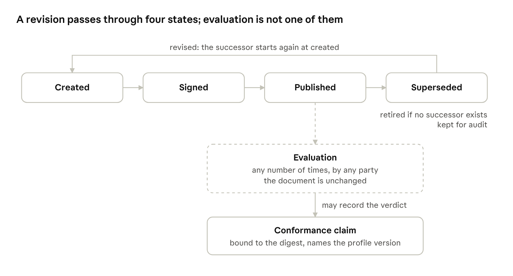

CBOM Profiles — Publication 3: Applying the methodology
=======================================================

Working Draft 0.1 · Nov 16, 2026 · \@Mike

Status of the draft
-------------------

Working Draft 0.1 is a draft for comment from the PKI Consortium (PKIC) CBOM Profiles Working Group. It is the third of three publications that together form Release 1: 1, Foundations; 2, Profiles and conformance; 3, Applying the methodology. Release 1 records the methodology as the working group has carried it out so far. When the publications are issued, they move to a separate part of the PKI Consortium platform and are governed there. Later work on the methodology starts from them.

**Ratification.** The working group ratifies its positions through this document. Every position is listed in *Positions put forward for ratification* at the end. The group works by lazy consensus: a position is ratified unless a member objects before comments close. Comments close four weeks after the draft is circulated to members. An objection names the position, says what is wrong with it, and proposes an alternative.

**Carrier format.** The examples, schemas and rules files are written in CycloneDX 2.0. Until Ecma International ratifies that release, field names follow the `2.0-dev` branch of the CycloneDX specification at commit `76f185c` (23 October 2026), and the working group's tests validate every example against that schema. The working group will compare the field names with the released schema and publish any changes as an editorial revision.

**How to comment.** Open a discussion in the working group repository at github.com/pkic/cbom, or write to the working group mailing list, cbom\@lists.pkic.org. Cite the chapter and paragraph.

Executive summary
-----------------

Publication 2 defines what a CBOM profile is and what it means for a document to conform to one. This publication covers the three tasks that follow once a profile is needed: writing the profile, encoding it in a file format, and governing the profile and the CBOMs evaluated against it after they are published.

**Writing a profile.** A profile can be written in twelve steps, which are grouped in five stages: scope, content, rules, realisation and proof. The steps are guidance, whereas requirements C1 to C18 in Publication 2 are binding. The steps should be followed in order. A profile starts from a named consumer and from a decision stated as a choice between options. It is not finished until an evaluator has evaluated two example documents: one that conforms, and one that fails for a stated reason. In a family of profiles, each depth is tied to a decision of its own, and each depth asks for a status on every attribute that it leaves to a deeper profile.

**Encoding it.** A profile does not depend on any particular file format. A mapping links the profile to a format. The mapping for CycloneDX 2.0, the target format, names one canonical location for each attribute and gives a single meaning to locations that the format leaves ambiguous. The evaluator also reads CycloneDX 1.6 and 1.7 documents as legacy documents and gives them the same verdicts, but it refuses older versions. SPDX 3.0.1 has no model for cryptography, so an SPDX SBOM points to a separate CycloneDX CBOM. Values are normalised before they are compared: algorithm names follow the format's registry, protocol names come from a short list, and keys are identified by the fingerprint of the public key or, for symmetric keys, by their role and location.

**Governing it.** A CBOM revision is created, signed, published and, later, superseded. Evaluating a revision does not change it. A conformance claim names the profile version, the format version and the CBOM revision, and it is bound to the revision by its digest. Because the profile authority can change a verdict by tightening a profile, every tightening carries a grace period, and every published profile version is signed and archived. The working group also recommends how a CBOM should relate to its SBOM at each lifecycle stage.

Chapter 16 groups use cases by the decision they support and shows which family of profiles meets each one. The change core is the shared base profile for planning a change, and the Use-case register records every use case and its current state. Chapter 17 explains how the methodology relates to the PQC Maturity Model and to two other efforts of the PKI Consortium.

Conventions
-----------

Requirement levels use the key words MUST, MUST NOT, SHOULD, SHOULD NOT and MAY as defined in BCP 14 (RFC 2119 and RFC 8174), when they appear in capitals. Sections marked *(normative)* bind any profile or document that claims to follow this methodology. Everything else is informative.

Text in `code font` is an attribute name, a value, a file or a command. A rule is cited as `tag#id`, for example `interface-disclosure#P2`: the tag names the profile and the id names the rule inside it.

This publication uses four verbs with distinct meanings. A tool *evaluates* a document against a profile, or a set of CBOMs against a policy, and the outcome is a verdict or a result. A rule, or a named checker such as [`check_profile.py`](../../docs/methodology/check_profile.py), *checks* one condition. Anyone who holds a conformance claim *verifies* it by running the evaluation again. A schema *validates* the format of a document.

Publication 1 defines the terms and lists the abbreviations used in this publication, and Publication 2 defines profiles, rules and conformance. This publication assumes that the reader is familiar with both. The examples are the Keycloak 26.7.3 records and the protection IED record that are published with the methodology. The values in these records are illustrative.

13. Writing a profile: the method
---------------------------------

A profile can be written in twelve steps, which are grouped in five stages. The steps are guidance only. What a finished profile must contain is binding, and Publication 2 states it as requirements C1 to C18. An author may therefore reach the same result by a different route. The steps were developed while building the worked examples, and they are expected to improve as more profiles are written. Changing the steps does not change the requirements.

### 13.1 The five stages

| Stage           | Steps     | What it settles                                                                                   |
|----------------------|---------------|---------------------------------------------------------------|
| 1\. Scope       | 1, 2      | the consumer and the decision; the subject, its boundary, and whether the profile extends another |
| 2\. Content     | 3, 4, 5   | the questions, the attributes that answer them, and which of those are judgements                 |
| 3\. Rules       | 6, 7, 8   | levels and disclosure treatment, structural rules, exclusions                                     |
| 4\. Realisation | 9, 10, 11 | the format mapping, the accepted format versions, the decisions and when to revisit them          |
| 5\. Proof       | 12        | examples that pass and fail, evaluated by a running evaluator                                     |

The stages should be taken in order, because each stage limits what the next stage can do. The most common way to produce an unusable profile is to start in the middle, by choosing attributes before the scope has been set. It is normal to return from stage 5 to stage 2, because a profile has not been tested until it has been run against a real document.

### 13.2 Stage 1: scope

**Step 1. Name the consumer and the decision.** Write down who will read a CBOM that has been evaluated against the profile, and what that reader will do differently depending on what the CBOM says. State the decision as a choice between options. For example, "whether to schedule this system for upgrade, replacement or no action" is an acceptable decision. "To understand our cryptographic position" is not, because a profile written for it keeps growing until it asks for everything. Record the options in `objective.decisionOptions`. At least two options are required, and [`check_profile.py`](../../docs/methodology/check_profile.py) checks this under C1.

**Step 2. Establish the subject and its boundary.** Decide what the profile describes. The published profiles describe one of four subjects: a product, written by its vendor; a deployment, written by its operator; a managed service, written by its provider; or a system design, written by its integrator. Each document declares its subject type (`interface-disclosure#P5`). The boundary is the limit of what the producer can reasonably declare. If the consumer cannot inspect the product, the profile can ask only for what can be observed or stated at the product's interfaces. Test each item against one question: could the producer answer it without disclosing something that it has a legitimate reason to protect?

Some subjects contain internal boundaries. Examples are the IEC 62443 zones and conduits in operational technology, and the boundary between two operators' telecommunications networks. A sector profile records such a boundary in two parts. First, a value on each interface states on which side of a boundary the interface sits, or whether it crosses the boundary. The evaluator checks this value against a list that the subject declares, or against a vocabulary. Second, a pointer names the component that guards the boundary, and the evaluator checks that the pointer names a component in the same record. These rules should remain sector rules, because each sector defines its boundaries differently and a single generic rule would have to choose one definition. A new sector should reuse the attribute names `boundary` and `boundaryProxy`, unless the sector already has a recognised term of its own, as operational technology has in zones and conduits. A managed service describes each tenant in a separate record, so it does not need a boundary rule.

Four further decisions are made at this stage, because each of them limits what the profile can ask for. All four are recorded in the `scope` object that C11 requires:

-   **Relationship types** the rules constrain.

-   **Cryptographic purposes** for which the profile requires full detail. When the purposes are declared, the rules can be written once and applied to every purpose in the set.

-   **Lifecycle stages** that the profile accepts. Each document carries a single stage (`interface-disclosure#P6`), so a profile accepts or refuses a whole document.

-   **Orientation**: `inventory`, `migration` or `both`. Under C12, an inventory profile must not require an attribute that looks forward to a future state. A profile that declares `both` must require the present-state attribute that corresponds to every capability attribute it requires.

**Extending or independent.** Before deriving the questions, check whether an existing profile already covers part of the ground. If it does, the new profile can extend the existing one and state only what it adds or tightens. A profile that would need to relax any rule of its base profile cannot extend it. Such a profile is independent and must state every requirement in full.

### 13.3 Stage 2: content

**Step 3. Derive the questions** that the consumer must answer in order to make the decision, and write them in the consumer's own words. A typical profile has between three and twelve questions. A much longer list usually means that the decision should be split into two or more decisions. This step is the one that authors most often skip, and profiles written without it tend to copy whatever fields a format happens to offer.

**Step 4. Turn each question into attributes that a producer can declare.** Each attribute must be declarable at the boundary set in step 2, and it must be possible for a declared value to be wrong. Use the terms of the model, so that each attribute belongs to a cryptographic relationship, an endpoint or a cryptographic asset. Name attributes according to the conventions in Publication 2: a bare name for the present state, the suffix `Supported` for a capability, a plural for a set, and a name that states what is disclosed rather than what it implies. For example, write `keyExchangeSupported` and never `pqcReady`. A later profile that reuses a published name must also keep its meaning.

**Step 5. Separate facts from judgements.** Remove any attribute that records a conclusion reached against criteria that change over time, such as a post-quantum posture or a level of cryptographic maturity. To test an attribute, ask whether the same disclosed values could give a different answer next year without any change to the product. If they could, keep the underlying facts in the profile and move the conclusion to an external policy.

### 13.4 Stage 3: rules

**Step 6. Assign levels and disclosure treatment.** Give each attribute a BCP 14 level, and then decide whether a producer may withhold it. For each attribute, ask what a consumer should conclude if the value is missing. If a missing value would not change the consumer's decision, the attribute does not need to be mandatory.

**Step 7. Add the structural rules.** A rule about the value of an attribute cannot detect an item that was left out altogether. Structural rules therefore constrain the set of declared items: how many items must be present, and of which kinds. A profile uses a structural rule to require, for example, that a management interface is declared, or that the producer states whether its list of interfaces is complete. Structural rules belong in the first version of a profile and in the shallowest depth of a family, because declaring that an interface exists costs a producer little. Reference rules (R) are a third kind of rule. A reference rule requires a pointer to context that the CBOM itself does not carry.

**Step 8. State the exclusions,** and give a reason for each one. A written list of exclusions answers in advance the objection that something obvious was forgotten. It also ensures that any later expansion of the profile is a deliberate decision.

### 13.5 Stage 4: realisation

**Step 9. Define the format mapping.** For each format that the profile supports, fix one canonical location for each attribute, so that every consumer reads the attribute from the same place. The profile itself remains independent of any format. Adding support for a new format adds a mapping and does not change any requirement.

**Step 10. Declare the accepted format versions**, as a minimum version and a tested version. The published profiles accept CycloneDX 1.6 as the minimum version and CycloneDX 2.0 as the tested version.

**Step 11. Record the decisions and when to revisit them.** Where the author chose one option over an alternative that could also be defended, record the decision together with the condition that should cause it to be reconsidered.

### 13.6 Stage 5: proof

**Step 12. Build the examples and run them.** Produce at least one document that conforms to the profile and at least one that fails for a stated reason. Check the rules file against C1 to C18 with `check_profile.py`, and run the evaluator over both documents. The errors that this step finds are usually in the attribute definitions, and most often in conditional attributes and in attributes whose value is a list.

### 13.7 Releasing a family of depths

A profile that asks for everything at once will not be met by producers at the start. A profile that asks only for what producers can provide today will still be in use, unchanged, three years later. The methodology resolves this with a family of profiles ordered by depth (Publication 2, Chapter 8). Two rules apply to every family:

-   **Every depth supports a decision of its own.** Each depth names a consumer, a decision and the options for that decision. The first depth is the smallest set of questions that answers a real decision.

-   **A depth still asks about what it defers.** For example, a profile that requires full detail for key establishment still requires a one-word status for entity authentication. Without that status, the deferred subject disappears from the record, and the first depth becomes a permanent floor.

A profile does not set the date after which a depth is no longer acceptable. That date is set by the contract between the parties.

### 13.8 When a profile is ready for a first release

-   The consumer and the decision are stated, and the decision contains a choice.

-   Every attribute traces back to a question, and every question to the decision.

-   No attribute encodes a judgement that policy should make.

-   No rule names a product, a vendor or an interface instance.

-   For every attribute, the profile defines what absence means, including whether it may be withheld.

-   The profile has structural rules, so that missing items can be detected.

-   Exclusions are written down with reasons.

-   A mapping exists for at least one format, with a stated range of accepted versions.

-   A conforming example and a non-conforming example exist, and an evaluator gives the expected verdict for both.

### 13.9 Ways this goes wrong

| Failure                                | How it shows                                                                                          | Remedy                                                                                          |
|---------------|-----------------------------------------------|--------------------------------------|
| Starting from the format               | The attributes resemble the fields CycloneDX offers, and none traces to a question.                   | Return to step 1 and derive the questions before reading any schema.                            |
| No named decision                      | The profile keeps growing during review, because there is no basis for rejecting any suggestion.      | State the decision as a choice. A suggestion that does not affect the decision is out of scope. |
| Encoding a judgement                   | An attribute such as a readiness rating, whose correct value changes when guidance changes.           | Keep the inputs and move the conclusion to an external policy.                                  |
| Naming an instance                     | A rule requires one particular identifier value, so the profile fits only one product.                | Constrain the kinds and numbers of items, not particular instances.                             |
| A depth that becomes a permanent floor | A whole subject is missing from the record, so a later profile has nothing to start from.             | Require a status for every subject that the profile defers.                                     |
| Treating absence as one thing          | A consumer cannot tell a producer that does not have the data from a producer that is withholding it. | Apply the four disclosure states, and decide for each attribute whether it may be withheld.     |

The method has been applied from start to finish to the following profiles and subjects: the PQC migration and procurement profiles for Keycloak, the substation component profile for a protection IED, the service disclosure profiles for Keycloak run as a managed service, System Disclosure for the reference substation, and IoT Device Estate for a soil sensor. Annex D lists the records and their verdicts.

14. Encoding a profile in a format
----------------------------------

A profile is defined independently of any file format. A mapping states where each attribute, and the set of interfaces that the profile counts, are found in a document written in a particular format. Adding support for a new format adds a mapping and does not change any requirement. When a format gains a new capability, the mapping is updated and the rules remain unchanged.

### 14.1 The carrier

The carrier is the format, together with the format version, in which a CBOM is written. The target carrier is CycloneDX 2.0. Every published example is a CycloneDX 2.0 document, apart from the two legacy examples, and the test suite validates each example against the pinned schema. The evaluator also reads CycloneDX 1.6 and 1.7 documents, because the tools that produce CBOMs today write CycloneDX 1.x.

SPDX 3.0.1 has no object model for cryptography. A CBOM is therefore written in CycloneDX, and an SPDX SBOM refers to it. SPDX is not a target carrier. Only the CycloneDX part of the mapping has been tested against real documents; the SPDX part has not yet been tested.

### 14.2 One canonical location for each attribute (normative)

Both formats allow the same information to be encoded in more than one valid way. A mapping MUST name one canonical location for each attribute that it maps. A consumer can then read each value from one place, and does not have to handle every valid alternative encoding.

Where a format allows a location to be read in two ways, the mapping also fixes one meaning for it. The TLS interface on Keycloak's main listener illustrates the problem. CycloneDX can record the key-exchange group X25519 inside a cipher suite, and it can also record it among the interface's related assets. Both encodings are valid. The mapping therefore reads `cipherSuites`, together with their `tlsGroups` and `tlsSignatureSchemes`, as the set of algorithms that the interface supports. It reads `relatedCryptographicAssets` that point to algorithm components as the set of algorithms that the interface uses. Without this convention, a consumer cannot tell whether X25519 is only offered or is actually used. The consumer could then report a complete CBOM as deficient, or report an algorithm that is only offered as one that is in use.

### 14.3 Representing a cryptographic interface

The profile treats an interface as a relationship between endpoints. CycloneDX has no object for such a relationship, so the mapping records the interface on a node instead. A security protocol instance, such as TLS, is recorded as a cryptographic-asset component with `assetType: protocol`. An application protocol, such as OIDC or the Keycloak Admin API, is recorded as a component with `type: "service"`. The dependency graph records how the layers are stacked: OIDC depends on HTTPS, and HTTPS depends on TLS. Interface attributes that have no native field in CycloneDX are written as properties in the `pkic:profile:` namespace.

This approach has five consequences for an implementation:

-   The document does not declare its set of interfaces explicitly. Instead, the evaluator derives the set from the components that carry `interfaceType`, and evaluates P1 and P2 against that set.

-   A protocol component or a service may be present only to record how the layers are stacked. `interfaceType` distinguishes an interface from such a record, so every interface MUST carry it.

-   An interface is identified by its `bom-ref`. A reference from another document uses a BOM-Link, `urn:cdx:<serial>/<version>#<bom-ref>`.

-   An interface refers to its algorithms by reference. If a reference is broken, the evaluator treats the attribute as absent.

-   A product vendor and an operator each describe the same connection in their own records. The operator's deployment record uses `correspondsTo` to name the product interface that the deployment realises. The two records are joined in this way, but they remain separate documents.

A finding that belongs to the connection itself, such as the group that a particular session negotiated, has no place in this representation. CycloneDX 2.0 does not fill this gap. Its blueprint flows describe a deployed system for the purpose of threat analysis, and they do not describe the cryptographic interfaces of a product. The working group will keep this workaround until a format provides a suitable object.

### 14.4 Where the main attributes sit

| Rule     | Attribute                                    | CycloneDX 2.0                                                                                                                                                | CycloneDX 1.6 and 1.7                                                                                                                   |
|-----------|-----------------------|------------------------------------------|-------------------------|
| P1       | at least one interface                       | components carrying `interfaceType`                                                                                                | the same, over `components[]` and `services[]`                                  |
| P2       | a management interface, or a reason for none | `interfaceType` = `management`; or `managementInterfaceAbsence` on the subject | the same                                                                                                                                |
| P3       | subject identifier                           | `inventories[0].subject.identifiers[]`, scheme `purl` or `tag-uri`         | `metadata.component.purl`; property `subjectIdentifier`                             |
| P6       | one lifecycle stage                          | `metadata.lifecycles[].phase`                                                                                                    | the same                                                                                                                                |
| I1, I2   | protocol and version                         | `protocolProperties.type` and `.version`; service properties                                             | the same                                                                                                                                |
| I3 to I5 | key exchange, encryption, authentication     | algorithms in `relatedCryptographicAssets`, directly or through a certificate                                                      | `cryptoRefArray`, `algorithmRef`, `signatureAlgorithmRef` |
| I6, I7   | endpoint roles, interface type               | `pkic:profile:` properties                                                                                                         | the same                                                                                                                                |
| I9       | implementing library                         | package URL in the library's `identifiers[]`                                                                                     | `purl` on the library                                                                                         |
| —        | module validation, product certification     | `certifications[]` on the library and on the subject                                                                             | properties                                                                                                                              |
| R        | context pointers                             | `externalReferences[]` with property `pkic:profile:context`                                            | the same                                                                                                                                |

The full mapping, with every attribute of every profile in the family and a column for SPDX, is kept in [`mapping-cyclonedx-spdx.md`](../../docs/methodology/mapping-cyclonedx-spdx.md) in the repository. That file remains the authoritative source of the mapping. In SPDX, there is as yet no mapping for P1 to P6, I6, I7, I8, I11, G1 or the identity of an interface, and I1 to I5 are reached through the linked CycloneDX CBOM.

### 14.5 Disclosure markers

A document records an unknown or withheld value with the property `pkic:profile:disclosure:<attribute>`, whose value is `unknown` or `withheld`. An attribute that has neither a value nor a marker is undeclared. The working group treats this as a convention of the mapping, and it does not ask the format bodies to add a dedicated field.

### 14.6 Normalising values

A canonical location fixes where a value is read, but it does not fix how the value is written. Every automated use of a CBOM compares values with something else, such as a policy, a deprecation list, a vulnerability feed or another CBOM, and these comparisons require an exact match. For example, a policy that looks for AES-256-GCM in a document that records AES256 finds no match, and no error is reported.

Values are therefore normalised according to four conventions:

-   **Algorithms** are named according to the format's registry. A Cryptography Registry identifier is preferred wherever one exists, and in CycloneDX 2.0 the enumerated `ellipticCurve` field replaces the free-text curve name. For example, P-256, secp256r1 and prime256v1 are three different strings for the same curve, but as registry identifiers they are a single value. For CBOMs that use free-text names, an adapter applies a versioned map of names before any rule is evaluated.

-   **Protocols** are named from a short list kept in Publication 2, Annex C.2. Each name refers to the protocol's own specification, and the version is written in the way that specification writes it, for example `1.3` for TLS. A protocol that is not on the list is recorded as `other`, with a reference to its specification, and it can be proposed for addition to the list.

-   **Asymmetric keys** are identified by the fingerprint of their public key, which every tool computes in the same way.

-   **Symmetric keys** have no public part, so they are identified by their role and the place where they are stored.

### 14.7 Version bands

Three things each have their own version, and each can change independently of the others: the carrier format, the profile, and the content of the CBOM. A conformance claim states all three versions, so that anyone can repeat the evaluation and obtain the same result.

Every published profile declares the carrier range `"cyclonedx": { "min": "1.6", "tested": "2.0" }`. On the basis of this range, the evaluator places each document in one of four bands:

| Band              | Versions         | Treatment                                                                 |
|--------------------------|--------------------|------------------------------------------------------|
| Below the minimum | earlier than 1.6 | refused; upgrade first                                                    |
| Legacy            | 1.6, 1.7         | accepted with a warning; the verdicts are the same as for the target band |
| Target            | 2.0              | accepted                                                                  |
| Newer             | later than 2.0   | accepted, and flagged for review                                          |

The evaluator reads documents of both carrier generations into the same abstract record, so each rule needs to be written only once. A document in the legacy band therefore receives the same verdict as the same document in the target band; the only difference is that its report includes a warning. To demonstrate this, the Keycloak product record is published twice with the same facts, once in CycloneDX 2.0 and once in CycloneDX 1.7. The 1.7 record conforms to the same five profiles as the 2.0 record, and its report begins with a warning that names the legacy band. The evaluator also reads untargeted scanner output written in CycloneDX 1.7 and places it in the legacy band. That output fails even the entry profile, on P1, P3, P4, P5 and P6. It fails because of its content; its format version has no effect on the verdict.

A producer can convert a CycloneDX 1.6 or 1.7 CBOM to CycloneDX 2.0 with [`cdx17_to_20.py`](../../docs/methodology/cdx17_to_20.py). The converter re-encodes the facts that the document already contains and does not add any new facts. The example generator builds each Keycloak document in 1.7 form and then converts it, so the converter is exercised on every example.

### 14.8 When a profile needs a new version (normative)

A profile MUST be given a new version when its requirements change, when the format versions that it accepts change, or when its mapping changes, because each of these changes can move a document from one band to another. A profile does not need a new version when it is only checked against a new release of a format and nothing else changes. The changelog records such a check as an editorial change.

### 14.9 Moving to the released CycloneDX 2.0

When Ecma International ratifies CycloneDX 2.0, the working group will:

1.  replace the pinned schema with the released schema;

2.  compare the two schemas, and revise the converter, the evaluator's reading of CycloneDX 2.0 and the mapping wherever a field that the profiles use has moved;

3.  regenerate the examples, the perspectives and the demonstration reports;

4.  run the test suite, which validates every example against the schema and checks every expected verdict.

The carrier range keeps `tested` at 2.0, so the acceptance rule in the profiles does not change. Conformance claims and policy results are bound to a document by its digest. If a regenerated example changes, the claims and results that cite it will therefore be issued again. A producer whose document was written against the pinned commit, and which uses a field that has since moved, should regenerate the document.

### 14.10 Perspectives, and two words with other meanings in CycloneDX

CycloneDX 2.0 introduces perspectives. A perspective is a list of JSONPath expressions, each marked as required, recommended or optional. Each published profile has a perspective that is generated from its rules file. A perspective cannot express conditions, vocabularies, withholding, reference rules or extension, so the perspective is informative only. The rules file is normative, and a document that satisfies a perspective may still fail the profile.

CycloneDX 2.0 also uses the words "profile" and "interface" for concepts of its own. Where the meaning could be confused, the methodology writes "PKIC CBOM profile" and "cryptographic interface". The root `risks` array in CycloneDX 2.0 carries judgements about risk. The evaluator ignores this array when it decides conformance, and a supplier's product record should not contain it.

15. Governance
--------------

Governance covers how CBOMs and profiles are produced, signed, distributed, changed and retired. Publication 1 uses the word *lifecycle* only for the stage at which a fact was captured. The successive conditions of a CBOM revision are therefore called its *states*.

### 15.1 The states of a revision

A CBOM revision passes through four states: created, signed, published and superseded. A revision becomes superseded in one of two ways: it is revised, when a successor revision exists, or it is retired, when no successor exists. A new revision starts again in the created state. Superseded revisions are kept so that they can be audited.

Evaluation is not one of the states. An evaluation is applied to a published revision, and it can be applied any number of times, by different parties who do not need to coordinate with each other. Each evaluation produces a verdict, which the evaluating party may record in a conformance claim, and it leaves the document unchanged. Two consumers who evaluate the same document against the same profile a year apart can reach different verdicts, because the profile may have changed in the meantime. A conformance claim is therefore bound to the digest of the document, and it names the exact version of the profile.

{width="6.0in" height="3.2321423884514435in"}

the states of a revision · four states, evaluation beside them

Evaluation acts on a published revision without moving it to another state.

### 15.2 Roles

| Role                | May cause            | Responsibility                                                                                                                                                       |
|-----------------------|------------------------|-----------------------------------------------------|
| Producer            | create, sign, revise | Generates the CBOM in a build pipeline or with a scanner, and records its provenance and the lifecycle stage of what it captured.                                    |
| Consumer            | nothing              | Evaluates a published revision against the profiles that it needs, and records the resulting claim. May evaluate the same revision again whenever a profile changes. |
| Curator or registry | publish, retire      | Stores, versions and serves revisions, and enforces retention and access control.                                                                                    |
| Profile authority   | nothing              | Defines and versions profiles, and manages the vocabularies and their deprecation.                                                                                   |

The profile authority does not move any revision from one state to another, but it has a wider power. When it tightens a published profile, revisions that conformed to the profile may stop conforming, even though no producer has acted and no document has changed. This has two consequences. First, the authority must state what happens to documents that conformed to the earlier version of the profile (15.6). Second, an earlier verdict can be verified only if the text of the earlier profile is kept (15.7).

### 15.3 Public and restricted variants

Publication 2, Chapter 11 defines the public and restricted variants of a CBOM and the obligations that they have towards each other. The two variants become separate documents when they are created, because the markers that make a document public are written into the document itself. Each variant is published to its own audience, and the two variants are superseded at the same time.

### 15.4 Signing and provenance

A CBOM should be signed, so that a consumer can verify where it came from and detect any later change to it. Two things may be signed: the document itself, with a detached signature over the file, and the process that produced it, with a build attestation such as in-toto or SLSA. The 2026 SBOM minimum elements already include a signature that can be attributed to the author.

Because a CBOM describes cryptography, the algorithm used to sign the CBOM is itself within scope. A signature gives assurance only for as long as its algorithm remains strong. The algorithm used to sign a CBOM should therefore meet the same requirements as the cryptography that the CBOM describes.

A signature shows who issued a CBOM and that the CBOM has not been changed since it was signed. It does not show that the CBOM is accurate, because accuracy depends on how the CBOM was produced. A CBOM should therefore record its provenance: the tool that produced it and the version of that tool, the inputs, the lifecycle stage at which it was captured, and any mechanical conversion that has been applied to it.

### 15.5 Relating a CBOM to its SBOM

A CBOM is of limited use unless the reader can find the software components that implement the cryptography it describes. Four arrangements of CBOM and SBOM are in use:

| Arrangement            | Documents                           | Strength                                                                     | Weakness                                                                                                                             |
|-----------------|----------------|-------------------------------|------------------------------------|
| A. Unified             | one, with software and cryptography | one signature covers the whole record; there is no reference to resolve      | the part that changes less often must be reissued whenever the other part changes; the two parts cannot have separate access control |
| B. Standalone CBOM     | one, cryptography only              | simple; discloses no software composition                                    | cannot say which library implements an algorithm, except through `implementationPurl`                      |
| C. CBOM points to SBOM | two                                 | the reader starts from the cryptography; each document has its own lifecycle | the reference must be kept up to date                                                                                                |
| D. SBOM points to CBOM | two                                 | reuses existing SBOM processes; the only arrangement SPDX allows today       | a consumer that reads only the SBOM never sees the CBOM                                                                              |

The working group recommends the following arrangement for each case:

-   **A product CBOM generated at build time:** a unified document (A), where one team produces both the SBOM and the CBOM on the same release cycle.

-   **Any other product CBOM, and every deployment record:** a CBOM that points to its SBOM (C), because the cryptographic configuration can change even when no software changes.

-   **Where the consumer requires SPDX:** an SBOM that points to the CBOM (D). In this case the pointer is part of what the producer delivers.

Where two separate documents are used, the following five requirements apply, whichever arrangement is chosen:

-   Pin the reference to one revision of the other document, by using a BOM-Link, `urn:cdx:<serial>/<version>`, together with a SHA-256 hash of the target document.

-   Give both documents the same subject identifier.

-   State whether the reference must be resolved for a document to conform. The published profiles check that the pointer is present, but they never check the target document.

-   Sign both documents, and place the reference inside the signed content of at least one of them.

-   Keep both documents for the same retention period.

The Keycloak product record uses arrangement C. Its rule R1 requires a pointer to the companion SBOM, given as a BOM-Link with a hash.

### 15.6 Changing a profile

Profiles, vocabularies and the methodology are changed only by issuing explicit new versions (Chapter 14). Within the working group, a change is agreed by lazy consensus. Four practices make changes predictable for producers and consumers:

-   **A changelog** classifies each change as a tightening, a relaxation or an editorial change, so that a producer can see whether a new version will require more work from it.

-   **A grace period** applies when a rule is tightened. The profile recommends a period and the date it ends, and a contract may set a different one. Publication 2, 9.5 states how an evaluation treats the rule until that date. A contract that sets a different period is applied by whoever evaluates under that contract.

-   **A vocabulary value is deprecated before it is removed.** A former value continues to be recognised, and is mapped to its replacement, for at least one major version.

-   **Publication serves as notification.** Publishing a new version in the register, together with its changelog, constitutes notice of the change. The register may also offer a feed. There is no obligation to notify each user individually.

### 15.7 Stewardship of profiles (normative)

A profile remains in use long after the circumstances in which it was written. A conformance claim made against a profile may be examined long after the group that wrote the profile has closed. The claim is meaningful only if the profile that it cites can still be obtained exactly as it stood when the claim was made.

| Area                     | Position                                                                                                                                                                                                                                                                                                       |
|-------------------------------------|---------------------------------------------------------------|
| Names                    | The PKI Consortium keeps a register of profile names that begin with `pkic.`. Anyone else names a profile within a name space that they already control, such as their own domain name in reverse order. The name `pkic.example` is reserved for examples. |
| Ownership                | Ownership is held at three levels. The working group owns the baseline. A sector body owns the profiles that it derives from the baseline. The PKI Consortium runs the register and the archive.                                                                                                               |
| Succession               | If an owner stops maintaining a profile for a stated period, or closes, ownership passes to the PKI Consortium.                                                                                                                                                                                                |
| Signing                  | The publisher MUST sign each published profile. A conformance claim records the hash of the profile text, which identifies one version of one file.                                                                                                                                                            |
| Archive                  | The publisher MUST keep every published version available, through the register and addressed by version, and MUST NOT change a published version. A correction is a new version.                                                                                                                              |
| Statements about formats | Each statement about a limitation of a format MUST name the format version it describes.                                                                                                                                                                                                                       |

Release 1 sets no review period and no procedure for withdrawing a profile. If a profile were withdrawn, the claims made against it in the past would remain valid, because they were correct when they were made.

A statement such as "CycloneDX 2.0 has no object for a cryptographic relationship" remains true of the version that it names. When a new release of the format appears, the statement is checked, and it is either restated for the new version or left in place as a record of the earlier version. As a result, the text stays accurate without anyone having to monitor every new release of the formats.

### 15.8 Retention and claims

A published CBOM revision cannot be changed. A correction is issued as a new revision, which supersedes the earlier revision without deleting it. The retained revisions form the audit trail on which progress tracking and incident investigation depend.

A conformance claim names the profile version, the carrier format version and the CBOM revision. A claim that omits any of these cannot be reproduced. When a newer revision of the CBOM is published, an existing claim is not affected: it remains true of the revision that it names. Whether that revision is still recent enough is a judgement, so the question belongs in a consumer's policy. A policy can set its own limit, for example by accepting only claims about revisions issued within the last twelve months.

16. Use cases and profile families
----------------------------------

A profile is written for someone who has a decision to make. A use case names that person and that decision, for example a buyer comparing tenders, a responder tracing an advisory, or a grid operator planning a migration. The working group records the use cases that it has registered, and how far work on each has progressed, in a living document that is not part of Release 1: the *Use-case register*.

Use cases are grouped according to how their profiles relate to the interface disclosure baseline, and not according to sector. For example, a telecommunications operator and a grid operator that are both planning a migration make the same kind of decision, so they share one use case. Terms that are specific to a sector are added in the sector's profile.

### 16.1 Four groups

| Group           | Defined by                 | What a profile in the group does                                                                                                                                | A document written for the group also serves                                  |
|---------------------|-------------|---------------------------------------------|---------------------|
| Disclosure      | the facts asked for        | chooses which of the baseline's facts are mandatory, and tightens some rules; orientation `inventory`                                 | every profile in the group                                                    |
| Change planning | the facts asked for        | adds capability, blocker, enablement and update-path facts through the change core; orientation `both`                                | every Disclosure profile, and the change-planning profiles it was written for |
| Operation       | who produces the document  | the operator states facts that only it can observe: configured and observed values, the data that an interface carries, and the parameters that were negotiated | the operator's own profiles                                                   |
| Assurance       | who relies on the document | adds requirements on provenance and on the conformance claim, but asks for no additional cryptographic facts                                                    | Disclosure and Assurance profiles together                                    |

A document written for change planning also satisfies the disclosure profiles. A document written only for disclosure cannot satisfy a change-planning profile, because the capability facts were never collected for it.

An operator that describes what it runs may also be planning a change. A profile in the Operation group may therefore extend the baseline, the change core or another Release 1 profile.

Two suggestions that are often made are not use cases in this sense. A continuous-integration gate applies an existing profile within a build pipeline, and what it needs is an evaluator that returns usable exit codes. A comparison between two versions of a CBOM is covered by versioning (Chapter 14).

### 16.2 The change core

The change-planning profiles ask for many of the same facts. Because each profile extends exactly one base profile, a fact that two profiles both need must be defined in a profile that both of them extend. That shared base is the change core, published as `change-core` v0.2. It accepts products and managed services as subjects, and it contains:

-   for each cryptographic purpose, `capabilityStatus`, `blockedBy` and `roadmapRef`;

-   the `Supported` forms of the protocol version, the key exchange and the authentication algorithm;

-   `enablementMethod`, `minimumProductVersion`, `coexistence`, `negotiationControl` and `integrationConstraints`;

-   the update path: `updateMechanism` for the product and for each management interface, `updateAuthority` and `updateAuthoritySupported` where an interface carries updates, and `keyReplaceable` on storage interfaces. A product that has no update path declares `none`.

Provider location, module validation and key-wrapping capability remain in the PQC migration profile, because their values do not fit constrained devices. The change core does not assume any particular target state. It records what an interface is capable of, and a policy states what the interface should achieve.

The change core and the PQC migration profile are siblings, because both extend the baseline. The change core declares each shared rule under the identifier that the PQC migration profile already uses, so no rule identifier has changed. A test checks that the shared rules remain identical in both profiles.

```
interface-disclosure (baseline)
├─ procurement, deployment-disclosure, …        Disclosure and Operation
├─ service-disclosure ── …-restricted           managed service, two audiences
├─ system-disclosure                            system design
├─ pqc-migration ── pqc-migration-extended      product, two depths
└─ change-core
   ├─ pqc-migration-ot                          substation component
   └─ iot-device                                device model
```

### 16.3 Vulnerability response and the baseline

Vulnerability response depends almost entirely on one attribute: the package URL of the library that implements an interface (`interface-disclosure#I9`). The baseline already supports the necessary join. A consumer takes the package URLs from I9, queries the advisory source that the record names under R3, and reads the vendor's statements from the source that the record names under R2.

However, the baseline also works against this use case, because it allows a producer to withhold the library. A profile written for vulnerability response would remove that permission, and such a profile would therefore be written for a restricted audience. Readers of public documents rely instead on the vendor's VEX statements.

### 16.4 Checking profiles against a regulation

Regulators and policy makers increasingly ask for a cryptographic inventory, but most instruments do not say what the inventory must contain. An organisation that wants to use CBOMs as evidence therefore needs to know, clause by clause, whether a CBOM that conforms to a given profile gives it the facts it needs. The working group answers this question with a register that is kept outside the release, because instruments change more often than the methodology does. The register is in the [`regulation/`](../../regulation/) folder of the repository, and its [coverage matrix](../../regulation/coverage.md) is generated from it.

**Step 1: break each clause into evidence questions.** An evidence question is something a reader must be able to answer to show that a clause is met. "Which key-establishment algorithms does each interface use, and at what strength?" is an example. A clause that asks for several things becomes several questions. The register states each question in its own words and records which clause it comes from. It does not quote or interpret the instrument.

**Step 2: map each question to profile rules.** Each question names the profiles and rule identifiers that supply the facts it needs. A test checks that every rule that is cited exists in the profile that is named, so the register stays correct when a profile changes.

**Step 3: test the question at three levels.** The three levels are kept apart, because they lead to different kinds of work:

-   **Expressible.** Can the model express the facts at all? If it cannot, the gap is in the methodology, and it leads to a candidate attribute.

-   **Required.** Does a named profile require those facts? If the model can express them but no profile requires them, a reader can still ask for them by writing or choosing a deeper profile.

-   **Evaluable.** Can a policy compute the answer from the facts without a person's judgement? If it cannot, the answer needs an allow list, a threshold or an operator's input that the policy must hold.

**Step 4: give the question a verdict.** There are six verdicts:

| Verdict | Meaning |
|---|---|
| Sufficient | A CBOM that conforms to the profile that is named answers the question |
| Deeper profile | The model has the facts, but only a deeper or more specific profile requires them |
| Partial | The CBOM supplies part of the answer, and the operator supplies the rest, for example how long data must stay confidential |
| Judgement | The CBOM supplies the facts, but the answer is a judgement, such as whether a mechanism is state of the art. The judgement belongs in a versioned policy (Publication 2, chapter 10) |
| Out of scope | The question is about an organisation or a process, and no CBOM can answer it |
| Open | The text that defines the question has not been published yet |

A question that is only partly answered names its gap. A gap is either a candidate attribute, which goes to the question register, or a plain statement that the question stays outside a CBOM. For example, the evidence questions for CNSA 2.0 show that no profile yet requires the algorithm that a product uses to verify its updates. That finding is a candidate attribute for the change core. The evidence questions for NIS2 key management show the opposite case. A CBOM can state what a product's key management can do, but it cannot state how an entity runs its key management, and no attribute could change that.

The first release of the register covers seven instruments that apply in every sector: NIST IR 8547, Executive Order 14412 with OMB memorandum M-26-15, NIS2 with Implementing Regulation (EU) 2024/2690, the NIS Cooperation Group's post-quantum roadmap, the Cyber Resilience Act, CNSA 2.0 and BSI TR-02102-1. Each application-domain document adds the instruments of its own sector in the same form.

17. Related work
----------------

Other efforts address parts of the same problem. The three efforts described in this chapter all belong to the PKI Consortium. The descriptions summarise each effort's published material as of November 2026, and they are not agreed positions of the working groups concerned.

### 17.1 PQC Maturity Model

The PQC Maturity Model (PQCMM) is maintained by the Post-Quantum Cryptography Working Group of the PKI Consortium. Its current release is version 1.0.1, published in June 2026. The model assesses products and services in the supply chain, whereas most maturity models assess an organisation. A PQCMM assessment and a product CBOM therefore have the same subject: a product as seen from outside, by a party that did not build it.

The model has six cumulative levels, from 0 (None) to 5 (Optimized). Level 4, Managed, requires CBOM support. The assessment questions for Level 4 list what each CBOM entry records: the algorithm, the parameter set, the key size, the protocol context and the purpose of use. However, the model does not express these requirements in a form that a tool can check. A profile can provide that form. A CBOM that conforms to such a profile could be offered informally to the PQCMM maintainers as evidence for an assessment.

The PQCMM depends on CBOM profiles: the model requires a CBOM as evidence, and a CBOM profile defines what that CBOM must contain. The table shows how the work is divided between the two.

|                          | PQC Maturity Model                                | CBOM profiles                                                         |
|-------------------------------|-----------------------------------|----------------------------------|
| Question answered        | How ready is this product, from 0 to 5?           | Does this document disclose what the purpose requires?                |
| Result                   | A graded, cumulative level                        | A verdict for each profile                                            |
| Subject                  | A product or service as released                  | One revision of one document                                          |
| Assessed or evaluated by | Self-assessment or an accredited assessor         | An evaluator                                                          |
| Changes when             | The criteria are revised, or the product improves | The profile is revised, or a new revision of the document is produced |
| Role                     | Reads the facts and forms a judgement             | Specifies and supplies the facts                                      |

A PQCMM level is a judgement, which is reached by applying criteria that change over time to a set of facts. In the terms of the methodology, it is an external policy (Publication 2, Chapter 10). A depth in a profile family, by contrast, is a set of rules that is fixed at a given version. For this reason, the methodology does not call a deeper profile a maturity level, and no maturity level is recorded in a CBOM.

Several attributes of the PQC migration profile appear to match what an assessment at Levels 2 to 4 needs. These are `keyExchangeSupported` and `authenticationSupported` for configurable algorithms, `coexistence` for hybrid operation, `enablementMethod` and `minimumProductVersion` for availability in a shipped release, `capabilityStatus` and `blockedBy` for the current status of a capability, and `implementationPurl` for the library that implements it. The profile was developed from migration-planning questions, and the model was not used as a source. The match therefore suggests that the two address the same subject. The match has not been agreed with the PQC Working Group.

The PQCMM and the profiles refer to external schemes in different ways. The PQCMM names schemes such as CycloneDX without a version, so that the model does not go out of date when a scheme is revised. A profile states the format versions that it accepts, because an evaluator has to know which data structures it can read.

The PQC Working Group has defined a certification process for the model. The practice of assessment at Level 4 is expected to become established as the first products are assessed.

### 17.2 PQC Capabilities Matrix

The PQC Capabilities Matrix, which is maintained by the same working group, records which products support which post-quantum capabilities. Its subject overlaps with the capability attributes of the PQC migration profile. The relationship between the two has not yet been examined.

### 17.3 PKI Maturity Model

The PKI Maturity Model assesses how an organisation operates its PKI, and it includes a post-quantum extension. It does not assess products. An operator may therefore run a mature PKI and still deploy products that have no post-quantum capability. Conversely, a product may be ready for post-quantum cryptography while the PKI that serves it is not.

Positions put forward for ratification
--------------------------------------

Each row is a position this publication takes. Rows 1 to 16 were settled provisionally by the chair's call on 10 and 11 November 2026. Rows 17 to 22 are put forward for the first time in this draft. Rows 23 to 34 were settled provisionally on 10 and 11 November 2026, and rows 35 to 37 are put forward for the first time. A position is ratified unless a member objects before comments close.

| \#  | Position                                                                                                                                                                                         | Section                  |
|---------|-----------------------------------------------------------|---------------------------------|
| 1   | The twelve steps are guidance. What a finished profile must contain, C1 to C18, is binding.                                                                                                      | 13                       |
| 2   | A new format release alone does not need a new profile version. The check against the release is recorded as editorial.                                                                          | 14.8                     |
| 3   | The SPDX side of the mapping is untested, and this is stated as a limitation.                                                                                                                    | 14.1                     |
| 4   | Withheld information is marked by a mapping convention. The working group does not ask the format bodies for a field.                                                                            | 14.5                     |
| 5   | Each statement about a format limitation names the format version it describes.                                                                                                                  | 15.7                     |
| 6   | Algorithms are named from the format's registry.                                                                                                                                                 | 14.6                     |
| 7   | Protocols are named from a short list, each name tied to its specification. Other protocols are recorded as `other`.                                                   | 14.6                     |
| 8   | An asymmetric key is identified by its public-key fingerprint, and a symmetric key by its role and storage location.                                                                             | 14.6                     |
| 9   | The working group recommends one way to link a CBOM and its SBOM at each stage.                                                                                                                  | 15.5                     |
| 10  | Profiles published under the `pkic.` name are listed in a register. Everyone else uses a name space they control.                                                      | 15.7                     |
| 11  | When a profile is tightened, the profile recommends a grace period, and a contract may vary it.                                                                                                  | 15.6                     |
| 12  | The publisher signs each published profile, and a claim records the hash of the profile's text.                                                                                                  | 15.7                     |
| 13  | The publisher archives every published profile version through the register.                                                                                                                     | 15.7                     |
| 14  | Ownership of a profile after publication is tiered, with the PKI Consortium as the fallback.                                                                                                     | 15.7                     |
| 15  | Statements bound to a superseded CBOM revision stay true about that revision. Whether a revision is current is a policy matter.                                                                  | 15.8                     |
| 16  | Publishing the new version in the register is the notice that a profile was tightened.                                                                                                           | 15.6                     |
| 17  | CycloneDX 1.6 is the oldest version a profile accepts. Versions 1.6 and 1.7 are read as legacy with the same verdicts, and anything older is refused.                                            | 14.7                     |
| 18  | The evaluator ignores the CycloneDX 2.0 `risks` array for conformance, and a supplier's product record should not contain it.                                          | 14.10                    |
| 19  | A CBOM should be signed, and its signing algorithm should follow the same rules as the cryptography the CBOM describes.                                                                          | 15.4                     |
| 20  | A tightened rule states the end of its grace period in the rules file, and a failure before that date is reported and not counted.                                                               | 15.6                     |
| 21  | Boundaries inside a subject, such as zones, operator boundaries and tenants, stay sector rules. No generic boundary rule is defined.                                                             | 13.2                     |
| 22  | Registering a published CBOM with a transparency service is described, and no profile requires it.                                                                                               | Annex E                  |
| 23  | The PQC migration profile is a draft specification at version 0.x, usable now.                                                                                                                   | Publication 2, 8.2       |
| 24  | `enablementMethod` gives one answer for a capability: the change that governs the cost of switching it on.                                                             | Publication 2, C.1       |
| 25  | What might break is recorded as a category plus a description.                                                                                                                                   | Publication 2, C.1       |
| 26  | A vulnerability-response profile is for a restricted audience and does not allow I9 to be withheld. Public readers rely on the producer's VEX statements.                                        | 16.3                     |
| 27  | A sector profile extends a Release 1 profile, directly or through another. It adds only rules specific to its sector; a rule that serves several sectors moves to Release 1 or a group document. | 16.1, 16.2               |
| 28  | Each document declares its subject type, so a CBOM can describe a device model or a deployed device.                                                                                             | Publication 2, 7.4       |
| 29  | `resourceBound` records a limit that is permanent rather than current.                                                                                                 | Publication 2, 7.4       |
| 30  | An IoT profile is a branch. It extends the change core, itself a branch of the baseline, and is not a depth of the PQC migration family.                                                         | Publication 2, 8.2, 8.3  |
| 31  | The change core is target-neutral. The migration target belongs to policy.                                                                                                                       | 16.2                     |
| 32  | A system record reports each cited document's verdict beside its own.                                                                                                                            | Publication 2, 9.4 (T11) |
| 33  | The PQCMM lists the content of a Level 4 CBOM, but not in a form a tool can check. A profile could supply that form; this publication describes the relationship only.                           | 17.1                     |
| 34  | A conforming CBOM is offered informally to the PQCMM maintainers as evidence for an assessment.                                                                                                  | 17.1                     |
| 35  | The change core and PQC Migration are siblings. Both extend the baseline, shared rules keep the same ids, and a test keeps them identical.                                                       | 16.2                     |
| 36  | Provider location, module validation and key-wrapping capability stay in PQC Migration and are not in the change core.                                                                           | 16.2                     |
| 37  | A continuous-integration gate and a comparison of CBOM versions are not use cases.                                                                                                               | 16.1                     |
| 38  | Whether CBOMs are sufficient evidence for a regulation is recorded per evidence question, tested at three levels (expressible, required, evaluable), in a register kept outside the release. | 16.4 |
| 39  | The register paraphrases instruments and does not interpret them. A gap it finds becomes either a candidate attribute or a statement that the question stays outside a CBOM. | 16.4 |

Annex D. Tools and reproduction (informative)
---------------------------------------------

Every result in this publication can be reproduced from the repository at the tag `release-1`. The tools require Python 3 and do not need network access. All commands are run from the directory [`docs/methodology/`](../../docs/methodology/).

### D.1 The tools

| Tool                                                            | What it does                                                                                                                                                                                                                                                                                                                                                                                                  |
|---------------------------------------------|-------------------------------------------------------|
| [`validate_cbom.py`](../../docs/methodology/validate_cbom.py)                   | Evaluates a CBOM against a profile. Reads CycloneDX 2.0 and 1.x, resolves extension, follows joins to cited documents given with `--with`, and issues and verifies conformance claims. `--as-of` sets the date grace periods are judged against; `--cited-profile` reports each cited record's verdict beside the record's own. |
| [`check_profile.py`](../../docs/methodology/check_profile.py)                   | Checks a rules file against requirements C1 to C18.                                                                                                                                                                                                                                                                                                                                                           |
| [`evaluate_policy.py`](../../docs/methodology/evaluate_policy.py)                 | Evaluates CBOMs against a policy at a stated date and writes a policy result.                                                                                                                                                                                                                                                                                                                                 |
| [`cdx17_to_20.py`](../../docs/methodology/cdx17_to_20.py)                    | Converts a CycloneDX 1.6 or 1.7 CBOM to CycloneDX 2.0. Its docstring lists every conversion.                                                                                                                                                                                                                                                                                                                  |
| [`tools/build_keycloak_examples.py`](../../tools/build_keycloak_examples.py)  | Writes every Keycloak example. It builds each document in 1.7 form, converts it, and writes a cited document before the one that cites it.                                                                                                                                                                                                                                                                    |
| [`tools/build_ot_examples.py`](../../tools/build_ot_examples.py)        | Writes the protection IED examples and their companion SBOM.                                                                                                                                                                                                                                                                                                                                                  |
| [`tools/build_lib60870_example.py`](../../tools/build_lib60870_example.py)   | Writes the lib60870 product record and its companion SBOM, from the library's public source.                                                                                                                                                                                                                                                                                                                  |
| [`tools/build_ot_system_example.py`](../../tools/build_ot_system_example.py) | Writes the reference substation's system record, which cites the protection IED and lib60870, and its non-conforming variant.                                                                                                                                                                                                                                                                                 |
| [`tools/build_service_examples.py`](../../tools/build_service_examples.py)   | Writes the two service disclosure profiles and the Keycloak service records, built from the configured deployment record.                                                                                                                                                                                                                                                                                     |
| [`tools/build_iot_examples.py`](../../tools/build_iot_examples.py)       | Writes the two soil sensor records, their companion SBOMs and the non-conforming variant.                                                                                                                                                                                                                                                                                                                     |
| [`tests/run-profile-tests.sh`](../../tests/run-profile-tests.sh)          | Runs the test suite: expected verdicts, schema validation of examples and perspectives, context pointers, claims, and the demonstration reports.                                                                                                                                                                                                                                                              |

The evaluator returns the following exit codes: 0, conforms; 1, does not conform; 2, usage error; 3, profile error; 4, refused; 5, claim mismatch. A refusal is different from a failure: a refused document has not been evaluated at all. A pipeline that treated every non-zero exit code as a rejection would therefore penalise a supplier for the age of its carrier format.

### D.2 Reproducing the results in this publication

| Result                                                                          | Command                                                                                                                                                                                                                                                                                                         | Exit                     |
|--------------------|---------------------------------------------------|-----------------------------|
| Every published rules file meets C1 to C18 (13.6)                               | `for p in profile-*.rules.json; do python3 check_profile.py "$p"; done`                                                                                                                                                                                                            | 0 for each of the twelve |
| A product record conforms (13.6)                                                | `python3 validate_cbom.py examples/cbom-keycloak-product.cdx.json profile-interface-disclosure.rules.json`                                                                                                                                                                           | 0                        |
| A record without a management interface fails (13.4)                            | `python3 validate_cbom.py examples/cbom-keycloak-product-fail-P2.cdx.json profile-interface-disclosure.rules.json`                                                                                                                                                                   | 1                        |
| The substation component profile, pass and fail (13.9)                          | `python3 validate_cbom.py examples/cbom-ot-protection-ied-product.cdx.json profile-pqc-migration-ot.rules.json`, then the same with [`cbom-ot-protection-ied-product-fail-ot-I4.cdx.json`](../../docs/methodology/examples/cbom-ot-protection-ied-product-fail-ot-I4.cdx.json)                                                                   | 0, then 1                |
| A 1.7 record gets the same verdict, with a legacy warning (14.7)                | `python3 validate_cbom.py examples/legacy/cbom-keycloak-product-1.7.cdx.json profile-interface-disclosure.rules.json`                                                                                                                                                                | 0                        |
| Scanner output fails for its content (14.7)                                     | `python3 validate_cbom.py examples/legacy/cbom-keycloak-scanner-output.cdx.json profile-interface-enumeration.rules.json`                                                                                                                                                            | 1                        |
| A system record conforms, and each cited record's verdict is reported beside it | `python3 validate_cbom.py examples/cbom-ot-sas-system-configured.cdx.json profile-system-disclosure.rules.json --with examples/cbom-ot-protection-ied-product.cdx.json --with examples/cbom-lib60870-2.4.1-product.cdx.json --cited-profile profile-interface-disclosure.rules.json` | 0                        |
| A device record without its resource bound fails                                | `python3 validate_cbom.py examples/cbom-iot-sensor-s1-product.cdx.json profile-iot-device.rules.json`, then the same with [`cbom-iot-sensor-s1-product-fail-P1.cdx.json`](../../docs/methodology/examples/cbom-iot-sensor-s1-product-fail-P1.cdx.json)                                                                                    | 0, then 1                |
| A document below 1.6 is refused (14.7)                                          | the 1.7 record with `specVersion` set to `1.5`                                                                                                                                                                                                              | 4                        |
| Conversion re-encodes without changing the verdict (14.7)                       | `python3 cdx17_to_20.py examples/legacy/cbom-keycloak-product-1.7.cdx.json converted-2.0.json`, then evaluate `converted-2.0.json`                                                                                                                        | 0, then 0                |
| A claim is bound by digest and can be verified (Publication 2, 9.5)             | `python3 validate_cbom.py examples/cbom-keycloak-product.cdx.json claim-example.json --verify-claim`                                                                                                                                                                                 | 0                        |
| The whole suite                                                                 | `bash tests/run-profile-tests.sh`, from the repository root                                                                                                                                                                                                                           | 362 passed, 0 failed     |

These results were checked on 18 November 2026.

### D.3 Example CBOMs

All files are in [`docs/methodology/examples/`](../../docs/methodology/examples/) at tag `release-1`, in CycloneDX 2.0 unless marked legacy. The values are illustrative. The build scripts are listed in D.1. The test suite checks every verdict below.

Keycloak 26.7.3 product records:

| File                                                               | What it shows                                                                                                              | Verdict                                                                                                                                |
|------------------------|-------------------------------------|---------------------------------------|
| [`cbom-keycloak-product.cdx.json`](../../docs/methodology/examples/cbom-keycloak-product.cdx.json)         | The vendor's build record of the image, thirteen interfaces                                                                | Conforms to Interface Enumeration, the baseline, PQC Migration, PQC Migration Extended and Procurement                                 |
| [`…-product-fail-P2.cdx.json`](../../docs/methodology/examples/cbom-keycloak-product-fail-P2.cdx.json)             | No management interface, and no reason given                                                                               | Fails baseline P2; conforms to Interface Enumeration                                                                                   |
| [`…-product-fail-R5.cdx.json`](../../docs/methodology/examples/cbom-keycloak-product-fail-R5.cdx.json)             | The listener states `deployment-defined` with no pointer to the configuration guide              | Fails baseline R5 only                                                                                                                 |
| [`…-product-disclosure-states.cdx.json`](../../docs/methodology/examples/cbom-keycloak-product-disclosure-states.cdx.json)   | The four disclosure states: a withheld library, an unknown authentication algorithm and an undeclared encryption algorithm | Fails baseline I5 (unknown) and I4 (undeclared); the withheld library is permitted                                                     |
| [`…-product-fail-pqc-I12.cdx.json`](../../docs/methodology/examples/cbom-keycloak-product-fail-pqc-I12.cdx.json)        | The storage interface omits its key-wrapping capability                                                                    | Fails `pqc-migration#I12`                                                                                   |
| [`…-product-fail-ext-I3.cdx.json`](../../docs/methodology/examples/cbom-keycloak-product-fail-ext-I3.cdx.json)         | The Admin API omits the key types it can generate                                                                          | Fails `pqc-migration-extended#I3` only                                                                      |
| [`…-product-fail-procurement-P1.cdx.json`](../../docs/methodology/examples/cbom-keycloak-product-fail-procurement-P1.cdx.json) | The storage interface is left out, with no reason                                                                          | Fails `procurement#P1` and `pqc-migration-extended#P1`; conforms to the baseline |
| [`…-product-intended.cdx.json`](../../docs/methodology/examples/cbom-keycloak-product-intended.cdx.json)            | A design record for Keycloak 27.0                                                                                          | Fails baseline I8 on all thirteen interfaces, and I3 to I5 where a literal is used at intended; conforms to Interface Enumeration      |

Deployment and service records:

| File                                                                     | What it shows                                                                                                             | Verdict                                                                                       |
|------------------------------|--------------------------------------|--------------------------------|
| [`cbom-keycloak-deployment-configured.cdx.json`](../../docs/methodology/examples/cbom-keycloak-deployment-configured.cdx.json) | Example Org's deployment, read from configuration                                                                         | Conforms to Deployment Disclosure                                                             |
| [`cbom-keycloak-deployment-observed.cdx.json`](../../docs/methodology/examples/cbom-keycloak-deployment-observed.cdx.json)   | The same deployment, observed over a week                                                                                 | Conforms to Deployment Disclosure                                                             |
| [`…-configured-fail-literal.cdx.json`](../../docs/methodology/examples/cbom-keycloak-deployment-configured-fail-literal.cdx.json)           | A literal the operator could have resolved                                                                                | Fails baseline I3, I4 and I5 on one interface                                                 |
| [`…-observed-fail-unknown.cdx.json`](../../docs/methodology/examples/cbom-keycloak-deployment-observed-fail-unknown.cdx.json)             | A key-exchange group the observation could not see                                                                        | Fails baseline I3                                                                             |
| [`…-observed-fail-P1.cdx.json`](../../docs/methodology/examples/cbom-keycloak-deployment-observed-fail-P1.cdx.json)                  | A cited record that has changed                                                                                           | Fails `deployment-disclosure#P1` when the cited record is supplied |
| [`…-observed-outside.cdx.json`](../../docs/methodology/examples/cbom-keycloak-deployment-observed-outside.cdx.json)                  | An outside assessor's partial view                                                                                        | Fails baseline I9 on the ingress                                                              |
| [`cbom-postgres-deployment-configured.cdx.json`](../../docs/methodology/examples/cbom-postgres-deployment-configured.cdx.json) | The database team's record of the PostgreSQL cluster, naming Keycloak's `int-db` as the far end | Conforms to Deployment Disclosure                                                             |
| [`cbom-keycloak-service-restricted.cdx.json`](../../docs/methodology/examples/cbom-keycloak-service-restricted.cdx.json)    | Keycloak run as a managed service, coverage `all`                                               | Conforms to Service Disclosure and its restricted variant                                     |
| [`…-service-public.cdx.json`](../../docs/methodology/examples/cbom-keycloak-service-public.cdx.json)                    | The public variant, with the internal links left out                                                                      | Conforms to Service Disclosure; fails the restricted variant's P1                             |
| [`…-service-fail-custody.cdx.json`](../../docs/methodology/examples/cbom-keycloak-service-fail-custody.cdx.json)              | The realm-key store without its key custody                                                                               | Fails `service-disclosure#I1` and `#I3` |

Substation, system and device records:

| File                                                                | What it shows                                                               | Verdict                                                                                                        |
|----------------------------|----------------------------------|-------------------------------------|
| [`cbom-ot-protection-ied-product.cdx.json`](../../docs/methodology/examples/cbom-ot-protection-ied-product.cdx.json) | A protection IED, illustrative values                                       | Conforms to Interface Enumeration, the baseline, Change core and PQC Migration for substation components       |
| [`…-fail-core-I13.cdx.json`](../../docs/methodology/examples/cbom-ot-protection-ied-product-fail-core-I13.cdx.json)                | A management interface without its update mechanism                         | Fails `change-core#I13`, and therefore `pqc-migration-ot` |
| [`…-fail-ot-I4.cdx.json`](../../docs/methodology/examples/cbom-ot-protection-ied-product-fail-ot-I4.cdx.json)                   | The IED with one substation fact left out                                   | Fails `pqc-migration-ot#I4` only                                                    |
| [`cbom-lib60870-2.4.1-product.cdx.json`](../../docs/methodology/examples/cbom-lib60870-2.4.1-product.cdx.json)    | The IEC 60870-5-104 library, from its public source; some values to confirm | Conforms to the baseline; fails the change core                                                                |
| [`cbom-ot-sas-system-configured.cdx.json`](../../docs/methodology/examples/cbom-ot-sas-system-configured.cdx.json)  | The reference substation, citing the IED and lib60870                       | Conforms to System Disclosure, with each cited record's verdict beside it                                      |
| [`…-sas-system-fail-keyprovider.cdx.json`](../../docs/methodology/examples/cbom-ot-sas-system-fail-keyprovider.cdx.json)  | GOOSE without its key provider                                              | Fails `system-disclosure#I3`                                                        |
| [`cbom-iot-sensor-s1-product.cdx.json`](../../docs/methodology/examples/cbom-iot-sensor-s1-product.cdx.json)     | A soil sensor model                                                         | Conforms to IoT Device Estate                                                                                  |
| [`…-s1-product-fail-P1.cdx.json`](../../docs/methodology/examples/cbom-iot-sensor-s1-product-fail-P1.cdx.json)           | The same model without its resource bound                                   | Fails `iot-device#P1`                                                               |

Context and legacy documents:

-   [`context/keycloak-26.7.3-sbom.cdx.json`](../../docs/methodology/examples/context/keycloak-26.7.3-sbom.cdx.json) and [`context/ot-protection-ied-sbom.cdx.json`](../../docs/methodology/examples/context/ot-protection-ied-sbom.cdx.json): the companion SBOMs, cited by BOM-Link and hash.

-   [`context/keycloak-26.7.3-vex.cdx.json`](../../docs/methodology/examples/context/keycloak-26.7.3-vex.cdx.json): three illustrative vulnerability statements that name SBOM components.

-   [`context/keycloak-configuration-guidance.json`](../../docs/methodology/examples/context/keycloak-configuration-guidance.json): for each value that the product leaves open, the party that decides it.

-   [`context/keycloak-pqc-roadmap.json`](../../docs/methodology/examples/context/keycloak-pqc-roadmap.json): target releases and dependencies, referenced through `roadmapRef`.

-   [`legacy/cbom-keycloak-product-1.7.cdx.json`](../../docs/methodology/examples/legacy/cbom-keycloak-product-1.7.cdx.json): the product record in CycloneDX 1.7, with the same verdicts.

-   [`legacy/cbom-keycloak-scanner-output.cdx.json`](../../docs/methodology/examples/legacy/cbom-keycloak-scanner-output.cdx.json): untargeted scanner output, which fails Interface Enumeration on P1, P3, P4, P5 and P6.

### D.4 Policies and results

A policy reads facts from one or more CBOMs and produces a dated result. The result is bound to the policy, and to every document that the policy read, by SHA-256 digest. The policies are in [`docs/methodology/policies/`](../../docs/methodology/policies/), and the results are in [`examples/results/`](../../docs/methodology/examples/results/).

| Policy                                           | Version | What it decides                                                                                                            |
|-------------------------------|------------|---------------------------------------------------------|
| `algorithm-transition` | 0.2     | Whether each algorithm is acceptable on a date, following the transition schedule in NIST IR 8547 (final)                  |
| `readiness-gap`        | 0.1     | For each interface and purpose, the gap between what the product can do, what the deployment permits and what was observed |
| `edge-posture`         | 0.1     | The post-quantum posture of a connection, read from the records of both its ends                                           |

| Result                                                                         | Documents read                                 | Summary on 25 October 2026                                                                                 |
|---------------------------|------------------------|------------------------------------------------|
| [`result-algorithm-transition-keycloak-product.json`](../../docs/methodology/examples/results/result-algorithm-transition-keycloak-product.json)  | the Keycloak product record                    | 126 acceptable, 13 decided by the peer, 2 not fixed by the product, 15 not applicable                      |
| [`result-algorithm-transition-sso-prod-observed.json`](../../docs/methodology/examples/results/result-algorithm-transition-sso-prod-observed.json) | the observed deployment record                 | 18 acceptable, 13 not applicable                                                                           |
| [`result-readiness-gap-sso-prod.json`](../../docs/methodology/examples/results/result-readiness-gap-sso-prod.json)                 | the product record and both deployment records | 1 enabled but not negotiated, 14 not capable, 4 unprotected, 1 unknown, 4 not applicable, 4 not deployed   |
| [`result-edge-posture-sso-db.json`](../../docs/methodology/examples/results/result-edge-posture-sso-db.json)                    | the Keycloak records and the PostgreSQL record | Key establishment is limited by Keycloak's end; for entity authentication neither end permits post-quantum |

To reproduce a result, run from `docs/methodology/`:

```
python3 evaluate_policy.py policies/policy-readiness-gap.policy.json \
    examples/cbom-keycloak-product.cdx.json \
    examples/cbom-keycloak-deployment-configured.cdx.json \
    examples/cbom-keycloak-deployment-observed.cdx.json \
    --date 2026-10-25 --out result.json
```

The findings and summary match the published result.

### D.5 Where the source material sits

-   The full profile-to-format mapping: [`docs/methodology/mapping-cyclonedx-spdx.md`](../../docs/methodology/mapping-cyclonedx-spdx.md).

-   Versioning and legacy CBOMs in full: [`docs/methodology/versioning-and-legacy-cboms.md`](../../docs/methodology/versioning-and-legacy-cboms.md).

-   The pinned CycloneDX 2.0 schema: [`tests/schemas/cyclonedx-2.0/`](../../tests/schemas/cyclonedx-2.0/).

-   The perspectives generated from each rules file: [`docs/methodology/perspectives/`](../../docs/methodology/perspectives/).

Annex E. Transparency services (informative)
--------------------------------------------

A transparency service keeps an append-only log of signed statements, and it returns a receipt for each statement that it registers. A producer that registers a published CBOM gains two benefits. First, anyone can check that a given revision was published, and when it was published. Second, the producer cannot show different revisions to different consumers under the same identity without the log recording both of them. The IETF SCITT architecture (Supply Chain Integrity, Transparency and Trust) defines one form of such a service for statements about the supply chain.

The statement that is registered is the CBOM revision exactly as it was published, identified by the SHA-256 digest of the file computed byte for byte. This is the same digest that a conformance claim and a citing record already use. The producer signs the statement in the same way as it signs the CBOM (15.4), and keeps the receipt alongside the CBOM. A conformance claim can be registered in the same way, which records when the result of the evaluation was published.

Registration shows only that the CBOM was published. It says nothing about whether the values in the CBOM are true, or about whether the CBOM conforms to a profile. A receipt does not replace the signature, and a consumer that does not check receipts is no worse off than before.

No Release 1 profile requires registration, and no Release 1 profile defines a context kind for a receipt. A profile that needs a receipt defines a context kind for it, for example `transparency-receipt`, attached at the level of the document and given as a document with its hash. The profile then requires the context kind at the level that its consumer needs.

References
----------

### Normative references

-   IETF, RFC 2119, Key words for use in RFCs to Indicate Requirement Levels, March 1997; and RFC 8174, Ambiguity of Uppercase vs Lowercase in RFC 2119 Key Words, May 2017. Together they form BCP 14.

-   OWASP CycloneDX, CycloneDX Specification 2.0, branch 2.0-dev at commit 76f185c, 23 October 2026. Used until Ecma International TC54 ratifies the release.

-   PKI Consortium CBOM Profiles Working Group, Publication 1: Foundations, Release 1, Working Draft 0.1.

-   PKI Consortium CBOM Profiles Working Group, Publication 2: Profiles and conformance, Release 1, Working Draft 0.1.

### Informative references

-   Ecma International, ECMA-424, CycloneDX Bill of Materials Standard, 1st edition (CycloneDX 1.6), June 2024; and 2nd edition (CycloneDX 1.7), December 2025.

-   OWASP CycloneDX, CycloneDX Cryptography Registry, 2025 onwards. https://cyclonedx.org/registry/cryptography/

-   Linux Foundation, SPDX Specification 3.0.1, December 2024. https://spdx.dev/

-   CISA, NSA, FBI and international partners, 2026 Minimum Elements for a Software Bill of Materials, 29 July 2026. It replaces the NTIA minimum elements of 2021.

-   in-toto project, in-toto Attestation Framework, current. https://in-toto.io/

-   OpenSSF, SLSA, Supply-chain Levels for Software Artifacts, current. https://slsa.dev/

-   PKI Consortium CBOM Profiles Working Group, Use-case register, living document.

-   PKI Consortium PQC Working Group, PQC Maturity Model, version 1.0.1, June 2026. https://pkic.org/wg/pqc/pqcmm/

-   NIST, IR 8547, Transition to Post-Quantum Cryptography Standards, final, 27 October 2026. https://csrc.nist.gov/pubs/ir/8547/final

-   IEC, IEC 62443, Security for industrial automation and control systems, series.

-   IEC, IEC 60870-5-104, Telecontrol equipment and systems – Part 5-104: Transmission protocols – Network access for IEC 60870-5-101 using standard transport profiles.

-   IETF SCITT working group, An Architecture for Trustworthy and Transparent Digital Supply Chains, Internet-Draft, work in progress.
